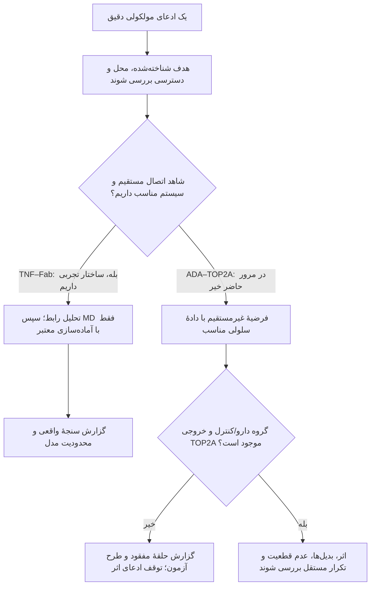

# طرح آزمایش‌های پس از مرور شواهد

پرسش جاری در [سند پژوهش](research-questions.fa.md) تعریف شده و [روش مرور](survey-protocol.fa.md) معیار انتخاب و نقد مقاله‌ها را مشخص می‌کند. این سند دربارهٔ طراحی آزمایش‌های ممکن پس از آن مرور است؛ اجرای همهٔ این پیشنهادها شرط تکمیل درس یا نوشتن سوروی نیست.

## ۱. از پاسخ مرور به آزمایش بعدی

پرسش فعلی: **چه شواهدی ارتباط آدالیموماب با تغییر بیان TOP2A در سلول‌های ایمنیِ فعال‌شده را پشتیبانی می‌کند؟** برای آن، شواهد ساختاریِ هدف‌گیری TNF و آزمایش‌های سلولیِ دارو/کنترل و حذف SIRPG را مقایسه می‌کنیم. بازتحلیل آموزشیِ RNA توصیفی است و تحلیل بیان افتراقی هنوز انجام نشده است.

اگر شواهد تغییر RNA تأیید شد، سنجش پروتئین و فعالیت می‌تواند گام بعدی باشد. اگر نقش SIRPG مطرح شد، باید اثر دارو در حضور و پس از دست‌کاری SIRPG در همان سیستم بررسی شود. فرضیهٔ اتصال مستقیم به TOP2A پرسش جداگانه‌ای است که دسترسی دارو، سنجش اتصال و فعالیتِ کنترل‌شده می‌خواهد. سرطان نیز به مدل و پیامد مستقلی نیاز دارد.

[بازتحلیل TNF–Fab](full-epitope-results.fa.md) برای شناخت اتصال و محدودیت محاسبه به کار می‌رود. این سیستم، سلول، رونویسی TOP2A یا پاسخ بیمار را در خود ندارد. بخش‌های بعد روش‌های متفاوت و خروجی هرکدام را توضیح می‌دهند تا آزمون بعدی را متناسب با ادعا انتخاب کنیم.

## ۲. چهار نوع محاسبه، چهار نوع پاسخ

| روش | خروجی واقعی | سقف تفسیر |
| --- | --- | --- |
| تحلیل مختصات و رابط | فاصله، تماس، سطح در دسترس یا هم‌پوشانی تعریف‌شده | توصیف هندسهٔ همان ساختار؛ نه انرژی اتصال یا اثر سلولی |
| دینامیک مولکولی، MD | مسیر زمانی اتم‌ها تحت مدل نیرو و شرایط مشخص | رفتار نمونه‌برداری‌شدهٔ مدل؛ نیازمند کنترل و سنجش عدم قطعیت |
| مدل شبکه/سلول | پیش‌بینی متغیرهایی مانند پیام‌رسانی یا RNA با معادلات و پارامترها | نتیجهٔ وابسته به فرض‌های مدل؛ نیازمند داده برای برازش و آزمون مستقل |
| مطالعهٔ مداخله‌ای/بالینی | پاسخ اندازه‌گیری‌شده به دارو در سیستم تعریف‌شده | شواهد اثر در همان زمینه؛ تعمیم و اثبات واسطه نیازمند طراحی جدا |

MD حرکت اتم‌ها را از مدل انرژی محاسبه می‌کند؛ چرخاندن دوربین سه‌بعدی یا محوکردن زنجیره در ویدئو، چنین محاسبه‌ای انجام نمی‌دهد. MD نیز به‌تنهایی فرایند رونویسی TOP2A یا پاسخ بیمار RA را شبیه‌سازی نمی‌کند. [راهنمای روش و گزارش MD در JCIM](https://doi.org/10.1021/acs.jcim.3c00599)

برای دانشجوی تازه‌وارد: در سیستم TNF–Fab، متغیرهای محاسبه جای اتم‌ها و نیروها هستند؛ رونوشت TOP2A، ماشین رونویسی، جمعیت سلول و تومور داخل این سیستم نیستند. پس از همان مسیر نمی‌توان «مقدار RNA کم شد» یا «تومور پاسخ داد» را اندازه گرفت. برای این پیامدها باید همان خروجی را در سیستم سلولی/بالینی مناسب مشاهده کرد. همین تفاوتِ متغیر و مقیاس است که آزمایش واسطهٔ مفقود را ضروری می‌کند.

**بیان بالا، توالی جهش‌یافته و آنزیم ناهنجار سه ادعای متفاوت‌اند.** مقدار بیشتر RNA مربوط به TOP2A می‌تواند همراه تکثیر باشد؛ به‌تنهایی تغییر توالی، مقدار پروتئین، فعالیت آنزیم یا سرطان را ثابت نمی‌کند. برای هرکدام دادهٔ خودش لازم است.

## ۳. پیش از docking: آیا دو مولکول واقعاً می‌توانند همدیگر را ببینند؟

ابتدا هدف شناخته‌شده، محل حضور، حالت مولکولی و امکان دسترسی دارو را بررسی می‌کنیم. FDA اتصال اختصاصی آدالیموماب به TNF و جلوگیری از تعامل آن با گیرنده‌های سطح سلول را بیان می‌کند. TNF صورت غشایی و صورت ترشح‌شده دارد؛ TOP2A آنزیم مرتبط با DNA با جایگاه‌های هسته‌ای ثبت‌شده است و UniProt حضور سیتوپلاسمی را نیز گزارش می‌کند. [FDA، بخش ۱۲.۱](https://www.accessdata.fda.gov/drugsatfda_docs/label/2025/125057s425lbl.pdf)، [UniProt TNF، P01375](https://www.uniprot.org/uniprotkb/P01375/entry)، [UniProt TOP2A، P11388](https://www.uniprot.org/uniprotkb/P11388/entry)

پس docking آدالیموماب–TOP2A شروع موجه این مطالعه نیست: دسترسی داروی معمول به TOP2A عملکردی و اتصال اختصاصی آن در منابع بررسی‌شده نشان داده نشده‌اند. این استنتاج، اعلام ناممکن‌بودن مطلق هر تعامل نیست؛ فقدان پیش‌نیاز برای ادعای زیستی فعلی است. نرم‌افزار docking ممکن است برای دو سطح یک وضعیت و امتیاز بسازد؛ آن امتیاز شاهد مواجههٔ مولکول‌ها در سلول، مهار آنزیم یا درمان نیست.

برای بررسی اتصال مستقیمِ تازه، باید نشان دهیم دارو به آنزیم دسترسی دارد، به آن متصل می‌شود و فعالیت آن را تغییر می‌دهد. مقایسه با یک آنتی‌بادی نامرتبط کمک می‌کند اثرِ اتصال به هدف را از اثرهای دیگر جدا کنیم. [طرح بررسی مسیر مستقیم و غیرمستقیم](top2a-inhibition-feasibility.fa.md) این آزمون‌ها را توضیح می‌دهد؛ هیچ‌کدام از پیش نتیجهٔ تأییدشده ندارند. Fab موجود در `3WD5` فاقد Fc است؛ حتی MD صحیح آن هم همهٔ رفتارهای آنتی‌بادی کامل در سلول را پوشش نمی‌دهد.

## ۴. فرضیهٔ ساختاری کوچک و کنترل‌های آن

**هدف ساختاری S1، اکتشافی و پیوست اختیاری:** رابط TNF–Fab را با مشخص‌کردن مدل سپرده‌شده یا مجموعهٔ بازسازی‌شده می‌توان با تعریف صریح تماس بازتولید و روی توالی/سه‌بعد موضع‌یابی کرد. چون ساختار اتصال از قبل وجود دارد، این کار بازتحلیل توصیفی است، نه پیش‌بینی مستقلِ اتصال.

**سنجه‌ها:** شمار جفت اتم سنگین، جفت باقی‌مانده و باقی‌مانده‌های رابط در حدهای `4.0/4.5/5.0 Å`؛ نقش زنجیره‌های نویسندهٔ `A` و `H/L`؛ شکاف‌های مختصاتی. فاصله و سیاست انتخاب اتم در [روش اجراشده](structural-method.fa.md) آمده‌اند. در `4.5 Å`، خروجی موجود ۲۵۲ جفت اتم و ۴۰ جفت باقی‌مانده است؛ این‌ها ۲۵۲ یا ۴۰ تکرار زیستی نیستند. [خروجی محاسبه](../data/processed/interface-summary.json)

**کنترل مناسب:** تطبیق با محاسبهٔ مستقلِ فاصله برای همان ورودی؛ ناوردایی نتیجه در برابر چرخش/انتقال مشترک تمام کمپلکس؛ کنترل انتخاب مدل، اتم و شناسهٔ زنجیره. این کنترل‌ها صحت محاسبه را می‌سنجند؛ آزمایش زیستی مستقل ایجاد نمی‌کنند. مجموعهٔ تماس با افزایش حد فاصله بزرگ‌تر می‌شود؛ این ویژگیِ تعریف، تأیید مستقل مکانیسم نیست.

**بدیل و توقف:** تماس ممکن است به سازهٔ بلوری، جایگاه جایگزین، اتم غایب یا رابط حذف‌شدهٔ همسایه‌های تقارن وابسته باشد. اگر انتخاب‌ها قابل بازسازی نباشند یا عدد با سیاست مستند بازتولید نشود، گزارش نتیجه متوقف و روش اصلاح می‌شود. `3WD5` فعلی یک زیرواحد TNF و یک Fab دارد؛ گزارش آن را رابط کامل تریمر نمی‌نامیم. [ثبت ساختار و گزارش اعتبارسنجی RCSB](https://www.rcsb.org/structure/3WD5)

**تحلیل مکمل سطح/هندسه، اجراشده:** پوشیدگی سطح با دقت‌های عددی مشخص محاسبه و کنترل دورکردن صلب Fab بررسی شده است. اعداد، روش و کنترل‌ها در [گزارش پیوست ساختاری](structural-feasibility-results.fa.md) آمده‌اند؛ اینجا تکرار نمی‌شوند. این تحلیل، انرژی آزاد، حرکت جداشدن واقعی یا اثربخشی را اندازه نمی‌گیرد و پیش‌نیاز خلاصهٔ مقالات این هفته نیست.

## ۵. سه فرضیهٔ سلولی و امکان ردشدن

**H1: در سلول T فعال‌شدهٔ انسانیِ تعریف‌شده، دارو ممکن است TOP2A را تغییر دهد.** پیش‌بینی، تفاوت RNA در زمان از پیش تعیین‌شده است؛ افزایش، کاهش و نبود تغییر مجازند. دادهٔ لازم: همان نوع سلول، دارو/کنترل IgG مناسب، حالت تحریک یکسان، جفت‌سازی بر اساس اهداکننده، زنده‌مانی و شاخص تکثیر. تغییر ترکیب سلول، زمان یا زنده‌مانی توضیح بدیل است. اگر بازهٔ عدم قطعیت با دقت کافی تغییر مورد توجهِ از پیش تعیین‌شده را کنار بگذارد، فرضیهٔ اثر قابل توجه در همان زمینه تضعیف می‌شود؛ یک `p` نامعنی‌دار در نمونهٔ کوچک کافی نیست. **دروازهٔ ادامه:** بدون بازوی دارو، H1 آزمون نمی‌شود.

**H2: SIRPG ممکن است واسطهٔ بخشی از اثر باشد.** ابتدا باید H1 در همان سیستم مشاهده شود؛ سپس مقایسهٔ دارو/کنترل در SIRPG سالم و دست‌کاری‌شده، همراه کنترل دست‌کاری و در صورت امکان بازگرداندن عملکرد، لازم است. سنجه، تغییر اثر دارو بر TOP2A میان این شرایط است. اختلال عمومی تکثیر یا آسیب ناشی از دست‌کاری، توضیح بدیل است. باقی‌ماندن اثر مشابه دارو با دقت کافی پس از حذف معتبر SIRPG، وابستگی ضروری به این واسطه را تضعیف می‌کند. **دروازهٔ ادامه:** فقط کنارهم‌گذاشتن دو مقاله یا دو بازوی متفاوت، آزمون واسطه نیست.

Marguerie دو مشاهدهٔ جدا دارد: آدالیموماب SIRPG سطحی را در T-cell فعال افزایش داد؛ در آزمایش حذف SIRPG، TOP2A و تکثیر کاهش یافتند. این مطالعه اثر مستقیم دارو بر TOP2A را گزارش نمی‌کند؛ جهت آن را هم از این دو مشاهده استنتاج نمی‌کنیم. [Marguerie، شکل‌های ۲ تا ۴ و روش‌ها](https://www.frontiersin.org/journals/immunology/articles/10.3389/fimmu.2025.1668361/full)

**H3: TOP2A عمدتاً همراه وضعیت چرخهٔ سلولی تغییر می‌کند.** مقایسهٔ TOP2A با نشانگرهای تکثیر مانند MKI67، همان نوع سلول و همان زمان، این توضیح را بررسی می‌کند. باقی‌ماندن تفاوت تکرارپذیر در سلول‌های دارای وضعیت قابل مقایسه، توضیح «صرفاً ترکیب/چرخه» را تضعیف می‌کند؛ اتصال مستقیم آنتی‌بادی را ثابت نمی‌کند. چرخهٔ سلولی ممکن است **واسطهٔ واقعی اثر** باشد؛ تعدیل آماری آن می‌تواند بخشی از اثر کل را حذف کند. «اثر کل دارو» و «اثر فراتر از وضعیت چرخه» باید دو تحلیل با تفسیر جدا باشند.

`GSE296196` برای SIRPG سالم/حذف‌شده سرنخ دارد؛ طبق ممیزی متادیتای پروژه، بازوی آدالیموماب ندارد. نوع مقادیر و نرمال‌سازی فایل پردازش‌شده نیز پیش از آزمون بیان باید روشن شوند. آن را به دیتاست H1 تبدیل نمی‌کنیم. [GEO](https://www.ncbi.nlm.nih.gov/geo/query/acc.cgi?acc=GSE296196)، [ممیزی داده و شواهد](connection-evidence.fa.md)

## ۶. اگر درس به MD نیاز داشته باشد، چه چیزی شبیه‌سازی می‌شود؟

**طرح پیشنهادی، اجرا نشده:** بررسی رفتار تماس‌های یک کمپلکس معتبر TNF–Fab در شرایط مدل، با مقایسهٔ از پیش تعریف‌شده. پرسش مناسب می‌تواند «کدام تماس‌ها در مسیرهای مستقل مدل تکرار می‌شوند؟» باشد؛ عبارت «MD نشان داد آدالیموماب TOP2A را مهار می‌کند» از این سیستم حاصل نمی‌شود.

قبل از اجرا باید مجموعهٔ زیستی مناسب TNF و نحوهٔ قرارگیری Fab با مقاله، عملگرهای تقارن و کنترل برخورد تأیید شود؛ دانلود فایلی با نام assembly به‌تنهایی کافی نیست. برای مدل جزئی، محدودیت حذف همسایه‌ها باید پذیرفته و سؤال متناسب محدود شود. زنجیره‌های ناقص، پیوندهای دی‌سولفیدی، اتم/باقی‌ماندهٔ غایب، پروتون‌دارشدن و عناصر ساختاری لازم، جداگانه ثبت شوند. ساختار آماده‌شده را جایگزین بی‌برچسب دادهٔ تجربی نمی‌کنیم.

مسیر اجرایی: **آماده‌سازی → افزودن آب/یون و توپولوژی معتبر → کمینه‌سازی انرژی → تعادل‌سازی → اجرای تولید → تحلیل**. کمینه‌سازی فقط برخوردهای اولیه را کاهش می‌دهد؛ تعادل‌سازی و نمونه‌برداری را جایگزین نمی‌کند. شرایط، میدان نیرو، مدل آب و نسخهٔ نرم‌افزار ثبت شوند. [آموزش رسمی GROMACS](https://tutorials.gromacs.org/docs/md-intro-tutorial.html)

در طرح مرحلهٔ بعد، حداقل سه اجرای جدا با seedهای تولید سرعت اولیهٔ ثبت‌شده در نظر می‌گیریم؛ این انتخاب برای سنجش پراکندگی است و تضمین همگرایی نیست. کنترل مقایسه باید سازه/توالی و شرایط سازگار داشته باشد. کنترل جهش رابط تنها با تعریف مستند و شواهد مناسب وارد طرح می‌شود. [راهنمای JCIM، تکرارها و اعتبارسنجی](https://doi.org/10.1021/acs.jcim.3c00599)

`1TNF` و `3WD5` سازه‌های یکسانی ندارند: در مقایسهٔ توالی اعلام‌شدهٔ فایل‌های mmCIF با بازهٔ محلول RefSeq `NP_000585.2`، TNF زنجیرهٔ `A` در `3WD5` در جایگاه ۳۱ سازه Asp دارد، درحالی‌که مرجع متناظر در ۱۰۷ Arg دارد؛ سازهٔ `1TNF` در جایگاه ۱۴۳ Leu دارد، درحالی‌که مرجع متناظر در ۲۱۹ Asp دارد. اختلاف شکل دو ساختار آزاد/متصل را به «فقط اثر دارو» نسبت نمی‌دهیم. این‌ها اختلاف سازه/منبع هستند؛ بیماری‌زا یا علت پاسخ درمان نامیده نشده‌اند. [درس تطابق توالی با ساختار](sequences-primer.fa.md)، [ورودی و SHA ساختارها](../data/metadata/structure-downloads.json)، [فرادادهٔ تطابق 3WD5](../data/metadata/sequences.json)

سنجهٔ سادهٔ پیشنهادی، سهم فریم‌های تولید است که یک تماس تعریف‌شده در آن وجود دارد:

$$
q_{ij}=\frac{1}{M}\sum_{k=1}^{M}\mathbf{1}\!\left[d_{ij}(t_k)\leq\tau\right]
$$

این کسر، احتمال موفقیت درمان یا ثابت اتصال نیست. RMSD با انتخاب اتم و هم‌ترازی مشخص و تغییرپذیری رابط نیز قابل گزارش‌اند. تعریف پیوند هیدروژنی به اتم دهنده/پذیرنده و معیار زاویه نیاز دارد؛ فقط نزدیکی دو اتم را پیوند هیدروژنی نمی‌نامیم. [RMSD در GROMACS](https://manual.gromacs.org/current/reference-manual/analysis/rmsd.html)، [پیوند هیدروژنی در GROMACS](https://manual.gromacs.org/current/reference-manual/analysis/hydrogen-bonds.html)

**معیار توقف MD:** اگر آماده‌سازی قابل دفاع نیست، پایلوت ناپایدار است یا منابع اجازهٔ نمونه‌برداری کافی نمی‌دهند، فقط امکان‌سنجی گزارش می‌شود. زمان اجرای لازم از پیش یک عدد جادویی ندارد؛ باید از سنجه و رفتار نمونه‌برداری نتیجه شود. چند فریم نزدیک به هم مستقل نیستند. بررسی بلوک‌های زمانی، پراکندگی میان اجراها و وابستگی نتیجه به بازهٔ تحلیل لازم است؛ صاف‌شدن RMSD به‌تنهایی همگرایی همهٔ سنجه‌ها را ثابت نمی‌کند. مسیر کوتاهِ متصل‌مانده، شاهد انرژی آزاد مطلوب یا اندازه‌گیری میل اتصال نیست. [LiveCoMS، عدم قطعیت و کیفیت نمونه‌برداری](https://doi.org/10.33011/livecoms.1.1.5067)

## ۷. مدل شبکه چه کمکی می‌کند و کجا می‌تواند گمراه کند؟

**مثال صرفاً آموزشی؛ اجرا و برازش نشده:** می‌توان RNA مربوط به TOP2A را متغیری به نام $m(t)$ و پیام‌رسانی/وضعیت سلولی را $S(t)$ و $C(t)$ نامید:

$$
\frac{dm}{dt}=k_{\mathrm{syn}}\,f\!\left(S(t),C(t)\right)-k_{\mathrm{deg}}\,m(t)
$$

معادله می‌گوید مقدار RNA حاصل ساخت و تخریب است. شکل تابع $f$، ضرایب و اثر دارو در این مثال مجهول‌اند. اگر علامت اثر دارو را دلخواه در مدل بگذاریم و همان نتیجه را در نمودار ببینیم، فرض خودمان را بازنمایی کرده‌ایم. برای ادعای پیش‌بینی، دادهٔ زمان‌مند مناسب، قابل‌شناسایی‌بودن پارامترها و دادهٔ مستقل برای آزمون لازم‌اند. این مرحله برای تحویل کوچک فعلی ضروری نیست.

دو مدل با فرض‌های متفاوت ممکن است هر دو دادهٔ محدود را توضیح دهند. مدل شبکه بدون مشاهدهٔ تازه، حلقهٔ مفقود ADA→TOP2A را ثابت نمی‌کند؛ استفادهٔ مفید آن می‌تواند پیشنهاد زمان/متغیر متمایزکنندهٔ دو توضیح باشد.

## ۸. نقشهٔ مرحله‌ای و دروازهٔ ادامه

| مرحله | تحویل | معیار ادامه یا توقف |
| --- | --- | --- |
| ارائهٔ این هفته | انتخاب TNF/آدالیموماب، شناسایی Fab، سه خلاصهٔ مقاله با دلیل انتخاب، سؤال پیشنهادی | دانشجو بتواند هر شکل و ادعا را با منبع و محدودیت توضیح دهد؛ اجرای MD لازم نیست |
| پیوست اختیاریِ بازتحلیل ساختاری | کد/ورودی ثبت‌شده، تماس/حساسیت و پوشیدگی سطح با کنترل | خروجی موجود بازتولید شود و با انتخاب مدل و مجموعهٔ زیستی سازگار باشد؛ محل ورودش به گزارش نهایی روشن بماند |
| MD اختیاری | ابتدا طرح سیستم و پایلوت منابع؛ سپس تکرار و تحلیل در صورت کفایت | اگر پیش‌نیازها یا نمونه‌برداری کافی نیست، خروجی «امکان‌سنجی» می‌ماند |
| پیوند TOP2A | ابتدا یافتن مطالعهٔ دارای بازوی واقعی دارو/کنترل و خروجی مرتبط | بدون طراحی مناسب، فقط نقد شواهد و پیشنهاد آزمون تحویل می‌شود |

خروجی هر فصل در راهنمای کار و ارائه مشخص شده است؛ برای طرح‌های توسعه‌ای موعد یا حجم قطعی تعیین نشده. آن‌ها با الزامات درس، زمان دانشجو و دسترسی محاسباتی تنظیم می‌شوند. وجود بخش آینده، به معنی تعهد به اجرای همهٔ آن‌ها در این ترم نیست.

## ۹. اعتبارسنجی، استقلال و گزارش صادقانه

سه سؤال جدا داریم: **آیا کد فرمول را درست اجرا می‌کند؟ آیا مدل مناسب سیستم است؟ آیا پیش‌بینی با مشاهدهٔ مستقل سازگار است؟** آزمون نرم‌افزار به سؤال اول کمک می‌کند؛ دو سؤال دیگر به کنترل علمی نیاز دارند.

واحد استقلال در تحلیل سلولی معمولاً اهداکننده است؛ کتابخانه، سلول، ژن یا چند زمان از یک اهداکننده را افراد مستقل نمی‌شماریم. برای مدل پیش‌بینی، جداسازی آموزش/آزمون بر اساس اهداکننده و پیش از انتخاب ویژگی/برازش انجام می‌شود؛ اطلاعات مجموعهٔ آزمون به انتخاب مدل راه نمی‌یابد. در MD، وابستگی زمانی فریم‌ها و شروع‌های مشترک لحاظ می‌شوند؛ در تحلیل ثابت `3WD5` نیز شمار اتم‌ها نمونهٔ آماری بیمار نیست.

برای هر خروجی این موارد ثبت شوند: سؤال، شناسه/نسخه و SHA ورودی، سیستم زیستی، انتخاب‌ها و واحدها، فرمان/نسخه/seed، کنترل، نتیجه با عدم قطعیتِ متناسب، بدیل و سقف ادعا. فرضیه‌ای که پس از دیدن نتیجه شکل گرفته، «اکتشافی» نوشته شود. یافتهٔ مخالف یا ناکافی حذف نمی‌شود.

**برچسب‌های پروژه:** «اجراشده» برای تماس، کنترل توالی و تحلیل مکملِ دارای گزارش؛ «گزارش‌شده در منبع» برای نتایج پژوهشگران؛ «پیشنهادی» برای MD/آزمون سلولی؛ «نمایشی» برای نمودار/حرکت دوربین. با این قرارداد می‌توان گزارش درست نوشت، حتی اگر اثر تازه‌ای پیدا نشود. [راهنمای نگارش و ارائه](paper-writing-guide.fa.md)
