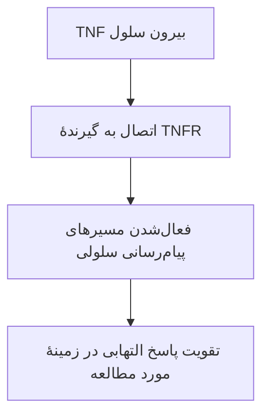
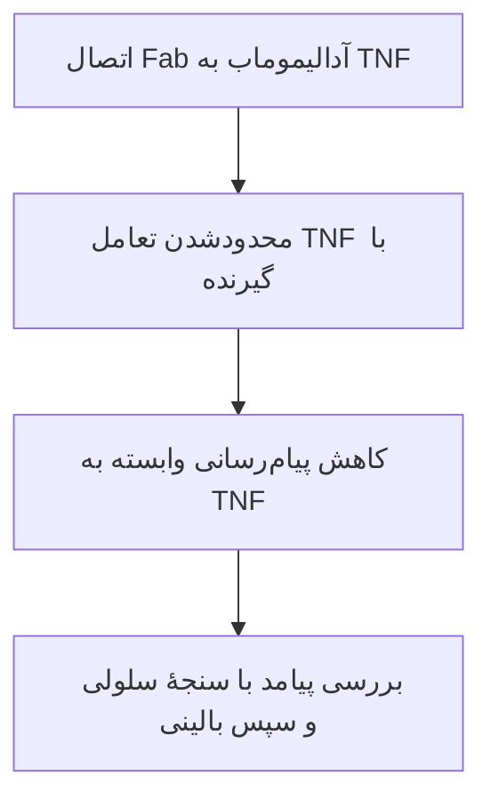

# از «قفل و کلید» تا مهار پیام التهاب

این درس را پیش از سه مقاله بخوانید. فرض نمی‌کنیم قبلاً ایمنی‌شناسی یا زیست‌شناسی مولکولی خوانده‌اید. هدف این است که بتوانید توضیح دهید **اتصال دو مولکول چگونه می‌تواند رفتار یک سلول را تغییر دهد** و کدام بخش این توضیح را واقعاً در ساختار 3WD5 می‌بینیم. بخش فرمول، اختیاری است؛ برای فهم داستان می‌توانید ابتدا از آن عبور کنید.

## پیش از شروع: سلول، مولکول و پروتئین

**سلول** یکی از واحدهای زندهٔ سازندهٔ بدن است. دور آن غشایی وجود دارد که داخل و بیرون را از هم جدا می‌کند. سلول برای زنده‌ماندن، ساختن مواد و پاسخ‌دادن به محیط از مولکول‌ها استفاده می‌کند. مولکول مجموعه‌ای از اتم‌های متصل به یکدیگر است؛ همهٔ مولکول‌ها پروتئین نیستند.

**پروتئین** نوعی مولکول ساخته‌شده از زنجیرهٔ اسیدآمینه‌هاست. برای تصور زنجیره می‌توان از مثال رشتهٔ مهره‌ها کمک گرفت؛ اما هر اسیدآمینه خودش چندین اتم و ویژگی شیمیایی دارد. زنجیره می‌تواند تا بخورد و شکل سه‌بعدی پیدا کند. بعضی پروتئین‌ها پیام‌رسان‌اند، بعضی مواد را جابه‌جا می‌کنند و بعضی واکنش‌ها را انجام می‌دهند.

**ژن** بخشی از DNA است که اطلاعات یک محصول زیستی را دارد. برای ساخت یک پروتئین، سلول ابتدا از اطلاعات ژن رونوشت RNA تهیه می‌کند؛ دستگاه ساخت پروتئین، یعنی ریبوزوم، بخش کدکنندهٔ RNA پیام‌رسان را می‌خواند و زنجیرهٔ اسیدآمینه می‌سازد. بنابراین «ژن TOP2A»، «RNA آن» و «پروتئین ساخته‌شده» سه چیز مرتبط اما جدا هستند. لازم نیست برای فهم اتصال دارو، همین ابتدا تحلیل RNA-seq انجام دهیم. [درس توالی با مثال واقعی](sequences-primer.fa.md)، [واژه‌نامهٔ ژنتیک NHGRI](https://www.genome.gov/genetics-glossary).

در این داستان، **TNF و آدالیموماب هر دو پروتئین‌اند**؛ یکی پیام‌رسان بدن است و دیگری آنتی‌بادیِ دارویی. گیرندهٔ TNF نیز پروتئین دیگری است. نام‌های متفاوت یعنی نقش‌های متفاوت، حتی اگر همگی از اسیدآمینه ساخته شده باشند.

## ۱. پروتئین فقط یک رشته نیست

توالی پروتئین، ترتیب اسیدآمینه‌های آن است. این زنجیره در فضا تا می‌خورد و سطحی با برجستگی‌ها، فرورفتگی‌ها و گروه‌های شیمیایی مختلف می‌سازد. در شکل سه‌بعدی، «رشتهٔ رنگی» معمولاً روشی برای رسم مسیر زنجیره است؛ فضای اطراف آن خالی نیست و اتم‌های زنجیره‌های جانبی هم حضور دارند.

در آزمایشگاه دفتر، **مسیر Cα** برای دنبال‌کردن زنجیره و انتخاب نقطه مناسب است. **Cα یا کربن آلفا** یکی از اتم‌های ستون اصلی هر اسیدآمینه است؛ دنبال‌کردن این اتم‌ها مسیر زنجیره را نشان می‌دهد. **نمای نواری** شکل تاخوردگی و ساختارهای ثانویه را واضح‌تر می‌کند. ساختار ثانویه یعنی الگوهای محلیِ منظم در زنجیره، مانند مارپیچ‌ها و صفحه‌های چین‌خورده. هیچ‌کدام به‌تنهایی سطح کامل اتم‌ها نیست. [تفاوت نمایش‌ها و تطبیق با مرجع](molecular-display-audit.fa.md)، [ساختار 3WD5](https://www.rcsb.org/structure/3WD5).

**برای گفتن:** «زنجیره، سطح سه‌بعدی می‌سازد؛ اتصال از طریق بخش‌هایی از این سطح اتفاق می‌افتد.»

## ۲. قفل و کلید چه چیزی را خوب و چه چیزی را ناقص توضیح می‌دهد؟

این تشبیه برای **اختصاصیت** مفید است: هر مولکول با هر سطحی اتصال یکسان ندارد. اما در پروتئین‌ها یک کلید سخت الزاماً وارد سوراخی ثابت نمی‌شود. دو سطح نسبتاً گسترده می‌توانند کنار هم قرار بگیرند و حین اتصال تغییر شکل بدهند. شکل، گروه‌های باردار، امکان پیوند هیدروژنی و محیط آبی همگی در رفتار اتصال نقش دارند. پیوند هیدروژنی نوعی جاذبهٔ جهت‌دار میان گروه‌های اتمی مناسب است؛ در کنار برهم‌کنش‌های دیگر می‌تواند به پایداری اتصال کمک کند.

دو اصطلاح مربوط به آنتی‌بادی:

- **اپی‌توپ:** بخش هدف که آنتی‌بادی شناسایی می‌کند؛ در این بحث، بخشی از سطح TNF.
- **پاراتوپ:** سطح شناسایی‌کننده روی بخش Fab، یعنی قطعهٔ شناسایی‌کنندهٔ آنتی‌بادی.

مولکول‌ها با «دانستن نشانی هدف» حرکت نمی‌کنند. حرکت گرمایی و برخوردهای فراوان، فرصت تماس ایجاد می‌کند؛ اگر تماس از نظر هندسی و شیمیایی مناسب باشد، دو مولکول ممکن است مدتی کنار هم بمانند. پس «شناسایی» در اینجا نام یک رفتار مولکولی است و به معنی فکرکردن یا تصمیم‌گرفتن پروتئین نیست. [درس عملکرد پروتئین در کتاب Alberts](https://www.ncbi.nlm.nih.gov/books/NBK26911/).

مثال تجربی ما: در مقالهٔ Hu، جایگزینی گلوتامین ۲۱ TNF با آلانین، میل اتصال Fab را در آزمایش SPR بسیار کم کرد. این مثال نشان می‌دهد خواندن نام پروتئین و نگاه‌کردن به شکل کلی کافی نیست؛ جزئیات سطح اهمیت دارند. شمارهٔ ۲۱ متعلق به سازهٔ آزمایش است. [Hu، جدول ۳ و شرح آزمایش](https://pmc.ncbi.nlm.nih.gov/articles/PMC3779706/)، [معنی و عددهای آزمایش](paper-explanations.fa.md).

**برای گفتن:** «قفل و کلید یک تشبیه است؛ اتصال واقعی، به هندسه و شیمیِ سطح و انعطاف مولکول بستگی دارد.»

## ۳. TNF چطور پیام می‌فرستد؟

**TNF پیام‌رسان و TNFR گیرندهٔ آن است.** گیرنده در غشای سلول قرار دارد: بخشی از آن بیرون سلول با پیام‌رسان تعامل می‌کند و این رویداد به مجموعه‌ای از فرایندهای درون سلول وصل می‌شود. اتصالِ پیام‌رسان به گیرنده می‌تواند مسیرهای سلولی را فعال کند؛ پاسخ دقیق به نوع گیرنده، سلول و شرایط بستگی دارد. [اصول پیام‌رسانی از غشا، کتاب Janeway](https://www.ncbi.nlm.nih.gov/books/NBK27151/).

برای تشبیه، زنگ در را تصور کنید: فشار بیرون ساختمان باعث رویدادی داخل می‌شود. گیرنده هم ارتباط بیرون و داخل را برقرار می‌کند؛ اما در سلول، زنگ و سیم الکتریکی این مثال وجود ندارند و تغییرات توسط مولکول‌ها انجام می‌شوند. «مسیر پیام‌رسانی» یعنی چند رویداد پشت‌سرهم، مثلاً فعال‌شدن پروتئین‌ها و تغییر ساخت بعضی مواد.

**التهاب** بخشی از پاسخ دفاعی بدن به آسیب یا تهدید است. در یک بیماری خودایمنی مانند آرتریت روماتوئید، پاسخ ایمنی می‌تواند به بافت خود بدن آسیب بزند و التهاب مفصل پایدار بماند. TNF یکی از پیام‌رسان‌های مؤثر است؛ بیماری را فقط به وجود یک مولکول تقلیل نمی‌دهیم. [زمینهٔ بیماری و منابع](scientific-context.fa.md).

برای این ارائه، یک مسیر مرتبط با التهاب را دنبال می‌کنیم:

این نمودار خلاصهٔ آموزشی است؛ تمام گیرنده‌ها و پیامدهای TNF را نشان نمی‌دهد. نام TNF که عبارت «نکروز تومور» در آن آمده است، به‌تنهایی نتیجهٔ درمان سرطان را تعیین نمی‌کند. [TNF در UniProt](https://www.uniprot.org/uniprotkb/P01375/entry)، [FDA، بخش ۱۲.۱](https://www.accessdata.fda.gov/drugsatfda_docs/label/2025/125057s425lbl.pdf).

**برای گفتن:** «مولکول بیرون سلول می‌تواند با گیرنده، یک رشته رویداد داخل سلول را راه بیندازد.»

## ۴. آدالیموماب کجای این مسیر دخالت می‌کند؟

آدالیموماب یک آنتی‌بادی پروتئینی است. بخش Fab آن به **TNF** متصل می‌شود. در شاهد ساختاری و آزمایش‌های مقالهٔ Hu، محل شناسایی آنتی‌بادی با ناحیهٔ مهم برای اتصال گیرنده هم‌پوشانی دارد. در نتیجه، دارو می‌تواند دسترسی TNF به گیرنده را محدود کند. [ساختار و مقایسهٔ گیرنده در Hu](https://pmc.ncbi.nlm.nih.gov/articles/PMC3779706/).

برای فهمِ مدل، این سه جسم را اشتباه نگیرید: **دارو، هدف دارو و گیرندهٔ هدف**. در 3WD5، TNF و Fab حضور دارند؛ TNFR در این فایل نیست. بنابراین از دیدن همین مدل نمی‌توان گفت برخورد دارو و گیرنده را شبیه‌سازی کرده‌ایم. توضیح رقابت با گیرنده به مقایسه‌های مقاله و شواهد عملکردی متکی است.

این طرح آموزشی روی یک جنبهٔ سازوکار تمرکز دارد. آنتی‌بادی کامل بخش Fc هم دارد و TNF علاوه بر شکل محلول، شکل غشایی دارد؛ رفتار ایمنی کامل دارو به تصویر یک Fab محدود نمی‌شود. [FDA، بخش‌های ۱۱ و ۱۲.۱](https://www.accessdata.fda.gov/drugsatfda_docs/label/2025/125057s425lbl.pdf).

**برای گفتن:** «آدالیموماب خودِ TNF را هدف می‌گیرد؛ این اتصال می‌تواند رساندن پیام به گیرنده را محدود کند.»

## ۵. آیا مولکول‌ها به‌صورت دائمی می‌چسبند؟

خیر؛ در این نوع اتصال، مولکول‌ها می‌توانند به هم متصل شوند و دوباره جدا شوند. «میل اتصال» یعنی تمایل به تشکیل این اتصال در شرایط مشخص. برای شروع، همین مفهوم کافی است. فرمول زیر ابزار دقیق‌تر بیان آن است.

در یک مدل سادهٔ تک‌جایگاهی، اتصال و جداشدن را می‌توان این‌طور نوشت:

$$D + T \rightleftharpoons DT$$

در این رابطه، D دارو، T هدف و DT کمپلکس اتصال‌یافته است. ثابت تفکیک تعادلی در همین مدل ساده برابر است با:

$$K_D = \frac{[D][T]}{[DT]}$$

کروشه غلظت گونهٔ آزاد یا کمپلکس را نشان می‌دهد. در شرایط یکسان، K_D کمتر با میل اتصال بیشتر سازگار است. **آدالیموماب کامل دو بازوی اتصال و TNF آرایش چندزیرواحدی دارد**؛ این رابطه برای شروع یادگیری است و بدون بررسی چندظرفیتی‌بودن، مدل کامل دارو در بدن نیست. مقالهٔ Hu، اتصال را با SPR می‌سنجد؛ شرح آن و مثال تغییر K_D در [راهنمای معنی مقاله‌ها](paper-explanations.fa.md) آمده است.

یک فاصلهٔ کوتاه بین دو اتم، K_D را به ما نمی‌دهد. برای میل اتصال به آزمون یا محاسبهٔ متناسب با همان پرسش نیاز داریم. تعداد تماس‌های دفتر، شرح هندسیِ یک ساختار است.

**برای گفتن:** «اتصال یک رویداد برگشت‌پذیر است؛ قدرت اتصال را با سنجهٔ مربوط به آن می‌سنجیم، نه فقط با قشنگ‌بودن شکل.»

## ۶. از اتصال تا بهترشدن بیمار چند فاصله وجود دارد؟

برای اثر درمان، دارو باید به محل هدف برسد، به مقدار و مدت مناسب حضور داشته باشد و تغییر مسیر در آن بیماری سودمند باشد. یک تصویر مولکولی، تمام این مراحل را اندازه نمی‌گیرد. Gehin غلظت خون و پیامد بالینی را بررسی می‌کند؛ Bianchi به آرایش محاسباتی آنتی‌بادی می‌پردازد. این دو مطالعه پرسش‌های متفاوتی دارند. [شرح سه مقاله](paper-explanations.fa.md).

CRP پروتئینی است که کبد می‌سازد و مقدار آن برای پیگیری التهاب به‌کار می‌رود. کاهش CRP می‌تواند به ارزیابی پاسخ کمک کند؛ از روی آن محل اتصال دارو یا شکل TNF مشخص نمی‌شود. در RA نیز چندین فرایند دخیل‌اند و هدف‌گیری TNF تضمین پاسخ یکسان در همهٔ افراد نیست. [CRP، MedlinePlus](https://medlineplus.gov/lab-tests/c-reactive-protein-crp-test/)، [Gehin](https://doi.org/10.1136/rmdopen-2024-004888).

**برای گفتن:** «ساختار محل اتصال را توضیح می‌دهد؛ آزمایش سلول و مطالعهٔ بیمار پیامد آن را بررسی می‌کنند.»

## ۷. پس دارو چگونه ویروس یا سلول سرطانی را از بین می‌برد؟

همهٔ داروها کار یکسانی ندارند. بعضی یک فرایند ضروری را مختل می‌کنند، بعضی مسیر پیام‌رسانی را تنظیم می‌کنند و بعضی به دستگاه ایمنی در شناسایی هدف کمک می‌کنند. **برای هر دارو باید هدف و پیامد همان دارو را بررسی کنیم.** مهار TNF به معنی حذف مستقیم ویروس یا اثبات مرگ سلول سرطانی نیست؛ TNF در دفاع ایمنی هم نقش دارد. [سازوکار و شواهد مصرف آدالیموماب، FDA](https://www.accessdata.fda.gov/drugsatfda_docs/label/2025/125057s425lbl.pdf).

برای مقایسه با موضوع استاد، اتوپوزاید مثال متفاوتی است: روی عملکرد توپوایزومراز II در اتصال دوبارهٔ DNA برش‌خورده اثر می‌گذارد و می‌تواند تجمع شکست‌های DNA را در پی داشته باشد. این سازوکار را نباید به آدالیموماب نسبت داد. [اتوپوزاید، NCI](https://www.cancer.gov/publications/dictionaries/cancer-drug/def/etoposide).

**سؤال درست پژوهش ما:** آیا تغییر پیام‌رسانی TNF در یک سیستم مشخص، به‌طور غیرمستقیم با تغییر TOP2A ارتباط دارد؟ برای پاسخ باید همان مداخلهٔ دارویی و همان خروجی را در آزمایش مناسب کنار هم سنجید. [حلقهٔ مفقود و طرح آزمون](paper-explanations.fa.md).

## ۸. پنج جمله برای تمرین ارائه

۱. TNF پیام‌رسان است و گیرندهٔ آن TNFR نام دارد.

۲. آدالیموماب یک آنتی‌بادی است که با Fab به TNF متصل می‌شود.

۳. اتصال به سطح مناسب می‌تواند تعامل TNF با گیرنده را محدود کند.

۴. 3WD5 شاهد ساختاریِ TNF–Fab است؛ پیام‌رسانی یا پاسخ بیمار داخل فایل مختصات نیست.

۵. ارتباط احتمالی با TOP2A پرسشی جداست که به دادهٔ سلولی مناسب نیاز دارد.
