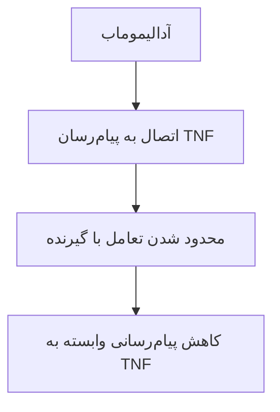
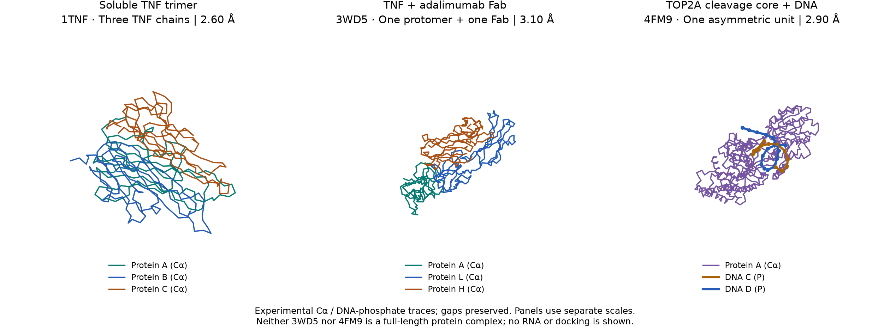
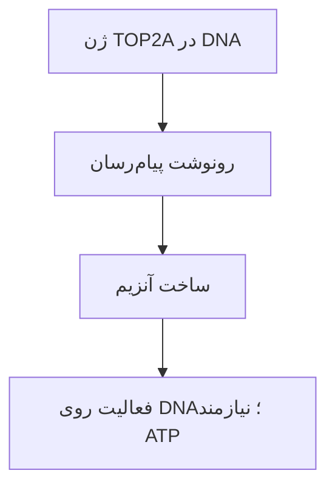

# ارائه‌های درس در همان نه فصل

این متن و نمایش اسلایدی از بانک جمله‌های ممیزی‌شدهٔ پروژه ساخته می‌شوند؛ ترتیب و انتخاب اسلایدها تابع همان فصل‌های درس است، نه برنامهٔ هفتگیِ جدا. پیوست‌های بالینی و RNA-seq با برچسب مکمل می‌آیند. [بازگشت به صفحهٔ واحد درس](../index.html)

## فصل 1. آشنایی با بیوانفورماتیک ساختاری

### پرسش و روش مطالعه

**پرسش:** چه شواهدی ارتباط آدالیموماب با تغییر بیان TOP2A در سلول‌های ایمنیِ فعال‌شده را پشتیبانی می‌کند؟

**روش:** اتصال شناخته‌شده به TNF را می‌خوانیم؛ سپس آزمایش‌های دارو/کنترل و حذف SIRPG را بر اساس نوع سلول، زمان و اندازه‌گیری مقایسه می‌کنیم.

**خروجی:** مرور انتقادی شواهد و یک بازتحلیل توصیفیِ همراه از RNA. تغییر بیان ژن با مهار مستقیم آنزیم یا پاسخ بیمار یکسان نیست.

> منابع: [Ho 2021](https://doi.org/10.1186/s13075-021-02558-z)؛ [Marguerie 2025](https://doi.org/10.3389/fimmu.2025.1668361)؛ [پرسش و انتخاب داده](../docs/research-questions.fa.md)؛ [روش مرور](../docs/survey-protocol.fa.md).

### هر مقاله کدام بخش پرسش را بررسی می‌کند؟

**نقطهٔ شروع مولکولی:** Hu ساختار TNF–Fab و اثر جهش بر اتصال را بررسی کرد؛ این مطالعه تغییر TOP2A را نمی‌سنجد.

**پاسخ سلولی:** Ho اثر دارو بر RNA و خروجی‌های سلول را بررسی کرد. Marguerie اثر دارو بر SIRPG و اثر حذف SIRPG بر TOP2A را در آزمایش‌های جدا سنجید؛ مسیر میانجی هنوز تعیین نشده است.

**مقایسهٔ دارویی:** دادهٔ Veerasubramanian بازوی آدالیموماب و کنترلِ هم‌اهداکننده دارد. نتیجهٔ ترکیب دارویی را به تک‌دارو نسبت نمی‌دهیم.

> منابع: [Hu 2013](https://doi.org/10.1074/jbc.M113.491530)؛ [Ho 2021](https://doi.org/10.1186/s13075-021-02558-z)؛ [Marguerie 2025](https://doi.org/10.3389/fimmu.2025.1668361)؛ [Veerasubramanian 2026](https://doi.org/10.3389/fimmu.2026.1867995).

### از بیماری و سازوکار دارو شروع می‌کنیم

**آرتریت روماتوئید**، بیماری خودایمنی است؛ دستگاه ایمنی به بافت‌های خود بدن حمله می‌کند و التهاب پایدارِ پوشش مفصل می‌تواند به غضروف و استخوان آسیب بزند. TNF یکی از پیام‌رسان‌های این پاسخ است.

**آدالیموماب**، یک آنتی‌بادی پروتئینی است که به TNF متصل می‌شود و پیام‌رسانی آن را محدود می‌کند. مسیر این ارائه: شناخت سلول و دارو، بررسی اتصال واقعی، و خواندن داده‌های بیمار و RNA-seq. سپس می‌پرسیم شواهد سلولی دربارهٔ بیان TOP2A چه می‌گویند؛ هدف شناخته‌شدهٔ دارو و خروجیِ RNA دو مرحلهٔ متفاوت این بررسی‌اند.

> منابع: [NIAMS، روماتوئید](https://www.niams.nih.gov/health-topics/rheumatoid-arthritis)؛ [برچسب Humira، بخش‌های ۱ و ۱۲٫۱](https://dailymed.nlm.nih.gov/dailymed/drugInfo.cfm?setid=608d4f0d-b19f-46d3-749a-7159aa5f933d).

### سلول، پروتئین و گیرنده

**سلول**، واحد زندهٔ بدن است؛ غشای سلول مرز آن با محیط اطراف است. **پروتئین**، از زنجیره‌های اسیدآمینه ساخته می‌شود. ترتیب اسیدآمینه‌ها و تاخوردگی زنجیره‌ها، شکل و ویژگی‌های شیمیایی آن را تعیین می‌کنند.

**[گیرنده](glossary.fa.md?chapter=chapter-10)**، پروتئینی است که اتصال یک پیام‌رسان را به پاسخ سلول مرتبط می‌کند. [TNF](glossary.fa.md?chapter=chapter-9) پیام‌رسان و [TNFR](glossary.fa.md?chapter=chapter-10) گیرندهٔ آن است. اتصال این دو می‌تواند رویدادهایی درون سلول آغاز کند؛ پروتئین پیام‌رسان لازم نیست خودش وارد هسته شود.

> منبع: [NHGRI: پروتئین](https://www.genome.gov/genetics-glossary/Protein)؛ [برچسب Humira، بخش ۱۲٫۱](https://dailymed.nlm.nih.gov/dailymed/drugInfo.cfm?setid=608d4f0d-b19f-46d3-749a-7159aa5f933d).

### اتصال دارو، پیام التهاب را محدود می‌کند

TNF می‌تواند به صورت محلول یا روی غشا وجود داشته باشد. آدالیموماب به TNF متصل می‌شود و اتصال آن به گیرنده‌های TNFR1 و TNFR2 را محدود می‌کند.

**قفل و کلید** تشبیهی برای شناسایی است؛ اتصال واقعی به شکل، بار و برهم‌کنش‌های شیمیایی سطح وابسته است. دارو TNF را «پاک» نمی‌کند و مستقیماً سلول سرطانی را در این نمودار از بین نمی‌برد. نمودار، مسیر مفهومی است؛ شبیه‌سازی اتمی نیست.

> منبع: [برچسب Humira، بخش ۱۲٫۱](https://dailymed.nlm.nih.gov/dailymed/drugInfo.cfm?setid=608d4f0d-b19f-46d3-749a-7159aa5f933d)؛ [Hu 2013، بحث سازوکار خنثی‌سازی](https://doi.org/10.1074/jbc.M113.491530).

### مکمل این فصل: Gehin 2024: خون بیمار و پاسخ درمان

**روش:** داده‌های کارآزمایی ADMYRA با ۳۵۳ بیمار آرتریت روماتوئید بررسی شدند. همه متوترکسات هم دریافت می‌کردند. غلظت آدالیموماب پیش از تزریق بعدی در هفته‌های ۱۲، ۲۴ و ۴۸، به‌ترتیب در ۳۳۶، ۳۳۰ و ۳۰۲ نمونهٔ بیمار اندازه‌گیری شد.

**CRP**، پروتئین واکنشی C، نشانگر خونی التهاب است؛ هدف اتصال آدالیموماب نیست. فعالیت بیماری با **DAS28-ESR** سنجیده شد: امتیازی شامل ارزیابی ۲۸ مفصل و سرعت رسوب گلبول قرمز.

> منبع: [Gehin 2024، روش‌ها و ویژگی‌های جمعیت](https://doi.org/10.1136/rmdopen-2024-004888). غلظت خون با مقدار تزریق یکی نیست.

### مکمل این فصل: Gehin: همراهی غلظت دارو با پاسخ بهتر

غلظت حداقل **3.9 mg/L** با CRP کمتر و احتمال بیشترِ خاموشی بیماری همراه بود. در تحلیل طولی، نسبت شانس خاموشی **3.88** و فاصلهٔ اطمینان ۹۵٪ آن **1.80–8.38** بود.

**معنی ساده:** در این داده‌ها، گروه دارای غلظت بالاتر بیشتر به خاموشی بیماری رسیده بود. نسبت شانس، نسبت شانس دو گروه است؛ به معنی «۳٫۸۸ برابر درمان قطعی» نیست.

**حد نتیجه:** مقایسهٔ غلظت‌ها تصادفی‌سازی نشده بود؛ رابطه، دستور افزایش دوز یا شاهد تغییر TOP2A نیست. دادهٔ فردی بیمار در این پروژه در اختیار نیست.

> منبع: [Gehin 2024، شکل ۲ و تحلیل طولی](https://doi.org/10.1136/rmdopen-2024-004888).

## فصل 2. ساختار مولکول‌های زیستی

### آدالیموماب: آنتی‌بادیِ متصل‌شونده به TNF

**[آنتی‌بادی](glossary.fa.md?chapter=chapter-1)**، پروتئینی است که سطح مشخصی از یک هدف را شناسایی می‌کند. آدالیموماب یک آنتی‌بادی [نوترکیب](glossary.fa.md?chapter=chapter-6) از نوع [IgG1](glossary.fa.md?chapter=chapter-2) است؛ مولکول کامل [دو زنجیرهٔ سنگین و دو زنجیرهٔ سبک](glossary.fa.md?chapter=chapter-3) دارد.

دو بازوی **[Fab](glossary.fa.md?chapter=chapter-4)** به هدف متصل می‌شوند. بخش **[Fc](glossary.fa.md?chapter=chapter-5)** با برخی گیرنده‌های ایمنی ارتباط دارد؛ **لولا** حرکت نسبی بازوها را ممکن می‌کند. «کاملاً انسانی» به منشأ توالی آنتی‌بادی اشاره دارد؛ به معنی بی‌عارضه‌بودن نیست. Humira نام تجاری داروی مرجع است.

> منبع: [برچسب Humira، بخش ۱۱](https://dailymed.nlm.nih.gov/dailymed/drugInfo.cfm?setid=608d4f0d-b19f-46d3-749a-7159aa5f933d)؛ [Bianchi 2026، مقدمه](https://doi.org/10.3389/fimmu.2025.1680199).

### زنجیره تا سه‌تایی: ساختار اول، دوم، سوم و چهارم

**پرسش:** پروتئین از چه لایه‌هایی ساخته می‌شود و در TNF کدام لایه را می‌بینیم؟ **ساختار اول** توالی است، **ساختار دوم** چیدمان محلی زنجیره، **ساختار سوم** شکل سه‌بعدی زنجیرهٔ تاخورده و **ساختار چهارم** آرایش چند زنجیره کنار هم است.

**آنچه ما واقعاً داریم:** توالی سازه و بخش دارای مختصات زنجیره‌های Fab از فایل 3WD5، و سه‌تایی TNF که خودمان از روی گروه فضایی همان فایل بازسازی کرده‌ایم. درستی این بازسازی را با ساختار مستقل 1TNF سنجیده‌ایم: ۴۵۶ جفت اتم Cα و RMSD برابر 1.178 Å.

**مرز:** طبقه‌بندی رسمی ساختار دوم، مانند DSSP، در این پروژه اجرا نشده است؛ دربارهٔ چینش زنجیره حرف می‌زنیم، نه دربارهٔ درصد هلیکس.

> منابع: [3WD5](https://www.rcsb.org/structure/3WD5)؛ [1TNF](https://www.rcsb.org/structure/1TNF)؛ [روش بازسازی و سنجش](../docs/full-epitope-results.fa.md).

### DNA و RNA: ساختار فضایی در برابر دادهٔ توالی

**پرسش:** DNA و RNA هر دو اسیدنوکلئیک‌اند؛ چرا یکی را با ساختار و دیگری را با توالی می‌شناسیم؟

**DNA** در ساختار 4FM9 به‌صورت دوبلکس دیده می‌شود: دو زنجیرهٔ ضدهم روی هم پیچیده و کنار هستهٔ TOP2A. آنچه می‌بینیم مختصات اتمی است.

**RNA** دو نوع دادهٔ جدا دارد: حروف RefSeq برای توالی مرجع، و جدول RNA-seq برای فراوانی نسبی رونوشت‌ها. جدول شمارش، توالی یا ساختار سه‌بعدی RNA را تعیین نمی‌کند.

**شیمی مشترک:** باز نیتروژنی، قند پنتوز و فسفات. قند RNA در کربن ۲′ گروه OH دارد؛ DNA در همان جایگاه H دارد. گروه ۲′-OH می‌تواند شکستن ستون فقرات RNA را، به‌ویژه در محیط قلیایی، تسهیل کند.

> منابع: [4FM9](https://www.rcsb.org/structure/4FM9)؛ [راهنمای RNA و پروتئین](../docs/sequences-primer.fa.md).

### سه باز یک کدون؛ پل RNA به آمینواسید

**باز** با یک حرف مانند A یا G نشان داده می‌شود. در RNA چهار حرف A، U، C و G داریم. در بخش کدکنندهٔ mRNA، **CDS**، هر سه حرف یک کدون‌اند؛ کدون به آمینواسید یا پایان ترجمه مربوط است. از شروع CDS ثبت‌شده می‌خوانیم، نه از اولین حرف دلخواه RNA.

**مثال واقعی TNF، NM_000594.4:** آغاز CDS از جایگاه ۱۷۸ است:

`AUG AGC ACU GAA AGC` → `MSTES`

یعنی متیونین، سرین، ترئونین، گلوتامات و سرین. ترجمهٔ کامل CDS با پروتئین مرجع NP_000585.2 تطبیق دارد. [دیدن کدون‌های واقعی و زنجیره‌های Fab](../?tab=sequences#codon-lesson)

> منابع: [NHGRI، کدون](https://www.genome.gov/genetics-glossary/Codon)؛ [RNA مرجع TNF](https://www.ncbi.nlm.nih.gov/nuccore/NM_000594.4)؛ [پروتئین مرجع](https://www.ncbi.nlm.nih.gov/protein/NP_000585.2).

### مکمل این فصل: مسیر موازی: TOP2A و کار آن روی DNA

**DNA** اطلاعات وراثتی سلول را نگه می‌دارد. هنگام کپی‌شدن DNA و تقسیم سلول، رشته‌ها می‌توانند درهم بپیچند. **توپوایزومراز IIα** با مصرف ATP، مولکول حامل انرژی در سلول، یک قطعهٔ DNA را موقتاً می‌بُرد، قطعهٔ دیگری را عبور می‌دهد و بریدگی را دوباره متصل می‌کند.

**[TOP2A](glossary.fa.md?chapter=chapter-11)**، نام ژن سازندهٔ این آنزیم است. این کار در تقسیم سلولی اهمیت دارد، بنابراین TOP2A در مطالعات تکثیر و سرطان مطرح است. **4FM9** فقط هستهٔ برش آنزیم همراه DNA مصنوعی را نشان می‌دهد؛ آدالیموماب در آن وجود ندارد.

> منبع: [UniProt: P11388، عملکرد](https://www.uniprot.org/uniprotkb/P11388)؛ [Wendorff 2012](https://doi.org/10.1016/j.jmb.2012.07.014)؛ [RCSB: 4FM9](https://www.rcsb.org/structure/4FM9).

### مکمل این فصل: RNA، مقدار پروتئین و فعالیت آنزیم

**ژن**، بخشی از DNA است. برای ژن پروتئین‌ساز، رونوشت پیام‌رسان **mRNA** ساخته می‌شود و سلول از اطلاعات آن برای ساخت پروتئین استفاده می‌کند. همهٔ RNAها پیام‌رسان یا پروتئین‌ساز نیستند.

**کاهش RNA** یعنی رونوشت کمتری اندازه‌گیری شده است. **کاهش مقدار پروتئین** باید با آزمون پروتئینی سنجیده شود. **مهار فعالیت** یعنی آنزیمِ موجود کار کمتری انجام می‌دهد؛ این سه مشاهده هم‌معنی نیستند.

> منبع: [NHGRI: RNA](https://www.genome.gov/genetics-glossary/Ribonucleic-Acid-RNA) و [ترجمه](https://www.genome.gov/genetics-glossary/Translation)؛ [UniProt: TOP2A](https://www.uniprot.org/uniprotkb/P11388).

## فصل 3. مشاهده و آنالیز ساختار پروتئین‌ها

### آنچه می‌سنجیم: RMSD، شعاع دوران و سطح در دسترس حلال

**RMSD** جذر میانگین مربعات فاصلهٔ اتم‌های متناظر بعد از هم‌راستاسازی است. آن را برای کنترل بازسازی سه‌تایی به کار بردیم: 3WD5 در برابر 1TNF، ۴۵۶ جفت اتم Cα و RMSD برابر 1.178 Å.

**سطح در دسترس حلال (SASA)** مساحتی است که یک کاوشگر کروی با شعاع 1.4 Å می‌تواند به آن برسد. کاهش آن پس از چسباندن دو جزء، مقدار پوشیده‌شده را می‌دهد. روش ما Shrake–Rupley با 960 نقطه به ازای هر اتم است و برای کل اپی‌توپ 2307.6 Ų به‌دست آمد.

**شعاع دوران (Rg)** کمیتی است که فشردگی زنجیره را نشان می‌دهد. ما آن را حساب نکرده‌ایم و این را صریح می‌گوییم.

**مرز:** هیچ‌کدام از این کمیت‌ها انرژی اتصال نیست. ΔSASA سطح پوشیده است، نه ΔG.

> منابع: [3WD5](https://www.rcsb.org/structure/3WD5)؛ [گزارش سطح و تماس](../docs/structural-feasibility-results.fa.md).

### VMD و TCL: همان کار با ابزار کلاس

**TCL** زبان اسکریپتی است که VMD با آن کنترل می‌شود. در کلاس دو دستور کلیدی را می‌نویسیم: `measure rmsd` برای فاصلهٔ جذر میانگین مربعات و `measure sasa` برای سطح در دسترس حلال. برای RMSD ابتدا تطابق و ترتیب اتم‌ها و سپس انطباق با `measure fit` لازم است؛ `measure rmsd` خودش هم‌راستاسازی نمی‌کند.

**ما چه کرده‌ایم:** نمونهٔ دستور Tcl در درس‌نامه هست، ولی اجرای VMD گزارش نشده است. عددهای ما از اسکریپت‌های پایتون خودمان می‌آید: شمارش تماس اتمی و SASA با همان روش Shrake–Rupley. VMD یک کنترل مقایسه‌ای ممکن است؛ انتخاب اتم، شعاع‌ها، نمونه‌برداری سطح و انطباق باید یکسان شوند و برابری عددها تضمین نشده است.

**مرز:** نمایشگر سه‌بعدی این صفحه جای VMD را نمی‌گیرد؛ ابزار کلاس است و جایگزین تحلیل ما نیست.

> منابع: [راهنمای VMD](https://www.ks.uiuc.edu/Research/vmd/)؛ [دستور measure](https://www.ks.uiuc.edu/Research/vmd/vmd/latest/ug_html/node122.html).

### تحلیل ساختاری ما: محل کامل اتصال روی TNF سه‌تایی

3WD5 فقط یک زیرواحد TNF دارد. سه‌تایی را با تقارن بلور بازسازی کردیم؛ اختلاف آن با ساختار مستقل 1TNF فقط **1.18 Å** بود. در فاصلهٔ **4.5 Å**، از ۳۶۵ تماس اتمی **۱۱۳ تماس (۳۱٪)** روی زیرواحد همسایه است و سطح رابط از **786** به **1154 Ų** می‌رسد. **CDR-H2 و H3** بیشترین سهم را دارند. مجموع ΔSASA ما **2308 Ų** است؛ کنترل مستقل FreeSASA نیز حدود **2308 Ų** داد. نمای تک‌زیرواحدی **1572 Ų** می‌دهد. این‌ها **محاسبهٔ هندسی** است، نه انرژی اتصال یا اثر درمان.

> منبع: [3WD5](https://www.rcsb.org/structure/3WD5)، [1TNF](https://www.rcsb.org/structure/1TNF)، [Hu 2013 جدول ۳](https://doi.org/10.1074/jbc.M113.491530)؛ [روش و نتایج کامل](../docs/full-epitope-results.fa.md).

## فصل 4. پایگاه داده‌های بیوانفورماتیک ساختاری

### 3WD5: دادهٔ واقعیِ اتصال TNF–Fab

**PDB**، بانک مختصات ساختارهای مولکولی است. **3WD5** ساختاری با تفکیک‌پذیری 3.1 Å است که با پراش پرتو X تعیین شده است؛ تصویر از مختصات همان فایل ساخته شده است.

در نمای ثبت‌شده، زنجیرهٔ **A** یک زیرواحد TNF و زنجیره‌های **H/L** بخش سنگین/سبک Fab هستند. مولکول کامل آدالیموماب، Fc و گیرندهٔ TNFR در این فایلِ نمایش‌داده‌شده حضور ندارند. ظاهر نواری با سطح اتمی فرق دارد؛ رنگ‌ها ابزار تشخیص زنجیره‌اند.

[باز کردن آزمایشگاه سه‌بعدی](../index.html?document=class-presentation.fa.md&chapter=chapter-13#lab)

> منبع داده: [RCSB: 3WD5](https://www.rcsb.org/structure/3WD5)؛ [Hu 2013](https://doi.org/10.1074/jbc.M113.491530). مدل چرخان در همین اسلاید نیز قابل بازکردن است.

### PDB: فایل، گروه فضایی و پرتو X

**PDB** آرشیو ساختارهای سه‌بعدی است. هر فایل رکوردهایی برای اتم‌ها، برای گروه فضایی بلوری و برای شرایط آزمایش دارد. 3WD5 با پراش پرتو X و تفکیک‌پذیری 3.10 Å اندازه‌گیری شده است؛ در رکورد سپرده‌شده R-work برابر 0.1867 و R-free برابر 0.2750 است. گروه فضایی آن I 21 3 است و رکورد اسمبلی فقط عملگر همانی را دارد.

**همین یک نکته کل کار ما را توضیح می‌دهد:** در این فایل سه‌تایی را با تقارن بلور بازسازی می‌کنیم، پس هر محاسبهٔ تماس باید بگوید از کدام نسخهٔ تقارنی استفاده کرده است. دو همسایهٔ نزدیک را پیدا کردیم و درستی‌اش را با 1TNF سنجیدیم.

**توالی‌ها از کجا می‌آیند:** توالی مرجع از NCBI و توالی سازه از خود wwPDB گرفته و اعتبارسنجی شده است. شمارهٔ جایگاه در فایل ساختار با شمارهٔ UniProt یکی نیست: برای TNF، جایگاه فایل برابر شمارهٔ UniProt منهای 76 است، و همین تطبیق را در درس کدون می‌بینیم.

> منابع: [3WD5](https://www.rcsb.org/structure/3WD5).

### پایگاه مولکول‌های کوچک: مؤلفهٔ شیمیایی

**پرسش:** یک مولکول کوچک درون ساختار کریستال از کجا می‌آید و چه اطلاعاتی دارد؟

**مؤلفهٔ شیمیایی (CCD)** همان چیزی است که RCSB برای هر لیگاند کوچک نگه می‌دارد: ساختار، پیوندها، بارها و نام اتم‌ها. در 1B09 فسفوکولین با کد `PC` در هر پنج زیرواحد CRP دیده می‌شود.

**ما از همین استفاده کردیم:** مدل ایده‌آل فسفوکولین را از مؤلفهٔ شیمیایی گرفتیم و در بازداکینگ داک کردیم. هش فایل در رکورد اجرا ثبت شده است تا معلوم باشد دقیقاً کدام نسخه به کار رفته است.

**چرا مهم است:** لیگاندی که در ساختار کریستال دیده می‌شود فقط با همان پیوندها و بارها معنا دارد؛ بدون آن، آماده‌سازی لیگاند حدس‌زدنی می‌شود.

> منابع: [مؤلفهٔ شیمیایی PC](https://www.rcsb.org/ligand/PC)؛ [پروتکل داکینگ](../docs/docking-protocol.fa.md).

### هر دیتاست برای چه پرسشی ساخته شده است

| منبع | داده | کاربرد و حد آن |
| --- | --- | --- |
| 3WD5 | ساختار TNF–Fab | شناخت محل اتصال؛ دادهٔ بیمار نیست |
| GSE138746 | RNA اولیهٔ بیماران RA | یادگیری نمونه/دارو/پاسخ؛ RNA پس از درمان ندارد |
| GSE129705 | RNA پیش/پسِ ضد TNF در RA | ۵۲ جفت کامل؛ برچسب داروی هر بیمار هنوز تأیید نشده |
| GSE339038 | RNA سلول‌های T آزمایشگاهی | گروه آدالیموماب دارد؛ کارآزمایی RA نیست |

این منابع از افراد و آزمایش‌های متفاوت آمده‌اند. برای یک سؤال، منبعی انتخاب می‌کنیم که واقعاً همان مقایسه و اندازه‌گیری را داشته باشد.

> منابع: [3WD5](https://www.rcsb.org/structure/3WD5)، [GSE138746](https://www.ncbi.nlm.nih.gov/geo/query/acc.cgi?acc=GSE138746)، [GSE129705](https://www.ncbi.nlm.nih.gov/geo/query/acc.cgi?acc=GSE129705)، [GSE339038](https://www.ncbi.nlm.nih.gov/geo/query/acc.cgi?acc=GSE339038).

### مکمل این فصل: نخستین دیتاست RNA-seq بیماران روماتوئید

**[RNA-seq](glossary.fa.md?chapter=chapter-12)**، RNA نمونه را می‌خواند؛ جدول شمارشِ ژن‌ها با حروف توالی یا شکل مولکول فرق دارد. **GSE138746** از ۸۰ بیمار RA آمده است؛ ۳۸ نفر آدالیموماب و ۴۲ نفر اتانرسپت دریافت کرده‌اند. سه بخش سلولی بررسی شده‌اند، پس ۲۴۰ کتابخانه به معنی ۲۴۰ بیمار نیست.

**زمان مهم است:** RNA پیش از شروع درمان گرفته شده؛ پاسخ در پیگیری تا شش ماه ارزیابی شد؛ برخی قطع‌کنندگان زودهنگام با آخرین ویزیت برچسب خوردند. برای تمرین، فایل PBMC نویسندگان را می‌خوانیم: ۷۹ ستون، از جمله ۳۷ ستون آدالیموماب. PBMC مجموعهٔ سلول‌های تک‌هسته‌ای خون است.

این داده به شناخت RNA اولیه و پاسخ آینده کمک می‌کند؛ RNA پس از درمان در آن نیست. فعلاً نام نمونه، دارو، نوع سلول و زمان را می‌خوانیم؛ مدل پیش‌بینی یا تغییر RNA پس از دارو اجرا نکرده‌ایم.

> منابع: [GEO: GSE138746](https://www.ncbi.nlm.nih.gov/geo/query/acc.cgi?acc=GSE138746)؛ [Tao و همکاران، شمارهٔ مجلهٔ ۲۰۲۱](https://doi.org/10.1002/art.41516)؛ [ثبت بررسی فایل‌ها](../data/metadata/ra-rnaseq-learning.json).

### مکمل این فصل: برای مطالعهٔ بعدی: دارو و RNA در مدل سلولی

**روش:** سلول‌های T و سلول‌های تحریک‌کننده از افراد متفاوت کنار هم کشت داده شدند؛ این آزمایش **MLR** نام دارد و پاسخ ایمنی آزمایشگاهی ایجاد می‌کند. داروهای تکی و ترکیبی مقایسه شدند؛ RNA سلول‌های T جداشده در روز پنجم خوانده شد.

دیتاست **GSE339038** دارای ۶۴ کتابخانه است: چهار اهداکننده، هرکدام در ۱۶ وضعیت. وضعیت‌های آدالیموماب به‌همراه آنتی‌بادی کنترل و کنترل‌های متناظر وجود دارند.

**چرا مرتبط است؟** این‌بار دادهٔ RNA واقعاً بازوی آدالیموماب دارد؛ بیمار RA یا آزمون فعالیت آنزیم نیست.

> منبع: [Veerasubramanian 2026، روش و شکل ۴](https://doi.org/10.3389/fimmu.2026.1867995)؛ [GEO: GSE339038](https://www.ncbi.nlm.nih.gov/geo/query/acc.cgi?acc=GSE339038).

### مکمل این فصل: پیوست آموزشی: خواندن نمودار پایلوت قبلی

این مثالِ قبلی از سلول‌های T آزمایشگاهی است و سؤال اصلیِ مرحلهٔ یادگیری نیست. از فایل عمومی GSE339038، ردیف TOP2A استخراج شد. **CPM** مقدار شمارش تقسیم بر مجموع شمارش‌های همان کتابخانه، ضربدر یک میلیون است؛ تفاوت عمق خوانش را تا حدی قابل مقایسه می‌کند.

در این مقایسهٔ توصیفی، چهار مقدار کمترند؛ آزمون آماری، اصلاح ترکیب کتابخانه و سنجش پروتئین/فعالیت انجام نشده است. این یافتهٔ اولیه، اثبات مهار آنزیم نیست.

> داده و روش: [GSE339038](https://www.ncbi.nlm.nih.gov/geo/query/acc.cgi?acc=GSE339038)؛ [گزارش قابل بازاجرا و محدودیت‌ها](../docs/top2a-count-inspection.fa.md).

## فصل 5. مناظر انرژی بیومولکولی

### Hu 2013: ساختار و آزمایش تغییر اسیدآمینه

**روش:** پژوهشگران ساختار TNF متصل به Fab را تعیین کردند، سطح تماس را بررسی کردند و چند اسیدآمینهٔ TNF را جداگانه تغییر دادند. سپس اتصال را با **SPR**، حسگری که اتصال مولکول‌ها به سطح را اندازه می‌گیرد، سنجیدند.

**چرا این مقاله؟** هم شکل اتصال را داریم، هم یک آزمون مستقل برای اهمیت جایگاه‌های آن. مشاهدهٔ دو سطح نزدیک، به‌تنهایی اهمیت هر اسیدآمینه را مشخص نمی‌کند؛ تغییر کنترل‌شدهٔ اسیدآمینه و سنجش اتصال شاهد قوی‌تری است.

> منبع: [Hu 2013، روش‌های ساختار و SPR، جدول ۳](https://doi.org/10.1074/jbc.M113.491530). این منبع تجربی، مستقل از شرط تازگی، پایهٔ مطالعه است.

### منظر انرژی: چرا هندسه به‌تنهایی کافی نیست

**پرسش:** چرا «تماس دارد» با «محکم می‌چسبد» فرق دارد؟

**منظر انرژی** حالت‌های ممکن و انرژی آن‌ها را توصیف می‌کند؛ در منظر انرژی آزاد و شرایط مشخص، جمعیت حالت‌ها و سدهای میان آن‌ها مهم‌اند. **تاشدن پروتئین** رسیدن به مجموعهٔ آرایش‌های تاخورده است. **بهینه‌سازی ژئومتری** معمولاً کمینهٔ محلی پیدا می‌کند. **پروتئین‌های بی‌نظم ذاتی** یک شکل ثابت یکتا ندارند؛ نبود مختصات بلوری به‌تنهایی بی‌نظمی را ثابت نمی‌کند.

**مرز صریح ما:** در تحلیل رابط، انرژی آزاد محاسبه نشده است؛ تماس و پوشیدگی سطح را می‌سنجیم. بنابراین ΔSASA را با ΔG اشتباه نمی‌گیریم و دربارهٔ محکم‌تر یا ضعیف‌تر حرفی نمی‌زنیم؛ تنها می‌گوییم این اسیدآمینه در این آرایش چقدر سطح پوشانده می‌شود.

> منابع: [GROMACS، مبانی مدل و انرژی](https://manual.gromacs.org/current/reference-manual/index.html)؛ [روش و مرزهای تفسیر](../docs/structural-method.fa.md).

### Hu: یک تغییر کوچک، اتصال ضعیف‌تر

در جهش **Q21A**، گلوتامینِ جایگاه ۲۱ با آلانین عوض شد. این شماره متعلق به قطعهٔ TNF در آزمایش است.

| نمونهٔ TNF | ثابت تفکیک، KD |
| --- | --- |
| بدون جهش | 0.1152 nM |
| Q21A | 23.35 nM |

**KD بزرگ‌تر یعنی اتصال ضعیف‌تر در همین آزمون.** نسبت دو مقدار حدود ۲۰۳ است. این شاهدی برای اهمیت شیمی سطح اتصال است؛ به معنی ۲۰۳ برابر کاهش اثر درمانی در انسان نیست.

> منبع: [Hu 2013، جدول ۳](https://doi.org/10.1074/jbc.M113.491530). مقادیر منتشرشده بازتولید آزمایشگاهی نشده‌اند.

### ۱۴ جهش مقالهٔ Hu در برابر نقشهٔ ما

**چه کردیم:** جدول ۳ مقالهٔ Hu برای ۱۴ جهش آلانین مقدار KD دارد. هر جهش را با سطحی که همان اسیدآمینه در نقشهٔ ما می‌پوشاند مقایسه کردیم. هر ۱۴ اسیدآمینه در نقشهٔ ما تماس دارند.

**نتیجه:** هم‌بستگی رتبه‌ای میان سطح پوشیده و لگاریتم نسبت KD برابر **۰٫۸۲** است. میانهٔ سطح پوشیده در جهش‌هایی که اتصال را ۱۰۰ برابر یا بیشتر ضعیف کردند `71.0 Ų` و در بقیه `29.4 Ų` است.

**نکتهٔ اصلی:** **۶ تا از ۱۴** اسیدآمینهٔ جهش‌یافته فقط از راه زیرواحد همسایه با Fab تماس دارند؛ یکی از آن‌ها، E135A، اتصال را ۱۰۳ برابر ضعیف کرد. سطح پوشیده انرژی نیست و این مقایسه **توصیفی** است.

> منبع: [Hu 2013، جدول ۳](https://doi.org/10.1074/jbc.M113.491530)؛ [مقایسهٔ اجراشدهٔ ما](../data/processed/hu-mutation-comparison.json)؛ [روش و نتایج کامل](../docs/full-epitope-results.fa.md).

## فصل 6. شبیه‌سازی دینامیک مولکولی

### شبیه‌سازی دینامیک مولکولی: چه چیزی را نمی‌بینیم

**پرسش:** تحلیل ایستای ما چه چیزی را از دست می‌دهد؟

**مکانیک مولکولی** می‌گوید نیروها چگونه حرکت را می‌سازند: کشش پیوند، زاویه، پیچش و برهم‌کنش‌های غیرکووالان. **میدان نیرو** مجموعه‌ای از پارامترها است که انرژی هر حالت را حساب می‌کند. **شبیه‌سازی دینامیک مولکولی** با گام‌های کوچک زمان، حرکت اتم‌ها را دنبال می‌کند و گروهی از آرایش‌ها را نمونه‌برداری می‌کند.

**مرز صریح ما:** در این پروژه هیچ شبیه‌سازی دینامیک مولکولی اجرا نشده است. بنابراین هیچ ادعایی دربارهٔ پویایی، دربارهٔ اثر جهش‌ها بر زمان‌بندی، یا دربارهٔ پایداری رابط نداریم. تحلیل ما ایستاست و در مقاله هم همین‌طور نوشته شده.

> منابع: [GROMACS، مکانیک مولکولی و میدان نیرو](https://manual.gromacs.org/current/reference-manual/index.html)؛ [محدودیت‌های روش](../docs/structural-method.fa.md).

### Bianchi 2026: مدل آنتی‌بادی کامل

**روش:** پژوهشگران آدالیموماب–TNF و آولوماب–PD-L1 را از قالب‌های تجربی مدل‌سازی کردند. برای آدالیموماب، Fab از 3WD5 و بخش‌های دیگر از قالب آنتی‌بادی کامل ساخته شدند؛ ساختار کامل مستقیماً از 3WD5 به دست نمی‌آید.

**دینامیک مولکولی** محاسبهٔ حرکت اتم‌ها با مدل نیرو است. برای هر کمپلکس، ۵۰ نانوثانیه شبیه‌سازی معمولی و سپس ۱ میکروثانیه شبیه‌سازی شتاب‌داده‌شده برای کاوش حالت‌های بیشتر اجرا شد. نانوثانیه یک میلیاردم و میکروثانیه یک میلیونم ثانیه است؛ زمانِ مدل، مدت درمان بیمار نیست. دو حالت متفاوت قندیِ Fc مقایسه شدند.

> منبع: [Bianchi، انتشار آنلاین ۸ ژانویهٔ ۲۰۲۶، بخش روش‌ها](https://doi.org/10.3389/fimmu.2025.1680199). سال ۲۰۲۵ در DOI، تاریخ انتشار آنلاین نیست.

### Bianchi: حرکت Fab و Fc به هم مرتبط است

**یافته:** در مدل‌های متصل به هدف، حرکت بخش‌های اتصال Fab با بخش‌های دورتر لولا و Fc همبستگی داشت؛ الگو به وضعیت قندهای Fc وابسته بود. همبستگی حرکت یعنی تغییرات دو بخش در مسیر شبیه‌سازی با هم همراه‌اند.

**اهمیت:** اتصال روی یک بازو می‌تواند با تغییر آرایش بخش‌های دورتر همراه شود؛ آنتی‌بادی جسم صلب نیست.

**حد نتیجه:** این مطالعه برای TOP2A آزمایشی ندارد و کارایی درمان یا عملکرد تازهٔ سلولی را مستقیماً اندازه نگرفته است. ما نیز مسیرهای دینامیک مولکولی این مقاله را بازاجرا نکرده‌ایم.

> منبع: [Bianchi 2026، شکل‌های ۲ تا ۴ و بحث](https://doi.org/10.3389/fimmu.2025.1680199).

## فصل 7. پیش‌بینی ساختار پروتئین‌ها

### ساختار تجربی در برابر ساختار پیش‌بینی‌شده

**سه رویکرد:** **همولوژی** از قالب هم‌خانواده استفاده می‌کند؛ **تردینگ** سازگاری توالی با تاخوردگی‌های شناخته‌شده را می‌سنجد، حتی وقتی شباهت توالی کم است؛ **یادگیری ماشین** ممکن است از توالی، هم‌ترازی و قالب استفاده کند. اجرای بدون قالب به معنی مستقل‌بودن آموزش مدل از ساختارهای شناخته‌شده نیست. در کنار آن‌ها، **پیش‌بینی ساختار دوم** فقط چیدمان محلی رشته است.

**در این پروژه:** مدل کامل آنتی‌بادی در گزارش Bianchi یک ساختار پیش‌بینی‌شده است، نه ساختار تجربی؛ برای همین آن را با 3WD5 که ساختار تجربی با پرتو X است مقایسه می‌کنیم و تفاوت این دو را صریح می‌گوییم.

**مرز:** ما خودمان مدل نمی‌سازیم. هیچ مدل‌سازی همولوژی، تردینگ یا مدل یادگیری ماشینی در این پروژه اجرا نشده است؛ آنچه داریم یک مدل گزارش‌شده در مقالهٔ دیگر است که با آن مقایسه می‌کنیم.

> منابع: [Bianchi 2026](https://doi.org/10.3389/fimmu.2025.1680199)؛ [3WD5](https://www.rcsb.org/structure/3WD5).

## فصل 8. Docking مولکولی

### از نقشهٔ اپی‌توپ تا طراحی مهارکنندهٔ تازه

**برای تقلید همین رابط:** جایگاه هدف روی مرز دو زیرواحد TNF است و روی یک زیرواحد تنها کامل نمی‌شود. پس غربالگری روی مدل تک‌زیرواحدی حدود یک‌سوم تماس‌های اتمی این رابط را نمی‌بیند. در آدالیموماب فقط زنجیرهٔ سنگین به زیرواحد همسایه می‌رسد.

**جایگاه‌های هدف، به ترتیب سطح پوشیده:** `Gln67` برابر `124.5 Ų`، `Gln21` برابر `75.2 Ų`، `Ala145` برابر `72.6 Ų`. دو مورد اول شاهد تجربی دارند: در جدول ۳ گزارش Hu، جهش Q67A مقدار KD را ۱۷۳ برابر و Q21A آن را ۲۰۳ برابر افزایش داد.

**آزمون پیشنهادی:** `Asn137` روی زیرواحد همسایه؛ `50.5 Ų` سطح می‌پوشاند و جهشش در جدول ۳ Hu گزارش نشده، در حالی که همسایه‌اش E135A اتصال را ۱۰۳ برابر ضعیف کرد. روی `Ala145` آزمون آلانین معنی ندارد، چون خودش آلانین است. این یک فرضیه است؛ برای TNF داکینگ، پیش‌بینی میل اتصال یا طراحی مولکول انجام نشده است.

> منبع: [تحلیل اجراشدهٔ ما](../data/processed/full-epitope.json)؛ [Hu 2013، جدول ۳](https://doi.org/10.1074/jbc.M113.491530)؛ [روش و نتایج کامل](../docs/full-epitope-results.fa.md).

### داکینگ: پاسخی که از قبل معلوم است

**بازداکینگ** یعنی بازسازی pose لیگاندِ شناخته‌شده. در 1B09، فاصلهٔ pose اول از کریستال `1.155 Å` بود؛ فاصلهٔ فسفر از کلسیم `3.26 Å` در برابر `3.05 Å` در کریستال. بازسازی pose موفق بود؛ کنترل امتیاز موفق نبود.

**اما نتیجهٔ منفی هم داریم:** جایگاه کنترل، که نه لیگاندی داشت و نه کلسیمی، 0.36 kcal/mol بهتر امتیاز گرفت. پس در این آزمون، امتیاز Vina جایگاه واقعی را از کنترل جدا نکرد؛ هر دو امتیاز باید با نتیجهٔ منفی گزارش شوند. امتیاز یک تابع رتبه‌بندی است، نه انرژی آزاد اتصال.

**مرز:** داکینگ آدالیموماب روی TNF و داکینگ پروتئین–پروتئین هنوز اجرا نشده‌اند؛ دروازه‌های دومی در پروتکل نوشته شده است.

> منابع: [1B09](https://www.rcsb.org/structure/1B09)؛ [پروتکل داکینگ](../docs/docking-protocol.fa.md).

## فصل 9. شبکه در بیوانفورماتیک ساختاری

### شبکهٔ برهم‌کنش: همان جدول تماس به زبان شبکه

**پرسش:** جدول تماس‌های ما چه چیزی از یک شبکه دارد؟

**شبکهٔ برهم‌کنش اسیدآمینه:** هر باقی‌مانده یک گره؛ هر جفت در تماس یک یال. در `4.5 Å`، ۳۶۵ جفت اتم به ۶۵ جفت باقی‌مانده می‌رسد. Gln21 دو شریک و ۱۶ تماس اتمی دارد. در شکل، شریک‌های Fab بر حسب CDR تجمیع شده‌اند.

**مرز:** شبکهٔ انرژی پروتئین یال‌های وزن‌دار با تعریف مشخص از انرژی برهم‌کنش دارد؛ شبکهٔ هم‌بستگی حرکت تعریف دیگری است. شبکهٔ انرژی به مدل انرژی نیاز دارد و ما انرژی حساب نکرده‌ایم، پس چنین شبکه‌ای در این پروژه ساخته نشده است. مرکزیت و مسیرهای کوتاه هم محاسبه نشده‌اند.

> منابع: [3WD5](https://www.rcsb.org/structure/3WD5)؛ [نتیجهٔ کامل اپی‌توپ](../docs/full-epitope-results.fa.md).

### اکنون چه می‌آموزیم و بعد چه می‌پرسیم

**اکنون:** شناخت RA، هدف TNF، ساختمان آدالیموماب، اتصال واقعی و معنی اندازه‌گیری بالینی. در توالی، باز و کدون را به آمینواسید وصل می‌کنیم؛ در RNA-seq، نمونه، دارو و زمان را تشخیص می‌دهیم.

**موازی:** DNA و نقش TOP2A در تقسیم سلول را مستقل می‌آموزیم. شباهت فرایندها را از رابطهٔ اندازه‌گیری‌شده جدا می‌خوانیم.

**پس از مبانی:** اگر یک دیتاستِ دارای مقایسهٔ مناسب تأیید شد، سؤال محدودِ تغییر TOP2A انتخاب می‌شود. مقدار RNA، مقدار پروتئین و فعالیت آنزیم به داده‌های متفاوت نیاز دارند. سؤال مهار مستقیم و اثر ضدسرطان در مرحلهٔ فعلی بررسی نمی‌شود.

> منابع راهنما: [NHGRI، RNA-seq](https://www.genome.gov/genetics-glossary/RNA-seq)؛ [UniProt، TOP2A](https://www.uniprot.org/uniprotkb/P11388)؛ [مسیر یادگیری پروژه](../docs/learning-path.fa.md).

### منابع شروع و مسیر ادامه

**برای مبانی:** [Hu 2013](https://doi.org/10.1074/jbc.M113.491530)، اتصال تجربی؛ [Gehin 2024](https://doi.org/10.1136/rmdopen-2024-004888)، مطالعهٔ بیمار و غلظت دارو؛ [Tao 2021](https://doi.org/10.1002/art.41516)، RNA اولیه و پاسخ درمان. قدیمی‌تر بودن منبعِ ساختار، نقش پایهٔ آن را حذف نمی‌کند.

**برای مطالعهٔ بعدی:** [Bianchi 2026](https://doi.org/10.3389/fimmu.2025.1680199)، مدل‌سازی حرکت؛ [Marguerie 2025](https://doi.org/10.3389/fimmu.2025.1668361)، دو آزمایش سلولی؛ [Veerasubramanian 2026](https://doi.org/10.3389/fimmu.2026.1867995)، RNA گروه‌های دارویی در مدل آزمایشگاهی.

**ساختارها:** [3WD5](https://www.rcsb.org/structure/3WD5)، [1TNF](https://www.rcsb.org/structure/1TNF)، [4FM9](https://www.rcsb.org/structure/4FM9). **تعاریف:** [کدون](https://www.genome.gov/genetics-glossary/Codon)، [کد استاندارد](https://www.ncbi.nlm.nih.gov/Taxonomy/Utils/wprintgc.cgi#SG1)، [برچسب Humira](https://dailymed.nlm.nih.gov/dailymed/drugInfo.cfm?setid=608d4f0d-b19f-46d3-749a-7159aa5f933d).

[جزوهٔ مقدماتی](../docs/preparation-guide.fa.md)، [درس کدون‌های واقعی](../docs/codons-primer.fa.md)، [آشنایی با TOP2A](../docs/top2a-primer.fa.md) و [مسیر یادگیری](../docs/learning-path.fa.md) ادامهٔ مطالعه را مرحله‌بندی می‌کنند.

### شباهت فرایند با علت مشترک یکسان نیست

**[TNF](glossary.fa.md?chapter=chapter-9)**، پیام‌رسان ایمنی است؛ **[TOP2A](glossary.fa.md?chapter=chapter-11)**، آنزیمی است که با DNA و تقسیم سلول کار می‌کند. این‌ها دو نقش متفاوت‌اند. در RA، التهاب پوشش مفصل می‌تواند با افزایش تعداد سلول‌ها همراه باشد؛ این زمینه برای مطالعهٔ تقسیم سلولی جالب است.

وجود تقسیم سلولی در التهاب یا سرطان، علت مشترک یا هدف دومِ دارو را مشخص نمی‌کند. برای ارتباط TOP2A و RA، باید مقالهٔ همان نوع سلول و بیماری را بخوانیم؛ برای اثر آدالیموماب، گروه دارویی و خروجی اندازه‌گیری‌شده لازم است.

در این مرحله نقش آنزیم را می‌آموزیم. گزارش‌های مدل‌های آزمایشگاهی، برای مطالعهٔ بعدی در کتابخانه باقی می‌مانند.

> منابع: [NIAMS، تغییرات سینوویوم در RA](https://www.niams.nih.gov/health-topics/rheumatoid-arthritis)؛ [UniProt، TOP2A](https://www.uniprot.org/uniprotkb/P11388)؛ [برچسب Humira، هدف TNF](https://dailymed.nlm.nih.gov/dailymed/drugInfo.cfm?setid=608d4f0d-b19f-46d3-749a-7159aa5f933d).

### سرنخ پژوهشی پس از شناخت مبانی

**Marguerie 2025** دو آزمایش جدا دارد. در سلول T فعال‌شده، آدالیموماب با افزایش پروتئین سطحی SIRPG همراه شد. در آزمایش دیگر، حذف ژن SIRPG با کاهش RNA ژن TOP2A و تکثیر همراه بود.

**معنی ساده:** ابتدا اثر دارو بر یک پروتئین و سپس اثر حذف یک ژن بررسی شده‌اند. این دو آزمایش، اندازه‌گیریِ مسیر کاملِ دارو تا TOP2A نیستند. دیتاست GSE296196 گروه آدالیموماب ندارد.

این منبع برای زمانی نگه داشته می‌شود که سلول T، بیان ژن و گروه کنترل را شناخته باشیم. در مطالعهٔ فعلی از آن جهت اثر دارو بر TOP2A را نتیجه نمی‌گیریم.

> منابع: [Marguerie 2025، شکل‌های ۲ تا ۴](https://doi.org/10.3389/fimmu.2025.1668361)؛ [GEO: GSE296196](https://www.ncbi.nlm.nih.gov/geo/query/acc.cgi?acc=GSE296196).
