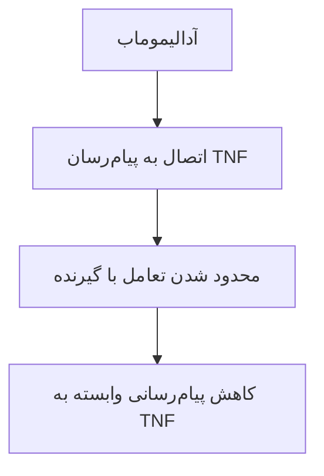
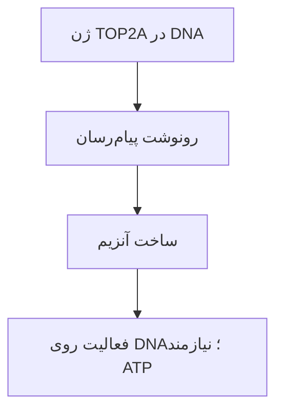
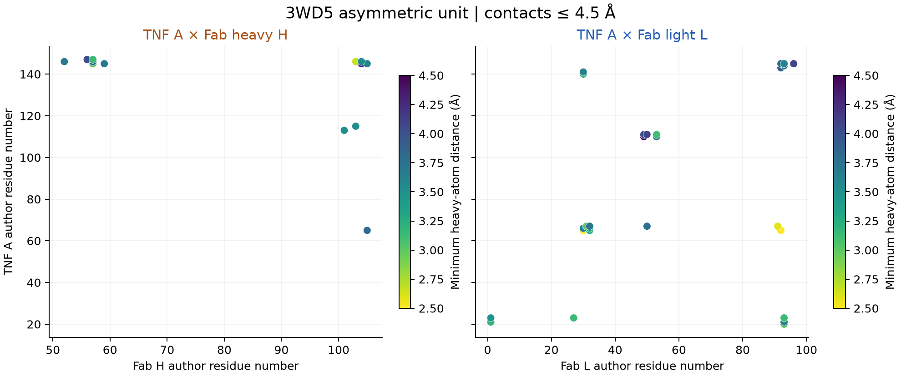

# آدالیموماب، TNF و فرضیهٔ مهار TOP2A

ارائهٔ بیوانفورماتیک ساختاری: شناخت مولکول‌ها، خواندن آزمایش‌های منتشرشده و بررسی یک فرضیه با دادهٔ قابل پیگیری. منابع کوتاه کنار هر مطلب آمده‌اند؛ جزئیات در دفتر پژوهش نگهداری می‌شوند.

## ۱. آدالیموماب، التهاب و هدف پژوهش

**التهاب** بخشی از پاسخ دفاعی بدن است. در **آرتریت روماتوئید**، پاسخ ایمنی نامناسب می‌تواند التهاب پایدار و آسیب مفصل ایجاد کند. TNF یکی از پیام‌رسان‌های این پاسخ است.

**آدالیموماب** دارویی پروتئینی است که به TNF متصل می‌شود و پیام‌رسانی آن را محدود می‌کند. هدف این پژوهش، توضیح همین اتصال و بررسی امکان اثر دارو بر آنزیم دیگری به نام **توپوایزومراز IIα** است. TOP2A نام ژن سازندهٔ آن آنزیم است؛ اثر دارو بر آن، هنوز نتیجهٔ اثبات‌شدهٔ این پروژه نیست.

> منبع: [برچسب Humira، بخش‌های ۱ و ۱۲٫۱](https://dailymed.nlm.nih.gov/dailymed/drugInfo.cfm?setid=608d4f0d-b19f-46d3-749a-7159aa5f933d)؛ [UniProt: TOP2A](https://www.uniprot.org/uniprotkb/P11388).

## ۲. سلول، پروتئین و گیرنده

**سلول** واحد زندهٔ بدن است؛ غشای سلول مرز آن با محیط اطراف است. **پروتئین** از زنجیره‌های اسیدآمینه ساخته می‌شود. ترتیب اسیدآمینه‌ها و تاخوردگی زنجیره‌ها، شکل و ویژگی‌های شیمیایی آن را تعیین می‌کنند.

**گیرنده** پروتئینی است که اتصال یک پیام‌رسان را به پاسخ سلول مرتبط می‌کند. TNF پیام‌رسان و TNFR گیرندهٔ آن است. اتصال این دو می‌تواند رویدادهایی درون سلول آغاز کند؛ پروتئین پیام‌رسان لازم نیست خودش وارد هسته شود.

> منبع: [NHGRI: پروتئین](https://www.genome.gov/genetics-glossary/Protein)؛ [برچسب Humira، بخش ۱۲٫۱](https://dailymed.nlm.nih.gov/dailymed/drugInfo.cfm?setid=608d4f0d-b19f-46d3-749a-7159aa5f933d).

## ۳. آدالیموماب: آنتی‌بادیِ متصل‌شونده به TNF

**آنتی‌بادی** پروتئینی است که سطح مشخصی از یک هدف را شناسایی می‌کند. آدالیموماب یک آنتی‌بادی نوترکیب از نوع IgG1 است؛ مولکول کامل دو زنجیرهٔ سنگین و دو زنجیرهٔ سبک دارد.

دو بازوی **Fab** به هدف متصل می‌شوند. بخش **Fc** با برخی گیرنده‌های ایمنی ارتباط دارد؛ **لولا** حرکت نسبی بازوها را ممکن می‌کند. «کاملاً انسانی» به منشأ توالی آنتی‌بادی اشاره دارد؛ به معنی بی‌عارضه‌بودن نیست. Humira نام تجاری داروی مرجع است.

> منبع: [برچسب Humira، بخش ۱۱](https://dailymed.nlm.nih.gov/dailymed/drugInfo.cfm?setid=608d4f0d-b19f-46d3-749a-7159aa5f933d)؛ [Bianchi 2026، مقدمه](https://doi.org/10.3389/fimmu.2025.1680199).

## ۴. اتصال دارو، پیام التهاب را محدود می‌کند

TNF می‌تواند به صورت محلول یا روی غشا وجود داشته باشد. آدالیموماب به TNF متصل می‌شود و اتصال آن به گیرنده‌های TNFR1 و TNFR2 را محدود می‌کند.

**قفل و کلید** تشبیهی برای شناسایی است؛ اتصال واقعی به شکل، بار و برهم‌کنش‌های شیمیایی سطح وابسته است. دارو TNF را «پاک» نمی‌کند و مستقیماً سلول سرطانی را در این نمودار از بین نمی‌برد. نمودار، مسیر مفهومی است؛ شبیه‌سازی اتمی نیست.

> منبع: [برچسب Humira، بخش ۱۲٫۱](https://dailymed.nlm.nih.gov/dailymed/drugInfo.cfm?setid=608d4f0d-b19f-46d3-749a-7159aa5f933d)؛ [Hu 2013، بحث سازوکار خنثی‌سازی](https://doi.org/10.1074/jbc.M113.491530).

## ۵. 3WD5: دادهٔ واقعیِ اتصال TNF–Fab

**PDB** بانک مختصات ساختارهای مولکولی است. **3WD5** ساختاری با تفکیک‌پذیری 3.1 Å است که با پراش پرتو X تعیین شده است؛ تصویر از مختصات همان فایل ساخته شده است.

در نمای ثبت‌شده، زنجیرهٔ **A** یک زیرواحد TNF و زنجیره‌های **H/L** بخش سنگین/سبک Fab هستند. مولکول کامل آدالیموماب، Fc و گیرندهٔ TNFR در این فایلِ نمایش‌داده‌شده حضور ندارند. ظاهر نواری با سطح اتمی فرق دارد؛ رنگ‌ها ابزار تشخیص زنجیره‌اند.

[باز کردن آزمایشگاه سه‌بعدی](../index.html?document=class-presentation.fa.md&chapter=chapter-5#lab)

> منبع داده: [RCSB: 3WD5](https://www.rcsb.org/structure/3WD5)؛ [Hu 2013](https://doi.org/10.1074/jbc.M113.491530). مدل چرخان در همین اسلاید نیز قابل بازکردن است.

## ۶. Hu 2013: ساختار و آزمایش تغییر اسیدآمینه

**روش:** پژوهشگران ساختار TNF متصل به Fab را تعیین کردند، سطح تماس را بررسی کردند و چند اسیدآمینهٔ TNF را جداگانه تغییر دادند. سپس اتصال را با **SPR**، حسگری که اتصال مولکول‌ها به سطح را اندازه می‌گیرد، سنجیدند.

**چرا این مقاله؟** هم شکل اتصال را داریم، هم یک آزمون مستقل برای اهمیت جایگاه‌های آن. مشاهدهٔ دو سطح نزدیک، به‌تنهایی اهمیت هر اسیدآمینه را مشخص نمی‌کند؛ تغییر کنترل‌شدهٔ اسیدآمینه و سنجش اتصال شاهد قوی‌تری است.

> منبع: [Hu 2013، روش‌های ساختار و SPR، جدول ۳](https://doi.org/10.1074/jbc.M113.491530). این مقالهٔ پایهٔ ساختاری است؛ جزو سه مقالهٔ جدید نیست.

## ۷. Hu: یک تغییر کوچک، اتصال ضعیف‌تر

در جهش **Q21A**، گلوتامینِ جایگاه ۲۱ با آلانین عوض شد. این شماره متعلق به قطعهٔ TNF در آزمایش است.

| نمونهٔ TNF | ثابت تفکیک، KD |
| --- | --- |
| بدون جهش | 0.1152 nM |
| Q21A | 23.35 nM |

**KD بزرگ‌تر یعنی اتصال ضعیف‌تر در همین آزمون.** نسبت دو مقدار حدود ۲۰۳ است. این شاهدی برای اهمیت شیمی سطح اتصال است؛ به معنی ۲۰۳ برابر کاهش اثر درمانی در انسان نیست.

> منبع: [Hu 2013، جدول ۳](https://doi.org/10.1074/jbc.M113.491530). مقادیر منتشرشده بازتولید آزمایشگاهی نشده‌اند.

## ۸. Bianchi 2026: مدل آنتی‌بادی کامل

**روش:** پژوهشگران آدالیموماب–TNF و آولوماب–PD-L1 را از قالب‌های تجربی مدل‌سازی کردند. برای آدالیموماب، Fab از 3WD5 و بخش‌های دیگر از قالب آنتی‌بادی کامل ساخته شدند؛ ساختار کامل مستقیماً از 3WD5 به دست نمی‌آید.

**دینامیک مولکولی** محاسبهٔ حرکت اتم‌ها با مدل نیرو است. برای هر کمپلکس، ۵۰ نانوثانیه شبیه‌سازی معمولی و سپس ۱ میکروثانیه شبیه‌سازی شتاب‌داده‌شده برای کاوش حالت‌های بیشتر اجرا شد. نانوثانیه یک میلیاردم و میکروثانیه یک میلیونم ثانیه است؛ زمانِ مدل، مدت درمان بیمار نیست. دو حالت متفاوت قندیِ Fc مقایسه شدند.

> منبع: [Bianchi، انتشار آنلاین ۸ ژانویهٔ ۲۰۲۶، بخش روش‌ها](https://doi.org/10.3389/fimmu.2025.1680199). سال ۲۰۲۵ در DOI، تاریخ انتشار آنلاین نیست.

## ۹. Bianchi: حرکت Fab و Fc به هم مرتبط است

**یافته:** در مدل‌های متصل به هدف، حرکت بخش‌های اتصال Fab با بخش‌های دورتر لولا و Fc همبستگی داشت؛ الگو به وضعیت قندهای Fc وابسته بود. همبستگی حرکت یعنی تغییرات دو بخش در مسیر شبیه‌سازی با هم همراه‌اند.

**اهمیت:** اتصال روی یک بازو می‌تواند با تغییر آرایش بخش‌های دورتر همراه شود؛ آنتی‌بادی جسم صلب نیست.

**حد نتیجه:** این مطالعه برای TOP2A آزمایشی ندارد و کارایی درمان یا عملکرد تازهٔ سلولی را مستقیماً اندازه نگرفته است. ما نیز مسیرهای دینامیک مولکولی این مقاله را بازاجرا نکرده‌ایم.

> منبع: [Bianchi 2026، شکل‌های ۲ تا ۴ و بحث](https://doi.org/10.3389/fimmu.2025.1680199).

## ۱۰. Marguerie 2025: اثر دارو بر سطح سلول T

**سلول T** یکی از سلول‌های دفاعی بدن است. **SIRPG** نام یک پروتئین روی سطح این سلول است. «افزایش بیان سطحی» یعنی پروتئین بیشتری با روش رنگ‌آمیزی روی سطح تشخیص داده شده است.

**آزمایش دارو:** سلول‌های خون اهداکنندگان سالم در آزمایشگاه تحریک شدند. پس از آدالیموماب، SIRPG سطحی افزایش یافت؛ پژوهشگران این تغییر را با **فلوسایتومتری**، شمارش سلول‌های رنگ‌آمیزی‌شده در جریان، سنجیدند.

**حد نتیجه:** این آزمایش دربارهٔ SIRPG است؛ در همین مقایسه، مهار فعالیت TOP2A نشان داده نشده است.

> منبع: [Marguerie 2025، شکل ۲ و روش‌های فلوسایتومتری](https://doi.org/10.3389/fimmu.2025.1668361).

## ۱۱. Marguerie: حذف SIRPG و RNA کمترِ TOP2A

**آزمایش جدا:** ژن، بخشی از DNA است که اطلاعات وراثتی را نگه می‌دارد؛ RNA پیام‌رسان رونوشتِ ژن برای ساخت پروتئین است. پژوهشگران با دست‌کاری کنترل‌شدهٔ ژن SIRPG، آن را غیرفعال کردند. سلول‌های دارای ژن سالم و غیرفعال‌شده را مقایسه کردند و RNA آن‌ها را خواندند. در گروه غیرفعال‌شده، RNA ژن TOP2A و تقسیم سلول کمتر بود.

دادهٔ RNA با شناسهٔ **GSE296196** شامل ۴۶ کتابخانه از شش اهداکننده است: ۲۳ کنترل و ۲۳ حذف ژن. کتابخانه، یک خروجی آماده‌شده برای توالی‌یابی است؛ ۴۶ کتابخانه به معنی ۴۶ فرد نیست.

**حد نتیجه:** این دیتاست بازوی آدالیموماب ندارد؛ نمی‌توان زنجیرهٔ «دارو ← SIRPG ← TOP2A» را از دو آزمایش جدا اثبات کرد.

> منبع: [Marguerie 2025، شکل ۳ و روش RNA-seq](https://doi.org/10.3389/fimmu.2025.1668361)؛ [GEO: GSE296196](https://www.ncbi.nlm.nih.gov/geo/query/acc.cgi?acc=GSE296196).

## ۱۲. Gehin 2024: خون بیمار و پاسخ درمان

**روش:** داده‌های کارآزمایی ADMYRA با ۳۵۳ بیمار آرتریت روماتوئید بررسی شدند. همه متوترکسات هم دریافت می‌کردند. غلظت آدالیموماب پیش از تزریق بعدی در هفته‌های ۱۲، ۲۴ و ۴۸، به‌ترتیب در ۳۳۶، ۳۳۰ و ۳۰۲ نمونهٔ بیمار اندازه‌گیری شد.

**CRP** پروتئین واکنشی C، نشانگر خونی التهاب است؛ هدف اتصال آدالیموماب نیست. فعالیت بیماری با **DAS28-ESR** سنجیده شد: امتیازی شامل ارزیابی ۲۸ مفصل و سرعت رسوب گلبول قرمز.

> منبع: [Gehin 2024، روش‌ها و ویژگی‌های جمعیت](https://doi.org/10.1136/rmdopen-2024-004888). غلظت خون با مقدار تزریق یکی نیست.

## ۱۳. Gehin: همراهی غلظت دارو با پاسخ بهتر

غلظت حداقل **3.9 mg/L** با CRP کمتر و احتمال بیشترِ خاموشی بیماری همراه بود. در تحلیل طولی، نسبت شانس خاموشی **3.88** و فاصلهٔ اطمینان ۹۵٪ آن **1.80–8.38** بود.

**معنی ساده:** در این داده‌ها، گروه دارای غلظت بالاتر بیشتر به خاموشی بیماری رسیده بود. نسبت شانس، نسبت شانس دو گروه است؛ به معنی «۳٫۸۸ برابر درمان قطعی» نیست.

**حد نتیجه:** مقایسهٔ غلظت‌ها تصادفی‌سازی نشده بود؛ رابطه، دستور افزایش دوز یا شاهد تغییر TOP2A نیست. دادهٔ فردی بیمار در این پروژه در اختیار نیست.

> منبع: [Gehin 2024، شکل ۲ و تحلیل طولی](https://doi.org/10.1136/rmdopen-2024-004888).

## ۱۴. TOP2A و مدیریت درهم‌پیچیدگی DNA

**DNA** اطلاعات وراثتی سلول را نگه می‌دارد. هنگام کپی‌شدن DNA و تقسیم سلول، رشته‌ها می‌توانند درهم بپیچند. **توپوایزومراز IIα** با مصرف ATP، یک قطعهٔ DNA را موقتاً می‌بُرد، قطعهٔ دیگری را عبور می‌دهد و بریدگی را دوباره متصل می‌کند.

**TOP2A** نام ژن سازندهٔ این آنزیم است. این کار در تقسیم سلولی اهمیت دارد، بنابراین TOP2A در مطالعات تکثیر و سرطان مطرح است. **4FM9** فقط هستهٔ برش آنزیم همراه DNA مصنوعی را نشان می‌دهد؛ آدالیموماب در آن وجود ندارد.

> منبع: [UniProt: P11388، عملکرد](https://www.uniprot.org/uniprotkb/P11388)؛ [Wendorff 2012](https://doi.org/10.1016/j.jmb.2012.07.014)؛ [RCSB: 4FM9](https://www.rcsb.org/structure/4FM9).

## ۱۵. RNA، مقدار پروتئین و فعالیت آنزیم

**ژن** بخشی از DNA است. برای ژن پروتئین‌ساز، رونوشت پیام‌رسان **mRNA** ساخته می‌شود و سلول از اطلاعات آن برای ساخت پروتئین استفاده می‌کند. همهٔ RNAها پیام‌رسان یا پروتئین‌ساز نیستند.

**کاهش RNA** یعنی رونوشت کمتری اندازه‌گیری شده است. **کاهش مقدار پروتئین** باید با آزمون پروتئینی سنجیده شود. **مهار فعالیت** یعنی آنزیمِ موجود کار کمتری انجام می‌دهد؛ این سه مشاهده هم‌معنی نیستند.

> منبع: [NHGRI: RNA](https://www.genome.gov/genetics-glossary/Ribonucleic-Acid-RNA) و [ترجمه](https://www.genome.gov/genetics-glossary/Translation)؛ [UniProt: TOP2A](https://www.uniprot.org/uniprotkb/P11388).

## ۱۶. Shi 2025: مدل التهاب با ترکیبِ هدف‌گیرندهٔ TOP2A

**روش:** از SW982، ردهٔ مشتق از سارکوم سینوویال، برای مدل التهاب شبیه RA و از A549، ردهٔ سرطان ریه، برای مدل فیبروز استفاده شد. به سلول‌ها محرک التهابی و سپس ترکیب **PluriSIn#2** داده شد.

**یافته:** تغییرات نشانگرهای التهابی/فیبروزی گزارش شد؛ مقاله نقش TOP2A را پیشنهاد می‌کند.

**حد نتیجه:** دارو آدالیموماب نبود، ردهٔ سرطانی نمونهٔ مفصل بیمار نیست و اثر ترکیب به‌تنهایی اختصاصیت هدف را ثابت نمی‌کند. این مقاله انگیزهٔ آزمایش است؛ شاهد مهار TOP2A توسط آدالیموماب نیست.

> منبع: [Shi 2025، روش‌ها و نتایج](https://doi.org/10.2147/JIR.S497734). منبع مکملِ مقایسهٔ التهاب و TOP2A.

## ۱۷. Veerasubramanian 2026: دادهٔ مستقیمِ تیمار دارویی و RNA

**روش:** سلول‌های T و سلول‌های تحریک‌کننده از افراد متفاوت کنار هم کشت داده شدند؛ این آزمایش **MLR** نام دارد و پاسخ ایمنی آزمایشگاهی ایجاد می‌کند. داروهای تکی و ترکیبی مقایسه شدند؛ RNA سلول‌های T جداشده در روز پنجم خوانده شد.

دیتاست **GSE339038** دارای ۶۴ کتابخانه است: چهار اهداکننده، هرکدام در ۱۶ وضعیت. وضعیت‌های آدالیموماب به‌همراه آنتی‌بادی کنترل و کنترل‌های متناظر وجود دارند.

**چرا مرتبط است؟** این‌بار دادهٔ RNA واقعاً بازوی آدالیموماب دارد؛ بیمار RA یا آزمون فعالیت آنزیم نیست.

> منبع: [Veerasubramanian 2026، روش و شکل ۴](https://doi.org/10.3389/fimmu.2026.1867995)؛ [GEO: GSE339038](https://www.ncbi.nlm.nih.gov/geo/query/acc.cgi?acc=GSE339038).

## ۱۸. مطالعهٔ ۲۰۲۶: تک‌دارو و ترکیب را جدا می‌خوانیم

در گزارش نویسندگان، آدالیموماب با کنترل IgG1، **۱۲۲ ژن** و ترکیب آدالیموماب–داپیرولیزوماب، **۵۲۴ ژن** را نسبت به وضعیت MLR بدون دارو کاهش داد. این شمارش‌ها نتیجهٔ تحلیل نویسندگان‌اند.

TOP2A در متن، میان ژن‌های تکثیر در گروه‌های مرتبط با ترکیب درمان‌ها نام برده شده است. این جمله به‌تنهایی مقدار اثرِ آدالیمومابِ تنها بر TOP2A را مشخص نمی‌کند.

**اهمیت:** این دیتاست اجازه می‌دهد تک‌دارو را جدا از ترکیب بررسی کنیم. مهار دو مسیر ایمنی را نمی‌توان به اثر یکی از داروها نسبت داد.

> منبع: [Veerasubramanian 2026، شکل ۴ و نتایج RNA](https://doi.org/10.3389/fimmu.2026.1867995). نسبت‌دادن اثر ترکیبی به تک‌دارو مجاز نیست.

## ۱۹. دیتاست‌های مشخص و کاربرد آن‌ها

**دیتاست** مجموعهٔ سازمان‌یافتهٔ اندازه‌گیری‌هاست؛ مدل سه‌بعدی، RNA و دادهٔ بالینی، ستون‌های یک آزمایش واحد نیستند.

| شناسه | دادهٔ موجود | کاربرد در این پژوهش |
| --- | --- | --- |
| 3WD5 | مختصات TNF–Fab | بررسی محل اتصال واقعی |
| GSE296196 | RNA؛ حذف SIRPG و کنترل | بررسی ارتباط SIRPG با TOP2A؛ بدون دارو |
| GSE339038 | RNA؛ تیمار تکی و ترکیبی | مقایسهٔ آدالیموماب و کنترل در چهار فرد |

نمونه‌های این منابع به هم متصل نیستند. CRP، ادرار یا پاسخ سرطانِ همان اهداکنندگان در این مجموعهٔ ترکیبی نداریم.

> منابع داده: [3WD5](https://www.rcsb.org/structure/3WD5)، [GSE296196](https://www.ncbi.nlm.nih.gov/geo/query/acc.cgi?acc=GSE296196)، [GSE339038](https://www.ncbi.nlm.nih.gov/geo/query/acc.cgi?acc=GSE339038).

## ۲۰. بررسی اولیهٔ ما: RNA ژن TOP2A در چهار فرد

از فایل عمومی GSE339038، ردیف TOP2A استخراج شد. **CPM** مقدار شمارش تقسیم بر مجموع شمارش‌های همان کتابخانه، ضربدر یک میلیون است؛ تفاوت عمق خوانش را تا حدی قابل مقایسه می‌کند.

در این مقایسهٔ توصیفی، چهار مقدار کمترند؛ آزمون آماری، اصلاح ترکیب کتابخانه و سنجش پروتئین/فعالیت انجام نشده است. این یافتهٔ اولیه، اثبات مهار آنزیم نیست.

> داده و روش: [GSE339038](https://www.ncbi.nlm.nih.gov/geo/query/acc.cgi?acc=GSE339038)؛ [گزارش قابل بازاجرا و محدودیت‌ها](../docs/top2a-count-inspection.fa.md).

## ۲۱. تحلیل ساختاری ما: نزدیکی اتم‌های TNF–Fab

مختصات 3WD5 خوانده شد؛ اتم‌های هیدروژن و جایگاه‌های اشغال‌نشده کنار گذاشته شدند. در فاصلهٔ حداکثر **4.5 Å**، **۲۵۲ جفت اتم** در **۴۰ جفت اسیدآمینه** نزدیک‌اند. آنگستروم، Å، برابر یک ده‌میلیاردم متر است.

نقشه نشان می‌دهد کدام جایگاه‌های TNF و Fab در این نمای ناقص نزدیک‌اند. این **محاسبهٔ هندسی اجرا شده است**؛ انرژی اتصال، دینامیک مولکولی یا اثر درمان از تعداد تماس نتیجه نمی‌شود. هیچ کمپلکس آدالیموماب–TOP2A در این پروژه ساخته یا آزموده نشده است.

> منبع مختصات: [3WD5](https://www.rcsb.org/structure/3WD5)؛ [روش و خروجی تحلیل پروژه](../docs/structural-feasibility-results.fa.md).

## ۲۲. سؤال پژوهش و آزمون‌های لازم

**آیا آدالیموماب، مستقیم یا پس از مهار TNF، فعالیت TOP2A را کاهش می‌دهد؟**

- **مسیر مستقیم:** دسترسی دارو، اتصال اختصاصی و فعالیت آنزیم با مقدار پروتئین ثابت باید بررسی شوند. docking، پیش‌بینی آرایش اتصال است؛ اثبات مهار نیست.
- **مسیر غیرمستقیم:** ابتدا RNA در تیمار و کنترلِ همان اهداکننده تحلیل می‌شود؛ سپس مقدار پروتئین و فعالیت آنزیم جدا سنجیده می‌شوند.
- **وضعیت فعلی:** اتصال TNF شناخته شده؛ بررسی RNA ما توصیفی است؛ مهار مستقیم TOP2A و فایدهٔ ضدسرطان هنوز نشان داده نشده‌اند.

> مبنای تفکیک: [UniProt: عملکرد TOP2A](https://www.uniprot.org/uniprotkb/P11388)؛ [طرح امکان‌سنجی پژوهش](../docs/top2a-inhibition-feasibility.fa.md). این اسلاید، برنامهٔ آزمون است.

## ۲۳. منابع و ادامهٔ مطالعه

**سه مقالهٔ اصلی کلاس:** [Bianchi 2026](https://doi.org/10.3389/fimmu.2025.1680199)، [Marguerie 2025](https://doi.org/10.3389/fimmu.2025.1668361)، [Gehin 2024](https://doi.org/10.1136/rmdopen-2024-004888): به‌ترتیب ساختار/حرکت، آزمایش سلولی و پاسخ بالینی.

**منابع مکمل:** [Hu 2013](https://doi.org/10.1074/jbc.M113.491530)، [Shi 2025](https://doi.org/10.2147/JIR.S497734)، [Veerasubramanian 2026](https://doi.org/10.3389/fimmu.2026.1867995): پایهٔ اتصال، مقایسهٔ TOP2A و دادهٔ دارو–RNA.

**ساختارها:** [3WD5](https://www.rcsb.org/structure/3WD5)، [1TNF](https://www.rcsb.org/structure/1TNF)، [4FM9](https://www.rcsb.org/structure/4FM9). **تعاریف و دارو:** [UniProt](https://www.uniprot.org/uniprotkb/P11388)، [NHGRI](https://www.genome.gov/genetics-glossary)، [برچسب Humira](https://dailymed.nlm.nih.gov/dailymed/drugInfo.cfm?setid=608d4f0d-b19f-46d3-749a-7159aa5f933d).

[دفتر صحت‌سنجی ادعاها](../docs/scientific-claim-audit.fa.md) و [گزارش بررسی RNA](../docs/top2a-count-inspection.fa.md) جزئیات داده، روش، برداشت و محدودیت را نگه می‌دارند.
