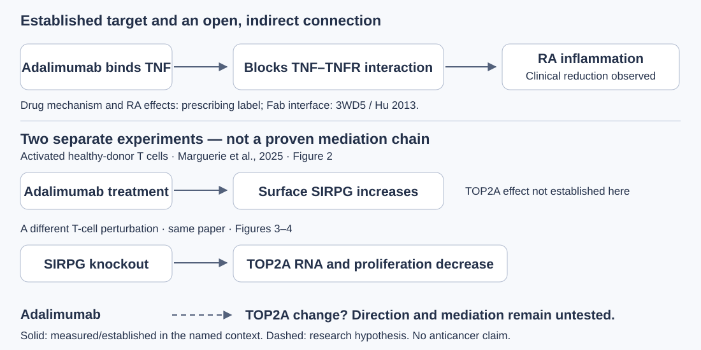
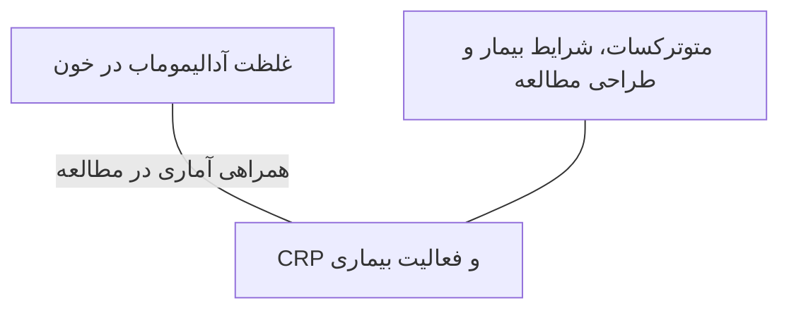

# ارائهٔ کلاسی: از آدالیموماب و TNF تا پرسش TOP2A

این هفته هدف، انتخاب پروتئین، توضیح مسئله و خلاصهٔ نقادانهٔ سه مقاله است. با «گام بعدی» پیش بروید؛ هر بخش یک قسمت از ارائهٔ حدود ۵ تا ۸ دقیقه‌ای است. عبارت «برای گفتن» یادداشت پیشنهادی شماست. محاسبات تکمیلی و طرح شبیه‌سازی، پیوست‌اند.

برای یادگیری پیش از ارائه، از [درس روشنِ سلول، پروتئین و سازوکار دارو](binding-mechanism.fa.md) شروع کنید؛ سپس [داستان آزمایش‌ها و معنی مقاله‌ها](paper-explanations.fa.md) را بخوانید. این مسیر کوتاه، خلاصهٔ ارائه است؛ متن‌های آموزشی توضیحات کامل‌تر دارند.

## ۱. مسئله‌ای که پیشنهاد می‌کنم

در آرتریت روماتوئید، التهاب به بافت مفصل آسیب می‌زند. می‌خواهم ابتدا شکل پروتئین TNF و نحوهٔ اتصال داروی آدالیموماب به آن را بفهمم؛ سپس بررسی کنم شواهد از چه پیوند غیرمستقیمی با TOP2A، آنزیم مرتبط با DNA و تقسیم سلول، حمایت می‌کنند.

**برای گفتن:** «پروتئین اصلی پیشنهادی من TNF-α، هدف آدالیموماب است. TOP2A موضوع مقایسه و سؤال مرحلهٔ بعد است؛ علاقهٔ استاد به آن انگیزهٔ بررسی است و خودش شاهد ارتباط محسوب نمی‌شود.»

منبع سازوکار دارو: [برچسب FDA، بخش‌های ۱۱ و ۱۲.۱](https://www.accessdata.fda.gov/drugsatfda_docs/label/2025/125057s425lbl.pdf).

## ۲. چهار اسم، چهار نقش

- **آدالیموماب:** داروی آنتی‌بادی و خودش یک مولکول پروتئینی؛ بخش Fab آنتی‌ژن را شناسایی می‌کند.
- **TNF-α:** پروتئین پیام‌رسان التهابی و هدف شناخته‌شدهٔ این دارو.
- **CRP:** پروتئینی که غلظتش در خون برای پیگیری التهاب سنجیده می‌شود.
- **TOP2A:** نام ژن سازندهٔ توپوایزومراز IIα؛ آنزیم با DNA و چرخهٔ سلولی کار می‌کند. مقدار RNA، مقدار پروتئین و فعالیت آنزیم سنجه‌های جدا هستند.

[طرح در اندازهٔ اصلی](../assets/antibody-anatomy.svg).

**برای گفتن:** «وقتی می‌گویم دارو یک پروتئین است، منظورم آنتی‌بادی است. TNF هدف دارو و CRP نشانگر بالینی است؛ این‌ها یک چیز نیستند.» [TNF در UniProt](https://www.uniprot.org/uniprotkb/P01375)، [TOP2A در UniProt](https://www.uniprot.org/uniprotkb/P11388).

**یک نقش دیگر، گیرنده:** TNFR پروتئینی روی سلول است که TNF به آن متصل می‌شود و پیام‌رسانی را راه می‌اندازد. آدالیموماب با گرفتن TNF می‌تواند این تعامل را محدود کند. [دیدن سه مرحلهٔ مفهومی](../index.html#binding-explainer)؛ [معنی «قفل و کلید» با مثال واقعی](binding-mechanism.fa.md).

## ۳. شکل واقعی را از کجا می‌آوریم؟

ساختار **3WD5** مختصات آزمایشگاهی TNF همراه Fab آدالیموماب دارد. در نمای فعلی، A زیرواحد TNF، H زنجیرهٔ سنگین و L زنجیرهٔ سبک Fab است. آنتی‌بادی کامل و تماس‌های همسایه‌های تقارن در این نما حاضر نیستند. **4FM9** هستهٔ ناقص TOP2A همراه DNA مصنوعی را نشان می‌دهد.

[شکل در اندازهٔ اصلی](../assets/structure-comparison.png).

**برای گفتن:** «این مختصات از PDB آمده‌اند. با چرخاندن مدل، جای زنجیره‌ها را می‌بینیم؛ حرکت دوربین، شبیه‌سازی حرکت اتم‌ها نیست.»

در آزمایشگاه، «نوع نمایش» را میان مسیر Cα و نمای نواری عوض کنید: مختصات منبع مشترک‌اند، روش رسم فرق دارد. [علت اختلاف ظاهر با RCSB و تفاوت ۵۷۳/۵۷۹ نقطه](molecular-display-audit.fa.md).

[باز کردن آزمایشگاه سه‌بعدی](../index.html?document=class-presentation.fa.md&chapter=chapter-3#lab)؛ پس از دیدن مدل، تب «کتابچهٔ پژوهش» را بزنید تا به همین گام برگردید. منابع: [3WD5 و Hu 2013](https://www.rcsb.org/structure/3WD5)، [4FM9](https://www.rcsb.org/structure/4FM9).

## ۴. مقالهٔ اول: ساختار و حرکت آنتی‌بادی

**Bianchi، انتشار آنلاین ۲۰۲۶:** مدل‌سازی آنتی‌بادی کامل و دینامیک مولکولی را برای بررسی تغییرات شکل پس از اتصال آنتی‌ژن به‌کار می‌برد؛ آدالیموماب/TNF یکی از سیستم‌هاست. مدل‌سازی با حل تجربی ساختار کامل فرق دارد.

**چرا انتخاب شد؟** نقش بخش‌های آنتی‌بادی و نوع سؤال قابل بررسی با شبیه‌سازی را توضیح می‌دهد. **محدودیت:** نتیجهٔ محاسباتی، اثربخشی در بیمار یا ارتباط با TOP2A را اندازه نمی‌گیرد. شبیه‌سازی این مقاله را خودمان بازتولید نکرده‌ایم.

**برای گفتن:** «این مقاله به بخش ساختاری پروژه کمک می‌کند. سال آنلاین ۲۰۲۶ است، هرچند DOI و جلد برچسب ۲۰۲۵ دارند.» [مقالهٔ اصلی](https://doi.org/10.3389/fimmu.2025.1680199)، [خلاصه و نقد کامل](literature-review.fa.md).

[داستان آزمایش: بخش‌های آنتی‌بادی چگونه حرکت می‌کنند؟](paper-explanations.fa.md)

## ۵. مقالهٔ دوم: سرنخ پیوند با TOP2A

**Marguerie 2025:** آدالیموماب SIRPG سطحی را در سلول T فعال‌شدهٔ اهداکنندهٔ سالم افزایش داد. در **آزمایش جدا**، حذف SIRPG با کاهش RNA ژن TOP2A و تکثیر همراه بود.

[نقشه در اندازهٔ اصلی](../assets/evidence-pathway.svg).

**چرا انتخاب شد؟** برای طرح یک واسطهٔ احتمالی سرنخ دارد. **محدودیت:** دو مداخله را نمی‌توان یک آزمایش دارو→TOP2A فرض کرد؛ جهت اثر دارو بر TOP2A از این نتایج تعیین نمی‌شود.

**برای گفتن:** «این مقاله دلیل طرح سؤال من است، نه پاسخ نهایی آن.» [مقالهٔ اصلی، شکل‌های ۲ تا ۴](https://doi.org/10.3389/fimmu.2025.1668361)، [نقشهٔ انتساب شواهد](connection-evidence.fa.md).

[داستان آزمایش: سلول T، حذف ژن و مقدار RNA یعنی چه؟](paper-explanations.fa.md)

## ۶. مقالهٔ سوم: دارو و نشانگر بالینی

**Gehin 2024:** در بازتحلیل داده‌های کارآزمایی ADMYRA، رابطهٔ غلظت آدالیموماب در خون با CRP و فعالیت RA بررسی شد. همهٔ شرکت‌کنندگان متوترکسات هم دریافت می‌کردند.

**چرا انتخاب شد؟** پژوهش را به سنجهٔ واقعی بیمار وصل می‌کند. **محدودیت:** بازتحلیل غلظت–پاسخ، آزمایش تغییر دوز نیست؛ TOP2A یا ساختار اختصاصی بیمار در آن اندازه‌گیری نشده است.

**برای گفتن:** «این مقاله زمینهٔ بالینی را پوشش می‌دهد. هر سه مقاله یک نوع شواهد تولید نمی‌کنند.» [مقالهٔ اصلی](https://doi.org/10.1136/rmdopen-2024-004888).

در این مقاله فعالیت بیماری با **DAS28-ESR** طبقه‌بندی شده و CRP جدا سنجیده شده است. [داستان مطالعه: غلظت خون، پاسخ بیمار و معنی اعداد](paper-explanations.fa.md).

## ۷. سؤال و فرضیهٔ پیشنهادی من

**سؤال:** آیا هدف‌گیری TNF با آدالیموماب، در یک نوع و حالت مشخص سلول، با تغییر برنامه‌های مرتبط با TOP2A ارتباط غیرمستقیم دارد؟

**فرضیهٔ قابل آزمون:** در شرایط تعریف‌شده، دارو ممکن است بیان TOP2A را تغییر دهد؛ اثر باید در همان آزمایش دارو/کنترل اندازه‌گیری شود. افزایش، کاهش و نبود تغییر هر سه نتیجهٔ مجازند. برای بررسی SIRPG به‌عنوان واسطه، دست‌کاری آن نیز باید در همین طراحی مقایسه شود.

**برای گفتن:** «اتصال مستقیم آدالیموماب به TOP2A را فرض نکرده‌ام. موضوع سرطان فعلاً مقایسهٔ نقش TOP2A است؛ شواهد اثر ضدسرطان، سؤال جداگانه‌ای می‌خواهد.» [پرسش‌ها و فرضیه‌ها](research-questions.fa.md)، [طرح آکادمیک](academic-study-plan.fa.md).

## ۸. چه کاری انجام شده و بعداً چه می‌کنیم؟

**انجام‌شده:** انتخاب ساختارهای واقعی، کنترل منبع/توالی، نمایش سه‌بعدی و شمارش تماس‌های رابط جزئی TNF–Fab. در حد 4.5 Å، 252 جفت اتم سنگین در تماس هندسی‌اند. [روش و فرمول‌ها](structural-method.fa.md).

**پیوست اختیاری:** یک محاسبهٔ واقعی سطح در دسترس حلال همراه کنترل جداسازی صلب اجرا شده است. این محاسبه هندسه را می‌سنجد و MD نیست. [گزارش سطح و کنترل](structural-feasibility-results.fa.md).

**مرحلهٔ بعد، پیشنهادی:** تعریف سیستم زیستی معتبر پیش از MD؛ پیدا کردن داده با بازوی واقعی دارو برای سؤال TOP2A؛ و مشخص‌کردن سنجه، کنترل و شرط ادامه. این هفته اجرای این مراحل ادعا نمی‌شود.

**برای گفتن:** «خروجی فعلی یک پیشنهاد پژوهشی مستند همراه بازتحلیل کوچک ساختاری است. نتیجهٔ جدید زیستی و قابلیت چاپ هنوز باید با کار بعدی ارزیابی شوند.» [راهنمای نوشتن گزارش و مقاله](paper-writing-guide.fa.md).

## ۹. سه پاسخ کوتاه برای گفت‌وگو با استاد

**آیا ارتباط ثابت شده است؟** رابطهٔ دارو و TNF مستند است؛ مسیر پیشنهادی تا TOP2A حلقهٔ آزموده‌نشده دارد. نتیجهٔ نامشخص هم باید گزارش شود.

**چرا شبیه‌سازی کافی نیست؟** شبیه‌سازی اتمی، رفتار یک سیستم مولکولی با فرض‌های مشخص را نمونه‌برداری می‌کند. بیان RNA و پاسخ بیمار سنجه‌های دیگری‌اند و به دادهٔ مربوط به خودشان نیاز دارند.

**آیا پژوهش را می‌فهمم؟** می‌توانم نقش چهار مولکول، منبع شکل‌ها، دلیل انتخاب هر مقاله و مرز ادعای خودم را توضیح دهم. اصطلاح یا روشی که هنوز نمی‌توانم توضیح بدهم، نتیجهٔ اجراشده معرفی نمی‌کنم.

**برای گفتن در پایان:** «از استاد می‌خواهم دربارهٔ تناسب پروتئین و سؤال نظر بدهند؛ سپس روش مرحلهٔ بعد را متناسب با درس محدود کنیم.»
