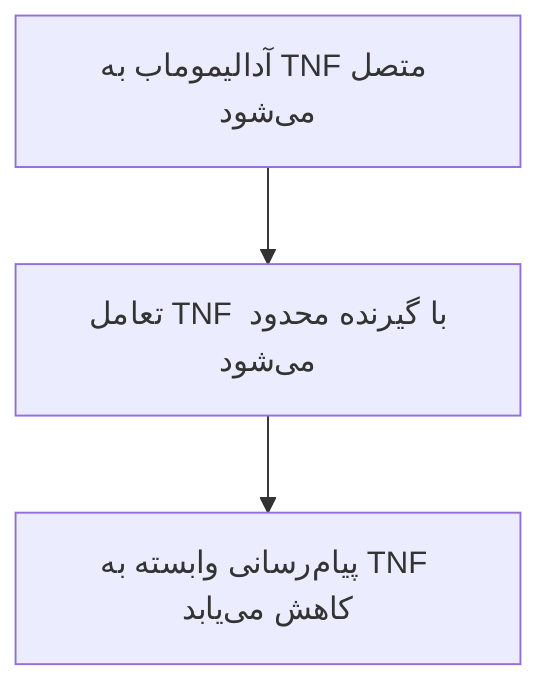

# آدالیموماب و TNF: از ساختار تا مهار التهاب

این ارائه، اتصال یک داروی پروتئینی به هدفش را توضیح می‌دهد، شواهد ساختاری، سلولی و بالینی را کنار هم می‌گذارد و پرسشی جدا دربارهٔ TOP2A مطرح می‌کند. منابع در بخش پایانی آمده‌اند.

## ۱. مسئلهٔ پژوهش: اتصال چگونه به مهار التهاب می‌رسد؟

در آرتریت روماتوئید، التهاب مزمن به مفاصل آسیب می‌زند. پروتئین اصلی این پژوهش **TNF-α**، هدف داروی آدالیموماب است.

**پرسش نخست:** شکل اتصال دارو چگونه محدودشدن پیام التهاب را توضیح می‌دهد؟

علاقهٔ من به نقش **TOP2A** در DNA و تقسیم سلول، پرسش آینده را شکل می‌دهد: آیا تغییر مسیر TNF می‌تواند ارتباطی غیرمستقیم با TOP2A داشته باشد؟

## ۲. سلول، پروتئین و گیرنده: سه نقش متفاوت

**سلول** واحد زندهٔ سازندهٔ بدن است. **پروتئین** زنجیره‌ای از واحدهای کوچک به نام اسیدآمینه است که شکل سه‌بعدی می‌گیرد.

TNF یک پروتئین پیام‌رسان است؛ **TNFR** گیرندهٔ آن روی سلول است. گیرنده، پروتئینی است که اتصال یک مولکول را به تغییر فعالیت سلول مرتبط می‌کند.

بنابراین اتصال بیرون سلول می‌تواند مجموعه‌ای از رویدادهای درون سلول را راه بیندازد؛ پاسخ به نوع سلول و شرایط بستگی دارد.

## ۳. آدالیموماب: یک آنتی‌بادی با بخش‌های متفاوت

آدالیموماب خودش پروتئین است؛ نوعی **آنتی‌بادی** که سطح مشخصی از هدف را شناسایی می‌کند. دو بازوی **Fab** بخش‌های اتصال به هدف‌اند. بخش **Fc** می‌تواند با گیرنده‌های ایمنی ارتباط داشته باشد و ناحیهٔ **لولا** به حرکت بازوها کمک می‌کند. آنتی‌بادی کامل دو زنجیرهٔ سنگین و دو زنجیرهٔ سبک دارد. قطعهٔ Fab فقط بخشی از این مولکول کامل است.

## ۴. دارو چگونه پیام TNF را محدود می‌کند؟

آدالیموماب به خود TNF متصل می‌شود و دسترسی گیرنده به سطح مهمی از آن را محدود می‌کند. تشبیه «قفل و کلید» فقط شروع توضیح است؛ شکل، ویژگی‌های شیمیایی سطح و انعطاف مولکول هم اهمیت دارند. نمودار زیر **طرح مفهومی سازوکار** است؛ حرکت اتم‌ها یا پاسخ بیمار را شبیه‌سازی نمی‌کند.

## ۵. 3WD5: شکل اتصال از دادهٔ تجربی

**3WD5** شناسهٔ ساختاری در بانک PDB است؛ مختصات اتم‌ها از آزمایش پرتو X برآورد شده‌اند. این تصویر یک زیرواحد TNF و Fab را نشان می‌دهد: A هدف، H بخش زنجیرهٔ سنگین و L زنجیرهٔ سبک است. Fc و گیرندهٔ TNFR در این نما حضور ندارند. خط‌ها مسیر زنجیره‌ها را نشان می‌دهند؛ رنگ و روش رسم، ظاهر را تغییر می‌دهند.

[باز کردن آزمایشگاه سه‌بعدی](../index.html?document=class-presentation.fa.md&chapter=chapter-5#lab)

## ۶. Hu 2013: شاهد مستقیم برای اهمیت سطح اتصال

این مطالعه، ساختار TNF–Fab را تعیین کرد و محل تماس را با محل اتصال گیرنده مقایسه کرد. سپس برخی اسیدآمینه‌های TNF را تغییر داد و اتصال را با حسگر نوری سنجید.

در یک نمونه، اسیدآمینهٔ گلوتامین در جایگاه ۲۱ با آلانین عوض شد؛ میل اتصال در همان آزمون حدود ۲۰۰ برابر ضعیف‌تر شد.

**نتیجه:** جزئیات شیمیایی سطح مهم‌اند؛ این عدد، میزان کاهش التهاب بیمار نیست.

## ۷. Bianchi: آیا اتصال، آرایش آنتی‌بادی کامل را تغییر می‌دهد؟

این مقاله، منتشرشدهٔ آنلاین در **۲۰۲۶**، آنتی‌بادی کامل را از قالب‌های تجربی مدل‌سازی کرد. **دینامیک مولکولی** یعنی محاسبهٔ حرکت اتم‌ها در رایانه، با فرض‌های مشخص.

**سؤال مطالعه:** اتصال هدف به Fab با چه تغییراتی در بخش دورتر Fc همراه می‌شود؟ مدل‌ها تغییر آرایش و دسترسی سطح را نشان دادند.

این یافته، پیش‌بینی ساختاری است؛ عملکرد ایمنی، پاسخ بیمار یا TOP2A در آزمایش تازه اندازه‌گیری نشده‌اند.

## ۸. Marguerie 2025: دو آزمایش که باید جدا خوانده شوند

**سلول T** نوعی سلول ایمنی و **SIRPG** پروتئینی روی سطح آن است. **ژن** بخشی از DNA، مولکول اطلاعات وراثتی، است؛ **RNA** رونوشت آن است. در نمونه‌های خون افراد سالم، آدالیموماب SIRPG را پس از تحریک آزمایشگاهی افزایش داد. در **آزمایش جدا**، غیرفعال‌کردن ژن SIRPG با RNA کمترِ TOP2A و تقسیم کمتر همراه بود. این دو مشاهده، اثر دارو بر TOP2A یا جهت آن را تعیین نمی‌کنند.

## ۹. Gehin 2024: غلظت دارو و پاسخ بیماران

**غلظت** مقدار دارو در حجم مشخص خون است و با دوز تزریق یکی نیست. این مطالعه، غلظت پیش از تزریق بعدی را با پاسخ بیماران آرتریت روماتوئید مقایسه کرد؛ همه متوترکسات هم دریافت می‌کردند.

غلظت بیشتر با **CRP کمتر**، نشانگر خونی التهاب، همراه بود. فعالیت بیماری با امتیاز **DAS28-ESR** سنجیده شد که از جمله بررسی ۲۸ مفصل و سرعت رسوب گلبول قرمز را در بر می‌گیرد.

این همراهی، اثر افزایش دوز یا تغییر TOP2A را ثابت نمی‌کند.

## ۱۰. TOP2A و سرطان: پرسشِ ارتباط غیرمستقیم

**DNA** مولکول اطلاعات وراثتی سلول است. **TOP2A** ژنی با دستور ساخت توپوایزومراز IIα است؛ آنزیمی که به مدیریت درهم‌پیچیدگی و جداشدن DNA کمک می‌کند. آنزیم، انجام واکنش شیمیایی را آسان‌تر می‌کند. پرسش پیشنهادی، ارتباط تغییر مسیر TNF با فعالیت‌های مرتبط با TOP2A است. اتصال مستقیم آدالیموماب به این آنزیم یا کمک به درمان سرطان، از شواهد فعلی تأیید نشده است.

## ۱۱. تحلیل انجام‌شده: شمارش نزدیکی اتم‌ها

در این پروژه، مختصات واقعی 3WD5 بررسی و تماس‌های رابط نمایش‌داده‌شدهٔ TNF–Fab شمارش شدند. در فاصلهٔ حداکثر **4.5 Å**، تعداد **۲۵۲ جفت اتم غیرهیدروژن** نزدیک هم‌اند. آنگستروم، Å، واحد بسیار کوچک طول است. نمودار، جایگاه اسیدآمینه‌های دو طرف و فاصله را خلاصه می‌کند. این خروجی، محاسبهٔ هندسهٔ یک ساختار است؛ دینامیک مولکولی اجرا نشده و انرژی اتصال یا اثر درمان از این شمارش نتیجه نمی‌شود.

## ۱۲. نتیجهٔ فعلی و سؤال قابل آزمون بعدی

اتصال مستقیم آدالیموماب به TNF مستند است. مدل رایانه‌ای، آزمایش سلول و مطالعهٔ بیمار، هرکدام بخشی متفاوت از مسئله را بررسی می‌کنند. پیوند احتمالی با TOP2A هنوز حلقهٔ آزموده‌نشده دارد.

**گام پیشنهادی بعدی:** مقایسهٔ دارو با **کنترل**، نمونهٔ مقایسه‌ای آزمایش، در یک نوع و حالت مشخص سلول و اندازه‌گیری TOP2A است.

افزایش، کاهش یا ثابت‌ماندن TOP2A باید بدون پیش‌داوری گزارش شود؛ اثر ضدسرطان از پیش فرض نمی‌شود.

## ۱۳. منابع اصلی و نوع شواهد

منابع پایهٔ توضیحات و تصاویر در این بخش گرد آمده‌اند. این فهرست، نوع شاهد هر منبع را مشخص می‌کند؛ نتایج منتشرشده را مستقلاً بازتولید نکرده‌ایم.

- [Hu 2013](https://doi.org/10.1074/jbc.M113.491530): ساختار تجربی و آزمون اتصال TNF–Fab.
- [Bianchi، آنلاین 2026](https://doi.org/10.3389/fimmu.2025.1680199): مدل‌سازی و دینامیک مولکولی آنتی‌بادی.
- [Marguerie 2025](https://doi.org/10.3389/fimmu.2025.1668361): آزمایش‌های جداگانهٔ دارو و حذف SIRPG.
- [Gehin 2024](https://doi.org/10.1136/rmdopen-2024-004888): همراهی غلظت دارو و پاسخ RA.
- [FDA، آدالیموماب](https://www.accessdata.fda.gov/drugsatfda_docs/label/2025/125057s425lbl.pdf): سازوکار و کاربردهای دارو.
- [RCSB، 3WD5](https://www.rcsb.org/structure/3WD5)، [1TNF](https://www.rcsb.org/structure/1TNF) و [4FM9](https://www.rcsb.org/structure/4FM9): مختصات ساختارهای نمایش‌داده‌شده.
