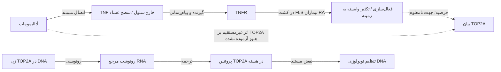

# نقشهٔ شواهد اتصال آدالیموماب، TNF و TOP2A

**بررسی منابع اولیه: ۲۰۲۶-۱۰-۱۳.** سه مقالهٔ محوری برای ساختار، سرنخ سلولی و زمینهٔ بالینی انتخاب شده‌اند؛ منابع بنیادی و مکمل برای بررسی حلقه‌های ارتباط لازم‌اند. سقف سه مقاله به معنی کفایت سه مقاله برای اثبات یک مسیر کامل نیست.

## سه برچسب برای هر ادعا

- **پشتیبانی مستقیم در یک سیستم:** همان مداخله و همان خروجی در آزمایش سنجیده شده‌اند؛ تعمیم به سیستم دیگر جداگانه لازم است.
- **همراهی یا ارتباط:** دو سنجه با هم تفاوت دارند؛ علت، جهت یا واسطه را به‌تنهایی تعیین نمی‌کند.
- **فرضیهٔ اثبات‌نشده:** از کنار هم قرار دادن شواهد، یک توضیح قابل آزمون پیشنهاد می‌شود؛ حلقهٔ مفقود باید مشخص باشد.

## جدول استخراج شواهد

| منبع و بخش بررسی‌شده | ادعای قابل پشتیبانی | محدودیت و ادعای مجاز نیست |
| --- | --- | --- |
| [Hu، ۲۰۱۳؛ ساختار/جهش‌زایی](https://doi.org/10.1074/jbc.M113.491530)، [3WD5](https://www.rcsb.org/structure/3WD5) | آدالیموماب Fab سطحی از TNF را می‌شناسد و با محل اتصال گیرنده هم‌پوشانی دارد. | مختصات موجود قطعهٔ Fab و رابط جزئی‌اند؛ دربارهٔ TOP2A یا پاسخ هر بیمار داده ندارند. |
| [Bianchi، آنلاین ۲۰۲۶؛ روش‌های ۲.۱–۲.۳ و بحث](https://www.frontiersin.org/journals/immunology/articles/10.3389/fimmu.2025.1680199/full) | در مدل‌های آنتی‌بادی کامل، اتصال با تغییرات هندسه و هم‌حرکتی Fab/Fc همراه است. | مدل‌سازی/شبیه‌سازی است؛ عملکرد تجربی Fc یا اثر TOP2A را اندازه نمی‌گیرد. |
| [Youn، ۲۰۰۲؛ چکیدهٔ مطالعهٔ اولیهٔ سلول بیمار](https://pubmed.ncbi.nlm.nih.gov/12067756/)؛ DOI `10.1016/S0165-2478(02)00079-2` | TNF در FLS گرفته‌شده از بیماران RA، تکثیر وابسته به مسیر NF-κB را تحریک کرد. | یافتهٔ کشت سلولی و وابسته به زمینه است؛ TOP2A و آدالیموماب سنجیده نشده‌اند. متن کامل روش‌ها در این مرور دریافت نشد. |
| [Marguerie، ۲۰۲۵؛ شکل ۲](https://www.frontiersin.org/journals/immunology/articles/10.3389/fimmu.2025.1668361/full) | آدالیموماب SIRPG سطحی را در سلول T فعال‌شدهٔ اهداکنندهٔ سالم افزایش داد؛ سلول استراحت‌کرده همین اثر را نداشت. | این آزمایش، اثر دارو بر TOP2A یا پیامد درمان RA را اندازه نمی‌گیرد؛ جهت اثر با ادعای سادهٔ «همه‌چیز کاهش می‌یابد» سازگار نیست. |
| همان مقاله؛ شکل‌های ۳–۴ و تأیید qPCR | حذف SIRPG در آزمایش جدا، با کاهش TOP2A/ژن‌های چرخه و کاهش تکثیر همراه بود. | هدف دست‌کاری SIRPG بود؛ از این نتیجه نمی‌توان «آدالیموماب TOP2A را کاهش داد» نوشت. اتصال مستقیم SIRPG–TOP2A نیز نتیجهٔ این آزمایش نیست. |
| [Shi، ۲۰۲۵؛ مدل سلولی و محدودیت‌ها](https://pmc.ncbi.nlm.nih.gov/articles/PMC11910056/) | دادهٔ بیان و مدل TNF-تحریک‌شده، TOP2A را به‌عنوان نامزد مرتبط با التهاب/فیبروز مطرح می‌کنند. | مدل RA از SW982 سارکوم سینوویال و مدل IPF از A549 سرطان ریه استفاده می‌کند؛ دارو PluriSIn #2 بود، نه آدالیموماب. |
| [Gehin، ۲۰۲۴؛ روش، نتیجه و دسترسی به داده](https://rmdopen.bmj.com/content/10/4/e004888) | غلظت سرمی آدالیموماب با فعالیت بیماری و CRP در RA ارتباط داشت. | TOP2A سنجیده نشده؛ ارتباط آماری و درمان همراه، مکانیسم واسطه یا اثر تغییر دوز را اثبات نمی‌کنند. |
| [Wendorff، ۲۰۱۲؛ ساختار 4FM9](https://www.rcsb.org/structure/4FM9)؛ DOI `10.1016/j.jmb.2012.07.014` | هستهٔ برش DNA توپوایزومراز IIα انسانی، DNA را در ساختار تجربی می‌گیرد و خم می‌کند. | قطعهٔ آنزیم و DNA مصنوعی است؛ کمپلکس آدالیموماب یا نمونهٔ ژنومی بیمار نیست. |
| [NCI، اتوپوزاید](https://www.cancer.gov/publications/dictionaries/cancer-drug/def/etoposide) و [FDA، بخش‌های ۱۱/۱۲.۱ آدالیموماب](https://www.accessdata.fda.gov/drugsatfda_docs/label/2025/125057s425lbl.pdf) | دو هدف دارویی متفاوت‌اند: توپوایزومراز II/DNA در برابر TNF. | این مقایسه، اثربخشی ضدسرطان آدالیموماب یا همسانی RA و سرطان را نشان نمی‌دهد. |

## آیا SIRPG حلقهٔ مفقود را کامل می‌کند؟

خیر؛ اما سرنخ واقعی می‌دهد. مقالهٔ **Marguerie** با DOI `10.3389/fimmu.2025.1668361`، PMID `41357240`، PMCID `PMC12678352` در **۲۰۲۵-۱۱-۲۱** منتشر شد. در شکل ۲، مداخله دارو و خروجی SIRPG است. در شکل‌های ۳–۴، مداخله حذف SIRPG و خروجی RNA/تکثیر است. برای پیوند علّی، اثر آدالیموماب بر TOP2A باید در همان سیستم و با آزمون واسطه بررسی شود. حتی جهت تغییر TOP2A با دارو، از این دو بخش معلوم نمی‌شود.

رکورد عمومی [`GSE296196`](https://www.ncbi.nlm.nih.gov/geo/query/acc.cgi?acc=GSE296196) در **۲۰۲۵-۱۲-۱۰** آزاد شده است. متادیتای زنده ۴۶ نمونه را نشان می‌دهد: ۲۳ WT، ۲۳ KO؛ ۲۲ CD4 و ۲۴ CD8؛ ۲۲ روز دوم و ۲۴ روز چهارم. شرایط ثبت‌شدهٔ همهٔ نمونه‌ها anti-CD3/IL-2 است؛ گروه آدالیموماب ندارد. این تعداد، تعداد بیمار نیست. داده برای محور SIRPG/TOP2A مناسب است؛ اثر دارو را از آن تخمین نمی‌زنیم.

## قواعد نمودار مفهومی

خط پیوسته برای اتصال مستقیم یا مداخله/پاسخ مستند، با ذکر سیستم آزمایش است؛ خط‌چین برای فرضیه. این نمودار جای دادهٔ یک مطالعهٔ واحد را نمی‌گیرد.

دو نتیجهٔ SIRPG به‌صورت دو مقایسهٔ جدا نمایش داده شوند: **دارو→SIRPG بیشتر در سلول T فعال** و **حذف SIRPG→TOP2A/تکثیر کمتر در آزمایش دیگر**. رسم یک مسیر پیوستهٔ دارو→SIRPG→TOP2A، فراتر از شواهد است. در مسیر فرضی، «کمتر»، «بیشتر» و «بدون تغییر» سه امکان‌اند.

## سرطان و سطح سلولی

TNF پیام‌رسان التهاب است و TOP2A آنزیم هسته‌ای مرتبط با DNA و تقسیم سلول. وجود TOP2A در سلول تکثیرشونده، به‌تنهایی نشانهٔ سرطان نیست. ردهٔ سرطانی برای مدل‌سازی یک پاسخ التهابی می‌تواند ابزار باشد، اما نتیجهٔ آن به بیمار RA یا درمان سرطان تبدیل نمی‌شود. در این پروژه، سرطان برای مقایسهٔ کارکرد/هدف دارویی است؛ برای هر ادعای درمانی، نوع سرطان و شواهد مداخلهٔ اختصاصی لازم خواهد بود.

## آنچه کنترل شد و آنچه هنوز انجام نشده

صفحات ناشر، متن روش‌ها/نتایج و شناسه‌های PubMed/Europe PMC بررسی شدند؛ برای SIRPG، متادیتای سری و نمونه‌های GEO نیز زنده خوانده شد. این کار صحت انتساب و حدود طراحی را کنترل می‌کند. آزمایش مستقل، بازاجرای RNA-seq یا شبیه‌سازی مقاله‌ها انجام نشده است. [پرسش‌های قابل آزمون](research-questions.fa.md) حلقه‌های باقی‌مانده و نتیجه‌های مخالف فرضیه را مشخص می‌کند.

## به‌روزرسانی: دادهٔ دارای بازوی آدالیموماب

[Veerasubramanian 2026](https://doi.org/10.3389/fimmu.2026.1867995) و [GSE339038](https://www.ncbi.nlm.nih.gov/geo/query/acc.cgi?acc=GSE339038) تک‌دارو و ترکیب را در MLR بررسی کرده‌اند؛ ۶۴ کتابخانه از چهار فرد. [پایلوت پروژه](top2a-count-inspection.fa.md) ردیف TOP2A و CPM هشت نمونهٔ دارو/کنترل را واقعاً خوانده است. چهار مقدار کمتر، مشاهدهٔ توصیفی‌اند؛ بدون تحلیل اختلاف، مقدار پروتئین یا آزمون فعالیت، مهار مستقیم یا غیرمستقیم آنزیم نتیجه نمی‌شود. [طرح تفکیک این دو فرضیه](top2a-inhibition-feasibility.fa.md) آزمون‌ها را مشخص می‌کند.
