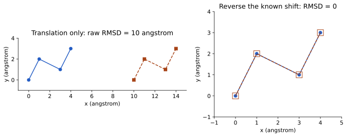
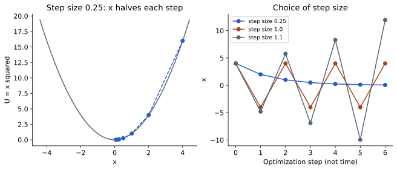
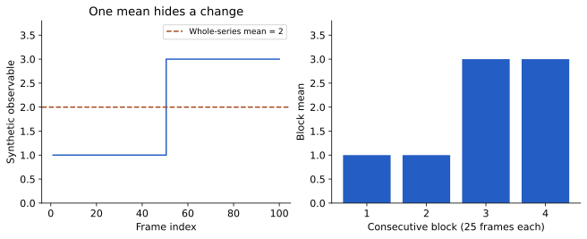
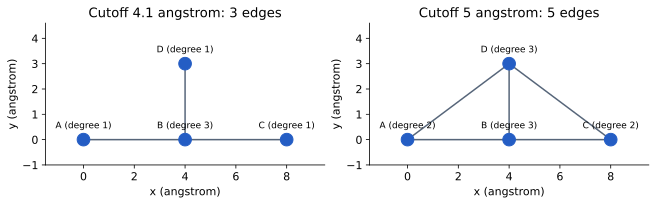

# درسنامهٔ بیوانفورماتیک ساختاری

آموزش عمومیِ مفاهیم و روش‌ها مطابق نه بخش [سرفصل درس ۴۰۵۵۳ شریف](https://docs.ce.sharif.edu/courses/40553). تقسیم داخلی به مباحث برای مطالعهٔ مرحله‌ای است و تقویم جلسات دانشگاه نیست.

## فصل 1. آشنایی با بیوانفورماتیک ساختاری

### آشنایی با بیوانفورماتیک ساختاری

#### از یک پرسش ساده شروع کنیم

چرا دو پروتئین با اندازهٔ نزدیک می‌توانند کارهای کاملاً متفاوتی انجام دهند؟ برای جواب، کافی نیست بگوییم «چون شکلشان فرق دارد». باید بدانیم پروتئین از چه ساخته شده، شکل را چگونه می‌شناسیم و چه آزمایشی کار مولکول را نشان می‌دهد. هدف این مبحث آن است که بتوانید یک پرسش زیستی را به داده و روش مناسب تبدیل کنید. در پایان باید فرق توالی، مدل سه‌بعدی و اندازه‌گیری عملکرد را با مثال توضیح دهید و نخستین پروندهٔ دادهٔ خود را بسازید.

برای کار با این درس، خواندن متن را با انجام فعالیت‌ها همراه کنید. برنامهٔ پیشنهادی: ۳۵ دقیقه توضیح و بازگویی مفاهیم، ۲۰ دقیقه مثال و محاسبه، ۴۰ دقیقه بررسی فایل، ۲۵ دقیقه حل تمرین و ۱۵ دقیقه اصلاح پاسخ‌ها. این زمان‌ها برنامهٔ کارند؛ صرف بازبودن صفحه، به معنی یادگیری نیست. اگر اصطلاحی را نمی‌شناسید، ابتدا معنای آن را در همین متن پیدا کنید و یک جملهٔ خودتان درباره‌اش بنویسید.

#### از سلول تا اتم

سلول کوچک‌ترین واحد سازمان‌یافته‌ای است که مجموعهٔ فرایندهای لازم برای زندگی را انجام می‌دهد. غشای سلول مرزی انتخاب‌گر است: بعضی مواد از آن عبور می‌کنند و عبور بعضی به پروتئین‌های غشایی نیاز دارد. درون سلول، آب و یون‌ها محیط واکنش‌ها را می‌سازند. یون اتم یا گروهی از اتم‌هاست که بار الکتریکی خالص دارد. بنابراین مولکول زیستی را باید در محیطش فهمید؛ یک تصویر جداشده از مولکول همهٔ شرایط کار آن را نشان نمی‌دهد.

اتم واحد سازندهٔ عناصر شیمیایی است. وقتی اتم‌ها با پیوندهای شیمیایی کنار هم قرار می‌گیرند، مولکول می‌سازند. کربن، نیتروژن، اکسیژن و هیدروژن در بسیاری از مولکول‌های زیستی حضور دارند. همان عناصر می‌توانند با ترتیب اتصال متفاوت، مولکول‌های متفاوت بسازند. پس دانستن «چند اتم داریم» با دانستن «اتم‌ها چگونه وصل‌اند» فرق می‌کند. بعداً می‌بینیم حتی یکسان‌بودن اتصال‌ها نیز همیشه به معنی یکسان‌بودن شکل فضایی نیست.

پروتئین‌ها زنجیره‌هایی از اسیدهای آمینه‌اند. DNA و RNA زنجیره‌هایی از نوکلئوتیدها هستند. در اینجا «زنجیره» یعنی واحدها به ترتیب به هم متصل‌اند؛ قرار نیست زنجیره همیشه مانند نخ صاف باشد. پروتئین می‌تواند پیچ بخورد، بخش‌هایی از آن کنار هم قرار بگیرند و چند زنجیره با هم یک مجموعه بسازند. نوکلئیک‌اسیدها هم فقط رشته‌ای از حروف نیستند؛ می‌توانند مارپیچ، ساقه، حلقه و آرایش‌های پیچیده‌تر داشته باشند. فصل دوم این ساختمان‌ها را با جزئیات باز می‌کند.

ژن بخشی از DNA است که اطلاعات لازم برای تولید یک RNA را در زمینهٔ تنظیمی مناسب در خود دارد؛ بسیاری از این RNAها الگوی ساخت پروتئین می‌شوند و بعضی خودشان نقش دارند. برای فهم این درس، فعلاً سه چیز را جدا نگه دارید: اطلاعات ذخیره‌شده، مولکول ساخته‌شده و کاری که آن مولکول انجام می‌دهد. از دیدن یک نام ژن نمی‌توان محل همهٔ اتم‌های پروتئینش را در همهٔ شرایط دانست.

#### توالی، ساختار و عملکرد چه می‌گویند؟

توالی پروتئین، ترتیب اسیدهای آمینه از یک انتهای زنجیره به انتهای دیگر است. برای کوتاه‌نوشتن، هر اسیدآمینه یک حرف دارد. حروف توالی، مختصات نیستند. مثلاً `AGST` چهار نوع واحد را به ترتیب مشخص می‌کند، اما نمی‌گوید فاصلهٔ واحد اول تا چهارم چند آنگستروم است. این توالی چهارحرفی صرفاً مثال آموزشی است، نه یک پروتئین ثبت‌شده.

ساختار سه‌بعدی معمولاً با مختصات اتم‌ها بیان می‌شود. هر اتم سه عدد x، y و z دارد. این اعداد نسبت به یک دستگاه مختصات‌اند؛ اگر کل مولکول را جابه‌جا کنیم، اعداد عوض می‌شوند ولی فاصلهٔ اتم‌ها از هم ثابت می‌ماند. آنگستروم، با نماد Å، برابر یک ده‌میلیاردم متر است؛ ۱۰ آنگستروم یک نانومتر است. واحد باید کنار هر اندازه‌گیری نوشته شود، زیرا برنامه‌های مختلف ممکن است قرارداد متفاوتی داشته باشند.

عملکرد یعنی یک خروجی مشخص در شرایط مشخص: شکستن یک پیوند، حمل یک ماده، اتصال به یک شریک یا کمک به سازمان‌دهی یک مجموعه. «فعال است» جملهٔ کافی نیست؛ باید بگوییم فعالیت را با چه آزمایشی و در چه محیطی سنجیده‌ایم. محل یک حفره در ساختار می‌تواند فرضیه‌ای دربارهٔ اتصال بسازد، اما برای نشان‌دادن اتصال به دادهٔ مناسب نیاز داریم. برعکس، مشاهدهٔ اتصال نیز به‌تنهایی شکل دقیق رابط را مشخص نمی‌کند.

بیوانفورماتیک ساختاری این اطلاعات را کنار هم می‌گذارد. گاهی از توالی به دنبال ساختار می‌گردیم، گاهی دو مدل را مقایسه می‌کنیم و گاهی بررسی می‌کنیم تغییر یک اسیدآمینه چه فرضیه‌ای دربارهٔ عملکرد ایجاد می‌کند. کیفیت پاسخ به سه انتخاب وابسته است: پرسش دقیق، دادهٔ مناسب و روشی که محدودیتش را می‌شناسیم.

#### مدل، مشاهده و تفسیر

بلورنگاری پرتو X، میکروسکوپی الکترونی و طیف‌سنجی NMR داده‌های متفاوتی تولید می‌کنند. پژوهشگر با تحلیل آن‌ها مدل ساختاری می‌سازد. بنابراین مختصات تجربی هم حاصل مدل‌سازی روی داده‌اند و در همهٔ نقاط دقت یکسان ندارند. بعضی بخش‌ها ممکن است در مدل غایب باشند. غیبت مختصات یک قطعه به معنی نبودن آن قطعه در مولکول واقعی نیست؛ ممکن است داده برای تعیین موقعیتش کافی نبوده باشد.

مدل محاسباتی از روش پیش‌بینی حاصل می‌شود و باید با معیار مناسب ارزیابی شود. نمایش نرم و رنگی یک مدل، اعتبار علمی آن را تعیین نمی‌کند. در گزارش، سه جمله را جدا تمرین کنید: «در فایل این مختصات وجود دارد»، «با این روش این عدد را محاسبه کردم» و «این نتیجه چنین فرضیه‌ای را پیشنهاد می‌کند». این تفکیک به شما اجازه می‌دهد حتی وقتی پاسخ نهایی معلوم نیست، گزارش دقیقی بنویسید.

#### مثال آموزشی

دو اتم فرضی را در نقاط `(0,0,0)` و `(3,4,0)` آنگستروم قرار دهید. فاصله با رابطهٔ فیثاغورس برابر ریشهٔ `3²+4²`، یعنی ۵ آنگستروم است. حالا به هر دو نقطه بردار `(10,0,0)` اضافه کنید. مختصات جدید `(10,0,0)` و `(13,4,0)` هستند، اما فاصله هنوز ۵ است. این مثال نشان می‌دهد اعداد مطلق مختصات و شکل داخلی یک چیز نیستند.

حالا فرض کنید کسی از همین فاصله نتیجه بگیرد «این دو اتم پیوند هیدروژنی دارند». اطلاعات کافی نیست: نوع اتم‌ها، وضعیت شیمیایی و جهت‌گیری را ندیده‌ایم. محاسبهٔ فاصله درست بود، ولی تفسیر زیستی می‌تواند نادرست باشد. در همهٔ درس‌ها همین دو مرحله را جدا بررسی می‌کنیم: آیا محاسبه درست انجام شده و آیا این محاسبه واقعاً پاسخ سؤال است؟

#### کار عملی: نخستین شناسنامهٔ یک ساختار

برای تمرین عمومی از یوبیکوئیتین استفاده می‌کنیم. [رکورد 1UBQ در RCSB](https://www.rcsb.org/structure/1UBQ) را باز کنید. عنوان، روش تعیین ساختار، تفکیک‌پذیری و نام مولکول را در یک جدول بنویسید. تفکیک‌پذیری ۱٫۸ آنگستروم در این رکورد مشخصهٔ دادهٔ بلورنگاری است؛ آن را با طول پیوند یا خطای یکسان همهٔ اتم‌ها اشتباه نگیرید.

نسخهٔ انتخاب‌شدهٔ پروتئین در [فایل آموزشی](../assets/course/gromacs/1ubq-protein.pdb) و شرح انتخاب در [رکورد منشأ](../data/metadata/md-teaching-input.json) موجود است. فایل را با یک ویرایشگر متن باز کنید. یک خط ATOM را پیدا کنید. فعلاً فقط نام اتم، نام باقی‌مانده، نام زنجیره و سه عدد مختصات را تشخیص دهید. در مباحث بعدی تمام ستون‌ها را می‌خوانیم. این فایل آموزشی آب‌ها را نگه نداشته است؛ بنابراین آن را با فایل کامل دانلودشده یکسان معرفی نکنید.

چهار خروجی تهیه کنید: یک جدول شناسنامه، تصویر صفحهٔ مرجع با شناسهٔ خوانا، یک خط اتم با توضیح اجزای آن، و سه سؤال که از این فایل می‌توان یا نمی‌توان جواب داد. برای هر سؤال دلیل انتخاب داده را بنویسید. اگر اینترنت در دسترس نبود، از فایل محلی و منشأ ذخیره‌شده استفاده کنید و تاریخ مراجعهٔ زنده را جعل نکنید.

#### خودآزمایی

۱. برای پرسش «ترتیب اسیدهای آمینه چیست؟» کدام داده را می‌خواهید؟ برای پرسش «دو جایگاه چقدر فاصله دارند؟» چطور؟

۲. دانشجویی تصویری را چرخانده و گفته است «دینامیک پروتئین را دیدم». مشکل جمله چیست؟ آن را اصلاح کنید.

۳. اگر مختصات یک قطعه در فایل نباشد، چه توضیح‌هایی ممکن است؟ چه اطلاعاتی باید بررسی شوند؟

۴. با مختصات `(1,2,3)` و `(1,2,8)` فاصله را محاسبه کنید؛ سپس واحد را از آنگستروم به نانومتر تبدیل کنید.

##### توضیح پاسخ

۱. توالی برای ترتیب مناسب است؛ برای فاصله به مختصات متناظر و تعریف اتم یا نمایندهٔ جایگاه نیاز داریم. انتخاب مرکز جرم، اتم Cα یا نزدیک‌ترین اتم دو پاسخ متفاوت می‌سازد.

۲. چرخاندن دوربین فقط جهت نگاه را عوض کرده است. جملهٔ دقیق: «مدل ایستای مولکول را از چند جهت مشاهده کردم». برای حرکت مولکولی به مدل زمانی یا دادهٔ متناسب نیاز داریم.

۳. بی‌نظمی یا محدودیت داده، تفاوت سازهٔ آزمایشگاهی با توالی مرجع و پردازش فایل از احتمال‌ها هستند. باید توالی سازه، بخش‌های مدل‌شده و توضیحات رکورد را مقایسه کرد.

۴. اختلاف فقط در z برابر ۵ است؛ فاصله ۵ آنگستروم، یعنی ۰٫۵ نانومتر می‌شود. مقدار عددی بدون واحد پاسخ کامل نیست.

#### برای توضیح شفاهی آماده شوید

در سه دقیقه به یک هم‌کلاسی بگویید چرا یک فایل سه‌بعدی را نمی‌توان پاسخ همهٔ سؤال‌های زیستی دانست. از مثال مختصات شروع کنید، سپس تفاوت توالی و عملکرد را توضیح دهید و در پایان شناسنامهٔ 1UBQ را نشان دهید. اگر مخاطب نتوانست بگوید فایل چه چیزی را اندازه می‌گیرد، توضیح را با نام ابزارهای بیشتر طولانی نکنید؛ دوباره به پرسش و نوع داده برگردید.

#### منابع و مطالعهٔ تکمیلی

- [RCSB PDB-101؛ آغاز کار با دادهٔ ساختاری](https://pdb101.rcsb.org/learn/guide-to-understanding-pdb-data/introduction): راهنمای انتخاب رکورد و شناخت داده.
- [RCSB 1UBQ](https://www.rcsb.org/structure/1UBQ): مرجع شناسنامهٔ تمرین.
- [NCBI Bookshelf؛ شکل و ساختمان پروتئین](https://www.ncbi.nlm.nih.gov/books/NBK26830/): مطالعهٔ تکمیلی دربارهٔ رابطهٔ زنجیره و ساختار؛ متن درس حاضر بازنویسی آموزشیِ مستقل است.

## فصل 2. ساختار مولکول‌های زیستی

### مونومر، پلیمر و شیمی اسیدآمینه

مونومر واحد کوچک سازنده و پلیمر زنجیره‌ای از واحدهای متصل است. اسیدآمینه واحد سازندهٔ پروتئین و نوکلئوتید واحد سازندهٔ اسید نوکلئیک است. در یک اسیدآمینهٔ معمولی، کربن مرکزی به گروه آمینی، گروه کربوکسیلی، هیدروژن و گروه جانبی متصل است. گروه جانبی علت بسیاری از تفاوت‌های شیمیایی اسیدهای آمینه است.

برخی گروه‌های جانبی بیشتر با محیط غیرقطبی سازگارند؛ برخی قطبی‌اند و برخی با توجه به pH می‌توانند بار داشته باشند. pH توصیفی از وضعیت اسیدی یا بازی محلول است و بر حالت پروتون‌گیری اثر می‌گذارد. «قطبی» با «دارای بار خالص» یکسان نیست. یک گروه بدون بار خالص هم ممکن است توزیع نامتقارن بار داشته باشد و با آب برهم‌کنش کند.

ویژگی اسیدآمینه را همراه محیطش می‌خوانیم: یک گروه باردار روی سطحِ در تماس با آب با همان گروه در هستهٔ پروتئین شرایط یکسانی ندارد. اندازه، آب‌پوشی و امکان پیوند هیدروژنی نیز مهم‌اند؛ صرف نام یک اسیدآمینه اثر هر جایگزینی را تعیین نمی‌کند.

#### پیوند و گروه شیمیایی را روی کاغذ بسازیم

مونومر واحدی است که می‌تواند جزئی از یک زنجیرهٔ بزرگ‌تر باشد و پلیمر زنجیره‌ای از این واحدهاست. مهره‌های زنجیره یکسان نیستند: در پروتئین، ستون مشترک اسیدهای آمینه تکرار می‌شود اما گروه جانبی تغییر می‌کند. گروه جانبی، که با R نشان می‌دهیم، بخشی از مولکول است که نوع اسیدآمینه و بسیاری از رفتارهای آن را تعیین می‌کند. ابتدا ساختار عمومی یک اسیدآمینهٔ آلفا را بکشید: کربن مرکزی به گروه آمینی، گروه کربوکسیلی، هیدروژن و R متصل است. گلایسین، با R برابر هیدروژن، در این مرکز کایرال نیست؛ برای بسیاری از اسیدهای آمینه، ترتیب فضایی چهار گروه متفاوت اهمیت دارد.

پیوند کووالانسی اتصال حاصل از اشتراک الکترون‌هاست. در مقابل، مولکول‌ها می‌توانند بدون تشکیل چنین پیوندی بر هم نیرو وارد کنند. برای مثال، بارهای مخالف همدیگر را جذب می‌کنند؛ اما مقدار این اثر به فاصله و محیط بستگی دارد. در آب، یون‌ها و جهت‌گیری مولکول‌های حلال بر برهم‌کنش اثر می‌گذارند. به همین دلیل، عبارت «بارهای مخالف جذب می‌شوند» آغاز توضیح است، نه روشی برای محاسبهٔ میل اتصال یک پروتئین کامل.

آب مولکولی قطبی است: توزیع بار در آن یکنواخت نیست. گروهی که می‌تواند با آب برهم‌کنش مناسبی داشته باشد اغلب آب‌دوست نامیده می‌شود. گروه غیرقطبی از نظر برهم‌کنش با آب رفتار دیگری دارد. اثر آب‌گریزی را نباید به صورت «دو کربن همیشه همدیگر را می‌کشند» تصور کرد؛ سازمان‌دهی آب و تغییر انرژی آزاد کل سامانه در کنارهم‌آمدن سطوح غیرقطبی اهمیت دارد. این نکته در تاخوردن پروتئین دوباره استفاده می‌شود.

#### یک دسته‌بندی مفید، با مرزهای روشن

برای شروع، گلایسین و آلانین را کوچک، والین و لوسین را عمدتاً غیرقطبی، سرین و ترئونین را قطبی، آسپارتات و گلوتامات را معمولاً منفی و لیزین و آرژینین را معمولاً مثبت در نزدیکی pH خنثی در نظر می‌گیریم. «معمولاً» مهم است: حالت بار به pH و محیط محلی وابسته است. هیستیدین نمونهٔ خوبی است که نشان می‌دهد یک برچسب ثابت، رفتار همهٔ جایگاه‌ها را توضیح نمی‌دهد. سیستئین هم گروه گوگرددار دارد و در شرایط مناسب می‌تواند با سیستئین دیگر پیوند دی‌سولفیدی بسازد.

pH توصیفی لگاریتمی از فعالیت یون هیدروژن در محلول است. برای یک گروه اسیدی، pKa به تعادل گرفتن و دادن پروتون مربوط است. در مدل ساده، وقتی pH برابر pKa باشد دو حالت پروتون‌دار و بدون پروتون مقدار برابر دارند. وقتی pH یک واحد بالاتر باشد، نسبت حالت بدون پروتون به پروتون‌دار حدود ده می‌شود. این رابطه به ما کمک می‌کند بفهمیم چرا تغییر محیط می‌تواند بار یک جایگاه و در نتیجه شبکهٔ برهم‌کنش‌هایش را عوض کند.

#### مثال آموزشی

گروه فرضیِ اسیدی با pKa برابر ۴ را در pH برابر ۵ بررسی کنید. از رابطهٔ `نسبت بدون پروتون به پروتون‌دار = 10^(pH−pKa)` مقدار ۱۰ به دست می‌آید. بنابراین سهم بدون پروتون `10/11`، تقریباً ۹۱ درصد، است. این محاسبه برای یک گروه مستقل در مدل ساده است؛ اسیدآمینه‌های پروتئین ممکن است pKa جابه‌جاشده داشته باشند. عدد فرضی را نباید به همهٔ آسپارتات‌های یک ساختار نسبت داد.

حال دو جایگزینی را مقایسه کنید: لوسین به ایزولوسین و لوسین به آسپارتات. در اولی اندازه و شاخه‌بندی تغییر می‌کند ولی ماهیت کلی غیرقطبی نزدیک می‌ماند. در دومی، امکان بار منفی و برهم‌کنش با آب اضافه می‌شود. هیچ‌کدام به‌تنهایی نتیجهٔ نهایی روی پایداری را قطعی نمی‌کند؛ باید محل جایگاه و محیط آن را هم ببینیم.

#### کار عملی: از حرف به شیمی

یک جدول برای دوازده اسیدآمینه بسازید: نام، کد یک‌حرفی، کد سه‌حرفی، ویژگی R، حالت بار معمول نزدیک pH خنثی و یک استثنا یا احتیاط. سپس توالی فرضی `AKELGSDV` را روی کاغذ به هشت خانه تبدیل کنید. جایگاه‌های بالقوهٔ مثبت، منفی و کوچک را مشخص کنید. بار انتهای زنجیره را جدا از Rها بنویسید؛ یک اسیدآمینه در میانهٔ پلی‌پپتید، همان گروه آمینی و کربوکسیلی آزادِ مولکول تنها را ندارد.

دو نسخهٔ تغییرکرده، `AKALGSDV` و `AKELGSPV`، بسازید. در هر نسخه فقط یک تفاوت شیمیایی را با جمله توضیح دهید. برای پرولین، اتصال R به نیتروژن ستون فقرات را بررسی کنید و بگویید چرا آزادی حرکتی آن با گلایسین برابر نیست. هدف، پیش‌گویی قطعی ساختار نیست؛ هدف این است که از حفظ‌کردن حرف‌ها به تشخیص تغییر شیمیایی برسید. خروجی کار، جدول و سه طرح دستی همراه با توضیح است.

#### خودآزمایی

۱. آیا قطبی‌بودن الزاماً به معنی داشتن بار خالص است؟ یک مثال بزنید. ۲. اگر pH از pKa دو واحد بالاتر باشد، در مدل ساده نسبت دو حالت چقدر است؟ ۳. چرا نمی‌توان بار پروتئین را فقط از شمار لیزین‌ها حساب کرد؟ ۴. آیا افزودن یک گروه آب‌گریز همیشه اتصال را بهتر می‌کند؟

##### توضیح پاسخ

۱. خیر؛ سرین می‌تواند قطبی باشد ولی R آن در شرایط معمول بار خالص نداشته باشد. قطبیت به توزیع بار مربوط است. ۲. نسبت حالت بدون پروتون به پروتون‌دار حدود ۱۰۰ است. ۳. گروه‌های منفی، انتهاها، سایر گروه‌های یونش‌پذیر و pH باید حساب شوند؛ محیط می‌تواند رفتارشان را جابه‌جا کند. ۴. خیر؛ جای گروه، هزینهٔ آب‌زدایی، برخورد فضایی و سازگاری شریک مهم‌اند. در پاسخ شفاهی، یک تغییر مفیدِ احتمالی و یک پیامد نامطلوب احتمالی را کنار هم توضیح دهید.

#### منابع برای ادامهٔ مطالعه

- [پایهٔ شیمی و ساختمان پروتئین](https://www.ncbi.nlm.nih.gov/books/NBK26830/)

### پیوند پپتیدی و سطوح ساختار پروتئین

پیوند پپتیدی، گروه کربوکسیلی یک اسیدآمینه را به گروه آمینی اسیدآمینهٔ بعدی وصل می‌کند. زنجیره دارای جهت از انتهای آمینی یا N به انتهای کربوکسیلی یا C است. ستون فقرات، بخش تکرارشوندهٔ زنجیره است و گروه‌های جانبی از آن بیرون می‌آیند. پیوند پپتیدی محدودیت چرخشی دارد؛ انعطاف زنجیره بیشتر از چرخش حول پیوندهای مجاور حاصل می‌شود.

ساختار اول، ترتیب اسیدهای آمینه است. ساختار دوم، آرایش‌های محلی مانند مارپیچ آلفا و رشتهٔ بتاست. ساختار سوم، شکل سه‌بعدی یک زنجیرهٔ تاخورده است. ساختار چهارم، آرایش چند زیرواحد کنار یکدیگر است. پروتئین تک‌زنجیره‌ای الزاماً ساختار چهارم ندارد. دو زاویهٔ مهمِ ستون فقرات با نام‌های φ و ψ توصیف می‌شوند. نقشهٔ رامچاندران ترکیب این زاویه‌ها را نشان می‌دهد و برای بررسی سازگاری هندسی مفید است؛ نواحی مجاز برای همهٔ اسیدهای آمینه دقیقاً یکسان نیستند.

«زنجیره» در فایل ساختاری و «زیرواحد عملکردی» را با هم بررسی می‌کنیم. یک مجموعه ممکن است چند زنجیرهٔ یکسان یا متفاوت داشته باشد. تعدد زنجیره‌های فایل به‌تنهایی نمی‌گوید هر زنجیره چه نقشی دارد یا مجموعهٔ زیستی کامل است.

#### از اسیدآمینهٔ آزاد تا باقی‌مانده در زنجیره

وقتی دو اسیدآمینه به وسیلهٔ پیوند پپتیدی متصل می‌شوند، کربن گروه کربونیل یکی به نیتروژن دیگری وصل است. به واحدی که در زنجیره قرار گرفته «باقی‌مانده» می‌گوییم. این واژه به معنی زباله یا بخش بی‌اهمیت نیست؛ یادآور آن است که واحدِ متصل در پلیمر با مولکول آزاد یکسان نیست. در نمایش شیمیاییِ سادهٔ تشکیل پیوند، خروج آب نوشته می‌شود؛ ساخت واقعی پروتئین در سلول به ماشین ترجمه و انرژی نیاز دارد.

زنجیره جهت دارد. یک انتها N و انتهای دیگر C نامیده می‌شود و توالی معمولاً از N به C نوشته می‌شود. ستون فقرات تکرار اتم‌های N، Cα و کربن کربونیل است. Rها به Cα وصل‌اند. وقتی نرم‌افزار انتخاب `backbone` یا `name CA` می‌دهد، این انتخاب‌ها تعداد و نوع اتم‌های یکسانی ندارند. نمای Cα برای دیدن مسیر کلی زنجیره مفید است اما جهت گروه‌های جانبی را کامل نشان نمی‌دهد.

#### چرا زنجیره هر شکلی نمی‌گیرد؟

پیوند پپتیدی به علت پخش‌شدن الکترون‌ها ویژگی جزئیِ پیوند دوگانه دارد و معمولاً تقریباً صفحه‌ای است. بنابراین آزادی حرکتی اصلی ستون فقرات به چرخش‌های اطراف N–Cα و Cα–C مربوط می‌شود. این دو زاویه را φ و ψ می‌نامیم. زاویهٔ پیچشی میان دو صفحه تعریف می‌شود؛ با زاویهٔ معمولی بین سه اتم فرق دارد. چهار اتم لازم‌اند تا یک زاویهٔ پیچشی تعریف شود.

اگر اتم‌ها را در هر زاویهٔ دلخواه قرار دهیم، بعضی به هم بیش از حد نزدیک می‌شوند. نمودار راماکاندران ترکیب‌های φ و ψ را نشان می‌دهد و نواحی سازگار با هندسهٔ ستون فقرات را مشخص می‌کند. جایگاه خارج از ناحیهٔ معمول می‌تواند هشدار باشد، ولی تفسیر آن به نوع باقی‌مانده و کیفیت داده نیاز دارد. گلایسین، پرولین و باقی‌ماندهٔ پیش از پرولین توزیع‌های متفاوتی دارند. یک نقطهٔ نامعمول به‌تنهایی حکم خرابی تمام مدل نیست.

#### چهار سطح را با یک مولکول توضیح دهیم

ساختار اول ترتیب واحدها و در توصیف کامل‌تر، اتصال‌های کووالانسی مرتبط است. ساختار دوم آرایش محلی منظم ستون فقرات، مثل مارپیچ آلفا و ورقهٔ بتاست. ساختار سوم سازمان سه‌بعدی یک زنجیره یا واحد ساختاری تاخورده را توصیف می‌کند. ساختار چهارم آرایش چند زیرواحد در یک مجموعه است. این چهار مورد چهار مولکول جدا نیستند؛ چهار سطح نگاه به ساختمان‌اند.

یک پروتئین تک‌زنجیره‌ای می‌تواند ساختار سوم پیچیده داشته باشد ولی ساختار چهارم چندزیرواحدی نداشته باشد. برعکس، یک مجموعه ممکن است از چند زنجیره با توالی یکسان ساخته شود. «دو زنجیره در فایل» هنوز به معنی دایمر زیستی نیست؛ فایل بلور می‌تواند همسایه‌های بسته‌بندی را هم نشان دهد. در مبحث مجموعهٔ زیستی یاد می‌گیریم چگونه این ادعا را بررسی کنیم.

#### مثال آموزشی

دو مدل فرضی با توالی یکسان دارید. در مدل اول یک حلقه باز و در مدل دوم بسته است. ساختار اول عوض نشده، اما آرایش سه‌بعدی تغییر کرده است. اگر دو نسخهٔ زنجیره کنار هم بنشینند، سازمان چندزیرواحدی اضافه می‌شود. حال اگر یک اسیدآمینه جایگزین شود، ساختار اول هم تغییر می‌کند؛ اثر آن بر سطوح دیگر باید بررسی شود و از روی نام جهش معلوم نیست.

برای زنجیره‌ای با ۸ باقی‌مانده، ۷ اتصال پپتیدی میان واحدهای متوالی وجود دارد. این شمارش از «تعداد اتم‌ها» یا «تعداد پیوندهای کووالانسی کل» متفاوت است. اگر دو زنجیرهٔ چهارواحدی جدا داشته باشیم، در هر یک ۳ اتصال و در مجموع ۶ اتصال پپتیدیِ بین واحدهای متوالی داریم. صرف جمع‌کردن طول دو زنجیره، یک زنجیرهٔ هشت‌واحدی نمی‌سازد.

#### کار عملی: خواندن ستون فقرات

[فایل یوبیکوئیتین](../assets/course/gromacs/1ubq-protein.pdb) را در ویرایشگر باز کنید. برای سه باقی‌ماندهٔ متوالی، نام‌های N، CA، C و O را پیدا کنید. یک جدول بسازید که هر ردیف آن یک باقی‌مانده و ستون‌هایش این چهار اتم باشد. در کنار جدول، پیوند پپتیدی بین C یک واحد و N واحد بعد را رسم کنید. روشن کنید O به کدام کربن تعلق دارد.

سپس همان زنجیره را با یک نمایشگر ساختاری باز کنید و نماهای خطی، توپ‌ومیله و روبانی را مقایسه کنید. در هر تصویر بنویسید چه اطلاعاتی آشکار و چه چیزی پنهان شده است. اگر ابزار هنوز نصب نیست، طرح دستی را کامل کنید و مشاهدهٔ نرم‌افزاری را در مبحث VMD انجام دهید. تصویر خروجی باید نام فایل و انتخاب اتم‌ها را داشته باشد؛ رنگ به‌تنهایی نام زنجیره را تعیین نمی‌کند.

برای بخش تحلیلی، دو ادعا بنویسید: یکی دربارهٔ سطح دوم و دیگری دربارهٔ سطح چهارم. سپس مشخص کنید برای دفاع از هر ادعا چه شاهدی لازم دارید. این فعالیت را با یک هم‌کلاسی مبادله کنید؛ طرف مقابل باید از روی جملهٔ شما بفهمد واحد تحلیل یک زنجیره است یا یک مجموعه.

#### خودآزمایی

۱. چرا تعداد Cαها در یک پروتئین معمولی اغلب تعداد باقی‌مانده‌های مدل‌شده را نشان می‌دهد؟ ۲. چرا چرخش φ و ψ نامحدود نیست؟ ۳. آیا مارپیچ‌بودن یک بخش به معنی مارپیچی‌بودن کل پروتئین است؟ ۴. فرق دو زنجیرهٔ یکسان با دو دمین در یک زنجیره چیست؟

##### توضیح پاسخ

۱. هر باقی‌ماندهٔ استاندارد یک Cα دارد؛ اما نبود مختصات، جایگاه جایگزین و انتخاب نادرست می‌تواند شمارش را عوض کند. ۲. هندسهٔ پیوندها و برخورد اتم‌ها بسیاری از ترکیب‌ها را نامطلوب می‌کند. ۳. خیر؛ یک پروتئین می‌تواند چند نوع ساختار دوم و حلقه داشته باشد. ۴. زنجیره با اتصال کووالانسی پیوسته تعریف می‌شود؛ دمین واحد سازمانی ساختار است و ممکن است چند دمین در یک زنجیره باشند. در پاسخ خود یک شکل بکشید و مرز زنجیره را با مرز دمین متفاوت علامت بزنید.

#### منابع برای ادامهٔ مطالعه

- [پایهٔ شیمی و ساختمان پروتئین](https://www.ncbi.nlm.nih.gov/books/NBK26830/)
- [راهنمای آموزشی داده‌های ساختاری، RCSB PDB-101](https://pdb101.rcsb.org/learn/guide-to-understanding-pdb-data/introduction)

### ساختار دوم، دمین و طبقه‌بندی تاخوردگی

ساختار دوم به الگوهای محلیِ ستون فقرات گفته می‌شود. در مارپیچ آلفا و ورقهٔ بتا، الگوهای پیوند هیدروژنیِ ستون فقرات مهم‌اند. رشته‌های بتا می‌توانند هم‌جهت یا خلاف‌جهت کنار هم قرار بگیرند. بخش‌های حلقه‌ای و پیچ‌ها نیز اجزای واقعی ساختمان پروتئین‌اند؛ نبود مارپیچ و ورقه به معنی بی‌اهمیت‌بودن یک ناحیه نیست.

دمین یا دامنه، بخش ساختاریِ نسبتاً متمایزی از پروتئین است که گاهی واحدی برای عملکرد یا تکامل هم هست. موتیف معمولاً الگوی کوچک‌تری از ترکیب عناصر ساختاری است. «تاخوردگی» یا fold به آرایش کلی عناصر ساختار دوم و اتصال آن‌ها اشاره می‌کند. دو زنجیره با اندازهٔ شبیه ممکن است تاخوردگی متفاوت داشته باشند.

طبقه‌بندی ساختارها برای مقایسهٔ منظم مفید است: مثلاً ساختمان عمدتاً آلفا، عمدتاً بتا یا ترکیبی. شباهت شکل به‌تنهایی کارکرد یکسان را اثبات نمی‌کند. توالی، جایگاه فعال (بخش کمک‌کننده به انجام واکنش در آنزیم)، لیگاند و زمینهٔ زیستی باید جدا بررسی شوند.

در طبقه‌بندی CATH، محتوای ساختار دوم در سطح Class، آرایش کلی در Architecture، آرایش همراه با نحوهٔ اتصال عناصر در Topology و شواهد خویشاوندی تکاملی در Homologous superfamily بررسی می‌شوند. این سطح‌ها را با هم یکی نگیرید؛ شباهت ترکیب آلفا و بتا به‌تنهایی خویشاوندی را تعیین نمی‌کند.

#### از حرکت محلی تا الگوی منظم

در مارپیچ آلفا، ستون فقرات دور محوری فرضی می‌پیچد. در الگوی متعارف، اکسیژن کربونیل باقی‌ماندهٔ i با گروه N–H باقی‌ماندهٔ i+4 در شبکهٔ پیوند هیدروژنی مشارکت می‌کند. این توضیح دربارهٔ ستون فقرات است؛ Rها رو به بیرون قرار می‌گیرند و شیمی آن‌ها می‌تواند پایداری و برهم‌کنش مارپیچ را تغییر دهد. حدود ۳٫۶ باقی‌مانده در هر دورِ مارپیچ آلفای متعارف داریم؛ این عدد برای تشخیص هندسه مفید است، نه وعدهٔ نظم کامل در همهٔ قطعات واقعی.

در ورقهٔ بتا، قطعات نسبتاً کشیدهٔ زنجیره کنار هم قرار می‌گیرند. هر قطعه رشتهٔ بتا است. رشته‌ها ممکن است در توالی کنار هم نباشند ولی در فضا نزدیک شوند. اگر جهت N به C دو رشته همسو باشد، آرایش موازی است و اگر مخالف باشد، پادموازی. همین مثال نشان می‌دهد نزدیکی توالی و نزدیکی فضایی را باید جدا دانست. پیکان‌های کارتون معمولاً جهت رشته را نشان می‌دهند، نه جهت حرکت مولکول.

حلقه و پیچ هم بخشی از ساختمان‌اند. «حلقه» به معنی بی‌اهمیتی یا بی‌نظمی ذاتی نیست؛ برخی حلقه‌ها هندسهٔ مشخص و نقش مهم در اتصال یا فعالیت دارند. از طرف دیگر، یک قطعهٔ فاقد مارپیچ و ورقه ممکن است واقعاً متحرک یا نامنظم باشد. برای تفاوت این وضعیت‌ها باید دادهٔ ساختاری و تجربی بیشتری دید.

#### از motif تا domain و fold

motif یا نقش‌مایه، الگوی تکرارشونده‌ای از چند عنصر ساختاری یا توالی است. یک نقش‌مایه الزاماً یک واحد مستقل تاخوردن نیست. domain یا دمین، بخش ساختاری نسبتاً فشرده‌ای است که می‌تواند در سازمان و عملکرد پروتئین نقش یک واحد داشته باشد؛ مرز آن همیشه با یک بازهٔ ساده و پیوسته از توالی منطبق نیست. fold یا تاخوردگی، آرایش کلی عناصر ساختار دوم و اتصال آن‌ها را توصیف می‌کند.

دو پروتئین ممکن است تاخوردگی شبیه داشته باشند اما واکنش متفاوتی انجام دهند. محل دقیق گروه‌های فعال، شریک‌ها، انعطاف و تنظیم زیستی نیز مهم‌اند. بنابراین طبقه‌بندی ساختاری راهی برای سازمان‌دهی شباهت‌هاست، نه جایگزین آزمایش عملکرد. در CATH از سطح‌های کلاس، معماری، توپولوژی و ابرخانوادهٔ همولوگ استفاده می‌شود. کلاس به ترکیب کلی عناصر دوم و توپولوژی به آرایش و اتصال آن‌ها توجه دارد؛ نسبت‌دادن همولوژی به شواهد تکاملی و طبقه‌بندی مناسب نیاز دارد.

#### مثال آموزشی

سه رشتهٔ بتا را با پیکان روی کاغذ بکشید: اول رو به بالا، دوم پایین و سوم بالا. سپس دو روش اتصال توالی بین آن‌ها رسم کنید. ظاهر فضایی مشابه می‌تواند مسیر اتصال متفاوتی داشته باشد. حال یک مارپیچ کنار ورقه بگذارید. با این اطلاعات می‌توانید ترکیب آلفا/بتای طرح را توصیف کنید، ولی هنوز نمی‌توانید نام آنزیم یا سوبسترای آن را تعیین کنید.

در مثال محاسباتی، اگر یک قطعهٔ ایدئال مارپیچی ۱۸ باقی‌مانده داشته باشد، تقسیم ۱۸ بر ۳٫۶ حدود ۵ دور می‌دهد. این تخمین نباید برای قطعه‌ای با شکست، کلاهک و انحراف به‌عنوان اندازه‌گیری دقیق گزارش شود. تفاوت «محاسبه از هندسهٔ ایدئال» و «اندازه‌گیری از مختصات واقعی» را زیر پاسخ بنویسید.

#### کار عملی: ساخت نقشهٔ دوم و سوم

در رکورد 1UBQ، نمایش روبانی را باز کنید و مارپیچ‌ها، رشته‌ها و حلقه‌ها را با سه رنگ روی طرح دستی مشخص کنید. سپس نمایش توپ‌ومیله را روشن کنید تا ببینید روبان چگونه بسیاری از اتم‌ها را خلاصه کرده است. جدول پنج‌ستونی بسازید: عنصر، بازهٔ شماره‌گذاری، جهت زنجیره، همسایهٔ فضایی و شاهد تشخیص. اگر تعیین بازه از تصویر مبهم است، از annotation رکورد یا ابزار تعیین ساختار دوم استفاده کنید؛ حدس بصری را نتیجهٔ قطعی ننویسید.

حالا به [راهنمای CATH](https://www.cathdb.info/wiki) مراجعه کنید. معنای هر سطح را با یک جملهٔ خودتان بنویسید. هدف این فعالیت حفظ کد طبقه‌بندی نیست؛ باید بتوانید بگویید دو رکورد در کدام سطح شبیه‌اند و آن شباهت چه چیزی را ثابت نمی‌کند. در گزارش، یک تصویر با شماره‌گذاری و یک طرح ساده با مسیر زنجیره قرار دهید. تصویر زیبا بدون توضیح اتصال رشته‌ها کافی نیست.

#### خودآزمایی

۱. پیوندهای نگه‌دارندهٔ الگوی آلفا عمدتاً میان کدام گروه‌ها توصیف می‌شوند؟ ۲. چرا دو رشتهٔ نزدیک در فضا ممکن است در توالی دور باشند؟ ۳. آیا نبودن مارپیچ، بی‌نظمی ذاتی را ثابت می‌کند؟ ۴. کدام ادعا قوی‌تر از داده است: «دو مدل ورقهٔ مشابه دارند» یا «دو مدل حتماً یک فعالیت دارند»؟

##### توضیح پاسخ

۱. شبکهٔ منظم مربوط به گروه‌های ستون فقرات است؛ گروه‌های جانبی هم بر پایداری و محیط اثر می‌گذارند. ۲. زنجیره در فضا تا می‌خورد و قطعات دورِ توالی را نزدیک می‌کند. ۳. خیر؛ حلقهٔ منظم و قطعهٔ فاقد مختصات دو وضعیت متفاوت‌اند. ۴. فعالیت یکسان به شواهد بیشتری نیاز دارد. برای پاسخ کامل، یک مشاهدهٔ ساختاری و یک آزمایش عملکردی پیشنهاد کنید که بتوانند ادعای دوم را بررسی کنند.

#### منابع برای ادامهٔ مطالعه

- [پایهٔ شیمی و ساختمان پروتئین](https://www.ncbi.nlm.nih.gov/books/NBK26830/)
- [راهنمای آموزشی داده‌های ساختاری، RCSB PDB-101](https://pdb101.rcsb.org/learn/guide-to-understanding-pdb-data/introduction)

- [راهنمای رسمی طبقه‌بندی CATH](https://www.cathdb.info/wiki)

### ساختار و شیمی DNA و RNA

نوکلئوتید از باز نیتروژنی، قند و فسفات تشکیل می‌شود. در RNA قند ریبوز و در DNA دئوکسی‌ریبوز داریم؛ تفاوت گروه ۲′ قند در شیمی و پایداری مهم است. پیوندهای ستون فقرات جهت ۵′ به ۳′ ایجاد می‌کنند. حروف A، C، G، T و U نام بازها را خلاصه می‌کنند، نه مختصات فضایی آن‌ها را.

DNA در بسیاری از شرایط به صورت مارپیچ دو‌رشته‌ای است و دو رشته جهت مخالف دارند. فرم B یک آرایش رایج است؛ فرم‌های دیگر نیز وجود دارند. RNA اغلب تک‌رشته‌ای است، اما می‌تواند با جفت‌شدن بازها درون همان زنجیره، ساقه، حلقه و ساختمان سوم بسازد. RNA انتقالی نمونه‌ای از RNA دارای شکل سه‌بعدیِ سازمان‌یافته است.

در ژن پروتئین‌ساز، RNA پیام‌رسان خوانده می‌شود و هر کدونِ سه‌بازی در چارچوب درست می‌تواند اسیدآمینه یا پایان ترجمه را مشخص کند. این رابطه دربارهٔ تبدیل اطلاعات توالی است. فراوانی RNA، شکل RNA و فعالیت محصول پروتئینی سه موضوع متفاوت‌اند.

#### نوکلئوتید را جزءبه‌جزء بشناسیم

هر نوکلئوتید از باز نیتروژنی، قند و گروه فسفات تشکیل می‌شود. بازها حامل تفاوت حروف‌اند، ولی ستون قند–فسفات زنجیره را می‌سازد. در RNA قند ریبوز گروه OH در کربن ۲′ دارد؛ در DNA در آن موقعیت H قرار گرفته است. علامت پریم در شمارهٔ کربن‌های قند کمک می‌کند آن‌ها را با شمارهٔ اتم‌های باز اشتباه نگیریم. این تفاوت شیمیایی بر واکنش‌پذیری و هندسهٔ زنجیره اثر دارد.

اتصال فسفودی‌استر میان واحدهای متوالی به زنجیره جهت ۵′ به ۳′ می‌دهد. توالی‌ها معمولاً در همین جهت نوشته می‌شوند. اگر دو رشتهٔ مکمل را کنار هم بنویسید، جهت آن‌ها در دو‌رشته‌ای متعارف پادموازی است. مکمل‌کردن حروف و برعکس‌کردن ترتیب، دو عمل جدا هستند؛ «مکمل معکوس» هر دو را انجام می‌دهد. این نکته در خواندن دادهٔ توالی و انتخاب جهت مدل ضروری است.

#### جفت‌باز و پشته‌شدن بازها

در جفت‌شدن متعارف، A با T در DNA و با U در RNA جفت می‌شود؛ G با C جفت می‌شود. جفت‌بازها در کنار هم پشته می‌شوند و این پشته‌شدن نیز در پایداری ساختمان مهم است. بنابراین شمار پیوند هیدروژنی تنها عامل تعیین پایداری یک دو‌رشته‌ای نیست. توالی همسایه، نمک، دما، طول و نابرابری جفت‌شدن بر رفتار سامانه اثر می‌گذارند.

DNA یک شکل ثابت برای همهٔ شرایط ندارد. B-DNA شکل آشنای بسیاری از دو‌رشته‌ای‌های DNA در شرایط معمول آبی است؛ شکل‌های A و Z نیز با هندسه و شرایط متفاوت شناخته می‌شوند. RNA دو‌رشته‌ای اغلب هندسه‌ای نزدیک خانوادهٔ A دارد. شیار بزرگ و کوچک سطوحی می‌سازند که مولکول‌های دیگر می‌توانند ویژگی‌های شیمیایی آن‌ها را بخوانند. خواندن توالی توسط پروتئین صرفاً تماس با حروف چاپی نیست؛ تماس با گروه‌های شیمیاییِ نمایان در ساختمان است.

#### RNA از توالی به ساختار و کار

یک RNA تک‌رشته‌ای می‌تواند با بخش‌های خودش جفت شود و ساقه و حلقه بسازد. ساقه از نواحی جفت‌شده و حلقه از قطعه‌ای تشکیل می‌شود که اتصال مسیر را کامل می‌کند. این عناصر می‌توانند آرایش‌های سه‌بعدی پیچیده‌تری پیدا کنند. ساختار دوم RNA معمولاً الگوی جفت‌شدن را توصیف می‌کند؛ ساختار سوم، جای‌گیری فضایی عناصر را. یک دیاگرام پرانتزی، مختصات همهٔ اتم‌ها را نمی‌دهد.

RNA پیام‌رسان الگوی ترجمه است، ولی همهٔ RNAها پیام‌رسان نیستند. tRNA و rRNA نمونه‌هایی از RNAهای دارای نقش مستقیم در ماشین ترجمه‌اند. یک توالی RNA ممکن است چند حالت ساختاری داشته باشد. الگوریتمی که کمینهٔ انرژی را پیشنهاد می‌کند، با اندازه‌گیری جمعیت همهٔ حالت‌ها در سلول یکسان نیست. شرایط، شریک‌های پروتئینی و زمان می‌توانند نتیجه را تغییر دهند.

#### مثال آموزشی

رشتهٔ DNA فرضی `5′-ATGCC-3′` را بنویسید. رشتهٔ مکمل روبه‌رو `3′-TACGG-5′` است. اگر همان رشتهٔ مکمل را در جهت استاندارد ۵′ به ۳′ گزارش کنیم، `5′-GGCAT-3′` می‌شود. اشتباه رایج آن است که `TACGG` را بدون ذکر جهت، مکمل معکوس بنامیم.

برای RNA فرضی `GGGAAACCC`، آرایش `(((...)))` را بررسی کنید. سه G ابتدایی می‌توانند در این طرح با سه C انتهایی جفت شوند و AAA حلقه باشد. این طرح آموزشی تنها یک امکان است؛ با کشیدن پرانتز، پایداری یا وجود واقعی آن در آزمایش ثابت نشده است. فاصلهٔ سه‌بعدی دو باز را هم نمی‌توان از شمارهٔ آن‌ها در رشته محاسبه کرد.

#### کار عملی: سه نمایش از یک رشته

برای همان RNA سه خروجی بسازید: توالی با شمارهٔ جایگاه‌ها، شکل دوبعدی ساقه–حلقه، و جدول جفت‌ها. سپس یکی از Gها را به A عوض کنید و مشخص کنید کدام جفت متعارف در طرح قبلی از بین می‌رود. دو ساختار جایگزین پیشنهاد دهید یا توضیح دهید چرا از این دادهٔ کوتاه نمی‌توان یک ساختار یکتا انتخاب کرد. محاسبهٔ انرژی انجام‌نشده را به شکل خود اضافه نکنید.

در مرحلهٔ دوم یک رکورد ساختاری دارای DNA یا RNA را از PDB پیدا کنید. در شناسنامه نوع پلیمر، تعداد زنجیره، وجود پروتئین همراه و روش تعیین ساختار را بنویسید. نمایش روبانی یا cartoon را با نمایش بازها مقایسه کنید. بررسی کنید آیا تمام توالی مرجع مختصات دارد. این فعالیت به جست‌وجوی یک نام ختم نمی‌شود؛ خروجی باید نشان دهد کدام اجزای شیمیایی را واقعاً در فایل دیده‌اید. راهنمای [ساختارهای RNA در PDB-101](https://pdb101.rcsb.org/learn/guide-to-understanding-pdb-data/introduction) نقطهٔ شروعِ خواندن رکوردهاست.

#### خودآزمایی

۱. مکمل معکوس `5′-ACGTTA-3′` چیست؟ ۲. تبدیل T به U چه اطلاعاتی اضافه نمی‌کند؟ ۳. آیا هر RNA به پروتئین ترجمه می‌شود؟ ۴. چرا «این RNA سه جفت GC دارد، پس حتماً پایدارتر است» کافی نیست؟

##### توضیح پاسخ

۱. `5′-TAACGT-3′`. برای کنترل، ابتدا مکمل روبه‌رو را بنویسید و سپس جهت را عوض کنید. ۲. این تبدیل حروف، ساختار سه‌بعدی، میزان بیان و شرایط شیمیایی را تعیین نمی‌کند. ۳. خیر؛ بسیاری از RNAها کارکرد غیرکدکننده دارند. ۴. باید کل توالی، پشته‌شدن، حلقه‌ها، شرایط و ساختارهای رقیب را بررسی کرد. پاسخ نهایی را با یک طرح و دو جملهٔ روشن ارائه کنید؛ فقط نام‌بردن از DNA و RNA کافی نیست.

#### منابع برای ادامهٔ مطالعه

- [پایهٔ شیمی و ساختمان پروتئین](https://www.ncbi.nlm.nih.gov/books/NBK26830/)
- [راهنمای آموزشی داده‌های ساختاری، RCSB PDB-101](https://pdb101.rcsb.org/learn/guide-to-understanding-pdb-data/introduction)

## فصل 3. مشاهده و آنالیز ساختار پروتئین‌ها

### مشاهدهٔ مولکول و انتخاب اتم در VMD

VMD نرم‌افزاری برای مشاهده و تحلیل ساختمان مولکول‌های زیستی است. برای شروع باید فایل مختصات را باز کنیم و بدانیم هر مدل چه اتم‌ها و زنجیره‌هایی دارد. نمایش cartoon مسیر کلی پروتئین را خوانا می‌کند؛ نمایش خطوط، میله و کره جزئیات متفاوتی را نشان می‌دهند. هیچ نمایش گرافیکی، اتمِ غایب از فایل را اندازه‌گیری نمی‌کند.

انتخاب اتم یعنی تعیین دقیق زیرمجموعه‌ای که می‌بینیم یا اندازه می‌گیریم. انتخاب «همهٔ اتم‌های پروتئین» با انتخاب فقط اتم‌های کربن آلفا، CA، یکسان نیست. شمارهٔ باقی‌مانده، نام زنجیره و حضور چند مدل باید کنترل شوند. پیش از اندازه‌گیری، مجموعهٔ انتخاب‌شده را با رنگ متفاوت نمایش دهید و صحت انتخاب را ببینید.

فایل دارای چند قاب می‌تواند مسیر زمانی یا مجموعه‌ای از مدل‌ها باشد؛ منشأ قاب‌ها را بررسی کنید. چرخاندن دوربین و تغییر بزرگ‌نمایی، مختصات داخلی مولکول را عوض نمی‌کند و شبیه‌سازی حرکت مولکولی محسوب نمی‌شود.

#### پیش از بازکردن نرم‌افزار، سؤال تصویر را تعیین کنید

نمایش مولکول برای پاسخ به یک سؤال است. اگر سؤال شما مسیر زنجیره باشد، کارتون یا رد Cα مناسب است؛ اگر تماس دو اتم را می‌خواهید، نمای اتمی لازم است. یک سطح مولکولی برای دیدن حفره مفید است، ولی ممکن است اتم‌های پشت سطح را پنهان کند. هیچ نمایش واحدی همهٔ اطلاعات را هم‌زمان خوانا نشان نمی‌دهد. بنابراین پیش از انتخاب رنگ، یک جمله بنویسید: «در این تصویر می‌خواهم ... را نشان دهم».

VMD مولکول بارگذاری‌شده، مجموعهٔ اتم‌های انتخاب‌شده و نمایش گرافیکی را جدا نگه می‌دارد. یک مولکول می‌تواند چند representation داشته باشد؛ هر representation انتخاب، سبک رسم و رنگ خودش را دارد. اگر آب‌ها را در یک نمایش پنهان کنید، لزوماً از داده حذف نشده‌اند. اگر فایلِ انتخابی را صادر کنید، ممکن است واقعاً فقط همان اتم‌ها در خروجی بمانند. فرق پنهان‌کردن و حذف‌کردن را از همین ابتدا در گزارش روشن کنید.

#### راه‌اندازی با فایل مشخص

نسخهٔ VMD را از [وبگاه توسعه‌دهندگان](https://www.ks.uiuc.edu/Research/vmd/) متناسب با سیستم‌عامل بگیرید. ممکن است دریافت نرم‌افزار نیازمند حساب یا پذیرش مجوز باشد؛ نسخه را از روی تصویر دیگران حدس نزنید. در VMD Main از File → New Molecule فایل [1ubq-protein.pdb](../assets/course/gromacs/1ubq-protein.pdb) را باز کنید و صبر کنید بارگذاری کامل شود. این فایل انتخاب‌شده فقط پروتئین زنجیرهٔ A را دارد؛ نبود آب در آن نتیجهٔ آماده‌سازی آموزشی است.

از Graphics → Representations وارد بخش نمایش شوید. ابتدا انتخاب `protein` و سبک NewCartoon را امتحان کنید. سپس یک نمایش دوم با انتخاب `protein and name CA` و سبک VDW یا Points بسازید. نمایش سوم را برای `resid 1 to 5` با Lines یا Licorice قرار دهید. هر بار یک نمایش را خاموش کنید تا بفهمید کدام شکل از کدام انتخاب آمده است. اگر نسخهٔ شما برچسب متفاوتی دارد، راهنمای همان نسخه را ملاک بگیرید.

#### زبان انتخاب، مرز اندازه‌گیری را تعیین می‌کند

`protein` اتم‌هایی را انتخاب می‌کند که نرم‌افزار در گروه پروتئین تشخیص داده است. `chain A` شناسهٔ زنجیره و `name CA` نام اتم را محدود می‌کند. `and` اشتراک، `or` اجتماع و `not` کنارگذاشتن است. پرانتز در انتخاب‌های چندشرطی اهمیت دارد. انتخاب `protein and (name N or name CA)` با برداشت مبهم از یک عبارت طولانی فرق دارد.

شمارهٔ باقی‌مانده در فایل لزوماً همان اندیس صفرمبنای نرم‌افزار نیست. `resid` با شماره‌گذاری ورودی و `index` با اندیس اتم سروکار دارد. کد درج و شناسهٔ زنجیره هم ممکن است برای مشخص‌کردن یکتای جایگاه لازم باشند. قبل از اندازه‌گیری، تعداد اتم‌ها و چند شناسهٔ اول را ببینید. انتخاب خالی می‌تواند ناشی از نام زنجیرهٔ اشتباه باشد و نباید با تغییر تصادفی فرمان برطرف شود.

#### مثال آموزشی

در Extensions → Tk Console این فرمان‌ها را جداگانه وارد کنید. متن بعد از `$` مقدار متغیر را می‌خواند و دستور داخل کروشه ابتدا اجرا می‌شود؛ مبحث بعدی این نحو را کامل باز می‌کند.

```tcl
set ca [atomselect top "protein and chain A and name CA and occupancy > 0"]
puts [$ca num]
puts [lrange [$ca get {resid resname name}] 0 4]
$ca delete
```

برای فایل آموزشیِ ذکرشده، شمار Cαها باید ۷۶ باشد. این انتظار از ورودی ثبت‌شده می‌آید؛ اگر فایل دیگری باز کرده‌اید، ۷۶ الزاماً پاسخ آن نیست. حذف selection در خط آخر خود مولکول را حذف نمی‌کند؛ شیء انتخاب را آزاد می‌کند. فرمان‌های VMD در این درس دستورکارند و نصب محلی شما باید نسخه و اجرای خودش را ثبت کند.

#### کار عملی: یک مولکول، سه روایت تصویری

سه تصویر از همان زاویه و همان فایل تهیه کنید: کل زنجیره به شکل کارتون، پنج باقی‌ماندهٔ اول به شکل اتمی، و همهٔ Cαها. کنار هر تصویر، نام فایل، انتخاب، سبک و هدف تصویر را بنویسید. یک تصویر را بدون شرح به هم‌کلاسی بدهید و ببینید آیا می‌تواند سؤال آن را تشخیص دهد. سپس عنوان را اصلاح کنید تا ابهام برطرف شود.

در مرحلهٔ دوم، اتم Cα از باقی‌ماندهٔ ۱ و ۲ را انتخاب و فاصله را با ابزار برچسب‌گذاری فاصله بخوانید. واحد و نام دو اتم را ثبت کنید. این عدد را با فاصلهٔ دو باقی‌ماندهٔ دورِ توالی مقایسه کنید. «فاصلهٔ دو باقی‌مانده» بدون تعریف اتم نماینده مبهم است. خروجی تمرین باید سه تصویر توضیح‌دار و جدول دو اندازه‌گیری باشد؛ صرف بازکردن نرم‌افزار پایان فعالیت نیست.

#### خودآزمایی

۱. آیا خاموش‌کردن representation آب‌ها یعنی حذف آن‌ها از فایل؟ ۲. چرا باید تعداد اتم‌های انتخاب را پیش از RMSD ثبت کنیم؟ ۳. اگر `chain A` خروجی صفر داد، چه چیزهایی را بررسی می‌کنید؟ ۴. چرا تصویر روبانی برای ادعای پیوند هیدروژنی کافی نیست؟

##### توضیح پاسخ

۱. خیر؛ نمایش و محتویات داده دو لایه‌اند. ۲. انتخاب، واحد مقایسه را تعیین می‌کند و خطای انتخاب می‌تواند عدد بی‌معنی بسازد. ۳. فایل و مولکول فعال، شناسه‌های زنجیره، تفاوت زنجیرهٔ نویسنده و برچسب، و عبارت انتخاب را بررسی می‌کنیم. ۴. روبان جای بسیاری از اتم‌ها و جهت گروه‌های شیمیایی را خلاصه می‌کند. برای بررسی پیوند به انتخاب اتمی، شیمی و معیار هندسی نیاز داریم. هر پاسخ را با یکی از تصویرهای خودتان پشتیبانی کنید.

#### منابع برای ادامهٔ مطالعه

- [راهنمای رسمی VMD؛ نمایش، انتخاب اتم و اندازه‌گیری](https://www.ks.uiuc.edu/Research/vmd/current/ug/)

### Tcl و تحلیل قابل بازاجرا

Tcl زبانی برای نوشتن فرمان و اسکریپت است که در محیط متنی VMD به کار می‌رود. متغیر مقداری را با نام نگه می‌دارد؛ فهرست مجموعه‌ای مرتب از مقدارهاست؛ حلقه فرمانی را برای چند ورودی تکرار می‌کند. اسکریپت کمک می‌کند انتخاب اتم و مراحل محاسبه روشن و قابل تکرار باشند.

در Tcl، `set x 3` مقدار ۳ را ذخیره می‌کند، `$x` مقدار متغیر را می‌خواند و براکت مربع خروجی یک فرمان را وارد فرمان دیگر می‌کند. آکولاد برای گروه‌بندی متن به کار می‌رود و با براکت مربع هم‌معنی نیست. برای محاسبهٔ عددی از `expr` استفاده می‌کنیم.

در VMD یک atom selection شیئی است که به مدل و قاب مشخص مربوط می‌شود. نام انتخاب به‌تنهایی نمی‌گوید چه چیزی انتخاب شده است؛ عبارت انتخاب، شناسهٔ مولکول و قاب را همراه خروجی ثبت کنید. قبل از اجرای اسکریپتِ دیگری، فرمان‌ها و مسیر فایل‌ها را بخوانید.

#### چرا فرمان‌نویسی بخشی از تحلیل است؟

اگر فاصله‌ای را با کلیک اندازه بگیریم ولی نام اتم‌ها و انتخاب را ننویسیم، فرد دیگر نمی‌تواند مطمئن شود همان کار را انجام داده است. اسکریپت مجموعهٔ فرمان‌هایی است که این انتخاب‌ها را ثبت می‌کند. هدف این مبحث تبدیل‌شدن به برنامه‌نویس حرفه‌ای نیست؛ باید بتوانید ورودی را بررسی کنید، اتم‌های مشخص را انتخاب کنید، نتیجه را چاپ کنید و خطای قابل فهم بدهید.

Tcl زبانی است که VMD برای بسیاری از فرمان‌های متنی استفاده می‌کند. هر فرمان نام و آرگومان دارد. `set x 5` مقدار ۵ را در x می‌گذارد؛ `$x` مقدار ذخیره‌شده را می‌خواند. کروشه یعنی «ابتدا دستور داخل را اجرا کن و نتیجه‌اش را اینجا بگذار». آکولاد اغلب متن را از جایگزینی زودهنگام محافظت می‌کند. تفاوت آکولاد و نقل‌قول را با یک مثال کوچک یاد بگیرید، چون در شرط‌ها و عبارت انتخاب بسیار استفاده می‌شود.

#### فهرست، حلقه و شرط

در Tcl یک فهرست مرتب را می‌توان با `list` ساخت و با `lindex` یک عضو را خواند. اندیس نخست صفر است. این اندیس را با شمارهٔ باقی‌مانده در PDB اشتباه نگیرید. `foreach` اعضای فهرست را یکی‌یکی به متغیر می‌دهد. `if` بر اساس شرط مسیر اجرا را تعیین می‌کند. برای محاسبه، `expr` به کار می‌رود؛ عبارت در آکولاد نوشته می‌شود تا تفسیر مرحله‌ای روشن بماند.

```tcl
set values {2 4 6}
set total 0
foreach value $values {
    set total [expr {$total + $value}]
}
puts "mean = [expr {double($total) / [llength $values]}]"
```

خروجی این مثال ۴٫۰ است. `double` کمک می‌کند تقسیم به شکل اعشاری انجام شود. اگر تعداد عضو صفر باشد، تقسیم معنی ندارد؛ بنابراین در تحلیل واقعی پیش از تقسیم، خالی‌نبودن ورودی را بررسی می‌کنیم. اجرای موفق یک دستور بر روی سه عدد، به معنی درست‌بودن کل تحلیل ساختاری نیست؛ فقط بخشی از منطق را آزمایش کرده‌ایم.

#### مثال آموزشی: انتخاب کنترل‌شده در VMD

پس از بارگذاری فایل آموزشی یوبیکوئیتین در VMD، دستور زیر را اجرا کنید. `top` مولکول فعال را نشان می‌دهد؛ وقتی چند مولکول دارید، ثبت شناسهٔ عددی مولکول مطمئن‌تر است.

```tcl
set molid [molinfo top]
set ca [atomselect $molid "protein and chain A and name CA and occupancy > 0"]
if {[$ca num] == 0} {
    $ca delete
    error "No occupied C-alpha atoms selected"
}
puts "molecule = $molid"
puts "selection = [$ca text]"
puts "count = [$ca num]"
puts "center = [measure center $ca]"
$ca delete
```

این مرکز با وزن برابر اتم‌های انتخاب‌شده محاسبه می‌شود. مرکز جرم با وزن جرمی مفهوم دیگری دارد. متن selection و شمار اتم‌ها در خروجی آمده‌اند تا عدد مرکز قابل تفسیر باشد. دستور `error` اجرای مسیر غلط را متوقف می‌کند؛ چاپ صفر و ادامه‌دادن می‌توانست نتیجهٔ گمراه‌کننده بسازد.

#### کار عملی: برنامه را تغییر دهید و اثر را توضیح دهید

کد میانگین را در فایلی به نام `mean.tcl` ذخیره و با `tclsh mean.tcl` اجرا کنید، اگر Tcl نصب است. این مثال بدون VMD کار می‌کند. سپس سه تغییر بدهید: یک عدد منفی اضافه کنید، فهرست تک‌عضوی بسازید و فهرست خالی را امتحان کنید. برای حالت خالی شرط بنویسید. قبل از اجرای هر تغییر، خروجی مورد انتظار را با دست حساب کنید. مقایسهٔ پیش‌بینی و خروجی مهم‌تر از تعداد فرمان‌هاست.

بعد در VMD انتخاب را از Cα به backbone تغییر دهید. شمار، مرکز هندسی و متن انتخاب را ثبت کنید. نباید انتظار داشته باشید همهٔ عددها ثابت بمانند، چون مجموعهٔ اتم‌ها تغییر کرده است. خط فرمان‌ها را در فایل نگه دارید و با `source /path/to/file.tcl` دوباره اجرا کنید. مسیر نمونه را با مسیر واقعی فایل خود جایگزین کنید؛ نام پوشهٔ کار در گزارش ذکر شود.

در پایان یک خطا عمداً ایجاد کنید: نام زنجیره‌ای را انتخاب کنید که در فایل نیست. گزارش کنید برنامه چگونه آن را تشخیص داد. این تمرین نشان می‌دهد بازتولیدپذیری فقط داشتن کد نیست؛ کد باید فرض‌های خود را بررسی کند و ورودی نامناسب را با نتیجهٔ علمی اشتباه نگیرد.

#### خودآزمایی

۱. در `set n [$sel num]` چه چیزی ابتدا اجرا می‌شود؟ ۲. چرا اندیس صفرمبنا را نباید جای resid به کار برد؟ ۳. اگر تعداد اتم‌های دو selection برابر باشد، آیا اتم‌ها حتماً متناظرند؟ ۴. چه اطلاعاتی باید همراه خروجی عددی ذخیره شود؟

##### توضیح پاسخ

۱. فرمان شیء انتخاب داخل کروشه اجرا و تعداد به n داده می‌شود. ۲. resid از شماره‌گذاری ساختار می‌آید و ممکن است از یک شروع نشود یا فاصله داشته باشد. ۳. خیر؛ ترتیب، نام اتم و نگاشت باقی‌مانده هم لازم‌اند. ۴. نسخهٔ نرم‌افزار، ورودی و هش، انتخاب، واحد، پارامترها و روش باید مشخص باشند. با یک جمله توضیح دهید که فرد دیگر چگونه می‌تواند خطای فرض شما را کشف کند.

##### مرجع فرمان‌ها

[راهنمای رسمی انتخاب اتم در VMD](https://www.ks.uiuc.edu/Research/vmd/current/ug/node122.html) و [فرمان measure](https://www.ks.uiuc.edu/Research/vmd/current/ug/node138.html) را برای نحو نسخهٔ مورد استفاده بخوانید. کد Tcl ساده و فرمان‌های مخصوص VMD را با هم اشتباه نگیرید؛ `atomselect` در tclsh معمولی وجود ندارد.

#### منابع برای ادامهٔ مطالعه

- [آموزش رسمی Tcl](https://www.tcl-lang.org/man/tcl8.6/tutorial/tcltutorial.html)
- [راهنمای رسمی VMD؛ نمایش، انتخاب اتم و اندازه‌گیری](https://www.ks.uiuc.edu/Research/vmd/current/ug/)

### RMSD، هم‌ترازی و اتم‌های متناظر

RMSD ریشهٔ میانگین مربع فاصلهٔ اتم‌های متناظر در دو مجموعه مختصات است. ابتدا باید تعیین کنیم کدام اتمِ مدل اول با کدام اتمِ مدل دوم مقایسه می‌شود. برابربودن تعداد اتم‌ها کافی نیست؛ نام، ترتیب، زنجیره و نگاشت باقی‌مانده‌ها باید سازگار باشند.

پیش از مقایسهٔ شکل، معمولاً انتقال و چرخش صلب را با هم‌ترازی کم می‌کنیم. در هم‌ترازی، شکل داخلی زنجیره تغییر نمی‌کند؛ فقط دستگاه مختصات آن نسبت به مرجع تنظیم می‌شود. اگر دو فایل فقط جای متفاوتی در فضا داشته باشند، RMSD خام می‌تواند بزرگ و RMSD پس از تطابق تقریباً صفر باشد.

واحد RMSD همان واحد مختصات است؛ اغلب آنگستروم. انتخاب ستون فقرات، CA یا همهٔ اتم‌ها پاسخ یکسانی نمی‌دهد. یک RMSD کلی نیز ممکن است حرکت یک ناحیهٔ کوچک را پنهان کند؛ برای پرسش موضعی، ناحیهٔ مورد نظر را جدا تحلیل کنید.

#### ابتدا «متناظر» را تعریف کنیم

RMSD فاصلهٔ مختصات متناظر را خلاصه می‌کند. اگر دو مدل هر کدام ۷۶ اتم داشته باشند، هنوز معلوم نیست اتم اول یکی با اتم اول دیگری متناظر است. نگاشت می‌تواند از هویت باقی‌مانده‌ها، هم‌ترازی توالی و نام اتم ساخته شود. جهش، حذف، کد درج، زنجیرهٔ اضافی و ترتیب فایل می‌توانند این نگاشت را تغییر دهند. پیش از محاسبه، جدولی با شناسهٔ جفت‌ها بسازید یا روشن کنید چرا دو فایل ترتیب کاملاً یکسانی دارند.

برای N جفت، ابتدا فاصلهٔ هر جفت را حساب می‌کنیم، مربع فاصله‌ها را جمع می‌کنیم، بر N تقسیم می‌کنیم و ریشه می‌گیریم. به همین دلیل RMSD واحد طول دارد. میانگین فاصله و ریشهٔ میانگین مربع فاصله یکسان نیستند؛ مربع‌کردن باعث می‌شود فاصله‌های بزرگ‌تر اثر بیشتری داشته باشند. اگر یک حلقه بسیار جابه‌جا شود، عدد کل ممکن است افزایش یابد حتی وقتی هستهٔ پروتئین نزدیک است.

#### هم‌ترازی، سؤال محاسبه را تغییر می‌دهد

دو ساختار یکسان را می‌توان در دو جای متفاوت دستگاه مختصات قرار داد. RMSD خام این جابه‌جایی را می‌بیند. برای مقایسهٔ شکل، معمولاً انتقال و چرخش صلبی می‌یابیم که مجموع مربع فاصله‌ها را کمینه کند. صلب یعنی طول‌ها و زاویه‌های داخلی در این مرحله عوض نمی‌شوند. الگوریتمی مانند Kabsch این مسئله را برای نگاشت مشخص حل می‌کند؛ هم‌ترازی توالی کار دیگری است.

مجموعهٔ اتم‌های fit ممکن است با مجموعهٔ report فرق داشته باشد. مثلاً هسته را هم‌تراز می‌کنیم و سپس حرکت دمین دوم را در همان دستگاه می‌سنجیم. اگر هر دمین را جداگانه fit کنیم، بخشی از حرکت نسبی آن‌ها حذف می‌شود. بنابراین عبارت «RMSD کم بود» بدون انتخاب fit، انتخاب سنجش و نگاشت ناقص است.

#### مثال آموزشی

دو فاصلهٔ متناظرِ ۰ و ۲ آنگستروم را در نظر بگیرید. میانگین فاصله ۱ است، ولی RMSD ریشهٔ `(0²+2²)/2`، حدود ۱٫۴۱۴ آنگستروم می‌شود. اکنون فرض کنید همهٔ اتم‌های یک مدل را ۱۰ آنگستروم در جهت x جابه‌جا کرده‌ایم. RMSD خام دقیقاً ۱۰ است. اگر همان انتقال را معکوس کنیم، شکل و مختصات اولیه بازمی‌گردند و RMSD در حد خطای عددی صفر می‌شود.

برای انجام واقعی این کنترل روی فایل آموزشی، از ریشهٔ مخزن اجرا کنید:

```sh
python3 structural-bioinformatics/assets/course/learning_lab.py geometry
```

برنامه ۷۶ اتم Cα را می‌خواند و RMSD خام ۱۰ را گزارش می‌کند. مقدار پس از معکوس‌کردن انتقال ممکن است حدود `10^-15` باشد؛ این اثر حساب اعشاری است. این برنامه معکوس انتقال معلوم را انجام می‌دهد و ادعای پیاده‌سازی fit عمومی یا MD ندارد. [فایل برنامه](../assets/course/learning_lab.py) قابل دریافت و خواندن است.

[](../assets/course/figures/translation.svg)

شکل آموزشی با چهار نقطهٔ ساختگی: در چپ همهٔ نقاط ده آنگستروم به راست رفته‌اند؛ فاصله‌های درونی ثابت است ولی RMSD خام ده می‌شود. در راست همان جابه‌جایی معلوم را برگردانده‌ایم و نقاط منطبق‌اند. این تصویر حرکت واقعی پروتئین یا الگوریتم عمومی هم‌ترازی را نشان نمی‌دهد.

#### کار عملی: سه مقایسه، سه تفسیر

ابتدا خروجی برنامه را ذخیره کنید و قبل از اجرا توضیح دهید چرا انتظار ۱۰ و تقریباً صفر دارید. سپس [اسکریپت VMD](../assets/course/vmd-geometry.tcl) را بخوانید و با مسیر واقعی 1UBQ اجرا کنید؛ توضیح بالای فایل دربارهٔ شکل فرمان است و هر فایل سازگار با انتخاب مشخص باید جدا بررسی شود. اسکریپت دو نسخهٔ همان ورودی را می‌خواند، یکی را جابه‌جا می‌کند و با `measure fit` هم‌تراز می‌کند.

در مرحلهٔ دوم، انتخاب Cα را به backbone تغییر دهید و شمار جفت‌ها را ثبت کنید. چون در این کنترل فقط انتقال صلب داده‌ایم، نتیجهٔ منطقی باید حفظ شود. در مرحلهٔ سوم، روی کاغذ فرض کنید فقط یک حلقه جابه‌جا شده است. پیش‌بینی کنید fit کل زنجیره و fit هسته چه تفاوتی خواهند داشت. لازم نیست عددی که محاسبه نکرده‌اید بسازید؛ فرض خود را با طرح نشان دهید.

گزارش نهایی شامل ورودی، انتخاب‌ها، واحد، RMSD پیش و پس از fit و توضیح دو خطای احتمالی باشد. اگر VMD نصب نیست، بخش محاسبهٔ Python و تحلیل انتخاب را کامل کنید و اجرای VMD را انجام‌شده ننویسید. ابزار جای استدلال دربارهٔ نگاشت را نمی‌گیرد.

#### خودآزمایی

۱. آیا RMSD صفر ثابت می‌کند دو پروتئین در همهٔ شرایط یک عملکرد دارند؟ ۲. چرا گزارش RMSD برای ۱۰ اتم و ۱۰۰۰ اتم بدون توضیح انتخاب قابل مقایسه نیست؟ ۳. تفاوت fit هسته و fit همهٔ زنجیره چیست؟ ۴. برای فاصله‌های ۱، ۱ و ۴ آنگستروم RMSD چقدر است؟

##### توضیح پاسخ

۱. فقط انطباق مجموعهٔ انتخاب‌شده در شرایط محاسبه را نشان می‌دهد. ۲. ممکن است بخش‌ها و نوع اتم‌ها متفاوت باشند و نواحی مشکل حذف شده باشند. ۳. دستگاه مرجع بر اساس مجموعهٔ متفاوتی تعیین می‌شود و حرکت نسبی نواحی می‌تواند متفاوت دیده شود. ۴. ریشهٔ `(1+1+16)/3`، یعنی ریشهٔ ۶ و حدود ۲٫۴۴۹ آنگستروم. نتیجه را با میانگین فاصلهٔ ۲ مقایسه کنید و اثر مربع‌کردن را توضیح دهید.

#### منابع برای ادامهٔ مطالعه

- [راهنمای رسمی VMD؛ نمایش، انتخاب اتم و اندازه‌گیری](https://www.ks.uiuc.edu/Research/vmd/current/ug/)
- [راهنمای آموزشی داده‌های ساختاری، RCSB PDB-101](https://pdb101.rcsb.org/learn/guide-to-understanding-pdb-data/introduction)

### شعاع دوران، سطح حلال و سطح رابط

شعاع دوران یا Rg پراکندگی جرم حول مرکز جرم را توصیف می‌کند. مرکز جرم، میانگین جایگاه‌ها با وزن جرم آن‌هاست. در تعریف جرم‌وزن، مربع فاصلهٔ هر اتم از مرکز با جرم آن وزن می‌گیرد. گاهی برای یک مجموعهٔ CA وزن برابر استفاده می‌شود؛ این دو قرارداد را باید جدا نام برد. انتقال صلب، Rg را تغییر نمی‌دهد.

سطح قابل دسترس حلال یا SASA را می‌توان با حرکت یک کاوشگر کروی روی سطح اتم‌ها تعریف کرد. شعاع کاوشگر، شعاع‌های اتمی و روش محاسبه بر نتیجه اثر دارند. SASA واحد سطح، مثلاً Ų، دارد. «بزرگ‌تر» یا «کوچک‌تر» را فقط با انتخاب و پارامتر یکسان مقایسه کنید.

هنگام تشکیل رابط، بخشی از سطح دو شریک از حلال پوشیده می‌شود. مجموع کاهش سطح دو طرف با نصف آن یک عدد نیست؛ قرارداد گزارش باید صریح باشد. سطح مدفون، انرژی آزاد اتصال یا فعالیت زیستی را مستقیماً اندازه نمی‌گیرد.

#### اندازهٔ گستردگی با اندازهٔ شباهت فرق دارد

شعاع دوران یا Rg نشان می‌دهد نقاط نسبت به مرکز چقدر گسترده‌اند. ابتدا مرکز را با وزن مشخص تعیین می‌کنیم؛ سپس میانگین وزنی مربع فاصلهٔ نقاط تا مرکز را می‌گیریم و ریشه می‌گیریم. با وزن برابر، مرکز هندسی داریم؛ با وزن جرمی، مرکز جرم. انتخاب فقط Cα و انتخاب همهٔ اتم‌ها تعریف‌های متفاوتی‌اند و ممکن است عدد متفاوتی بدهند.

دو شکل متفاوت می‌توانند Rg یکسان داشته باشند. برای مثال، چند نقطه روی آرایش‌های مختلف در فاصلهٔ یکسان از مرکز می‌توانند همین خلاصه را بدهند. Rg فشردگی را در معنایی محدود خلاصه می‌کند و شکل دقیق حفره یا تاخوردگی را تعیین نمی‌کند. انتقال و چرخش صلب نباید Rg را عوض کنند؛ این ناوردایی یک کنترل مفید برای پیاده‌سازی است.

#### سطح قابل دسترس حلال چگونه ساخته می‌شود؟

برای فهم SASA، اتم‌ها را کره‌هایی با شعاع وان‌دروالس تصور کنید و یک کرهٔ کاوشگر را نمایندهٔ حلال بگیرید. مسیر مرکز کاوشگر هنگام غلتیدن روی این کره‌ها یک تعریف از سطح در دسترس می‌سازد. مقدار کاوشگر و شعاع اتم‌ها جزئی از روش‌اند. سطح قابل دسترس حلال با سطح مولکولیِ فرورفته یا تصویر روبانی یک چیز نیست.

بعضی الگوریتم‌ها نقاطی روی کرهٔ هر اتم می‌گذارند و بررسی می‌کنند چه کسری پوشیده نشده است. تعداد نقاط بر تقریب عددی اثر دارد. بنابراین تفاوت کوچک دو عدد را قبل از بررسی همگرایی عددی به تغییر زیستی نسبت ندهید. هیدروژن‌ها، آب‌ها، حالت‌های جایگزین و انتخاب مولکول هم بر نتیجه اثر دارند. فقط نوشتن نام نرم‌افزار برای بازتولید SASA کافی نیست.

#### سطح مدفون در رابط و قرارداد گزارش

اگر دو شریک A و B را جدا و سپس در کمپلکس AB حساب کنیم، مجموع کاهش سطح برابر `SASA(A)+SASA(B)−SASA(AB)` است. بعضی گزارش‌ها کل این کاهش و بعضی نصف آن را سطح رابط می‌نامند. دلیل نصف‌کردن این است که دو روی تماس در مجموع شمرده شده‌اند. پیش از مقایسهٔ مقاله‌ها، فرمول هر کدام را بخوانید. SASA می‌تواند برای توضیح هندسهٔ تماس مفید باشد، اما انرژی آزاد اتصال از همین فرمول به دست نمی‌آید.

#### مثال آموزشی

دو نقطهٔ هم‌وزن در `(−2,0,0)` و `(2,0,0)` مرکز صفر و Rg برابر ۲ آنگستروم دارند. اگر فاصلهٔ آن‌ها را دو برابر کنیم، Rg هم دو برابر می‌شود. اگر هر دو را ۱۰ آنگستروم منتقل کنیم، Rg ثابت است. اکنون سطوح فرضی A=1000، B=800 و AB=1500 آنگستروم مربع را بگیرید. کاهش کل ۳۰۰ و نصف آن ۱۵۰ است. این اعداد آموزشی‌اند و نتیجهٔ یک کمپلکس واقعی نیستند.

برای فایل آموزشی واقعی، فرمان `geometry` در [learning_lab.py](../assets/course/learning_lab.py) مقدار Rg هم‌وزنِ Cα را حدود **۱۱٫۴۹۳ آنگستروم** می‌دهد. ورودی ۷۶ Cα از فایل انتخاب‌شدهٔ یوبیکوئیتین است. این عدد را با Rg جرمی همهٔ اتم‌ها یا مقدار یک مسیر زمانی مخلوط نکنید.

#### کار عملی: حساسیت به تعریف را گزارش کنید

ابتدا نتیجهٔ برنامه را اجرا و همراه هش ورودی ذخیره کنید. سپس در VMD برای انتخاب Cα از `measure rg $ca` استفاده کنید. پیش از مقایسه، مطمئن شوید فایل و وزن‌ها یکسان‌اند. نسخهٔ VMD و عبارت انتخاب را بنویسید. اختلاف کوچک می‌تواند از دقت عددی یا انتخاب ناشی شود؛ اختلاف بزرگ را با گردکردن پنهان نکنید.

برای SASA، راهنمای `measure sasa` را بخوانید. پس از ساخت selection اتم‌های پروتئین، کاوشگر ۱٫۴ آنگستروم را امتحان کنید و مقدار `-samples` را در دو اجرا تغییر دهید. این یک بررسی حساسیت عددی است. دو بار اجرا با پارامتر متفاوت، تکرار زیستی مستقل محسوب نمی‌شود. انتخاب همهٔ اتم‌های مناسب پروتئین را با انتخاب Cα برای SASA جایگزین نکنید؛ Cαها سطح کامل اتمی را نشان نمی‌دهند.

در گزارش یک جدول با ستون‌های «انتخاب»، «وزن یا شعاع»، «پارامتر عددی»، «خروجی و واحد» و «تفسیر» بسازید. سپس یک مثال از مقاله یا گزارش روش پیدا کنید که سطح رابط را تعریف کرده باشد و با فرمول نشان دهید کل سطح را گزارش کرده یا نصف آن را. اگر تعریف نیافتید، نتیجهٔ مقایسه را نامطمئن بنویسید.

#### خودآزمایی

۱. چرا Rg به انتقال حساس نیست؟ ۲. آیا SASA بزرگ‌تر یعنی پروتئین فعال‌تر است؟ ۳. دو گزارش ۳۰۰ و ۱۵۰ برای همان هندسه چه توضیح قراردادی می‌توانند داشته باشند؟ ۴. چرا بهبود تعداد نقاط SASA، افزایش تعداد نمونهٔ زیستی نیست؟

##### توضیح پاسخ

۱. مرکز همراه نقاط منتقل می‌شود و فاصله‌های نسبی ثابت می‌مانند. ۲. فعالیت به آزمایش و سامانه وابسته است؛ SASA یک توصیف هندسی است. ۳. یکی ممکن است مجموع سطح دو طرف و دیگری نصف آن را گزارش کرده باشد. ۴. ورودی زیستی همان است و فقط تقریب محاسباتی را دقیق‌تر کرده‌ایم. برای دفاع از گزارش، باید هم فرمول و هم واحد و انتخاب را توضیح دهید.

[مرجع فرمان‌های اندازه‌گیری VMD](https://www.ks.uiuc.edu/Research/vmd/current/ug/node138.html) برای وزن‌ها، کاوشگر و تعداد نمونه‌ها بررسی شود.

#### منابع برای ادامهٔ مطالعه

- [راهنمای آموزشی داده‌های ساختاری، RCSB PDB-101](https://pdb101.rcsb.org/learn/guide-to-understanding-pdb-data/introduction)
- [راهنمای رسمی VMD؛ نمایش، انتخاب اتم و اندازه‌گیری](https://www.ks.uiuc.edu/Research/vmd/current/ug/)

## فصل 4. پایگاه داده‌های بیوانفورماتیک ساختاری

### پایگاه‌های توالی: UniProt و RefSeq

پایگاه توالی فقط انباری از حروف نیست. هر رکورد شناسه، نوع مولکول، موجود زنده، توضیح منشأ و گاهی اطلاعات عملکرد یا ویژگی‌های توالی دارد. شناسه کمک می‌کند به همان رکورد بازگردیم؛ نام کوتاه ژن ممکن است در موجودهای متفاوت یا در چند ایزوفرم تکرار شود.

UniProt اطلاعات پروتئین و حاشیه‌نویسی آن را فراهم می‌کند. RefSeq مجموعهٔ مرجع NCBI برای توالی‌هایی از جمله ژنوم، RNA و پروتئین است. RNA مرجع و پروتئین مرجع، دو رکورد متفاوت‌اند. برای فایل FASTA، خطی که با `>` آغاز می‌شود سرآیند است و خط‌های بعد توالی‌اند.

هنگام تطبیق یک ساختار با توالی مرجع، پوشش و اختلاف‌ها را بررسی کنید. سازهٔ آزمایشگاهی ممکن است قطعه‌ای از پروتئین، دارای جهش، برچسب یا شماره‌گذاری متفاوت باشد. نسخهٔ accession و تاریخ دریافت را ثبت کنید تا تغییر رکورد در آینده نتیجه را مبهم نکند.

#### یک نام، چند نوع رکورد

نام رایج پروتئین ممکن است در چند گونه، چند ایزوفرم و چند سازهٔ آزمایشگاهی به کار رود. ایزوفرم شکل متفاوتی از محصول یک ژن است؛ سازهٔ آزمایشگاهی ممکن است تنها بخشی از توالی یا نسخه‌ای دارای برچسب و جهش باشد. بنابراین اولین سؤالِ بازیابی داده «این پروتئین چیست؟» نیست، بلکه «محصول کدام گونه، کدام توالی و برای کدام مقایسه را می‌خواهم؟» است.

UniProt اطلاعات توالی و annotation پروتئین را سازمان می‌دهد. annotation توضیحی دربارهٔ ویژگی‌هایی مثل ناحیهٔ فعال، دامنه، پردازش و شواهد عملکرد است. RefSeq در NCBI توالی‌های مرجع ژنومی، RNA و پروتئین را با ارتباط‌های مشخص عرضه می‌کند. نام یک ژن به‌تنهایی جای شناسهٔ رونوشت یا پروتئین را نمی‌گیرد. هنگام مقایسهٔ توالی با ساختار، به دنبال خودِ زنجیرهٔ پلی‌پپتیدی مناسب باشید.

#### شناسه، نسخه و شواهد

شناسه برای یافتن رکورد است؛ نسخه و تاریخ برای روشن‌کردن وضعیت آن در زمان استفاده. اگر توالی اصلاح شود، شماره‌گذاری جایگاه‌ها می‌تواند تحت تأثیر قرار بگیرد. تاریخ دریافت و هش فایل کمک می‌کنند معلوم باشد دقیقاً چه بایتی تحلیل شده است. هش یک اثرانگشت محاسباتی است؛ ثابت نمی‌کند داده از نظر زیستی درست است، اما تفاوت فایل‌ها را آشکار می‌کند.

عبارت «بازبینی‌شده» را با «همهٔ ادعاها مستقیماً آزمایش شده‌اند» برابر نگیرید. هر annotation ممکن است شاهد مستقیم، استنباط از شباهت یا روش دیگری داشته باشد. در گزارش یک ویژگی، منبع همان ویژگی را پیدا کنید. اگر هدف تمرین شناخت جایگاه فعال است، فقط دانلود FASTA کافی نیست؛ باید annotation و شاهد مربوط را هم بخوانید.

#### FASTA را درست بخوانیم

یک رکورد FASTA با خطی شروع می‌شود که نخستین نویسه‌اش `>` است؛ آن خط شناسه و توضیح را دارد. خطوط بعدی حروف توالی‌اند. شکستن توالی در چند خط به معنی چند زنجیره نیست. تعداد رکوردها را از تعداد خط‌های `>` می‌شماریم. برای طول توالی باید خطوط توالی را به هم متصل و فاصله‌های اضافی را کنار گذاشت، نه اینکه طول کل فایل را حساب کرد.

در تمرین زیر توالی فرضی است و به رکورد واقعی نسبت داده نمی‌شود:

```text
>example_A illustrative peptide
ACDEFG
HIKL
>example_B illustrative peptide
ACDDFG
HIKL
```

هر رکورد ۱۰ واحد دارد. در یک هم‌ترازی بدون شکاف، ۹ جایگاه یکسان است؛ هویت توالی ۹۰ درصد می‌شود. با اضافه‌کردن شکاف یا تغییر طول ناحیه، مخرج محاسبه را باید دوباره تعریف کرد. درصد هویت بدون طول و پوشش گزارش کاملی نیست.

#### مثال آموزشی: نگاشت توالی به مختصات

فرض کنید توالی مرجع ۱۰۰ باقی‌مانده دارد اما سازهٔ آزمایشگاهی از جایگاه ۲۱ شروع می‌شود و شماره‌گذاری فایل را از ۱ آغاز کرده است. جایگاه ۵ فایل با فرض نبود حذف و درج به جایگاه ۲۵ مرجع می‌رسد. این یک تبدیل سادهٔ آموزشی است. در دادهٔ واقعی، صرف افزودن یک عدد ثابت همیشه درست نیست؛ باید هم‌ترازی و annotation سازه را دید.

اگر مقاله از «جهش جایگاه ۵» حرف می‌زند، ابتدا بپرسید شماره‌گذاری مربوط به چه توالی‌ای است. تطبیق نام اسیدآمینه در دو طرف یک کنترل ساده است. اگر انتظار گلوتامات دارید ولی فایل در آن جایگاه گلایسین دارد، قبل از تفسیر جهش، نگاشت را بازبینی کنید.

#### کار عملی: پروندهٔ دو توالی

یک پروتئین را انتخاب و در UniProt و NCBI Protein جست‌وجو کنید. گونه، شناسه، طول، وضعیت رکورد، تاریخ مراجعه و یک ویژگی دارای شاهد را ثبت کنید. FASTAها را ذخیره کنید و توضیح دهید آیا واقعاً همان محصول‌اند. برای پیدا‌کردن رکوردها می‌توانید از پیوندهای متقابل یک رکورد ساختاری مانند 1UBQ شروع کنید؛ اگر توالی یک پیش‌ساز چندبخشی ظاهر شد، صرف نام مشابه را تطابق کامل ندانید.

دو توالی را به‌صورت متن مقایسه کنید: ابتدا طول، سپس چند جایگاه آغاز و پایان و در نهایت هم‌ترازی. جدول تفاوت‌ها تهیه کنید و هر اختلاف را به یکی از احتمال‌های ایزوفرم، سازه، گونه، پردازش یا خطای انتخاب نسبت دهید؛ در نبود شاهد، احتمال را قطعی ننویسید. خروجی قابل قبول شامل فایل، شناسه و توضیح انتخاب است، نه فقط تصویر نتیجهٔ جست‌وجو.

#### خودآزمایی

۱. چرا نام ژن برای بازتولید تحلیل کافی نیست؟ ۲. آیا دو خط توالی در یک FASTA یعنی دو مولکول؟ ۳. هویت ۱۰۰ درصد برای یک قطعهٔ ۱۰تایی چه محدودیتی دارد؟ ۴. اگر شماره‌گذاری فایل و مرجع فرق کند، پیش از تحلیل جایگاه چه می‌کنید؟

##### توضیح پاسخ

۱. محصول، گونه و نسخه ممکن است متفاوت باشند. ۲. خیر؛ رکورد با سرآیند مشخص می‌شود. ۳. فقط همان قطعه را پوشش می‌دهد و دربارهٔ بقیهٔ توالی چیزی نمی‌گوید. ۴. توالی سازه و مرجع را هم‌تراز، شکاف‌ها و درج‌ها را ثبت و چند جایگاه را کنترل می‌کنیم. در گزارش، نگاشت را به صورت جدول نگه دارید تا خواننده مجبور به حدس نباشد.

#### منابع برای ادامهٔ مطالعه

- [راهنمای UniProt](https://www.uniprot.org/help/sequence_annotation)
- [دربارهٔ RefSeq، NCBI](https://www.ncbi.nlm.nih.gov/refseq/about/)

### بلورنگاری پرتو X و کیفیت مدل

در بلورنگاری پرتو X، مولکول‌ها در یک بلور آرایش تکرارشونده دارند. شدت‌های پراش ثبت می‌شوند و با روش‌های محاسباتی، نقشهٔ چگالی الکترونی و مدل اتمی ساخته می‌شود. مختصات، مدل تفسیر داده است؛ تصویر مستقیم هر اتم با یک دوربین معمولی نیست.

تفکیک‌پذیری به جزئیات قابل تشخیص مربوط است و معمولاً با آنگستروم گزارش می‌شود. عدد کوچک‌تر اغلب امکان دیدن جزئیات بیشتری می‌دهد، اما کیفیت همهٔ جایگاه‌ها یکسان نیست. برای یک باقی‌مانده، کیفیت موضعی، اشغال‌پذیری، سازگاری هندسی و پشتیبانی داده را نیز بررسی کنید. B-factor را بدون توجه به مدل و آزمایش، مترادف حرکت واقعی مولکول نگیرید.

گزارش اعتبارسنجی کمک می‌کند مشکلاتی مانند برخورد اتمی، زاویه‌های نامعمول یا نواحی کم‌پشتیبان دیده شوند. R و R-free شاخص‌هایی برای سازگاری مدل با داده‌اند؛ هیچ‌یک به‌تنهایی گواه عملکرد زیستی نیست. بخش بدون مختصات ممکن است انعطاف‌پذیر یا از نظر آزمایش نامشخص باشد.

#### از بلور تا مدل اتمی

در بلور، مولکول‌ها آرایشی تکرارشونده می‌سازند. پرتو X با این آرایش برهم‌کنش می‌کند و الگوی پراش ثبت می‌شود. آشکارساز مستقیماً عکس توپ‌ومیله‌ای پروتئین را نمی‌گیرد. از شدت بازتاب‌ها و اطلاعات لازم برای فاز، نقشه‌ای از چگالی الکترونی به دست می‌آید و مدل اتمی در آن ساخته و پالایش می‌شود. بنابراین فاصلهٔ میان دادهٔ آزمایش و تصویر نهایی چند مرحلهٔ محاسباتی و ارزیابی دارد.

مسئلهٔ فاز به این نکته مربوط است که شدت‌های ثبت‌شده به‌تنهایی تمام اطلاعات موج را نمی‌دهند. روش‌هایی مانند جایگزینی مولکولی از مدل مرتبط کمک می‌گیرند. این وابستگی به مدل آغازین دلیل نیاز به کنترل و بررسی نقشه است. نباید از این توضیح نتیجه گرفت همهٔ مدل‌های بلورنگاری دلخواه‌اند؛ نتیجه با داده و معیارهای کیفیت محدود می‌شود، اما این محدودیت باید فهمیده شود.

#### تفکیک‌پذیری و کیفیت یکسان نیستند

تفکیک‌پذیری، در این زمینه، به جزئیات مکانی قابل پشتیبانی توسط دادهٔ پراش مربوط است. عدد آنگسترومی کوچک‌تر معمولاً امکان دیدن جزئیات ریزتر را می‌دهد. با این حال دو ساختار با تفکیک‌پذیری مشابه می‌توانند در بخش‌های محلی کیفیت متفاوتی داشته باشند. حتی یک ساختار واحد می‌تواند هستهٔ روشن و حلقهٔ نامشخص داشته باشد.

R-work سازگاری مدل و بخشی از دادهٔ استفاده‌شده در پالایش را خلاصه می‌کند. R-free روی مجموعه‌ای کنارگذاشته‌شده از پالایش ارزیابی می‌شود و برای آشکارکردن بیش‌برازش مفید است. پایین‌بودن یک عدد، جای بررسی هندسه، نقشه و محل مورد مطالعه را نمی‌گیرد. برای ادعای تماس یک زنجیرهٔ جانبی باید کیفیت همان ناحیه مهم باشد، نه فقط رتبهٔ کلی رکورد.

#### occupancy و B-factor را جدا بخوانیم

occupancy یا اشغال، سهم مدل‌شدهٔ یک جایگاه در توصیف بلور است. برای حالت‌های جایگزین، چند مختصات ممکن است برای همان اتم ثبت شود. جمع‌کردن همهٔ حالت‌ها در یک تحلیل تماس می‌تواند مولکولی بسازد که هیچ‌گاه به آن شکل واحد وجود نداشته است. انتخاب حالت جایگزین باید سازگار و ثبت‌شده باشد.

B-factor جابه‌جایی و پراکندگی مدل‌شدهٔ چگالی را در چارچوب مدل پراش توصیف می‌کند و عوامل مختلفی بر آن اثر می‌گذارند. آن را دماسنج مستقیم یا مسیر حرکت زمانی یک اتم ندانید. مقایسهٔ B-factor میان ساختارهای متفاوت بدون توجه به پالایش و شرایط ساده نیست. occupancy صفر نیز برای تحلیل مختصاتِ مورد استفاده باید آشکار باشد؛ نقطهٔ رسم‌شده لزوماً سهم معناداری در مدل اندازه‌گیری ندارد.

#### مثال آموزشی

دو مدل فرضی A و B به‌ترتیب تفکیک‌پذیری ۱٫۸ و ۲٫۵ آنگستروم دارند. در A، حلقهٔ مورد علاقه غایب است؛ در B همان حلقه مدل و شواهد محلی قابل بررسی دارد. برای سؤال مربوط به حلقه، صرف انتخاب کمترین عدد کافی نیست. باید تناسب سازه، حالت مولکولی و کیفیت همان حلقه را بسنجید. این مثال نشان می‌دهد انتخاب داده تصمیم چندمعیاره است.

برای دو حالت جایگزین با اشغال ۰٫۶ و ۰٫۴، فاصلهٔ یکی تا شریک ۳ و دیگری ۶ آنگستروم فرض شده است. نمی‌توان هر دو را هم‌زمان دو تماس مستقل شمرد. می‌توان هر حالت را جدا بررسی کرد و حساسیت نتیجه را گزارش داد. میانگین‌گرفتن از مختصات نیز ممکن است جایگاهی بسازد که در هیچ حالت ثبت‌شده‌ای وجود ندارد.

#### کار عملی: برگهٔ کنترل کیفیت یک رکورد

رکورد 1UBQ را باز کنید و روش، تفکیک‌پذیری، مقالهٔ اصلی و بخش validation را پیدا کنید. یک ویژگی کلی و یک ویژگی محلی را ثبت کنید. اگر فیلدی در رکورد قدیمی موجود نیست، «گزارش نشده» بنویسید؛ از نبودن فیلد مقدار صفر نسازید. سپس فایل کامل و نسخهٔ آموزشی را مقایسه کنید و توضیح دهید کدام اطلاعات در انتخاب آموزشی کنار گذاشته شده‌اند.

یک باقی‌ماندهٔ هسته و یک باقی‌ماندهٔ سطحی انتخاب کنید. اگر ابزار نمایش نقشه در دسترس است، تطابق اتم‌ها با نقشه را مشاهده کنید؛ اگر فقط مختصات دارید، همین محدودیت را بنویسید. یک پاراگراف دربارهٔ این بنویسید که برای ادعای برهم‌کنش همان جایگاه چه مدرک بیشتری می‌خواهید. خروجی، «خوب» یا «بد» نامیدن کل فایل نیست؛ یک تصمیم مستدل دربارهٔ مناسب‌بودن آن برای یک سؤال مشخص است.

#### خودآزمایی

۱. آیا تفکیک‌پذیری ۲ آنگستروم یعنی خطای هر اتم دقیقاً ۲ آنگستروم است؟ ۲. چرا دادهٔ کنارگذاشته‌شده برای ارزیابی مفید است؟ ۳. چرا B-factor را نباید سرعت اتم دانست؟ ۴. با دو حالت جایگزین چه دو روش گزارش می‌توان داشت؟

##### توضیح پاسخ

۱. خیر؛ این عدد مشخصهٔ تفکیک داده است و دقت محلی به عوامل دیگر وابسته است. ۲. ارزیابی روی دادهٔ استفاده‌نشده در تنظیم مدل، بخشی از بیش‌برازش را آشکار می‌کند. ۳. B-factor مسیر زمانی نیست و عوامل مختلفی در آن سهم دارند. ۴. انتخاب سازگار یک حالت با ثبت قاعده، یا تحلیل حساسیت جداگانهٔ حالت‌ها. در هر دو روش باید از شمارش هم‌زمانِ ناسازگار جلوگیری کرد.

[راهنمای روش‌های تعیین ساختار و ارزیابی مدل، PDB-101](https://pdb101.rcsb.org/learn/guide-to-understanding-pdb-data/methods-for-determining-structure) مراحل آزمایش تا مدل و جایگاه گزارش اعتبارسنجی را توضیح می‌دهد.

#### منابع برای ادامهٔ مطالعه

- [راهنمای آموزشی داده‌های ساختاری، RCSB PDB-101](https://pdb101.rcsb.org/learn/guide-to-understanding-pdb-data/introduction)

### فایل‌های PDB و mmCIF و مجموعهٔ زیستی

در فایل ساختاری، برای اتم‌ها اطلاعاتی مانند نام، زنجیره، شمارهٔ باقی‌مانده و مختصات ذخیره می‌شود. قالب سنتی PDB از ستون‌های با جای ثابت استفاده می‌کند. PDBx/mmCIF داده‌ها را با نام فیلد و جدول بیان می‌کند و محدودیت‌های قالب قدیمی را کمتر دارد. تغییر پسوند، به‌تنهایی تبدیل معتبر قالب نیست.

مختصات x، y و z جای اتم را نسبت به یک دستگاه مختصات مشخص می‌کنند. شناسهٔ زنجیرهٔ نویسنده ممکن است با شناسهٔ داخلی فایل mmCIF فرق داشته باشد. جایگزین‌های مکانی یا altloc، آب، یون، لیگاند و چند مدل را هنگام انتخاب بررسی کنید. اتم با اشغال‌پذیری صفر را به‌عنوان موقعیت اشغال‌شدهٔ قطعی نشمارید.

واحد نامتقارن بلور، مجموعهٔ زیستی و مولکول‌های تماس‌یافته در شبکهٔ بلور یکسان نیستند. برای ساخت مجموعهٔ زیستی، ممکن است عملگرهای چرخش و انتقال لازم باشند. هر همسایهٔ بلوری شریک عملکردی نیست؛ توضیح سازندهٔ رکورد و شواهد زیستی را بخوانید.

#### فایل مختصات را مثل یک جدول بخوانیم

در قالب قدیمی PDB، جای ستون‌ها معنا دارد. در خط ATOM، بخش‌هایی برای شمارهٔ اتم، نام اتم، حالت جایگزین، نام باقی‌مانده، زنجیره، شماره و کد درج، مختصات، occupancy و B-factor وجود دارد. شکستن هر خط با فاصله برای همهٔ فایل‌ها قابل اعتماد نیست؛ ستون خالی و شناسه‌ها می‌توانند معنا را جابه‌جا کنند. برای پردازش عمومی، کتابخانهٔ آزموده یا parser مبتنی بر تعریف قالب مناسب‌تر است.

در PDBx/mmCIF، نام فیلدها صریح‌اند. در یک جدول `loop_`، ابتدا نام ستون‌ها می‌آید و سپس مقدارها. `_atom_site.Cartn_x` به مختصات x مربوط است. فیلدهای `auth_*` اطلاعات شماره‌گذاری نویسنده و `label_*` برچسب‌های استانداردشدهٔ رکورد را نگه می‌دارند. این دو مجموعه را بدون نگاشت مخلوط نکنید؛ chain A در یک نمایش ممکن است همان برچسبی نباشد که در انتخاب دیگری استفاده شده است.

#### زنجیره، entity، مدل و مجموعه

زنجیره یک نمونه از پلیمر در مدل است. entity نوع مولکولی را توصیف می‌کند؛ چند زنجیره با توالی یکسان می‌توانند نمونه‌های یک entity باشند. مدل ممکن است یک عضو از مجموعهٔ NMR یا چند حالت دیگر باشد. «مدل اول» انتخابی است که باید ثبت شود. ترکیب اتم‌های چند مدل در یک مدل واحد معمولاً تفسیر درست آن مجموعه نیست.

واحد نامتقارن بلور کمترین بخش مستقلی است که با تقارن، آرایش بلوری را می‌سازد. مجموعهٔ زیستی، آرایش مولکولیِ مرتبط با عملکرد زیستی است. این دو ممکن است برابر باشند، یکی از دیگری کوچک‌تر باشد یا برای بازسازی مجموعه به عملگرهای تقارن نیاز باشد. فایل حاوی دو زنجیره به‌تنهایی ثابت نمی‌کند دو زنجیره همان شریک‌های زیستی‌اند. اطلاعات assembly و شواهد مرجع باید بررسی شوند.

#### مثال آموزشی

در مثال فرضی، واحد نامتقارن یک زنجیره دارد و مجموعهٔ زیستی دو نسخهٔ همان زنجیره را با یک عملگر مشخص در کنار هم قرار می‌دهد. اگر فقط فایل اولیه را رسم کنیم، رابط دایمر را نمی‌بینیم. در مثال دیگر، واحد نامتقارن سه نسخه دارد ولی مجموعهٔ زیستی تک‌زنجیره‌ای است؛ شمار زنجیره‌های بلور را نباید شمار زیرواحدهای فعال نامید. این دو مثال نشان می‌دهند «فایل بزرگ‌تر» الزاماً «ساختار زیستی کامل‌تر» نیست.

در فایل آموزشی یوبیکوئیتین، ۶۰۲ خط اتمِ اشغال‌دار و ۷۶ Cα داریم. این شمارش توسط برنامهٔ همراه بازتولید می‌شود. عدد ۶۰۲ متعلق به انتخاب پروتئینی این فایل است؛ آن را به فایل کامل با آب‌ها یا فایلِ دارای هیدروژن تعمیم ندهید.

#### کار عملی: کنترل یک مسیر پردازش

[فایل ورودی آموزشی](../assets/course/gromacs/1ubq-protein.pdb) و [منشأ انتخاب](../data/metadata/md-teaching-input.json) را دریافت کنید. یک خط ATOM را با شمارهٔ ستون‌ها علامت بزنید. سپس فرمان زیر را اجرا کنید و نام فایل، هش، شمار اتم و شمار Cα را در گزارش قرار دهید:

```sh
python3 structural-bioinformatics/assets/course/learning_lab.py geometry
```

از صفحهٔ رسمی همان رکورد، نسخهٔ mmCIF را هم دریافت کنید. نام فیلدهای مختصات، زنجیره و شمارهٔ باقی‌مانده را پیدا کنید. اگر شمارها فرق داشتند، ابتدا مدل‌ها، آب‌ها، هیدروژن‌ها و انتخاب را بررسی کنید. یکسان‌نبودن اندازهٔ دو فایل نشانهٔ خرابی نیست؛ قالب و محتوا ممکن است متفاوت باشند.

برای تمرین assembly یک رکورد دارای مجموعهٔ چندزیرواحدی پیدا کنید و سه ستون بنویسید: زنجیره‌های فایل، زنجیره‌های مجموعهٔ پیشنهادی، و عملیاتی که آن‌ها را به هم مربوط می‌کند. اگر هیچ عملیات غیرهمانی لازم نیست، همان را ثبت کنید. بازسازی را فقط وقتی «انجام‌شده» بنویسید که خروجی را ساخته و شمار و فاصله‌ها را بررسی کرده‌اید. خروجی نهایی یک جدول نگاشت و توضیحِ تصمیم انتخاب فایل است.

#### خودآزمایی

۱. چرا جایگاه را گاهی باید با زنجیره، شماره و کد درج مشخص کرد؟ ۲. آیا تمام ردیف‌های `HETATM` بی‌اهمیت‌اند؟ ۳. چه چیزی فرق فایل اولیه و biological assembly را روشن می‌کند؟ ۴. آیا تبدیل قالب باید مختصات را عوض کند؟

##### توضیح پاسخ

۱. شماره به‌تنهایی ممکن است بین زنجیره‌ها یا جایگاه‌های دارای درج تکرار شود. ۲. خیر؛ آب، یون، لیگاند یا واحد تغییریافته می‌تواند مهم باشد و تصمیم بر اساس سؤال است. ۳. اطلاعات assembly، عملگرها و شواهد مرجع. ۴. تبدیل صرف قالب باید دادهٔ متناظر را تا دقت ثبت حفظ کند؛ فیلتر، گردکردن یا اعمال تقارن عملیات اضافی‌اند و باید جدا ثبت شوند.

[راهنمای رسمی PDBx/mmCIF](https://mmcif.wwpdb.org/docs/user-guide/guide.html) و [توضیح مجموعه‌های زیستی](https://pdb101.rcsb.org/learn/guide-to-understanding-pdb-data/biological-assemblies) مرجع تعریف فیلدها و بازسازی‌اند.

#### منابع برای ادامهٔ مطالعه

- [راهنمای آموزشی داده‌های ساختاری، RCSB PDB-101](https://pdb101.rcsb.org/learn/guide-to-understanding-pdb-data/introduction)

### پایگاه‌های مولکول کوچک و ثبت ورودی

مولکول کوچک را می‌توان با ساختار شیمیایی، شناسهٔ پایگاه و چند نوع نمایش توصیف کرد. PubChem اطلاعات ترکیبات و راه‌های دریافت آن‌ها را فراهم می‌کند. فرمول مولکولی تعداد اتم‌ها را می‌دهد؛ اتصال اتم‌ها، شکل فضایی و ایزومرها اطلاعات بیشتری می‌خواهند. دو ترکیب با فرمول یکسان الزاماً یک ماده نیستند.

SMILES یک نمایش متنی از ساختمان شیمیایی است؛ فایل SDF می‌تواند مختصات و ویژگی‌ها را نگه دارد. برای محاسبه، حالت پروتون‌گیری، تاتومر، استریوشیمی و بار اهمیت دارند. یک ساختار دوبعدی آمادهٔ هر محاسبهٔ سه‌بعدی نیست. انتخاب حالت شیمیایی باید با سؤال و شرایطی مانند pH سازگار باشد.

استریوشیمی به آرایش فضایی گروه‌ها مربوط است. مولکول کایرال با تصویر آینه‌ای خود قابل انطباق نیست؛ تاتومرها شکل‌هایی‌اند که جای پروتون و الگوی برخی پیوندها در آن‌ها فرق دارد. حالت پروتون‌گیری نیز تعداد پروتون‌ها و بار را تحت تأثیر قرار می‌دهد. این ویژگی‌ها را از نام کوتاه مولکول نمی‌توان همیشه فهمید.

در دفتر ورودی، نام پایگاه، شناسه، نسخه یا زمان دریافت، فایل اصلی، تبدیل‌ها و هش فایل را ثبت کنید. هش یک خلاصهٔ عددی برای تشخیص تغییر بایت‌های فایل است؛ یکسان‌بودن هش، کیفیت زیستی ورودی را تأیید نمی‌کند. فایل دانلودشده را جدا از فایل آماده‌سازی‌شده نگه دارید.

#### «نام ماده» برای محاسبه کافی نیست

مولکول کوچک نیز مثل پروتئین هویت و حالت دارد. فرمول مولکولی تعداد عناصر را می‌دهد، ولی اتصال اتم‌ها یا شکل فضایی را کامل مشخص نمی‌کند. ایزومرها ممکن است فرمول یکسان و اتصال یا آرایش فضایی متفاوت داشته باشند. دو انانتیومر تصویر آینه‌ای غیرقابل‌انطباق یکدیگرند و در محیط کایرال زیستی می‌توانند رفتار متفاوتی نشان دهند.

پروتوناسیون به گرفتن یا از دست‌دادن پروتون و تغییر حالت بار مربوط است. توتومرها با جابه‌جایی پروتون و الگوی پیوندها به هم مربوط‌اند. کانفورمرها آرایش‌های فضایی متفاوتی‌اند که معمولاً از چرخش حول پیوندها حاصل می‌شوند. این سه تغییر یکسان نیستند. در محاسبهٔ داکینگ، ورودی اشتباه می‌تواند حتی با اجرای بی‌خطای موتور، مسئلهٔ دیگری را حل کند.

#### نمایش‌ها چه اطلاعاتی دارند؟

SMILES راهی متنی برای نوشتن اتصال‌ها و در صورت ثبت، برخی اطلاعات فضایی است. یک مولکول می‌تواند چند نوشتار SMILES معتبر داشته باشد؛ نابرابری دو رشته همیشه به معنی دو مولکول متفاوت نیست. SDF می‌تواند جدول اتم و پیوند، مختصات و ویژگی‌های ثبت‌شده را نگه دارد. داشتن فایل سه‌بعدی به معنی کمینهٔ انرژی بودن یا مناسب‌بودن برای میدان نیروی انتخابی نیست.

پایگاه‌هایی مانند PubChem شناسه و اطلاعات ساختاری و منابع را فراهم می‌کنند. رکورد ماده و رکورد ترکیب استانداردشده را با هم اشتباه نگیرید. برای محاسبه باید مشخص کنید کدام شناسه، کدام حالت بار و کدام فایل دریافت شده است. اگر نام تجاری جست‌وجو می‌کنید، وجود نمک، حلال یا مخلوط را بررسی کنید؛ یک نام ممکن است به چند جزء اشاره کند.

#### مثال آموزشی

اتانول و دی‌متیل‌اتر هر دو فرمول C2H6O دارند ولی اتصال اتم‌ها یکسان نیست. پس جدول شمار عناصر برای تشخیص هویت کافی نیست. در مثال دوم، یک مولکول فرضی با یک پیوند چرخان را در سه زاویه رسم کنید. اتصال‌ها ثابت‌اند ولی کانفورمرها متفاوت‌اند. اگر گروه اسیدی آن پروتون از دست بدهد، دیگر فقط چرخش فضایی رخ نداده و حالت بار نیز تغییر کرده است.

یک برگهٔ ورودی خوب می‌گوید: «این شناسه، این حالت پروتوناسیون، این کانفورمر، این روش آماده‌سازی». برگه‌ای که فقط «مولکول را دانلود کردیم» می‌گوید، برای بازتولید تحلیل کافی نیست. این دقت پیش از شروع داکینگ از بسیاری از تفسیرهای نادرست جلوگیری می‌کند.

#### کار عملی: شناسنامهٔ یک مولکول کوچک

یک ترکیب ساده مانند کافئین را در PubChem جست‌وجو کنید. شناسهٔ CID، فرمول، جرم مولکولی و نمایش اتصال را ثبت کنید. اگر فایل سه‌بعدی ارائه شده، آن را همراه تاریخ دریافت ذخیره کنید؛ اگر وجود ندارد، نبود آن را بنویسید. مختصات دوبعدی را بی‌توضیح به‌عنوان کانفورمر سه‌بعدی وارد محاسبه نکنید.

فایل SDF را با ویرایشگر باز و محل جدول اتم‌ها و پیوندها را پیدا کنید. تعداد هیدروژن‌های صریح، بار و وجود جزء جدا را بررسی کنید. سپس شکل دوبعدی را با فایل سه‌بعدی مقایسه کنید. هدف حفظ قالب نیست؛ باید بتوانید نشان دهید فایل همان مادهٔ مورد نظر با همان حالت است. یک تغییر فرضی در pH را مطرح کنید و بگویید پیش از تولید ورودی تازه چه اطلاعاتی دربارهٔ گروه‌های یونش‌پذیر لازم دارید.

برای پیوند با مبحث بعد، جدول تصمیم آماده‌سازی بسازید: حذف یا حفظ آب و یون، انتخاب پروتوناسیون، روش تولید سه‌بعدی، و بررسی برخوردهای شدید. هیچ‌کدام را قاعدهٔ عمومی برای همهٔ مولکول‌ها معرفی نکنید. برای هر ردیف یک دلیل مبتنی بر سامانه بنویسید. خروجی، پروندهٔ قابل بازبینیِ ورودی است؛ هنوز نتیجهٔ اتصال یا قدرت دارویی تولید نشده است.

#### خودآزمایی

۱. فرمول یکسان چه چیزهایی را تضمین نمی‌کند؟ ۲. تفاوت کانفورمر و توتومر چیست؟ ۳. چرا شناسهٔ یک ترکیب به‌تنهایی پارامترهای داکینگ را تعیین نمی‌کند؟ ۴. اگر برنامه هیدروژن اضافه کند، چه چیزهایی باید دوباره بررسی شوند؟

##### توضیح پاسخ

۱. اتصال، آرایش فضایی و عملکرد یکسان را. ۲. در کانفورمر اتصال‌های شیمیاییِ مورد نظر ثابت‌اند و آرایش فضایی تغییر می‌کند؛ در توتومری جابه‌جایی پروتون و الگوی پیوند دخالت دارد. ۳. حالت شیمیایی، آماده‌سازی و سامانهٔ هدف همچنان انتخاب می‌خواهند. ۴. ظرفیت، بار، گروه‌های یونش‌پذیر و سازگاری با روش پارامترگذاری. پاسخ را با فایل خود و یک مثال روشن توضیح دهید.

#### منابع برای ادامهٔ مطالعه

- [راهنمای دسترسی به PubChem](https://pubchem.ncbi.nlm.nih.gov/docs/pug-rest)
- [راهنمای رسمی AutoDock Vina](https://autodock-vina.readthedocs.io/en/latest/docking_basic.html)

## فصل 5. مناظر انرژی بیومولکولی

### منظر انرژی و انرژی آزاد

یک مولکول می‌تواند آرایش‌های متفاوتی داشته باشد. اگر برای هر آرایش یک مقدار انرژی در نظر بگیریم، مجموعهٔ آن‌ها تصویری از منظر انرژی می‌سازد. محورهای این منظر معمولاً بسیار بیشتر از دو یا سه بعدند؛ شکل تپه و دره صرفاً تشبیهی برای فهم آن است.

انرژی پتانسیلِ یک مختصات با انرژی آزادِ یک حالت یکسان نیست. انرژی آزاد هم سهم انرژی و هم تعداد حالت‌های قابل دسترس و محیط را در بر می‌گیرد. کمینهٔ محلی حالتی است که تغییر کوچک اطرافش انرژی را افزایش می‌دهد؛ الزاماً کمینهٔ سراسری نیست. سد میان دو ناحیه می‌تواند عبور را کند کند، حتی اگر حالت نهایی از نظر ترمودینامیکی مطلوب باشد.

برای تفسیر محاسبه بپرسید: چه متغیرهایی تغییر کرده‌اند، انرژی با چه مدلی محاسبه شده، حلال چگونه در نظر گرفته شده و نمونه‌برداری چقدر بوده است؟ یک امتیاز دلخواه را بدون تعریف و واحد، انرژی آزاد آزمایشگاهی ننامید.

#### چرا یک مختصات برای توصیف حالت کافی نیست؟

برای N اتم، موقعیت‌ها در حالت کلی به 3N مؤلفه نیاز دارند. اگر شکل یک پروتئین را با یک محور مانند فاصلهٔ دو دمین توصیف کنیم، اطلاعات بسیار زیادی را فشرده کرده‌ایم. محور افقیِ یک نمودار انرژی معمولاً چنین توصیفِ کم‌بعدی‌ای است، نه همهٔ مختصات سامانه. دو حالت با همان فاصلهٔ دمین‌ها ممکن است جهت گروه‌های جانبی یا آرایش آب متفاوتی داشته باشند.

انرژی پتانسیل U در یک مدل مولکولی از مختصات و پارامترهای مدل محاسبه می‌شود. اگر فقط U را کمینه کنیم، یک آرایش کم‌انرژی در همان مدل پیدا می‌کنیم. در دمای غیرصفر، سامانه مجموعه‌ای از حالت‌ها را می‌بیند. اهمیت یک ناحیه فقط به پایین‌بودن یک نقطه بستگی ندارد؛ شمار و گستردگی حالت‌های قابل دسترس نیز مهم است. اینجا مفهوم انرژی آزاد وارد می‌شود.

#### انرژی، آنتروپی و احتمال

آنتروپی با تعداد و توزیع حالت‌های ممکن مرتبط است. در شرایط دما و فشار ثابت، انرژی آزاد گیبس به صورت G=H−TS نوشته می‌شود؛ H آنتالپی، T دما و S آنتروپی است. در شرایط مناسب دیگر، انرژی آزاد هلمهولتز F=U−TS به کار می‌رود. بنابراین باید بدانیم نمودار مربوط به چه شرایط و چه تعریفی از حالت است. «کمترین انرژی» بدون نام انرژی و شرایط جملهٔ دقیقی نیست.

برای دو حالت تعریف‌شده در تعادل، اختلاف انرژی آزاد با نسبت جمعیت‌ها ارتباط دارد. اگر ΔG=G_B−G_A باشد، نسبت P_B/P_A برابر exp(−ΔG/kBT) برای انرژی هر ذره است؛ برای انرژی مولی RT به کار می‌رود. وقتی ΔG مثبت است، B کم‌جمعیت‌تر است. این رابطه دربارهٔ جمعیت تعادلی است، نه اینکه سامانه در یک زمان کوتاه حتماً به آن رسیده باشد.

#### دره، سد و مختصات واکنش

درهٔ انرژی ناحیه‌ای از حالت‌های پایدارتر در توصیف انتخابی است. برای رفتن از یک دره به دیگری ممکن است عبور از ناحیه‌ای نامطلوب‌تر لازم باشد. ارتفاع سد به سرعت گذار مرتبط است و با اختلاف عمق دو دره یکسان نیست. دو سامانه می‌توانند جمعیت تعادلی مشابه ولی سرعت رسیدن به تعادل متفاوت داشته باشند.

یک مختصات واکنش، متغیری است که برای دنبال‌کردن پیشرفت گذار انتخاب می‌کنیم. انتخاب نامناسب می‌تواند سدها را پنهان کند یا دو حالت متفاوت را روی هم بیندازد. بنابراین نمودار یک‌بعدی یک توضیح مفید است اما به تنهایی نقشهٔ کامل رفتار مولکول نیست. در تحلیل باید بگویید چرا این متغیر برای سؤال شما مناسب است.

#### مثال آموزشی

در مدل فرضی دوحالتی، ΔG برابر ۲kBT است. نسبت جمعیت B به A حدود exp(−2)=0.135 می‌شود. اگر فقط همین دو حالت وجود داشته باشند، سهم B برابر `0.135/(1+0.135)` یا حدود ۱۱٫۹ درصد است. این مثال واحد ندارد چون انرژی را بر kBT تقسیم کرده‌ایم. آن را به مقدار انرژی اتصال یک پروتئین واقعی نسبت ندهید.

برنامهٔ همراه این محاسبه را بازتولید می‌کند:

```sh
python3 structural-bioinformatics/assets/course/learning_lab.py energy
```

سپس خودتان برای ΔG برابر صفر و منفی ۲kBT حساب کنید. در حالت صفر، جمعیت‌ها برابرند؛ برای منفی ۲، B پرجمعیت‌تر می‌شود. علامت اختلاف را در ابتدای پاسخ تعریف کنید تا نتیجه برعکس تعبیر نشود.

[](../assets/course/figures/populations.svg)

منحنی از رابطهٔ همین مثال محاسبه شده است. محور افقی اختلاف انرژی آزاد تقسیم بر kBT و محور عمودی احتمال حالت B است. در اختلاف صفر دو حالت احتمال برابر دارند؛ در اختلاف مثبت دو، سهم B حدود ۱۱٫۹ درصد می‌شود. ارتفاع سد و سرعت گذار در این نمودار وجود ندارند.

#### کار عملی: دو منظر با یک تعادل

دو نمودار فرضی بکشید که عمق دره‌های A و B در آن‌ها یکسان باشد ولی ارتفاع سد فرق کند. برای هر نمودار، جمعیت تعادلی نسبی و دشواری گذار را به زبان ساده توضیح دهید. سپس محور افقی را از «فاصلهٔ دو بخش» به «زاویهٔ یک پیوند» تغییر دهید و بگویید چه اطلاعاتی حذف یا آشکار می‌شود. هدف رسم منحنی زیبا نیست؛ باید معنای هر محور و هر استنتاج روشن باشد.

برای بخش عددی جدولی از ΔG/kBT برابر −۲، −۱، ۰، ۱ و ۲ بسازید. نسبت و سهم B را محاسبه و نمودار کنید. یک خطا عمداً امتحان کنید: استفاده از نسبت به جای احتمال. توضیح دهید چرا نسبت می‌تواند از یک بزرگ‌تر شود ولی احتمال نمی‌تواند. خروجی نهایی شامل دو نمودار منظر، جدول جمعیت و یک پاراگراف دربارهٔ فرض تعادل است.

#### خودآزمایی

۱. چرا کمینه‌سازی U همان محاسبهٔ G نیست؟ ۲. آیا سد بزرگ الزاماً یعنی حالت نهایی کم‌جمعیت است؟ ۳. اگر ΔG=0 باشد، زمان رسیدن به تعادل معلوم است؟ ۴. چرا واحد kcal/mol را نمی‌توان بی‌تبدیل کنار kBT هر ذره گذاشت؟

##### توضیح پاسخ

۱. انرژی آزاد اثر توزیع حالت‌ها و شرایط ترمودینامیکی را نیز دارد. ۲. سد به مسیر و سرعت مربوط است؛ اختلاف انرژی آزاد به نسبت جمعیت تعادلی. ۳. خیر؛ اطلاعات سینتیکی لازم است. ۴. انرژی مولی و انرژی هر ذره مقیاس متفاوت دارند و باید با RT یا kBT سازگار شوند. پاسخ کامل، تعریف حالت و شرایط را هم ذکر می‌کند.

#### منابع برای ادامهٔ مطالعه

- [راهنمای مرجع GROMACS؛ الگوریتم دینامیک مولکولی](https://manual.gromacs.org/current/reference-manual/algorithms/molecular-dynamics.html)
- [پایهٔ شیمی و ساختمان پروتئین](https://www.ncbi.nlm.nih.gov/books/NBK26830/)

### تاخوردن پروتئین و پایداری

تاخوردن یا folding فرایند رسیدن زنجیره به مجموعه‌ای از آرایش‌های سازمان‌یافته است. توالی، محیط، برهم‌کنش با آب و گاهی مولکول‌های همراه بر این فرایند اثر دارند. ساختار بومی را یک جسم کاملاً ثابت تصور نکنید؛ پروتئین در شرایط مشخص مجموعه‌ای از حالت‌ها را نمونه‌برداری می‌کند.

اثر آب‌گریزی، پیوند هیدروژنی، تماس‌های واندروالس، برهم‌کنش‌های الکتریکی و محدودیت‌های زنجیره در ساختمان پروتئین نقش دارند. اثر آب‌گریزی به حضور حلال مربوط است و نباید فقط یک «پیوند» میان دو گروه نامیده شود. شاپرون‌ها می‌توانند به تاخوردن و جلوگیری از تجمع کمک کنند؛ توالی پروتئین را به توالی دیگری تبدیل نمی‌کنند.

پایداری تعادلی و سرعت تاخوردن دو ویژگی متفاوت‌اند. یک حالت می‌تواند پایدار باشد ولی رسیدن به آن کند باشد. برای بررسی اثر تغییر توالی، باید میان تغییر پایداری، تغییر مسیر، تجمع و تغییر عملکرد تمایز بگذاریم.

#### تاخوردن، جست‌وجوی کور همهٔ حالت‌ها نیست

یک زنجیرهٔ بلند می‌تواند تعداد بسیار زیادی آرایش داشته باشد، ولی پروتئین‌ها معمولاً همهٔ آن‌ها را به ترتیب امتحان نمی‌کنند. برهم‌کنش‌های محلی و غیرمحلی و محیط، بعضی مسیرها و حالت‌ها را محتمل‌تر می‌کنند. تصویر قیف تاخوردن برای بیان کاهش کلی انرژی آزاد و محدودشدن فضای حالت مفید است، اما نباید آن را یک مسیر یکتای صاف برای همهٔ پروتئین‌ها تصور کرد.

حالت بازشده نیز یک خط صاف واحد نیست. مجموعه‌ای از آرایش‌هاست که ممکن است برهم‌کنش‌های گذرا یا ساختار محلی داشته باشند. حالت تاخورده هم کاملاً بی‌حرکت نیست؛ در اطراف یک خانوادهٔ ساختاری نوسان می‌کند. بنابراین مقایسهٔ folded و unfolded اغلب مقایسهٔ دو مجموعهٔ حالت است. این نگاه از برابرگرفتن یک تصویر با همهٔ رفتار سامانه جلوگیری می‌کند.

#### نیروهای مؤثر و نقش محیط

برهم‌کنش‌های غیرقطبی، پیوندهای هیدروژنی، اثرهای الکتریکی، بسته‌بندی و پیوندهای کووالانسی مانند دی‌سولفید می‌توانند در پایداری سهم داشته باشند. یک پیوند هیدروژنیِ داخلی را نباید بدون درنظرگرفتن برهم‌کنش قبلی گروه با آب، سود خالص قطعی دانست. ایجاد تماس ممکن است هم‌زمان هزینهٔ آب‌زدایی و کاهش آزادی حرکتی داشته باشد.

دما، pH، نمک، شریک اتصال و غشا می‌توانند جمعیت حالت‌ها را تغییر دهند. نتیجهٔ آزمایش در یک شرایط لزوماً به شرایط دیگر منتقل نمی‌شود. برخی پروتئین‌ها برای تاخوردن کارآمد در سلول از شپرون‌ها کمک می‌گیرند؛ شپرون گروهی از پروتئین‌های کمک‌کننده به مدیریت تاخوردن و جلوگیری از تجمع نامناسب است. کمک‌گرفتن از شپرون به معنی بی‌اهمیتی توالی نیست؛ محیط سلولی بخشی از مسئله است.

#### پایداری تعادلی و سرعت تاخوردن

با قرارداد `ΔG_unfold = G_unfolded − G_folded`، مقدار مثبت یعنی مجموعهٔ تاخورده در شرایط تعریف‌شده مطلوب‌تر است. با قرارداد برعکس، علامت هم برعکس می‌شود. مقایسهٔ مقاله‌ها بدون دیدن قرارداد علامت می‌تواند نتیجه را وارونه کند. سرعت تاخوردن یا بازشدن به سدهای مسیر نیز وابسته است؛ پایداری بالاتر لزوماً سرعت تاخوردن بیشتر نیست.

تجمع، مسیر رقیب مهمی است: مولکول‌ها ممکن است به جای رسیدن به حالت عملکردی، مجموعه‌های نامناسب بسازند. در آزمایش، کاهش مقدار محلول می‌تواند با تجمع مرتبط باشد و لزوماً همان تغییر انرژی آزاد تاخوردن یک مونومر نیست. انتخاب خروجی و کنترل آزمایش باید با فرضیه سازگار باشد.

#### مثال آموزشی

برای یک مدل دوحالتی فرضی، اگر `ΔG_unfold=2RT` باشد، نسبت جمعیت بازشده به تاخورده exp(−2)، حدود ۰٫۱۳۵، است. سهم بازشده حدود ۱۱٫۹ درصد می‌شود. اگر یک جهش این اختلاف را به RT برساند، سهم بازشده افزایش می‌یابد. این نتیجه مربوط به مدل و شرایط فرضی است؛ دربارهٔ سرعت یا تجمع چیزی تعیین نکرده‌ایم.

دو پروتئین فرضی با همین اختلاف انرژی آزاد را تصور کنید که یکی سد بازشدن بزرگ‌تری دارد. در تعادل نسبت جمعیت مشابه است، ولی در یک مشاهدهٔ کوتاه ممکن است تغییرات بسیار متفاوت دیده شود. این مثال دلیل نیاز به ثبت مدت آزمایش و شرایط آغازین است.

#### کار عملی: طراحی یک مقایسهٔ قابل تفسیر

برای بررسی اثر دما، یک طرح آزمایش فرضی بنویسید. متغیر مستقل دماست؛ متغیر پاسخ باید روشن باشد، مثلاً سیگنال ساختار دوم یا سهم گونهٔ محلول. غلظت، pH، زمان تعادل و روش اندازه‌گیری را ثابت یا ثبت‌شده در نظر بگیرید. توضیح دهید چگونه برگشت‌پذیری را بررسی می‌کنید و چرا گرم‌کردن و سردکردن می‌تواند اطلاعات متفاوتی بدهد.

برای بخش محاسباتی، نمودار سهم دو حالت را در برابر اختلاف انرژی آزاد رسم کنید؛ از اعداد درس پیش استفاده کنید. سپس به جای نوشتن «جهش پروتئین را خراب کرد»، سه فرضیهٔ جدا بنویسید: تغییر تعادل تاخوردن، تغییر سرعت و افزایش تجمع. برای هر فرضیه یک نوع شاهد مناسب پیشنهاد کنید. خروجی کار یک جدول فرضیه–اندازه‌گیری–کنترل است. در ارائهٔ شفاهی باید بتوانید توضیح دهید چرا یک عدد RMSD به‌تنهایی این سه فرضیه را از هم جدا نمی‌کند.

#### خودآزمایی

۱. آیا حالت unfolded یک ساختار یکتا دارد؟ ۲. علامت مثبت ΔG_unfold با قرارداد بالا چه می‌گوید؟ ۳. چرا افزایش پیوند هیدروژنیِ درون‌پروتئینی الزاماً پایداری بیشتر نمی‌دهد؟ ۴. چرا مشاهدهٔ کوتاه ممکن است جمعیت تعادلی را نشان ندهد؟

##### توضیح پاسخ

۱. خیر، مجموعه‌ای از آرایش‌هاست. ۲. حالت تاخورده در آن شرایط انرژی آزاد پایین‌تری دارد. ۳. باید هزینه‌های حلال‌پوشی و آنتروپی و کل سامانه را دید. ۴. عبور از سدها ممکن است کند باشد. در جواب، «شرایط» و «زمان مشاهده» را حذف نکنید؛ این دو بخشی از معنای نتیجه‌اند.

#### منابع برای ادامهٔ مطالعه

- [پایهٔ شیمی و ساختمان پروتئین](https://www.ncbi.nlm.nih.gov/books/NBK26830/)
- [راهنمای مرجع GROMACS؛ الگوریتم دینامیک مولکولی](https://manual.gromacs.org/current/reference-manual/algorithms/molecular-dynamics.html)

### بهینه‌سازی هندسی و جست‌وجوی ساختاری

بهینه‌سازی هندسی مختصات را با هدف کاهش تابع هدف، مانند انرژی یک میدان نیرو، تغییر می‌دهد. در روش‌های گرادیانی، جهت تغییر از شیب تابع به دست می‌آید. کمینه‌سازی برای رفع برخورد شدید و آماده‌سازی مفید است، اما پاسخ نهایی به مدل و نقطهٔ شروع وابسته است.

جست‌وجوی ساختاری به کاوش آرایش‌های متفاوت مربوط است. با داشتن چند کمینهٔ محلی، شروع از یک نقطه کافی نیست تا بهترین حالت پیدا شود. جست‌وجوی چندشروعی، روش‌های تصادفی یا نمونه‌برداری می‌توانند نواحی بیشتری را بررسی کنند؛ هزینه و معیار توقف باید روشن باشند.

در کمینه‌سازی، شمارهٔ تکرار لزوماً زمان فیزیکی نیست. الگوریتم برای پایین‌آوردن تابع حرکت می‌کند، نه برای بازسازی مسیر واقعیِ حرکت در دمای معین. پس از بهینه‌سازی، کیفیت هندسی و سازگاری با داده را بررسی کنید؛ کاهش تابع هدف به‌تنهایی درستی مدل را ثابت نمی‌کند.

#### کمینهٔ محلی دقیقاً چیست؟

یک تابع انرژی می‌تواند چند نقطهٔ کمینه داشته باشد. در کمینهٔ محلی، حرکت کوچک در جهت‌های اطراف انرژی را کاهش نمی‌دهد؛ این الزاماً پایین‌ترین مقدار کل فضا نیست. نقطهٔ آغاز الگوریتم و مسیر انتخاب گام‌ها بر کمینهٔ یافته‌شده اثر دارند. اگر دو شروع مختلف به دو خروجی برسند، الزاماً یکی از اجراها خطای نرم‌افزاری ندارد؛ ممکن است تابع چند حوضه داشته باشد.

گرادیان برداری است که جهت بیشترین افزایش محلی تابع را نشان می‌دهد. در گرادیان کاهشی، در جهت مخالف آن حرکت می‌کنیم. اندازهٔ گام تعیین می‌کند چقدر جلو برویم. گام کوچک می‌تواند همگرایی کند بدهد و گام بزرگ می‌تواند از دره عبور کند یا ناپایداری بسازد. برای سامانهٔ مولکولی، نیرو با منفی مشتق انرژی نسبت به مختصات مرتبط است؛ کمینه‌سازی معمولاً بزرگی نیرو و تغییر انرژی را کنترل می‌کند.

#### معیار توقف و دامنهٔ نتیجه

توقف ممکن است به رسیدن نیروی بیشینه به آستانه، کوچک‌شدن تغییر انرژی یا رسیدن به تعداد گام مجاز مربوط باشد. «برنامه تمام شد» با «معیار همگرایی مورد نظر برقرار شد» برابر نیست. اگر به حد گام رسیدیم ولی نیروی بزرگی باقی مانده، گزارش باید همین را بگوید. افزایش بی‌بررسی تعداد گام یا خاموش‌کردن هشدار، تشخیص مشکل را جایگزین نمی‌کند.

کمینه‌سازی برای برطرف‌کردن بعضی تماس‌های نامطلوب و آماده‌سازی مفید است. اما مسیر آن زمان فیزیکیِ تاخوردن نیست. برای دانستن جمعیت حرارتی یا سرعت گذار به روش مناسب دیگری نیاز داریم. حتی یک ساختار با انرژی پایین می‌تواند از نظر شیمی، پروتوناسیون یا سامانهٔ انتخابی نامناسب باشد؛ الگوریتم فقط مسئله‌ای را که تعریف کرده‌ایم حل می‌کند.

#### مثال آموزشی

تابع فرضی `U(x)=x²` را بگیرید. مشتق آن 2x است. با قاعدهٔ `x_new=x−α(2x)` و α=0.25، هر گام x نصف می‌شود. از x=4 به 2، سپس 1 و 0.5 می‌رسیم. انرژی‌ها به‌ترتیب 16، 4، 1 و 0.25 هستند. این مدل بی‌بعد است و یک پروتئین را شبیه‌سازی نمی‌کند.

در [برنامهٔ همراه](../assets/course/learning_lab.py)، فرمان `energy` همین دنباله را چاپ می‌کند. اگر α=1 بگذارید، x فقط بین 4 و −4 جابه‌جا می‌شود و انرژی پایین نمی‌آید. برای α بزرگ‌تر از 1، مقدار مطلق x رشد می‌کند. با همین تابع ساده می‌توان نقش اندازهٔ گام را دید، بدون اینکه نتیجهٔ یک موتور پیچیده را حفظ کنیم.

#### جست‌وجوی ساختاری با کمینه‌سازی فرق دارد

جست‌وجو می‌کوشد نواحی متفاوت فضای حالت را ببیند؛ کمینه‌سازی محلی معمولاً اطراف یک شروع را پایین می‌رود. می‌توان چند کانفورمر ساخت، هرکدام را کمینه کرد و خروجی‌ها را خوشه‌بندی کرد. خوشه‌بندی یعنی گروه‌کردن پاسخ‌های شبیه بر اساس یک معیار معلوم. تعداد زیاد خروجی‌های تقریباً یکسان، پوشش مستقل تمام فضا نیست.

در انتخاب بهترین خروجی، انرژی یک معیار است ولی شیمی، برخوردها و سازگاری با داده نیز مهم‌اند. اگر تابع امتیاز بعضی اثرهای فیزیکی را خوب مدل نکند، جست‌وجوی بیشتر همان تابع الزاماً پاسخ زیستی بهتر نمی‌دهد. باید کیفیت تابع و کیفیت نمونه‌برداری را جدا ارزیابی کرد.

[](../assets/course/figures/minimization.svg)

در سمت چپ مسیر کمینه‌سازی روی تابع فرضی U=x² دیده می‌شود. در راست اندازهٔ گام ۰٫۲۵ به صفر نزدیک می‌شود، گام ۱ بین دو مقدار نوسان می‌کند و گام ۱٫۱ دورتر می‌شود. شمارهٔ محور افقی تعداد تکرار الگوریتم است، نه زمان شبیه‌سازی؛ انرژی‌ها نیز واحد فیزیکی ندارند.

#### کار عملی: جدول شکست و موفقیت الگوریتم

برای αهای 0.1، 0.25، 1 و 1.1، از x=4 شش گام دستی یا با صفحه‌گسترده حساب کنید. نمودار x و U را در برابر شمارهٔ گام بکشید. شمارهٔ گام را «پیکوثانیه» نام‌گذاری نکنید. سپس معیار توقف `|2x|<0.1` را اعمال کنید و تعداد گام لازم را برای یک اندازهٔ گام مناسب بیابید.

در بخش دوم تابعی با دو دره روی کاغذ بکشید و سه نقطهٔ آغاز انتخاب کنید. پیش‌بینی کنید کمینه‌ساز محلی به کجا می‌رود. برای فرار از وابستگی به نقطهٔ آغاز، یک طرح چندشروع پیشنهاد دهید. خروجی کار شامل نمودارها، جدول معیار توقف و توضیح یک حالت شکست است. این گزارش به شما یاد می‌دهد «کمینه کردیم» را به جمله‌ای قابل ارزیابی تبدیل کنید.

#### خودآزمایی

۱. کمینهٔ محلی و سراسری چه فرقی دارند؟ ۲. چرا شمارهٔ گام بهینه‌سازی زمان فیزیکی نیست؟ ۳. با α=0.25 از x=1 به کجا می‌رویم؟ ۴. اگر اجرا به سقف گام رسید، چه چیزی باید گزارش شود؟

##### توضیح پاسخ

۱. اولی فقط در همسایگی و دومی در کل دامنه پایین‌ترین مقدار است. ۲. حرکت را قاعدهٔ بهینه‌سازی تعیین می‌کند، نه لزوماً معادلهٔ حرکت با جرم و زمان. ۳. x=0.5 و U=0.25. ۴. مقدار نهایی انرژی، نیرو یا معیار توقف و این‌که همگرایی حاصل نشده است. [مرجع کمینه‌سازی GROMACS](https://manual.gromacs.org/current/reference-manual/algorithms/energy-minimization.html) تعریف معیارهای ابزار واقعی را توضیح می‌دهد.

#### منابع برای ادامهٔ مطالعه

- [راهنمای مرجع GROMACS؛ الگوریتم دینامیک مولکولی](https://manual.gromacs.org/current/reference-manual/algorithms/molecular-dynamics.html)

### پروتئین‌های بی‌نظم ذاتی

برخی پروتئین‌ها یا بخش‌های آن‌ها در شرایط زیستیِ مورد بررسی، یک آرایش سه‌بعدیِ ثابت و یکتا ندارند. به این حالت بی‌نظمی ذاتی می‌گوییم. این نواحی می‌توانند نقش عملکردی داشته باشند؛ «بی‌نظم» معادل خراب، بی‌فایده یا بدون برهم‌کنش نیست.

برای توصیف چنین ناحیه‌ای، مجموعهٔ حالت‌ها از یک مدل منفرد مناسب‌تر است. بعضی نواحی هنگام اتصال سازمان‌یافته‌تر می‌شوند و بعضی همچنان انعطاف‌پذیر می‌مانند. توالی و محیط در این رفتار نقش دارند، اما پیش‌بینی رایانه‌ای به‌تنهایی جای سنجش تجربی را نمی‌گیرد.

نبود مختصات در یک ساختار بلوری، اعتماد پایین یک مدل پیش‌بینی‌شده و بی‌نظمی ذاتی سه مفهوم متفاوت‌اند. برای نتیجه‌گیری، روش آزمایش، شرایط، پوشش توالی و شواهد مکمل را بررسی کنید. فایلِ بدون یک حلقه، خودبه‌خود آزمایش اثبات بی‌نظمی نیست.

#### بی‌نظمی ذاتی به معنی نداشتن کار نیست

بعضی پروتئین‌ها یا بخش‌های آن‌ها در شرایط مورد بررسی یک ساختار سه‌بعدی یکتای پایدار ندارند و مجموعه‌ای از آرایش‌ها را می‌پیمایند. این وضعیت را بی‌نظمی ذاتی می‌نامیم. واژهٔ «بی‌نظم» دربارهٔ توزیع ساختار است، نه کیفیت نام یا بی‌فایده‌بودن مولکول. چنین نواحی می‌توانند در تنظیم، اتصال و سازمان‌دهی مولکولی نقش داشته باشند.

یک ناحیه ممکن است هنگام اتصال به شریک، آرایش منظم‌تری پیدا کند. این تغییر می‌تواند با هزینهٔ آنتروپی همراه باشد و از برهم‌کنش‌های تازه سود بگیرد. بنابراین دیدن قطعه‌ای منظم در یک کمپلکس، لزوماً نمی‌گوید همان قطعه در حالت آزاد نیز همین ساختمان را دارد. حالت و محیط باید همراه نتیجه نوشته شوند.

#### سه نوع شاهد را مخلوط نکنیم

پیش‌بینی از روی توالی یک برآورد محاسباتی است. نبود مختصات در یک مدل بلورنگاری یک مشاهدهٔ مربوط به داده و ساختار آن رکورد است. اندازه‌گیری تجربیِ رفتار در محلول شاهد دیگری است. این سه می‌توانند همدیگر را تقویت کنند، ولی یکسان نیستند. فقدان مختصات ممکن است از محدودیت داده، پردازش یا سازهٔ آزمایشگاهی ناشی شود؛ از این مشاهده به‌تنهایی نباید برچسب قطعی IDR زد.

روش‌های مختلف جنبه‌های متفاوتی می‌بینند. NMR می‌تواند دربارهٔ محیط محلی و حرکت اطلاعات بدهد؛ SAXS شکل کلی و توزیع اندازه را به صورت میانگین‌گیری‌شده محدود می‌کند؛ طیف‌های ساختار دوم نیز اطلاعات جمعی می‌دهند. هیچ‌کدام را بدون توجه به طراحی آزمایش، تصویر مستقیم تمام حالت‌ها ندانید. چند مدل متفاوت ممکن است با یک دادهٔ کم‌تفکیک سازگار باشند.

#### توالی و محیط چه سرنخ‌هایی می‌دهند؟

ترکیب اسیدهای آمینه، بار و الگوهای توالی می‌توانند با تمایل به بی‌نظمی مرتبط باشند. اما یک قانون ساده مثل «این بخش قطبی است، پس حتماً بی‌نظم است» کافی نیست. طول، توزیع بارها، شریک‌ها و شرایط نیز اهمیت دارند. ابزار پیش‌بینی باید با نسخه، آستانه و دادهٔ ارزیابی مشخص استفاده شود.

همچنین یک ناحیهٔ انعطاف‌پذیر در پروتئین تاخورده الزاماً همان بی‌نظمی ذاتیِ گسترده نیست. انعطاف نسبی دو دمین می‌تواند در کنار ساختار محلی منظم رخ دهد. به همین دلیل، کمبود اعتماد به آرایش نسبی دمین‌ها و کمبود اعتماد محلی را جدا بررسی می‌کنیم.

#### مثال آموزشی

سه مشاهدهٔ فرضی داریم: در مدل بلوری، جایگاه‌های ۲۰ تا ۴۰ غایب‌اند؛ پیش‌بینی توالی همان ناحیه را کم‌نظم می‌داند؛ در محلول، آزمایش مستقل با مجموعه‌ای متحرک سازگار است. جملهٔ مناسب می‌گوید «چند شاهد از بی‌نظمی این ناحیه در این شرایط پشتیبانی می‌کنند». اگر فقط مشاهدهٔ اول را داشتیم، باید ادعا محدودتر می‌بود: «برای این ناحیه مختصات مدل نشده است».

اکنون همان قطعه در کمپلکس یک مارپیچ نشان می‌دهد. این یافته با بی‌نظمی حالت آزاد الزاماً تناقض ندارد؛ ممکن است نظم‌یابی همراه اتصال رخ داده باشد. برای ارزیابی، باید هویت توالی، شرایط و روش‌ها را تطبیق داد، نه اینکه یکی از دو شکل را خودکار غلط دانست.

#### کار عملی: پروندهٔ شواهد یک ناحیه

در [DisProt](https://www.disprot.org/) یک رکورد دارای شواهد تجربی انتخاب کنید. شناسه، ناحیه، روش آزمایش و شرایط گزارش‌شده را ثبت کنید. اگر صفحه نیازمند JavaScript است، آن را در مرورگر عادی بخوانید؛ نبود متن در یک ابزار دانلود را نبود رکورد تلقی نکنید. مقالهٔ اصلی را از پیوند رکورد پیدا کنید و محل ادعای بی‌نظمی را مشخص کنید.

جدولی با سه ردیف بسازید: شاهد تجربی، پیش‌بینی و مشاهدهٔ ساختاری. برای هر ردیف بنویسید چه چیزی مستقیماً دیده شده و چه چیزی استنباط است. سپس یک مدل ایستای فرضی از همان ناحیه رسم کنید و توضیح دهید چرا انتخاب یک کانفورمر، همهٔ رفتار ناحیه را نشان نمی‌دهد. خروجی شما باید بتواند یک ادعای بیش‌ازحد را اصلاح کند؛ مثلاً جملهٔ «مدل کم‌اعتماد است، پس پروتئین خراب است» را به توضیح علمیِ قابل بررسی تبدیل کند.

#### خودآزمایی

۱. آیا IDR می‌تواند نقش اتصال داشته باشد؟ ۲. چرا ناحیهٔ غایب در PDB لزوماً IDR قطعی نیست؟ ۳. آیا ساختار منظم در حالت متصل، بی‌نظمی حالت آزاد را رد می‌کند؟ ۴. چرا مدل یکتای زیبا برای یک ensemble کافی نیست؟

##### توضیح پاسخ

۱. بله؛ کارکرد به سازوکار و شرایط وابسته است. ۲. چند علت برای غیبت مختصات وجود دارد. ۳. خیر؛ حالت‌ها و شرایط متفاوت‌اند و نظم‌یابی همراه اتصال ممکن است. ۴. ensemble توزیعی از حالت‌هاست و یک مدل فقط یک عضو یا نمایندهٔ محدود است. پاسخ خود را با نوع شاهد همراه کنید، نه صرفاً نام یک پایگاه یا الگوریتم.

#### منابع برای ادامهٔ مطالعه

- [راهنمای آموزشی داده‌های ساختاری، RCSB PDB-101](https://pdb101.rcsb.org/learn/guide-to-understanding-pdb-data/introduction)
- [روش AlphaFold؛ مقالهٔ اصلی](https://www.nature.com/articles/s41586-021-03819-2)
- [DisProt؛ شواهد بی‌نظمی ذاتی](https://www.disprot.org/)

### برهم‌کنش‌ها و سنجش اثر تغییر توالی

مولکول‌ها از راه برهم‌کنش‌های متفاوت با هم سازگار می‌شوند. پیوند هیدروژنی به شیمی دهنده و پذیرنده و جهت‌گیری وابسته است؛ فاصله به‌تنهایی آن را قطعی مشخص نمی‌کند. برهم‌کنش الکتریکی به حالت بار و محیط مربوط است. تماس بسیار نزدیک نیز می‌تواند برخورد نامطلوب باشد، نه اتصال بهتر.

برای بررسی نقش یک جایگاه، می‌توان توالی را تغییر داد و خروجی مشخصی را سنجید. جایگزینی یک اسیدآمینه ممکن است هم‌زمان تماس، آب‌پوشی و پایداری را عوض کند. به همین دلیل، نتیجهٔ جهش را با آزمایش و کنترل متناسب تفسیر می‌کنیم. اثر بر مقدار پروتئین، فعالیت و اتصال خروجی‌های یکسانی نیستند.

در یک مدل سادهٔ تعادل یک‌به‌یک، Kd ثابت جدایش و توصیفی از تعادل اتصال است. مقایسهٔ Kd باید با شرایط سازگار انجام شود. هندسهٔ رابط برای طرح فرضیه مفید است، ولی مقدار Kd یا انرژی آزاد را مستقیماً از شمار تماس‌ها به دست نمی‌آوریم.

#### از فاصله به برهم‌کنش

وقتی دو اتم نزدیک‌اند، نخست فقط یک رابطهٔ هندسی دیده‌ایم. برای نامیدن آن به عنوان پیوند هیدروژنی باید دهنده، پذیرنده و هندسهٔ مناسب را بررسی کنیم. گروه دهنده معمولاً هیدروژنِ متصل به اتم مناسب دارد؛ پذیرنده باید آرایش الکترونی سازگار داشته باشد. همهٔ نیتروژن‌ها یا اکسیژن‌ها در هر حالت شیمیایی نقش یکسان ندارند. پروتوناسیون و جهت‌گیری می‌تواند برداشت از یک فاصله را عوض کند.

پل نمکی به نزدیکی گروه‌های باردار با بار مخالف مربوط است، ولی سود خالص آن به محیط، حلال و تغییرات همراه بستگی دارد. تماس غیرقطبی نیز یکی از اجزای رابط است. شمارش تماس‌های بیشتر لزوماً اتصال قوی‌تر نمی‌دهد؛ برخی تماس‌ها برخورد نامطلوب‌اند و بعضی با هزینهٔ کاهش آزادی یا آب‌زدایی همراه می‌شوند.

#### تعادل اتصال را به زبان تعداد مولکول‌ها بخوانیم

در مدل سادهٔ `A+B ⇌ AB`، ثابت جدایش Kd از غلظت‌های تعادلی `[A][B]/[AB]` تعریف می‌شود. هرچه Kd کوچک‌تر باشد، در این مدل و شرایط سازگار، میل اتصال بیشتر است. اما غلظت کل، تعداد جایگاه‌ها و فرض یک‌به‌یک مهم‌اند. برای اتصال چندظرفیتی یا رفتار پیچیده نباید همان تفسیر ساده را بدون بررسی تعمیم داد.

در یک مدل سینتیکی ساده، `Kd=koff/kon` است. kon و koff به سرعت نزدیک‌شدن به اتصال و جداشدن مربوط‌اند و واحدهای متفاوت دارند. دو سامانه می‌توانند Kd نزدیک داشته باشند ولی سرعت‌های متفاوتی نشان دهند. پس «قدرت اتصال» و «مدت ماندن کمپلکس» مفاهیم مرتبط ولی یکسان نیستند.

#### جهش‌زایی چه چیزی را می‌آزماید؟

جایگزینی یک اسیدآمینه می‌تواند شکل، بار، آب‌پوشی، پایداری و میزان تولید پروتئین را عوض کند. اگر اتصال کاهش یافت، باید مطمئن شویم پروتئین مورد آزمایش هنوز به‌درستی تولید و تاخورده است. در آلانین‌اسکن، بسیاری از گروه‌های جانبی کوچک می‌شوند، اما اثر آن برای همهٔ باقی‌مانده‌ها یکسان نیست. جایگزینی آلانین با آلانین تغییری ایجاد نمی‌کند و حذف هندسی گروه جانبی در یک فایل، جهش‌زایی واقعی با بازآرایی و آزمایش نیست.

برای مقایسهٔ اثر جهش باید نوع آزمون، شرایط، عدم‌قطعیت و کنترل‌ها را بخوانیم. اگر خطاهای اندازه‌گیری بزرگ باشند، رتبه‌بندی دقیق چند جهش ممکن است قابل دفاع نباشد. گزارش صحیح تنها فهرست نسبت‌ها نیست؛ توضیح می‌دهد چه فرضی اجازهٔ مقایسه را داده است.

#### مثال آموزشی

Kd نوع مرجع را ۱ نانومولار و جهش‌یافته را ۱۰ نانومولار فرض کنید. نسبت جهش‌یافته به مرجع ۱۰ است. با قرارداد `ΔΔG_bind=RT ln(Kd_mut/Kd_ref)`، تغییر انرژی آزاد اتصال مثبت و برابر حدود ۲٫۳۰۳RT می‌شود. علامت مثبت در این قرارداد به نامطلوب‌ترشدن اتصال مربوط است. این محاسبه از دادهٔ اتصال فرضی آمده، نه از شمار تماس‌ها.

اگر هر دو مقدار با شرایط متفاوت اندازه‌گیری شده باشند، نسبت هنوز از نظر حسابی ۱۰ است ولی استنتاج دربارهٔ اثر تنها جهش معتبر نیست. اختلاف دما، pH، سازه یا مدل برازش می‌تواند دخیل باشد. محاسبهٔ درست روی ورودی نامقایسه‌پذیر، استدلال درست نمی‌سازد.

#### کار عملی: جدول طراحی آزمون جهش

چهار جهش فرضی با نسبت Kd برابر ۱، ۲، ۱۰ و ۰٫۵ بسازید. برای هرکدام ln نسبت و علامت ΔΔG را حساب کنید. سپس یک ردیف اضافه کنید که پروتئین جهش‌یافته در آزمون کنترل تاخوردگی مشکل دارد. توضیح دهید چرا آن ردیف را نباید مثل یک اثر خالص روی رابط رتبه‌بندی کرد.

در مرحلهٔ ساختاری، یک باقی‌ماندهٔ سطحی از فایل آموزشی انتخاب کنید و گروه جانبی آن را رسم کنید. جایگزینی با آلانین چه اتم‌هایی را تغییر می‌دهد و چه چیزهایی در مدلِ ثابت نادیده می‌مانند؟ جدول «آنچه هندسه نشان می‌دهد / آنچه آزمایش باید بسنجد» بسازید. خروجی شما باید یک طرح آزمون همراه کنترل بیان، تاخوردگی و اتصال باشد. هیچ عدد ساختاری را به Kd ساختگی تبدیل نکنید.

#### خودآزمایی

۱. Kd کوچک‌تر در مدل یک‌به‌یک چه معنایی دارد؟ ۲. چرا فاصلهٔ مناسب به‌تنهایی پیوند هیدروژنی را ثابت نمی‌کند؟ ۳. با نسبت Kd برابر ۰٫۵ علامت ΔΔG طبق قرارداد بالا چیست؟ ۴. چرا کاهش سیگنال اتصال ممکن است از کاهش مقدار پروتئین سالم باشد؟

##### توضیح پاسخ

۱. میل اتصال بیشتر در شرایط قابل مقایسه. ۲. شیمی، هیدروژن و جهت‌گیری نیز لازم‌اند. ۳. منفی، چون ln(0.5) منفی است. ۴. سیگنال به مقدار و کیفیت نمونه وابسته است و کنترل لازم دارد. پاسخ کامل باید فرق اثر روی نمونه، اثر روی تعادل و اثر روی سرعت را توضیح دهد.

#### منابع برای ادامهٔ مطالعه

- [پایهٔ شیمی و ساختمان پروتئین](https://www.ncbi.nlm.nih.gov/books/NBK26830/)
- [راهنمای آموزشی داده‌های ساختاری، RCSB PDB-101](https://pdb101.rcsb.org/learn/guide-to-understanding-pdb-data/introduction)

## فصل 6. شبیه‌سازی دینامیک مولکولی

### مکانیک مولکولی و میدان نیرو

مکانیک مولکولی برای محاسبهٔ انرژی و نیرو از مدلی کلاسیکی از اتم‌ها استفاده می‌کند. میدان نیرو مجموعهٔ تعریف‌ها و پارامترهای همان مدل است. در بسیاری از مدل‌های زیست‌مولکولی، سهم‌هایی برای کشش پیوند، تغییر زاویه، پیچش و برهم‌کنش‌های غیرپیوندی داریم.

توپولوژی می‌گوید کدام ذره‌ها وجود دارند و چگونه به هم متصل‌اند؛ مختصات جای آن‌ها را در فضا می‌دهد. پارامترهای اتمی، بارها و مدل آب نیز لازم‌اند. دو فایل دارای مختصات مشابه، بدون توپولوژی و پارامتر سازگار لزوماً محاسبهٔ یکسانی تولید نمی‌کنند.

هر میدان نیرو محدودهٔ اعتبار و تقریب‌های خودش را دارد. مدل کلاسیکیِ معمول با پیوندهای ثابت، روش عمومیِ مطالعهٔ شکستن و ساخته‌شدن پیوند شیمیایی نیست. انتخاب پارامتر مناسب برای پروتئین، یون و لیگاند و سازگاری آن‌ها بخشی از طراحی محاسبه است.

#### مدل مکانیکی چه فرضی می‌سازد؟

در مکانیک مولکولیِ رایج، اتم‌ها با مختصات و جرم نمایش داده می‌شوند و انرژی با تابعی پارامتری محاسبه می‌شود. الکترون‌ها معمولاً به صورت صریح دنبال نمی‌شوند. به همین دلیل میدان نیروی کلاسیک با اتصال‌های ثابت برای تشکیل و شکستن عمومی پیوند شیمیایی مناسب نیست. اگر سؤال دربارهٔ واکنش باشد، باید روش و فرض‌های سازگار، مثلاً مدل کوانتومی یا ترکیبی، بررسی شوند.

توپولوژی مشخص می‌کند چه اتم‌هایی داریم، چگونه متصل‌اند و چه پارامترهایی به آن‌ها تعلق می‌گیرد. فایل مختصات محل اتم‌ها را می‌گوید؛ توپولوژی قوانین مدل را. تغییر نام فایل PDB به قالب دیگر، جای تولید توپولوژی معتبر را نمی‌گیرد. اگر لیگاند یا باقی‌ماندهٔ غیرمعمول پارامتر ندارد، موتور نمی‌تواند فقط از شکل تصویر تمام فیزیک آن را استنتاج کند.

#### جمله‌های انرژی را جدا بخوانیم

انرژی پیوند در یک تقریب معمول با فاصله از طول تعادلی افزایش می‌یابد، مانند فنر. انرژی زاویه به انحراف زاویهٔ سه اتم و انرژی پیچشی به چرخش چهار اتم مربوط است. جمله‌های ناپیوندی، از جمله اثرهای الکتریکی و مدل‌های وان‌دروالس، برای جفت‌های مناسب محاسبه می‌شوند. استثناها و مقیاس‌گذاری جفت‌های نزدیک در توپولوژی مهم‌اند؛ جمع همهٔ جفت‌ها بدون توجه به تعریف میدان نیرو درست نیست.

پتانسیل لنارد–جونز در شکل رایج `4ε[(σ/r)^12−(σ/r)^6]` یک دافعهٔ شدید کوتاه‌برد و بخش جاذب را مدل می‌کند. این تابع تقریب است. ε مقیاس عمق چاه و σ پارامتر فاصله است. کمینه در `r=2^(1/6)σ` قرار دارد، نه دقیقاً σ. در r=σ مقدار تابع صفر می‌شود. این تمایز را با رسم تابع بهتر می‌توان دید.

#### پارامترهای سازگار، نه مجموعه‌ای از نام‌ها

میدان نیرو، مدل آب، بارها و پارامترهای یون باید با منطق پارامترگذاری سازگار باشند. انتخاب یک نام مشهور به‌تنهایی تضمین کیفیت برای هر سامانه نیست. بسیاری از مدل‌های رایج از بارهای ثابت استفاده می‌کنند؛ قطبش محیط را به صورت کامل و صریح دنبال نمی‌کنند. این محدودیت برای بعضی سؤال‌ها مهم‌تر می‌شود.

در شرایط مرزی تناوبی، سامانه با نسخه‌های تکراری جعبه تصور می‌شود. این روش به کاهش اثر مرز کمک می‌کند، ولی اندازهٔ جعبه و برهم‌کنش با تصویرهای تناوبی باید بررسی شود. روش‌هایی مانند PME برای برهم‌کنش‌های الکتریکی دوربرد به کار می‌روند؛ قطع‌کردن سادهٔ همهٔ اثرها در یک فاصلهٔ دلخواه همان روش نیست.

#### مثال آموزشی

برای پتانسیل فنری `U=0.5k(r−r0)^2` با k=100 و انحراف ۰٫۱ در واحدهای سازگار، انرژی ۰٫۵ می‌شود. اگر انحراف دو برابر شود، انرژی چهار برابر می‌شود. نیرو از مشتق می‌آید و قدر مطلق آن k برابر انحراف است. این مثال برای فهم تابع است؛ واحد k باید با واحد طول و انرژی نوشته شود و مقدار فرضی را به یک پیوند واقعی نسبت نمی‌دهیم.

برای لنارد–جونز، در r=σ مقدار صفر و در کمینه مقدار −ε است. دو مقدار را در یک جدول بگذارید و توضیح دهید چرا «فاصلهٔ پارامتر» با «فاصلهٔ کمینه» یکی نیست. این تمرین کمک می‌کند خروجی آمادهٔ نرم‌افزار را بدون شناخت تعریف پارامتر تفسیر نکنید.

#### کار عملی: خواندن فایل مدل

فایل‌های [پارامتر آموزشی GROMACS](../assets/course/gromacs/em.mdp) را باز کنید. `integrator`، `constraints`، `coulombtype` و فاصله‌های قطع را پیدا کنید. این فایل روش اجرا را توصیف می‌کند و خودِ پارامتر همهٔ پیوندها نیست. در یک توپولوژیِ ساخته‌شده با ابزار مناسب، بخش اتم‌ها و بارها و پیوندها را پیدا کنید و با فایل مختصات مقایسه کنید.

یک جدول با چهار نوع اطلاعات بسازید: مختصات، توپولوژی، تنظیم اجرای زمانی و تنظیم تحلیل. برای هرکدام نمونهٔ یک فیلد و اثر تغییر آن را بنویسید. سپس سه خطای عمدی را روی کاغذ بررسی کنید: نبود پارامتر لیگاند، ناسازگاری ترتیب اتم و توپولوژی، و مخلوط‌کردن واحد آنگستروم با نانومتر. توضیح دهید هر خطا چگونه می‌تواند حتی یک تصویر ظاهراً خوب را غیرقابل اعتماد کند.

#### خودآزمایی

۱. چرا PDB به‌تنهایی میدان نیرو نیست؟ ۲. در تقریب فنری، دوبرابرشدن انحراف چه اثری بر انرژی دارد؟ ۳. آیا مدل بار ثابت همهٔ تغییرات الکترونی را دنبال می‌کند؟ ۴. برای سؤال شکستن پیوند، چه محدودیتی باید روشن شود؟

##### توضیح پاسخ

۱. مختصات همهٔ پارامترها و قراردادهای انرژی را تعیین نمی‌کند. ۲. چهار برابر. ۳. خیر، قطبش و بازتوزیع بار به صورت کامل صریح نیست. ۴. مدل کلاسیک با توپولوژی ثابت معمولاً آن واکنش را بازنمایی نمی‌کند. [جمله‌های پیوندی](https://manual.gromacs.org/current/reference-manual/functions/bonded-interactions.html) و [ناپیوندی GROMACS](https://manual.gromacs.org/current/reference-manual/functions/nonbonded-interactions.html) برای بررسی فرمول و واحدها مرجع‌اند.

#### منابع برای ادامهٔ مطالعه

- [راهنمای مرجع GROMACS؛ الگوریتم دینامیک مولکولی](https://manual.gromacs.org/current/reference-manual/algorithms/molecular-dynamics.html)

### آماده‌سازی، تعادل‌یابی و گام زمانی

پیش از MD باید ساختمان ورودی، اتم‌های غایب، حالت‌های پروتون‌گیری، محیط حلال، یون‌ها و شرایط مرزی مشخص شوند. شرایط مرزی دوره‌ای، جعبه را با نسخه‌های تکرارشونده توصیف می‌کند؛ این یک انتخاب مدل‌سازی است و باید با سؤال سازگار باشد.

کمینه‌سازی می‌تواند برخوردهای نامناسب را کم کند. تعادل‌یابی برای آماده‌شدن سامانه تحت شرایط انتخاب‌شده و بررسی رفتار کمیت‌هایی مانند دما، فشار و چگالی است. بخش تولید برای نمونه‌برداری بعدی جدا تعریف می‌شود. مدت زمان ثابت و یکسانی وجود ندارد که برای هر سامانه کفایت تعادل را تضمین کند.

گام زمانی فاصلهٔ زمانی بین به‌روزرسانی‌های محاسبه است. انتخاب گام بیش‌ازحد بزرگ می‌تواند خطای انتگرال‌گیری یا ناپایداری ایجاد کند. ترموستات و باروستات شرایط دمایی و فشاری را کنترل می‌کنند؛ وجود آن‌ها به‌تنهایی صحت نمونه‌برداری را تضمین نمی‌کند.

#### آماده‌سازی بخشی از تعریف سامانه است

پیش از اجرای MD باید معلوم باشد کدام زنجیره‌ها، لیگاندها، آب‌های ساختاری، یون‌ها و حالت‌های شیمیایی در مدل‌اند. حذف همهٔ آب‌ها یا همهٔ مواد غیرپروتئینی یک قاعدهٔ عمومی نیست. در تمرین سادهٔ حاضر، یک ورودی پروتئینی کوچک از یوبیکوئیتین داریم و سپس حلال مدل را اضافه می‌کنیم؛ این تصمیم آموزشی باید همراه فایل ثبت شود.

پروتوناسیون، انتهای زنجیره و باقی‌مانده‌های گمشده بر توپولوژی اثر دارند. اگر ابزار هشدار می‌دهد که اتمی شناخته نشده، صرف تغییر نام برای خاموش‌کردن پیام کافی نیست. ابتدا باید هویت شیمیایی را فهمید. خطای آماده‌سازی ممکن است در پایان به یک مسیر متحرک و ظاهراً عادی تبدیل شود، ولی سامانهٔ اشتباه را توصیف کند.

#### مراحل را با هدفشان بشناسیم

کمینه‌سازی تماس‌های شدید و نیروهای نامطلوب را کاهش می‌دهد. تعادل‌یابی فرصت می‌دهد دما، فشار، چگالی و محیط با مدل سازگار شوند. در NVT، تعداد ذره، حجم و دمای هدف مشخص‌اند؛ در NPT، فشار هدف نیز با تغییر حجم تنظیم می‌شود. این نام‌ها شرایط آماری مطلوب را توصیف می‌کنند و تحقق عملی آن‌ها به الگوریتم و ارزیابی وابسته است.

ترموستات برای کنترل دما و باروستات برای کنترل فشار به کار می‌رود. فشار لحظه‌ای در سامانهٔ کوچک می‌تواند نوسان زیادی داشته باشد؛ یک نقطهٔ نمودار را نتیجهٔ تعادلی ندانید. قید موقعیت می‌تواند در آغاز به نگه‌داشتن بخش‌هایی از مدل کمک کند، اما مرحلهٔ مقید و مرحلهٔ تولیدِ بدون همان قید خروجی یکسانی ندارند.

#### مثال آموزشی: زمان را از تنظیمات حساب کنیم

در فایل‌های آموزشی، `dt=0.002` پیکوثانیه و `nsteps=50000` است. حاصل‌ضرب برابر ۱۰۰ پیکوثانیه یا ۰٫۱ نانوثانیه است. این اجرای کوتاه برای یادگیری مسیر ابزار است و به‌تنهایی همگرایی پروتئین را ثابت نمی‌کند. ذخیره هر ۵۰۰ گام یعنی فاصلهٔ نمونه‌های ذخیره‌شده ۱ پیکوثانیه؛ گام انتگرال‌گیری با فاصلهٔ ذخیرهٔ خروجی فرق دارد.

فایل `nvt.mdp` سرعت اولیه تولید می‌کند؛ مراحل بعدی با checkpoint ادامه می‌یابند. اگر در هر مرحله بی‌توضیح سرعت تازه بسازید، مسیر پیوستهٔ مورد نظر را تغییر می‌دهید. باید روشن باشد شروع تازه انجام داده‌اید یا ادامهٔ یک اجرا را.

#### کار عملی: آماده‌سازی قابل بازبینی

این دستورکار نیازمند نصب GROMACS است و اجرای آن روی رایانهٔ شما باید ثبت شود. فایل‌ها و فرمان‌ها را ابتدا بخوانید. از ریشهٔ مخزن یک پوشهٔ خروجی بسازید و ورودی‌ها را کپی کنید:

```sh
mkdir -p structural-bioinformatics/results/general-md
cp structural-bioinformatics/assets/course/gromacs/* structural-bioinformatics/results/general-md/
cd structural-bioinformatics/results/general-md
gmx --version
gmx pdb2gmx -f 1ubq-protein.pdb -o processed.gro -p topol.top -ff amber99sb-ildn -water tip3p -ignh
gmx editconf -f processed.gro -o box.gro -c -d 1.2 -bt cubic
gmx solvate -cp box.gro -cs spc216.gro -o solvated.gro -p topol.top
```

انتخاب میدان نیرو در این تمرین یک انتخاب آموزشی است و بهترین‌بودن آن برای همهٔ سامانه‌ها ادعا نمی‌شود. `-d 1.2` بر حسب نانومتر است. نام فایل جعبهٔ حلال، به‌تنهایی پارامتر مدل آب را تعیین نمی‌کند؛ مدل آب در توپولوژی از انتخاب TIP3P می‌آید. پیام‌های بار و انتهاها را نگه دارید.

برای افزودن یون، نخست ورودی ابزار را آماده کنید:

```sh
gmx grompp -f em.mdp -c solvated.gro -p topol.top -o ions.tpr
gmx genion -s ions.tpr -o ionized.gro -p topol.top -pname NA -nname CL -neutral -conc 0.15
```

در انتخاب گروهِ genion، گروه آب را با نام و تعداد واقعی آن کنترل کنید؛ عدد یک منوی دیگر را کورکورانه تکرار نکنید. سپس شمار آب و یون در توپولوژی و مختصات باید سازگار باشد. برای مینیمم‌سازی:

```sh
gmx grompp -f em.mdp -c ionized.gro -p topol.top -o em.tpr
gmx mdrun -deffnm em
```

پیش از ادامه، نیروی نهایی، علت توقف و هشدارها را بخوانید. به‌کاربردن `-maxwarn` برای عبور بی‌بررسی از خطا بخشی از این دستورکار نیست. اگر نرم‌افزار نصب نیست، جدول ورودی–خروجی هر فرمان و محاسبهٔ زمان را کامل کنید؛ اجرای آماده‌سازی را انجام‌شده ثبت نکنید.

#### خودآزمایی

۱. چرا ۵۰هزار گام به‌تنهایی زمان را مشخص نمی‌کند؟ ۲. چرا شمار آب در توپولوژی پس از genion تغییر می‌کند؟ ۳. آیا رسیدن دمای میانگین به هدف برای اعلام همگرایی همهٔ متغیرها کافی است؟ ۴. خروجی کارگاه تا این مرحله چیست؟

##### توضیح پاسخ

۱. dt لازم است. ۲. بخشی از آب‌ها با یون جایگزین می‌شوند. ۳. خیر؛ هر کمیت و مقیاس زمانی باید بررسی شود. ۴. ورودی و توپولوژیِ بررسی‌شده، گزارش آماده‌سازی و نتیجهٔ کمینه‌سازی در صورت اجرا؛ هنوز یک نتیجهٔ زیستی دربارهٔ دینامیک تولید نشده است.

#### منابع برای ادامهٔ مطالعه

- [راهنمای مرجع GROMACS؛ الگوریتم دینامیک مولکولی](https://manual.gromacs.org/current/reference-manual/algorithms/molecular-dynamics.html)

### MD و نمونه‌برداری از حالت‌های مولکولی

در دینامیک مولکولی، نیرو از مدل انرژی به دست می‌آید و معادلات حرکت به‌صورت عددی در زمان حل می‌شوند. خروجی مسیر یا trajectory شامل قاب‌های مختصات است. هر قاب یک آرایش است و تحلیل مسیر باید زمان، هم‌بستگی میان قاب‌ها و شرایط شبیه‌سازی را در نظر بگیرد.

سامانه ممکن است در یک ناحیهٔ منظر انرژی بماند و به‌آسانی از سدها عبور نکند. روش‌های نمونه‌برداری پیشرفته تلاش می‌کنند حالت‌های بیشتری را بررسی کنند. بعضی روش‌ها انرژی یا مسیر نمونه‌برداری را تغییر می‌دهند؛ در آن صورت، تفسیر زمان، جمعیت حالت‌ها و نیاز به وزن‌دهی مجدد باید با روش انتخاب‌شده سازگار باشد.

طولانی‌بودن یک مسیر به‌تنهایی همگرایی را ثابت نمی‌کند. چند اجرای مستقل، مقایسهٔ توزیع‌ها، تعریف کمیت مورد توجه و برآورد عدم‌قطعیت کمک می‌کنند. قاب‌های متوالیِ هم‌بسته را تکرارهای زیستیِ مستقل نشمارید.

#### یک گام زمانی چگونه ساخته می‌شود؟

در MD کلاسیک، از نیرو و جرم شتاب به دست می‌آید و با یک الگوریتم عددی، موقعیت و سرعت در زمان جلو می‌روند. نیرو از مدل انرژی محاسبه می‌شود. این کار بارها تکرار می‌شود و مسیر زمانی یا trajectory می‌سازد. تصویر متحرک، نمایش بخشی از همین مختصات ذخیره‌شده است؛ تعداد فریم‌های فیلم و نرخ پخش الزاماً زمان فیزیکی مسیر نیست.

الگوریتم انتگرال‌گیری تقریب عددی دارد. گام زمانی باید با سریع‌ترین حرکت‌های مدل‌شده و قیدهای اعمال‌شده سازگار باشد. کوچک‌کردن dt معمولاً هزینه را زیاد می‌کند؛ بزرگ‌کردن بی‌بررسی ممکن است ناپایداری یا خطای شدید بدهد. قید پیوندهای هیدروژن می‌تواند انتخاب گام را تغییر دهد، ولی مجوزی برای هر dt دلخواه نیست.

#### انواع رویکردها را بر اساس سؤال انتخاب کنیم

MD اتمی، اتم‌های بیشتری را صریح نگه می‌دارد؛ مدل درشت‌دانه چند جزء را در واحدهای بزرگ‌تر خلاصه می‌کند و با هزینهٔ کمتر بعضی مقیاس‌ها را می‌بیند. جزئیاتی که حذف شده‌اند خودبه‌خود از مسیر درشت‌دانه بازیابی نمی‌شوند. روش‌های Langevin اثر محیط را با اصطکاک و نویز در معادلهٔ حرکت وارد می‌کنند؛ تفسیر زمان و پارامترها باید با مدل سازگار باشد.

روش‌های نمونه‌برداری تقویت‌شده می‌توانند عبور از سدها را آسان‌تر کنند، مثلاً با تغییر شرایط یا افزودن سوگیری. مسیر سوگیری‌دار را نباید بی‌اصلاح همان حرکت طبیعی با همان زمان‌بندی دانست. هدف ممکن است تخمین توزیع باشد، نه مشاهدهٔ مستقیم سرعت گذار. انتخاب روش باید پس از تعریف خروجی صورت بگیرد.

#### نمونه‌برداری چرا از طول فایل مهم‌تر است؟

فریم‌های پشت‌سرهم شبیه‌اند، چون سامانه از یک حالت به حالت نزدیک می‌رود. هزار فریم لزوماً هزار مشاهدهٔ مستقل نیست. اگر سامانه در یک دره گیر کند، طولانی‌ترشدن خروجی ممکن است فقط همان دره را بهتر ببیند. شروع‌های مستقل، زمان هم‌بستگی و مقایسهٔ توزیع‌ها برای ارزیابی پوشش فضا مهم‌اند.

یک اجرای بلند و چند اجرای مستقل پاسخ‌های مکمل می‌دهند. چند شروع می‌تواند حساسیت به شرایط آغاز را نشان دهد؛ اجرای بلند ممکن است گذارهای کندتری را ببیند. تعداد تکرار مناسب عددی جهانی نیست و به سؤال و نوسان سامانه وابسته است. زمان تولید باید از شواهد تحلیل دفاع شود، نه از رایج‌بودن یک عدد در مقاله‌های دیگر.

#### مثال آموزشی

صد مقدار فرضی داریم: پنجاه مقدار اول ۱ و پنجاه مقدار بعد ۳. میانگین کل ۲ است، ولی هیچ نقطه‌ای مقدار ۲ ندارد. میانگین چهار بلوک ۲۵تایی برابر ۱، ۱، ۳ و ۳ است. این تفاوت نشان می‌دهد میانگین کل تغییر رژیم را پنهان کرده است. دادهٔ این مثال مصنوعی است و MD واقعی محسوب نمی‌شود.

```sh
python3 structural-bioinformatics/assets/course/learning_lab.py sampling
```

خروجی را با محاسبهٔ دستی مقایسه کنید. سپس تصور کنید هر مقدار را ده بار تکرار کنیم: تعداد فریم‌ها ده برابر شده ولی اطلاعات مستقل تازه‌ای اضافه نشده است. این مثال کوچک دلیل اهمیت خودهم‌بستگی را نشان می‌دهد.

#### کار عملی: ادامهٔ اجرای آموزشی با کنترل

اگر مرحلهٔ آماده‌سازی و کمینه‌سازی مبحث قبل با بررسی خروجی موفق بود، می‌توانید مراحل زیر را در همان پوشه اجرا کنید. نسخه باید پارامترهای فایل‌ها از جمله C-rescale را پشتیبانی کند.

```sh
gmx grompp -f nvt.mdp -c em.gro -r em.gro -p topol.top -o nvt.tpr
gmx mdrun -deffnm nvt
gmx grompp -f npt.mdp -c nvt.gro -r em.gro -t nvt.cpt -p topol.top -o npt.tpr
gmx mdrun -deffnm npt
gmx grompp -f production.mdp -c npt.gro -t npt.cpt -p topol.top -o production.tpr
gmx mdrun -deffnm production
```

هر مرحله مشروط به کنترل مرحلهٔ قبل است. این فرمان‌ها نسخهٔ کوتاه آموزشی را می‌سازند؛ اگر اجرا نشده، فایل خروجی و نتیجه‌ای را در گزارش فرض نکنید. زمان رایانه ممکن است از زمان مطالعه بیشتر باشد. در صورت نبود ابزار، تحلیل سری مصنوعی و طراحی تکرار مستقل را انجام دهید و بخش اجرا را باز بگذارید.

گزارش شامل نسخه، سخت‌افزار، dt، زمان هر مرحله، نرخ ذخیره، seed و معیار پذیرش باشد. توضیح دهید کدام مراحل قید موقعیت داشتند. یک جدول برای خروجی‌های `.tpr`، `.gro`، `.cpt`، `.xtc`، `.edr` و `.log` بسازید و نقش هرکدام را از راهنمای ابزار بررسی کنید.

#### خودآزمایی

۱. آیا سرعت پخش انیمیشن همان سرعت مولکول است؟ ۲. چرا فریم بیشتر الزاماً نمونهٔ مستقل بیشتر نیست؟ ۳. مسیر سوگیری‌دار چه محدودیتی در تفسیر زمان دارد؟ ۴. چرا استفاده از checkpoint با تولید سرعت تازه فرق دارد؟

##### توضیح پاسخ

۱. خیر؛ نرخ نمایش انتخاب گرافیکی است. ۲. هم‌بستگی و تکرار حالت‌ها اطلاعات را محدود می‌کند. ۳. قانون نمونه‌برداری یا حرکت تغییر کرده و تفسیر باید با روش سازگار باشد. ۴. checkpoint حالت لازم برای ادامهٔ اجرا را نگه می‌دارد؛ سرعت تازه شرایط آغاز جدیدی می‌سازد. جواب‌ها را با جدول تنظیمات اجرای خودتان توضیح دهید.

#### منابع برای ادامهٔ مطالعه

- [راهنمای مرجع GROMACS؛ الگوریتم دینامیک مولکولی](https://manual.gromacs.org/current/reference-manual/algorithms/molecular-dynamics.html)

### طراحی و ارزیابی یک مطالعهٔ دینامیک مولکولی

برای خواندن یک مطالعهٔ MD، نخست پرسش و کمیت مورد سنجش را مشخص کنید. تغییر RMSD، جابه‌جایی یک حلقه، توزیع فاصله و تفاوت انرژی پرسش‌های متفاوتی‌اند. مدل اولیه، سازه، بخش‌های غایب و روش آماده‌سازی بر نتیجه اثر می‌گذارند.

سپس میدان نیرو، مدل آب، جعبه، یون، گام زمانی، دما، فشار و محدودیت‌ها را ثبت کنید. تعادل‌یابی و بخش تولید را جدا بخوانید. تعداد اجراهای مستقل و تفاوت نتایج آن‌ها برای ارزیابی تکرارپذیری مهم است. میانگین یک کمیت بدون توزیع و عدم‌قطعیت ممکن است تفاوت حالت‌ها را پنهان کند.

در پایان بپرسید نتیجه با کدام شاهد مستقل ارزیابی شده است. شباهت یک منحنی به انتظار ذهنی، اعتبارسنجی مستقل نیست. شکل حرکتی، اثر درمانی یا فعالیت آزمایشگاهی را اندازه نمی‌گیرد. دستورکارِ آماده و فیلم نمایش هم با اجرای کاملِ دارای ورودی، تنظیم و خروجی یکسان نیستند.

#### تحلیل را پیش از اجرا طراحی کنیم

اگر سؤال روشن نباشد، پس از MD می‌توان ده‌ها نمودار ساخت و یکی را که داستان جذاب‌تری دارد انتخاب کرد. روش قابل دفاع از قبل مشخص می‌کند چه کمیتی، برای کدام انتخاب و با چه مقایسه‌ای بررسی می‌شود. برای نمونه، «فاصلهٔ دو دمین با زمان تغییر می‌کند؟» به تعریف دمین، اتم‌های نماینده، اصلاح تناوب و انتخاب مرجع نیاز دارد.

دو خروجی را جدا کنید: کنترل سلامت عددی اجرا و پاسخ به پرسش ساختاری. دما، چگالی، انرژی و هشدارها به کنترل کمک می‌کنند؛ فاصله، توزیع حالت، تماس و حرکت نسبی ممکن است به سؤال پاسخ دهند. یک نمودار دمای خوب، صحت همهٔ ادعاهای ساختاری را تضمین نمی‌کند. برعکس، تصویر حرکت جالب جای بررسی اجرای عددی را نمی‌گیرد.

#### آماده‌سازی مسیر برای تحلیل

در جعبهٔ تناوبی، مولکول ممکن است از یک مرز خارج و از مرز دیگر وارد نمایش شود. اگر زنجیره در تصویر شکسته به نظر برسد، نخست باید قرارداد تصویر تناوبی را بررسی کرد. فاصله یا Rg روی مولکولِ تکه‌تکه‌شده می‌تواند بی‌معنی شود. بازسازی مولکول پیوسته و مرکزکردن عملیات پردازشی‌اند که باید ثبت شوند.

برای RMSD، انتقال و چرخش کلی را با انتخاب مشخص حذف می‌کنیم. برای RMSF، نوسان هر اتم یا باقی‌مانده حول مرجع یا میانگین تعریف‌شده سنجیده می‌شود. RMSD تغییر کل انتخاب نسبت به مرجع را خلاصه می‌کند؛ RMSF به پراکندگی مکانی هر عضو در طول زمان توجه دارد. روش fit می‌تواند هر دو را تغییر دهد، به‌خصوص در پروتئین چنددمینی.

#### همگرایی و عدم‌قطعیت

پایدارشدن ظاهری RMSD فقط می‌گوید آن کمیت در آن بازه تغییر شدیدی نشان نداده است. متغیرهای کند دیگر ممکن است هنوز نمونه‌برداری نشده باشند. توزیع فاصله‌ها، جمعیت خوشه‌ها و مقایسهٔ تکرارها اطلاعات بیشتری می‌دهند. توافق دو نیمهٔ یک مسیر می‌تواند بررسی مفیدی باشد، اما اثبات ریاضیِ دیدن همهٔ حالت‌ها نیست.

برای کمیت‌های هم‌بسته، خطای استانداردِ فرض استقلال ممکن است بیش از حد کوچک شود. میانگین‌گیری بلوکی و تحلیل زمان هم‌بستگی راه‌هایی برای بررسی اثر وابستگی‌اند. بلوک خیلی کوتاه هنوز هم‌بستگی دارد؛ بلوک خیلی بلند تعداد بلوک‌های اندک می‌دهد. باید حساسیت نتیجه به انتخاب بلوک و اختلاف تکرارهای مستقل را بررسی کرد.

#### مثال آموزشی

سه اجرای فرضی از یک کمیت میانگین‌های ۱٫۱، ۲٫۰ و ۲٫۹ می‌دهند. اگر همهٔ فریم‌ها را روی هم بریزیم، ممکن است میانگین نزدیک ۲ شود و اختلاف شروع‌ها پنهان بماند. میانگین کل بدون گزارش اختلاف بین اجراها می‌تواند حس اطمینان کاذب بدهد. این مثال دادهٔ آموزشی است، نه نتیجهٔ پروتئین خاص.

در مثال صدنقطه‌ایِ درس قبل، میانگین نیمهٔ اول ۱ و نیمهٔ دوم ۳ بود. رسم فقط میانگین تجمعی می‌تواند از دیدن تغییر رژیم جلوگیری کند. هم سری زمانی و هم توزیع و هم خلاصهٔ بلوک‌ها را ببینید. هر نمودار باید محور، واحد، انتخاب و بازهٔ تحلیل داشته باشد.

[](../assets/course/figures/sampling.svg)

این سری عمداً ساخته شده تا محدودیت یک میانگین را نشان دهد؛ خروجی MD نیست. خط‌چین میانگین کل را نشان می‌دهد، اما بلوک‌های زمانی از ۱ به ۳ تغییر می‌کنند. از همین شکل نمی‌توان مدت اجرای لازم برای یک پروتئین واقعی را تعیین کرد.

#### کار عملی: یک گزارش تحلیل واقعی یا ممیزی دستورکار

اگر مسیر آموزشی را اجرا کرده‌اید، ابتدا هشدارهای log و انرژی‌های ثبت‌شده را بخوانید. ابزار `gmx energy` برای استخراج کمیت‌های موجود در فایل انرژی به کار می‌رود؛ نام و شمارهٔ گروه‌ها را از همان فایل انتخاب کنید. برای تحلیل RMSD و Rg، راهنمای `gmx rms` و `gmx gyrate` را با نسخهٔ نصب‌شده بخوانید. فایل مسیر، توپولوژی و انتخاب را ثبت کنید و پیش از سنجش، پیوستگی مولکول در شرایط تناوبی را بررسی کنید.

اگر اجرا ندارید، از سری مصنوعیِ برنامهٔ همراه استفاده کنید و یک گزارش روش‌شناختی بنویسید. نتیجهٔ آن را MD یوبیکوئیتین نام‌گذاری نکنید. چهار شکل آماده کنید: سری زمانی، میانگین بلوک‌ها، مقایسهٔ نیمه‌ها و نمودار تکرارهای فرضی. توضیح دهید هر شکل چه خطایی را آشکار می‌کند و چه چیزی را هنوز نمی‌داند.

در پایان یک ادعای محدود و یک پیشنهاد آزمون بعدی بنویسید. مثلاً «در این مسیر کوتاه، این فاصله چنین توزیعی داشت؛ برای بررسی پایداری جمعیت‌ها به تکرار و زمان بیشتری نیاز داریم». از جمله‌های کلی مانند «پروتئین کاملاً پایدار بود» بدون تعریف کمیت دوری کنید. خروجی تمرین باید قابل نقد باشد، نه فقط قابل نمایش.

#### خودآزمایی

۱. چرا RMSD ثابت به‌تنهایی همگرایی را ثابت نمی‌کند؟ ۲. چرا اصلاح تصویر تناوبی پیش از Rg مهم است؟ ۳. اگر بلوک‌ها هنوز هم‌بسته باشند چه مشکلی در عدم‌قطعیت داریم؟ ۴. فرق «دستورکار آماده است» و «شبیه‌سازی انجام شده» در گزارش چیست؟

##### توضیح پاسخ

۱. یک کمیت همهٔ فضای حالت را نشان نمی‌دهد. ۲. شکستن ظاهری مولکول فاصله‌ها را خراب می‌کند. ۳. تعداد مشاهدهٔ مستقل را بیش از واقع می‌گیریم و عدم‌قطعیت را کوچک برآورد می‌کنیم. ۴. دومی به فایل‌های خروجی، ثبت نسخه و بررسی اجرا نیاز دارد. وجود فرمان و فایل تنظیمات، شاهد اجرای محاسبه نیست.

#### منابع برای ادامهٔ مطالعه

- [راهنمای مرجع GROMACS؛ الگوریتم دینامیک مولکولی](https://manual.gromacs.org/current/reference-manual/algorithms/molecular-dynamics.html)

## فصل 7. پیش‌بینی ساختار پروتئین‌ها

### پیش‌بینی ساختار دوم و مدل‌سازی همولوژی

پیش‌بینی ساختار دوم به برچسب‌زدن حالت‌های محلیِ توالی مانند مارپیچ، رشته و سایر نواحی مربوط است. این پیش‌بینی هنوز مختصات کامل سه‌بعدی نیست. برای ارزیابی آن، توالی‌های آزمون و معیار درست لازم‌اند؛ شباهت زیاد دادهٔ آموزش و آزمون می‌تواند عملکرد را خوش‌بینانه نشان دهد.

در مدل‌سازی همولوژی یا مقایسه‌ای، از ساختار شناخته‌شدهٔ یک پروتئین مرتبط به‌عنوان الگو استفاده می‌کنیم. انتخاب الگو، هم‌ترازی توالی، پوشش، بخش‌های درج و حذف، ساخت مدل و ارزیابی مراحل مهم‌اند. «درصد هویت بالا» به‌تنهایی کیفیت همهٔ حلقه‌ها یا جایگاه فعال را تعیین نمی‌کند.

مدل باید از نظر هندسه، برخورد، پوشش و پشتیبانی الگو بررسی شود. ناحیهٔ بدون الگوی مناسب را با همان قطعیت بخش خوبِ مدل تفسیر نکنید. اگر هدف بررسی رابط، لیگاند یا چندزنجیره‌ای‌بودن است، کیفیت همان بخش‌ها به‌طور اختصاصی اهمیت دارد.

#### پیش‌بینی دقیقاً کدام مجهول را هدف می‌گیرد؟

پیش‌بینی ساختار دوم معمولاً برای هر جایگاه برچسبی مثل مارپیچ، رشته یا حالت دیگر و گاهی احتمال آن را می‌دهد. این خروجی، جای همهٔ اتم‌ها را مشخص نمی‌کند. پیش‌بینی ساختار سوم می‌کوشد آرایش سه‌بعدی را پیشنهاد کند. کیفیت این دو مسئله را باید با معیارهای متناسب سنجید. درست‌بودن درصد زیادی از برچسب‌های دوم لزوماً به معنی درست‌بودن آرایش نسبی دمین‌ها نیست.

توالی تنها یک رشته از حروف نیست؛ هر حرف ویژگی‌های شیمیایی دارد و الگوهای تکاملی می‌توانند اطلاعات اضافه بدهند. روش‌های پیش‌بینی ممکن است از پنجرهٔ توالی، هم‌ترازی چندتایی یا ساختارهای شناخته‌شده استفاده کنند. بنابراین باید بدانیم ورودی روش چه بوده و ارزیابی روی چه داده‌ای انجام شده است. اگر نمونه‌های بسیار شبیه در آموزش و آزمون باشند، عملکرد ظاهری ممکن است بیش از تعمیم واقعی باشد.

#### همولوژی یک رابطهٔ تکاملی است

همولوگ‌بودن یعنی داشتن منشأ تکاملی مشترک؛ اصطلاح «۷۰ درصد همولوگ» دقیق نیست. درصد هویت یا شباهت توالی را می‌توان گزارش کرد، اما همولوژی خود درصد نیست. مدل‌سازی همولوژی یا تطبیقی از ساختار یک یا چند الگو برای پیشنهاد ساختار توالی هدف استفاده می‌کند. فرض راهنما این است که در بسیاری از خانواده‌ها، ساختار در طول تکامل نسبتاً حفظ می‌شود؛ این فرض باید برای بخش مورد نظر و کیفیت نگاشت ارزیابی شود.

چهار مرحله را جدا نگه دارید: یافتن الگو، هم‌ترازی هدف و الگو، ساخت مدل، و ارزیابی. خطای هم‌ترازی می‌تواند گروه جانبی را در جایگاه ساختاری غلط قرار دهد. نواحی درج و حذف و حلقه‌ها اغلب دشوارترند. وجود یک الگوی خوب برای نصف توالی به معنی مدل قابل اعتماد برای نیمهٔ دیگر نیست.

#### انتخاب الگو فقط بیشترین درصد هویت نیست

پوشش، کیفیت ساختار الگو، حالت باز یا بسته، حضور شریک و تناسب مجموعهٔ زیستی مهم‌اند. اگر سؤال دربارهٔ یک حفرهٔ اتصال باشد، پوشش و کیفیت همان حفره اهمیت ویژه دارد. الگویی با هویت بالاتر ولی ناحیهٔ غایب در محل مورد نظر ممکن است انتخاب نامناسبی باشد. با چند الگو می‌توان اثر انتخاب را بررسی کرد، ولی ترکیب آن‌ها باید با روش مشخص انجام شود.

پس از ساخت مدل، برخوردهای شدید، هندسهٔ ستون فقرات، کیفیت نواحی کم‌پوشش و سازگاری با دادهٔ مستقل را ببینید. یک نمرهٔ کلی، جای ارزیابی محلی را نمی‌گیرد. برای هر نتیجه بنویسید کدام بخش از الگو آمده و کدام بخش با عدم‌قطعیت بیشتری ساخته شده است.

#### مثال آموزشی

دو الگوی فرضی داریم: A با هویت ۶۵ درصد و پوشش ۴۰ درصد، و B با هویت ۴۵ درصد و پوشش ۹۵ درصد. اگر سؤال دربارهٔ قطعه‌ای خارج از پوشش A باشد، برتری درصد هویت A پاسخ مسئله نیست. باید B و کیفیت موضعی آن را بررسی کرد. اگر سؤال فقط دربارهٔ ناحیهٔ مشترک باشد، مقایسهٔ دیگری لازم است.

برای دو هم‌ترازی از یک توالی، یک شکاف را داخل رشتهٔ بتا و دیگری در حلقه قرار دهید. هر دو از نظر تعداد حرف شاید نزدیک باشند، اما پیامد ساختاری متفاوت است. این مثال دلیل بازبینی نگاشت را نشان می‌دهد. هم‌ترازی عددیِ ظاهراً خوب، جای بررسی زمینهٔ ساختار را نمی‌گیرد.

#### کار عملی: گزارش انتخاب الگو

یک توالی عمومی کوتاه و دارای منبع مشخص انتخاب کنید. در SWISS-MODEL ابتدا جست‌وجوی الگو و گزارش پوشش را بررسی کنید. [راهنمای رسمی](https://swissmodel.expasy.org/docs/help) مراحل و معیارها را توضیح می‌دهد. اگر اجرای سرویس نیازمند حساب است، می‌توانید یک مدل و گزارش عمومی موجود را ممیزی کنید؛ آن را اجرای تازهٔ خودتان ننویسید.

جدولی برای حداقل دو الگو بسازید: شناسه، روش تعیین ساختار، هویت، پوشش، ناحیهٔ سؤال، حالت مولکولی و محدودیت. هم‌ترازی را در محل سؤال بررسی و سه جایگاه را دستی کنترل کنید. سپس یک تصمیم انتخاب بنویسید که به شواهد جدول ارجاع دهد. اگر مدل ساختید، فایل، نسخهٔ سرویس و گزارش کیفیت را ذخیره کنید و نواحی کم‌اعتماد را مشخص کنید.

خروجی نهایی یک مدلِ بدون شرح نیست؛ یک پروندهٔ تصمیم است. در ارائهٔ پنج‌دقیقه‌ای، ابتدا سؤال و سپس علت انتخاب الگو را بگویید. هم‌کلاسی باید بتواند با عوض‌شدن سؤال تشخیص دهد آیا انتخاب شما هنوز مناسب است.

#### خودآزمایی

۱. فرق هویت ۶۰ درصد با همولوژی چیست؟ ۲. چرا پوشش باید همراه هویت گزارش شود؟ ۳. پیش‌بینی ساختار دوم چه چیزی دربارهٔ مکان اتم‌ها تعیین نمی‌کند؟ ۴. اگر محل مورد نظر در الگو غایب باشد چه می‌کنید؟

##### توضیح پاسخ

۱. اولی یک شاخص تطبیق در هم‌ترازی است؛ دومی رابطهٔ منشأ مشترک است. ۲. نمرهٔ خوب روی قطعهٔ کوچک نمی‌تواند کل توالی را نمایندگی کند. ۳. مختصات کامل و آرایش عناصر دور از هم را. ۴. الگوی دیگر، روش مناسب‌تر یا ادعای محدودتر لازم است؛ بخش غایب را با اطمینان فرضی پر نمی‌کنیم.

#### منابع برای ادامهٔ مطالعه

- [راهنمای مدل‌سازی همولوژی SWISS-MODEL](https://swissmodel.expasy.org/docs/help)
- [راهنمای آموزشی داده‌های ساختاری، RCSB PDB-101](https://pdb101.rcsb.org/learn/guide-to-understanding-pdb-data/introduction)

### Threading و تشخیص تاخوردگی

در تشخیص تاخوردگی، می‌پرسیم توالی مورد نظر با کدام آرایش‌های ساختاریِ شناخته‌شده سازگارتر است. Threading می‌تواند سازگاری قرارگرفتن توالی روی قالب‌های ساختاری را با امتیازهای متناسب بررسی کند. این ایده با جست‌وجوی صرف شباهت حروف توالی یکسان نیست، هرچند روش‌ها ممکن است اطلاعات مشترک به کار ببرند.

یک اسیدآمینه در هسته، سطح یا کنار شریک‌های متفاوت، محیط ساختاری متفاوتی دارد. امتیاز سازگاری می‌تواند از چنین اطلاعاتی استفاده کند. نبود شباهت آشکار توالی، به‌تنهایی نبود رابطهٔ ساختاری را اثبات نمی‌کند؛ اما امتیاز خوب نیز عملکرد مشترک را تضمین نمی‌کند.

برای ارزیابی، مجموعهٔ قالب‌ها، پوشش نگاشت، کیفیت ساختمان نهایی و استقلال دادهٔ آزمون را ثبت کنید. نام یک روش به‌تنهایی نمی‌گوید کدام اطلاعات واقعاً استفاده شده‌اند. بسیاری از سامانه‌های جدید، اجزای توالی، الگو و یادگیری را ترکیب می‌کنند.

#### وقتی شباهت توالی ضعیف است

ممکن است دو پروتئین در سطح حروف توالی شباهت آشکاری نداشته باشند ولی سازمان فضایی مرتبطی داشته باشند. تشخیص تاخوردگی می‌پرسد آیا توالی هدف با یکی از ساختمان‌های شناخته‌شده سازگار است. در threading، توالی روی چارچوب یا محیط ساختاری الگوها نگاشته می‌شود و سازگاری آن سنجیده می‌شود. این روش فقط کپی‌کردن نزدیک‌ترین توالی نیست.

برای تصور مسئله، جایگاه‌های یک ساختار را به محیط‌هایی مانند دفن‌شده، سطحی، مارپیچی و رشته‌ای تقسیم کنید. یک اسیدآمینهٔ غیرقطبی در بعضی محیط‌های دفن‌شده سازگارتر از یک گروه باردارِ بدون شریک است. روش واقعی بسیار پیچیده‌تر از این قانون ساده است، ولی همین تصور نشان می‌دهد چرا اطلاعات محیط می‌تواند فراتر از برابری حروف کمک کند.

#### امتیاز و پایگاه الگو هر دو اهمیت دارند

یک امتیاز سازگاری به تابع، دادهٔ مرجع و فضای جست‌وجو وابسته است. بهترین گزینه در یک مجموعهٔ ضعیف ممکن است هنوز گزینهٔ نامناسبی باشد. رتبهٔ اول به‌تنهایی تضمین نمی‌کند تاخوردگی درست پیدا شده است. باید فاصلهٔ امتیاز با گزینه‌های بعدی، پوشش و شواهد مستقل را بررسی کرد.

اگر الگوی مناسب در پایگاه نباشد، روش ممکن است یک گزینهٔ نزدیک ولی نادرست برگرداند. نواحی چنددمینی نیز می‌توانند جست‌وجو را دشوار کنند؛ یک الگو ممکن است تنها یک دمین را توضیح دهد. بنابراین ابتدا طول، معماری احتمالی و کیفیت هم‌ترازی را بخوانید و بعد سراغ ساخت مدل بروید.

#### با همولوژی و پیش‌بینی یادگیری ماشین چه تفاوتی دارد؟

در مدل‌سازی تطبیقی، معمولاً شواهد رابطهٔ توالی و الگو راهنمای اصلی است. در threading، سازگاری توالی با ساختار شناخته‌شده برجسته می‌شود. روش‌های جدید ممکن است این مرزها را ترکیب کنند و از پروفایل‌های تکاملی، الگو و مدل‌های آماری بهره ببرند. پس نام دسته‌بندی به‌تنهایی روش دقیق را توضیح نمی‌دهد؛ ورودی، الگوریتم و شیوهٔ ارزیابی باید خوانده شوند.

«بدون الگو» در یک خروجی هم همیشه به معنی «بدون استفاده از دانش ساختاری گذشته در آموزش» نیست. این تفاوت در مبحث بعد مهم می‌شود. برای یک گزارش آموزشی، روشن کنید الگویی در زمان پیش‌بینی استفاده شده یا مدل از قبل از داده‌های ساختاری یاد گرفته است.

#### مثال آموزشی

یک الگوی فرضی چهار جایگاه دارد: دفن‌شده، سطحی، دفن‌شده، سطحی. برای تمرین، به قرارگرفتن L یا V در جایگاه دفن‌شده ۱ امتیاز و به K یا E در جایگاه سطحی ۱ بدهید. توالی `LKVE` چهار امتیاز می‌گیرد؛ `KLEV` صفر. این امتیاز آموزشی، یک پتانسیل علمی معتبر یا ابزار تشخیص ساختار نیست؛ فقط نشان می‌دهد نگاشت توالی به محیط چگونه با تطبیق حرف‌به‌حرف فرق دارد.

حالا یک شکاف مجاز کنید و جریمهٔ آن را ۲ بگذارید. ممکن است سازگاری محلی بهتر شود ولی هزینهٔ شکاف نتیجه را عوض کند. وزن‌ها و جریمه‌ها بخشی از تعریف الگوریتم‌اند. با تغییر آن‌ها، رتبه‌ها می‌توانند جابه‌جا شوند؛ باید پایداری تصمیم را بررسی کرد.

#### کار عملی: نقد یک رتبه‌بندی

برای سه الگوی فرضی، جدول محیط با طول شش جایگاه بسازید. همان توالی را روی هر سه نگاشت و امتیاز آموزشی را حساب کنید. سپس جریمهٔ شکاف را از ۱ به ۳ تغییر دهید و رتبه‌ها را مقایسه کنید. در گزارش، جدا بنویسید کدام تغییر از داده و کدام از انتخاب تابع امتیاز آمده است.

در بخش مطالعهٔ روش، [مقالهٔ اصلی تشخیص تاخوردگی](https://pubmed.ncbi.nlm.nih.gov/1614539/) یا شرح روش مرتبط را بخوانید. پرسش، نمایش ساختار، نوع امتیاز و شیوهٔ ارزیابی را استخراج کنید. به جای بازنویسی چکیده، یک مثال از خطای محتمل طراحی کنید: نبود الگوی مناسب، هم‌ترازی کوتاه یا چنددمینی‌بودن هدف. پیشنهاد دهید چه شاهد مستقلی می‌تواند تصمیم را تقویت کند.

خروجی فعالیت یک رتبه‌بندی همراه حساسیت به پارامتر و یک نقد روش است. اگر از سرویس واقعی استفاده می‌کنید، نام، نسخه و تاریخ و کل فهرست گزینه‌ها را ذخیره کنید؛ فقط مدل رتبهٔ اول را جدا نکنید.

#### خودآزمایی

۱. چرا رتبهٔ اول همیشه پاسخ درست نیست؟ ۲. مزیت استفاده از محیط ساختاری در شباهت توالی کم چیست؟ ۳. جریمهٔ شکاف کدام بخش تصمیم است؟ ۴. اگر دو الگو امتیاز بسیار نزدیک داشته باشند، چگونه گزارش می‌کنید؟

##### توضیح پاسخ

۱. رتبه فقط مقایسه در همان فضای گزینه‌ها و تابع است. ۲. بعضی سازگاری‌های فضایی ممکن است با حروف یکسان کم همچنان حفظ شده باشند. ۳. جزئی از مدل امتیازدهی و نه یک مشاهدهٔ مستقیم. ۴. عدم‌قطعیت انتخاب را حفظ و با پوشش، کیفیت و شاهد مستقل بررسی می‌کنیم. اختلاف کوچک را به قطعیت ساختار تبدیل نمی‌کنیم.

#### منابع برای ادامهٔ مطالعه

- [راهنمای مدل‌سازی همولوژی SWISS-MODEL](https://swissmodel.expasy.org/docs/help)
- [راهنمای آموزشی داده‌های ساختاری، RCSB PDB-101](https://pdb101.rcsb.org/learn/guide-to-understanding-pdb-data/introduction)
- [Jones، Taylor و Thornton؛ روش تشخیص تاخوردگی](https://pubmed.ncbi.nlm.nih.gov/1614539/)

### پیش‌بینی ساختار با یادگیری ماشین و ارزیابی اعتماد

روش‌های یادگیری ماشین می‌توانند از الگوهای توالی، اطلاعات تکاملی و داده‌های ساختاری برای پیش‌بینی آرایش سه‌بعدی استفاده کنند. در کاربرد آموزشی، تفاوتِ ورودی، مدل پیش‌بینی‌شده و شاهد تجربی را روشن نگه دارید. اصطلاح «بدون الگو» به معنی نبود هرگونه اطلاعات ساختاری در آموزش مدل نیست.

در روش‌هایی مانند AlphaFold، معیارهای اعتماد موضعی و خطای مورد انتظارِ آرایش نسبی بخش‌ها به تفسیر کمک می‌کنند. pLDDT اعتماد موضعیِ پیش‌بینی را برای هر باقی‌مانده توصیف می‌کند؛ PAE دربارهٔ خطای مورد انتظارِ موقعیت نسبی دو ناحیه است. این دو معیار جای یکدیگر را نمی‌گیرند. اعتماد یک ناحیه و اعتماد به جای‌گیری دو دامنه، پرسش‌های متفاوتی‌اند. نمرهٔ اعتماد، اندازه‌گیری اتصال، پایداری یا فعالیت زیستی نیست.

برای ارزیابی، توالی ورودی، نسخه و روش تولید، وضعیت چندزنجیره‌ای، پوشش و بخش‌های نامطمئن را ثبت کنید. مدل منفرد همهٔ حالت‌های عملکردی، حرکت‌ها، اثر محیط یا شریک‌های غایب را نشان نمی‌دهد. استفاده در داکینگ یا طراحی به ارزیابی اضافهٔ همان ناحیه و همان حالت نیاز دارد.

#### یادگیری ماشین چه چیزی را یاد می‌گیرد؟

مدل یادگیری ماشین از نمونه‌ها الگو می‌آموزد تا برای ورودی تازه خروجی پیشنهاد کند. در پیش‌بینی ساختار، توالی، اطلاعات تکاملی و گاهی الگوهای ساختاری می‌توانند ورودی باشند. خروجی مختصات همراه شاخص‌های اعتماد است. این فرایند را نباید فیلمِ فیزیکیِ تاخوردن دانست؛ پیش‌بینی ساختار و شبیه‌سازی مسیر زمانی مسائل متفاوتی‌اند.

دادهٔ آموزش و ارزیابی اهمیت دارد. اگر نمونهٔ آزمون یا خویشاوند بسیار نزدیک آن در دادهٔ آموزش بوده، تفسیر تعمیم باید محتاطانه‌تر باشد. تاریخ انتشار ساختارها، شباهت خانواده و روش جداکردن داده‌ها می‌توانند بر نتیجهٔ ارزیابی اثر بگذارند. یک درصد موفقیت کلی جای بررسی سؤال خاص شما را نمی‌گیرد.

#### اعتماد محلی و آرایش نسبی را جدا ببینیم

در خروجی‌های AlphaFold2، pLDDT نمرهٔ اعتماد محلی برای باقی‌مانده‌ها با مقیاس صفر تا صد است. مقدار بالاتر معمولاً اعتماد بیشتر به هندسهٔ محلی را نشان می‌دهد. این نمره احتمال فعالیت زیستی یا درصد درست‌بودن همهٔ تماس‌ها نیست. ناحیهٔ کم‌اعتماد می‌تواند دلایل مختلفی داشته باشد، از بی‌نظمی تا کمبود اطلاعات یا وابستگی به شریک.

PAE خطای مورد انتظار جایگاه یک باقی‌مانده را هنگام هم‌ترازی روی باقی‌ماندهٔ دیگر توصیف می‌کند و معمولاً به شکل ماتریس نمایش داده می‌شود. دو دمین می‌توانند هرکدام محلی خوب باشند ولی موقعیت نسبی آن‌ها نامطمئن باشد. در این حالت نقشهٔ PAE بین دمین‌ها اطلاعاتی می‌دهد که میانگین pLDDT پنهان می‌کند. این تعریف مخصوص خروجی و قرارداد روش است و باید راهنمای نسخه را خواند.

#### اعتماد بالا چه چیزی را ثابت نمی‌کند؟

یک مدل با اعتماد بالا هنوز ممکن است حالت خاصی را نمایندگی کند، شریک یا لیگاند مهم را نداشته باشد یا برای سؤال انرژی و فعالیت کافی نباشد. اعتماد به هندسه با اندازه‌گیری پایداری، اتصال و سرعت واکنش برابر نیست. اگر از مدل برای داکینگ استفاده می‌کنید، کیفیت محلی حفره و حالت شیمیایی باید جدا ارزیابی شوند.

در برخی فایل‌های پیش‌بینی، ستون تاریخیِ B-factor برای ذخیرهٔ نمرهٔ اعتماد استفاده می‌شود. این عدد را با B-factor بلورنگاری یکسان تعبیر نکنید. محل ذخیرهٔ یک عدد، معنای علمی آن را تعیین نمی‌کند؛ مستندات تولید فایل مهم است. برچسب رنگی باید نام شاخص را داشته باشد، نه فقط «خوب» و «بد».

#### مثال آموزشی

یک پروتئین فرضی دو دمین ۱۰۰باقی‌مانده‌ای دارد که هر دو pLDDT بالا دارند. اتصال بین آن‌ها کم‌اعتماد و PAE بین دو دمین بزرگ است. جملهٔ درست می‌تواند بگوید «ساختار محلی دمین‌ها قابل استفاده‌تر از آرایش نسبی آن‌هاست». از این وضعیت نمی‌توان فاصلهٔ دقیق دو جایگاه روی دو دمین را با همان اعتماد گزارش کرد.

در مثال دوم، میانگین نمرهٔ کل ۸۵ است ولی حفرهٔ مورد مطالعه در ناحیهٔ کم‌اعتماد قرار دارد. میانگین خوب، مسئلهٔ محلی را حل نمی‌کند. انتخاب داده باید بر اساس محل سؤال انجام شود. این همان اصل کیفیت محلی است که در بلورنگاری نیز آموختیم، با معیار متفاوت.

#### کار عملی: یک مدل و یک نقشهٔ عدم‌قطعیت

یک مدل عمومی از AlphaFold DB انتخاب کنید و شناسه، توالی، نسخه و فایل اعتماد آن را ثبت کنید. از [آموزش رسمی EMBL-EBI دربارهٔ pLDDT](https://www.ebi.ac.uk/training/online/courses/alphafold/inputs-and-outputs/evaluating-alphafolds-predicted-structures-using-confidence-scores/plddt-understanding-local-confidence/) و [PAE](https://www.ebi.ac.uk/training/online/courses/alphafold/inputs-and-outputs/evaluating-alphafolds-predicted-structures-using-confidence-scores/pae-a-measure-of-global-confidence-in-alphafold-predictions/) برای خواندن نقشه استفاده کنید.

سه ناحیه انتخاب کنید: محلی با اعتماد بالا، محلی با اعتماد پایین و رابطهٔ بین دو بخش. برای هرکدام یک کاربرد مجاز و یک کاربرد نامطمئن بنویسید. اگر ساختار تجربی متناظر موجود است، ابتدا نگاشت توالی و سازه را کنترل کنید و سپس مقایسه کنید؛ ناحیهٔ غایب را با نمرهٔ صفرِ دلخواه پر نکنید.

خروجی، تصویر مدل با راهنمای رنگ، نقشهٔ PAE با محورهای مشخص و جدول تصمیم است. یک پاراگراف توضیح دهید چه دادهٔ مستقلی برای ادعای عملکردی لازم دارید. اگر فقط مدل آماده را دریافت کرده‌اید، در گزارش بنویسید «مدل عمومی را بررسی کردیم»، نه «ساختار را پیش‌بینی کردیم».

#### خودآزمایی

۱. چرا مدل پیش‌بینی‌شده فیلم تاخوردن نیست؟ ۲. pLDDT بالا در دو دمین چه چیزی را دربارهٔ فاصلهٔ آن‌ها تضمین نمی‌کند؟ ۳. چرا میانگین اعتماد برای مطالعهٔ حفره کافی نیست؟ ۴. ستون B-factor در فایل پیش‌بینی ممکن است چه معنای دیگری داشته باشد؟

##### توضیح پاسخ

۱. الگوریتم مختصات را پیشنهاد می‌کند و لزوماً مسیر زمانی فیزیکی را محاسبه نمی‌کند. ۲. آرایش نسبی باید با PAE و شواهد مناسب ارزیابی شود. ۳. کیفیت همان ناحیه اهمیت دارد. ۴. ممکن است نمرهٔ اعتماد باشد؛ باید منشأ و قرارداد فایل را خواند. هدف، استفادهٔ آگاهانه از مدل است، نه پذیرفتن یا ردکردن همهٔ خروجی‌ها با یک برچسب کلی.

#### منابع برای ادامهٔ مطالعه

- [روش AlphaFold؛ مقالهٔ اصلی](https://www.nature.com/articles/s41586-021-03819-2)
- [راهنمای مدل‌سازی همولوژی SWISS-MODEL](https://swissmodel.expasy.org/docs/help)
- [راهنمای رسمی اعتماد مدل در AlphaFold DB](https://alphafold.ebi.ac.uk/faq)

## فصل 8. Docking مولکولی

### داکینگ پروتئین و مولکول کوچک

داکینگ جست‌وجوی حالت‌های قرارگیری دو شریک و رتبه‌بندی آن‌ها با یک تابع امتیاز است. در داکینگ پروتئین–مولکول کوچک، حالت فضایی لیگاند و موقعیت آن نسبت به پروتئین بررسی می‌شود. لیگاند مولکولی است که با شریکِ مورد بررسی برهم‌کنش دارد؛ وجود نام «لیگاند» به معنی داروی مؤثر نیست.

ورودی شامل ساختار پروتئین و لیگاندِ آماده‌سازی‌شده و تعریف ناحیهٔ جست‌وجو است. آب، یون، کوفاکتور (مولکول یا یون کمک‌کننده به کار پروتئین)، حالت بار، تاتومر و استریوشیمی را با دلیل انتخاب کنید. انعطافِ مدل و دامنهٔ جست‌وجو به روش بستگی دارند. حذف خودکار هر مولکول غیرپروتئینی همیشه تصمیم درستی نیست.

خروجی معمولاً چند pose یا حالت قرارگیری همراه امتیاز است. امتیاز را مطابق تعریف همان نرم‌افزار بخوانید. رتبهٔ بهتر اثبات اتصال در آزمایش، ورود به سلول یا اثر درمانی نیست. برای تفسیر، برخوردهای هندسی، برهم‌کنش‌ها و کنترل‌های روش را نیز بررسی کنید.

#### داکینگ دو مسئله را با هم حل می‌کند

در داکینگ مولکول کوچک، معمولاً پروتئین را receptor و مولکول کوچک را ligand می‌نامند. این نام‌ها نقش محاسباتی را توصیف می‌کنند؛ receptor در اینجا الزاماً یک گیرندهٔ غشایی نیست. pose، موقعیت، جهت‌گیری و کانفورماسیون پیشنهادی لیگاند نسبت به پروتئین است. دو pose می‌توانند در همان حفره باشند ولی گروه‌های متفاوتی را رو به محیط قرار دهند.

بخش جست‌وجو حالت‌های مختلف را پیدا می‌کند. بخش امتیازدهی آن‌ها را با یک تابع تقریبی رتبه‌بندی می‌کند. اگر جست‌وجو حالت مناسب را پیدا نکند، امتیازدهی فرصت انتخاب آن را ندارد. اگر تابع رتبه‌بندی مناسب نباشد، حتی حالت درستِ پیدا‌شده ممکن است پایین‌تر قرار گیرد. این دو نوع شکست را باید جدا تشخیص داد.

#### آماده‌سازی، پیش‌فرض‌های شیمیایی را وارد می‌کند

فایل ساختاری باید از نظر بخش‌های غایب، پروتوناسیون، یون، آب و لیگاندهای مرتبط بررسی شود. برخی آب‌ها ممکن است در شبکهٔ اتصال نقش داشته باشند و برخی فقط بخشی از محیط بلور باشند. حذف یا حفظ باید با سؤال سازگار باشد. لیگاند نیز نیازمند هویت، حالت بار، کانفورمر و پارامترهای مناسب است. آماده‌سازی، یک تبدیل بی‌اثرِ پسوند فایل نیست.

جعبهٔ جست‌وجو تعیین می‌کند موتور کجا را بررسی کند. اگر حفره بیرون جعبه باشد، نتیجهٔ منفی دربارهٔ اتصال زیستی نمی‌دهد. اگر جعبه بسیار بزرگ باشد، مسئلهٔ جست‌وجو دشوارتر می‌شود. مقدار exhaustiveness در Vina تلاش جست‌وجو را تغییر می‌دهد؛ افزایش آن کیفیت نامناسب ورودی یا تابع امتیاز را به‌تنهایی درمان نمی‌کند.

#### امتیاز را چگونه بخوانیم؟

امتیاز موتور، خروجی تابع رتبه‌بندی همان روش است. حتی اگر واحدی شبیه انرژی داشته باشد، نباید بدون اعتبارسنجی آن را ΔG تجربی یا Kd دانست. مقایسهٔ عددها میان موتورهای متفاوت یا سامانه‌های نامتناسب نیز می‌تواند بی‌معنی باشد. اختلاف کوچک رتبه‌ها در برابر عدم‌قطعیت آماده‌سازی و جست‌وجو باید سنجیده شود.

رتبهٔ اول را با چشم و معیارهای روشن بررسی کنید: برخورد، جهت گروه‌های قطبی، جای حفره، سازگاری با شواهد و پایداری در تکرارها. تصویر چند خط اتصال رنگی کافی نیست؛ باید بدانید خطوط با چه قاعده‌ای ساخته شده‌اند. نتیجهٔ داکینگ یک فرضیهٔ ساختاری برای آزمون است و دربارهٔ جذب، سمیت یا اثر درمانی کل سامانه پاسخ مستقیم نمی‌دهد.

#### مثال آموزشی

دو pose فرضی امتیازهای −۷٫۲ و −۷٫۰ دارند. اختلاف ۰٫۲ در همان مقیاس امتیازدهی، به‌تنهایی برتری قطعی زیستی اولی را ثابت نمی‌کند. اگر pose اول برخورد شدید و دومی سازگاری بهتر با دادهٔ مرجع داشته باشد، تصمیم باید از کل شواهد بیاید. از سوی دیگر، کنارگذاشتن pose اول فقط چون ظاهر دومی زیباتر است هم کافی نیست؛ معیار را باید از قبل تعریف کرد.

اگر حفرهٔ واقعی در جعبهٔ جست‌وجو نباشد، بهترین خروجی فقط بهترین حالتِ فضای ناقص است. «بهترین» یک واژهٔ نسبی است. این اصل در پیش‌بینی ساختار و شبکه‌ها نیز کاربرد دارد: روش فقط گزینه‌هایی را می‌سنجد که اجازه داده‌ایم دیده شوند.

#### کار عملی: طراحی ورودی و اجرای قابل بازتولید

[آموزش رسمی Vina](https://autodock-vina.readthedocs.io/en/latest/docking_basic.html) را باز کنید و فایل‌های نمونه را از همان منبع بگیرید. نسخهٔ ابزار آماده‌سازی و موتور را ثبت کنید. فرمان نمونهٔ زیر فقط پس از آماده‌شدن فایل‌های واقعی و تعریف config قابل اجراست:

```sh
vina --receptor receptor.pdbqt --ligand ligand.pdbqt --config search-box.txt --seed 42 --out poses.pdbqt
```

این نام‌ها نمونه‌اند؛ آن‌ها را با فایل واقعی جایگزین کنید. در config، مرکز و اندازهٔ جعبه و تلاش جست‌وجو باید مشخص باشند. ابتدا فایل receptor و ligand را در نمایشگر ببینید و ثبت کنید که سیستم مختصات یکسان و حفره در جعبه است. برای بازداکینگ، ساختار مرجع لیگاند را برای مقایسه نگه دارید ولی مختصات پاسخ را بی‌توضیح به فرایند ارزیابی نشت ندهید.

سه seed را با تنظیم یکسان امتحان کنید، اگر ابزار نصب و اجرای نمونه امکان‌پذیر است. امتیاز، شباهت poseها و حفرهٔ اشغال‌شده را مقایسه کنید. اگر هنوز اجرا ندارید، همان جدول را با خروجی آموزشی رسمی ممیزی کنید و منشأ خروجی را بنویسید. [کارگاه ثبت‌شدهٔ سایت](../docking.html) نیز یک نمونهٔ واقعی با کنترل‌ها ارائه می‌کند. خروجی درس شامل ورودی ثبت‌شده، جعبهٔ مستدل و جدول تکرار است.

#### خودآزمایی

۱. receptor در داکینگ همیشه گیرندهٔ سلولی است؟ ۲. تفاوت شکست جست‌وجو و شکست رتبه‌بندی چیست؟ ۳. آیا امتیاز منفی‌تر اثربخشی دارویی را ثابت می‌کند؟ ۴. چرا seed و جعبه باید ثبت شوند؟

##### توضیح پاسخ

۱. خیر، این نام نقش شریک ثابت یا هدف محاسباتی را دارد. ۲. در اولی حالت مناسب تولید نشده و در دومی ممکن است تولید شده ولی درست انتخاب نشده باشد. ۳. خیر؛ امتیاز یک مدل محدود است. ۴. برای بازتولید فضای جست‌وجو و بخش تصادفی اجرا. در پاسخ نهایی یک کنترل پیشنهاد دهید که هر نوع شکست را آشکار کند.

#### منابع برای ادامهٔ مطالعه

- [راهنمای رسمی AutoDock Vina](https://autodock-vina.readthedocs.io/en/latest/docking_basic.html)
- [راهنمای دسترسی به PubChem](https://pubchem.ncbi.nlm.nih.gov/docs/pug-rest)

### بازداکینگ و کنترل اعتبار روش

بازداکینگ یعنی برداشتن لیگاند از یک ساختار کمپلکسِ دارای پاسخ معلوم و تلاش برای بازیابی حالت ثبت‌شده با روش داکینگ. پاسخ مرجع، امکان آزمودن بخشی از توان روش را فراهم می‌کند. آماده‌سازی باید مستند باشد تا پاسخ به‌طور ناخواسته از مختصات اولیه یا محدودیت‌های پنهان وارد جست‌وجو نشود.

برای مقایسه، هم‌ترازی گیرنده و نگاشت درست اتم‌های لیگاند اهمیت دارد؛ تقارن شیمیایی نیز ممکن است بر RMSD اثر بگذارد. علاوه بر دقت حالت، رتبهٔ آن را بررسی کنید: پیدا‌شدن حالت مناسب در رتبهٔ پایین با رتبه‌بندی درست یکسان نیست.

کنترل مثبت و کنترل نامطلوب یا جایگاه نامرتبط می‌توانند ضعف جست‌وجو و امتیازدهی را نشان دهند. اگر کنترل شکست خورد، شکست را گزارش و پیش از توسعهٔ ادعا علت را بررسی کنید. یک عدد آستانه، معیار عمومی و کافی برای هر مسئلهٔ داکینگ نیست.

#### چرا باید پاسخ معلوم را دوباره پیدا کنیم؟

بازداکینگ یعنی لیگاندِ دارای وضعیت تجربی را جدا و با روش مورد نظر دوباره در همان سامانه داک کنیم تا توان بازتولید pose سنجیده شود. این تمرین برای تشخیص مشکلات آماده‌سازی، جست‌وجو و امتیازدهی مفید است. چون شکل متصل پروتئین را در اختیار داریم، مسئله معمولاً از یافتن اتصال یک مولکول تازه ساده‌تر است. بنابراین موفقیت آن به‌تنهایی اعتبار همهٔ غربالگری‌های آینده را تضمین نمی‌کند.

cross-docking از ساختار receptor در حالت یا کمپلکس دیگر استفاده می‌کند و حساسیت به تغییر شکل را بیشتر به چالش می‌کشد. غربالگری مولکول‌های فعال و کنترل‌های مشابه نیز سؤال دیگری را می‌سنجد: آیا روش می‌تواند گزینه‌های مفید را از گزینه‌های نامناسب جدا کند؟ بازتولید هندسه و جداسازی فعال‌ها دو آزمون متفاوت‌اند.

#### RMSD لیگاند به چه نگاشتی نیاز دارد؟

برای مقایسهٔ pose با مرجع، سیستم مختصات receptor باید سازگار باشد و اتم‌های لیگاند درست متناظر شوند. اتم‌های متقارن می‌توانند چند نگاشت معادل داشته باشند؛ استفاده از شمارهٔ فایل بدون توجه به تقارن ممکن است RMSD را بیش از واقع نشان دهد. معیار فاصله، مجموعهٔ اتم‌ها و نحوهٔ برخورد با تقارن باید در روش نوشته شوند.

آستانهٔ ۲ آنگستروم در بسیاری از تمرین‌ها برای یک تعریف مشخص از RMSD به کار می‌رود، اما مرز جادوییِ صحت زیستی نیست. بزرگی لیگاند، تقارن و اهمیت موضعی گروه‌ها بر تفسیر اثر دارند. می‌توان علاوه بر RMSD، حضور در حفره، حفظ تماس‌های شناخته‌شده و برخوردها را بررسی کرد. معیارها باید پیش از دیدن پاسخ مطلوب تعریف شوند.

#### کنترل منفی چگونه انتخاب می‌شود؟

کنترل می‌تواند جایگاه نامناسب، لیگاند نامناسبِ با ویژگی‌های قابل مقایسه یا شکل تغییرکردهٔ سیستم باشد، بسته به سؤال. کنترل بسیار آسان ممکن است روش ضعیف را خوب جلوه دهد. اگر کنترل از نظر اندازه یا بار کاملاً متفاوت باشد، اختلاف امتیاز ممکن است از همان تفاوت‌ها بیاید. هدف کنترل، ساختن نتیجهٔ دلخواه نیست؛ آشکارکردن محدودیت ادعاست.

برای هر کنترل بنویسید کدام ادعا را می‌آزماید. یک جعبهٔ دور از جایگاه واقعی می‌تواند رفتار تابع در جایگاه نامناسب را بررسی کند، ولی به‌تنهایی همهٔ خطاهای غربالگری را پوشش نمی‌دهد. شکست یک کنترل باید در گزارش اصلی دیده شود، نه فقط در فایل خام پنهان بماند.

#### مثال آموزشی

در [کارگاه موجود](../docking.html)، بازداکینگ فسفوکولین در 1B09 از نظر هندسه و محل بررسی شده و کنترل امتیاز نیز جدا گزارش می‌شود. هدف مطالعهٔ گزارش این است که بفهمید چرا قبولی یک معیار نمی‌تواند شکست معیار دیگر را پاک کند. مقادیر دقیق را از [رکورد محاسبه](../data/processed/docking-redock-1b09.json) بخوانید؛ این درس نتیجهٔ تازه‌ای به آن اجرا اضافه نمی‌کند.

مثال فرضیِ ساده: pose اول RMSD برابر ۱٫۲ آنگستروم دارد، اما امتیاز جایگاه کنترل از جایگاه واقعی بهتر است. می‌توان گفت «هندسهٔ نزدیک به مرجع پیدا شده»، ولی نمی‌توان ادعا کرد «امتیاز به‌طور معتبر جایگاه واقعی را تشخیص می‌دهد». دو جمله به دو شاهد متفاوت نیاز دارند.

#### کار عملی: بازبینی یک گزارش داکینگ

جدول چهارستونی بسازید: ادعا، معیار، نتیجه و محدودیت. ردیف‌های آن شامل بازتولید pose، بازتولید حفره، حساسیت به seed و کنترل رتبه‌بندی باشد. برای گزارش موجود سایت، هر عدد را به مسیر JSON و توضیح روش وصل کنید. فرمول RMSD را با مبحث هم‌ترازی مقایسه و بگویید receptor چگونه مرجع مختصات را تعیین می‌کند.

سپس طرح یک تکرار مستقل بنویسید: کدام فایل‌ها را باید بگیرید، چه پارامترهایی ثابت‌اند و چه چیزی تغییر می‌کند؟ اگر موتور را اجرا کردید، جدول همهٔ تکرارها را نگه دارید؛ فقط بهترین اجرا را انتخاب نکنید. اگر اجرا ندارید، ممیزی گزارش را انجام دهید و آن را بازاجرای محاسبات ننامید.

در پایان یک پاراگراف نتیجه‌گیری بنویسید که هم موفقیت و هم شکست را در یک روایت روشن بیان کند. از واژهٔ «تأیید» فقط با ذکر چیزی که تأیید شده استفاده کنید. یک هم‌کلاسی باید بتواند از همان پاراگراف بفهمد روش برای کدام ادعا هنوز کافی نیست.

#### خودآزمایی

۱. چرا بازداکینگ مسئلهٔ ساده‌تری از طراحی لیگاند تازه است؟ ۲. تقارن لیگاند چگونه RMSD را تحت تأثیر قرار می‌دهد؟ ۳. اگر pose مناسب تولید شود ولی رتبهٔ اول نباشد، چه بخشی را باید بررسی کرد؟ ۴. چرا گزارش همهٔ seedها مهم است؟

##### توضیح پاسخ

۱. receptor و پاسخ تجربیِ همان سیستم موجود است. ۲. چند نگاشت معادل می‌تواند وجود داشته باشد و نگاشت نادرست فاصله را زیاد نشان دهد. ۳. تابع رتبه‌بندی و معیار انتخاب در کنار نمونه‌برداری. ۴. انتخاب فقط بهترین اجرا عدم‌قطعیت را پنهان می‌کند. [پرسش‌های رسمی Vina](https://autodock-vina.readthedocs.io/en/latest/faq.html) بر وابستگی عملکرد به سامانه و نیاز به ارزیابی همان هدف تأکید می‌کند.

#### منابع برای ادامهٔ مطالعه

- [راهنمای رسمی AutoDock Vina](https://autodock-vina.readthedocs.io/en/latest/docking_basic.html)
- [راهنمای آموزشی داده‌های ساختاری، RCSB PDB-101](https://pdb101.rcsb.org/learn/guide-to-understanding-pdb-data/introduction)

### داکینگ پروتئین–پروتئین و انعطاف شرکا

در داکینگ پروتئین–پروتئین، دو سطح بزرگ با گروه‌های شیمیایی فراوان باید نسبت به هم قرار بگیرند. شکل، بار، آب‌پوشی و انعطاف هر شریک بر حالت‌های ممکن اثر دارند. مطالعهٔ جسم صلب ساده‌تر است، ولی تغییر شکل ناشی از اتصال را به‌طور کامل نمی‌بیند.

روش‌ها ممکن است اطلاعاتی مانند باقی‌مانده‌های محتملِ رابط، دادهٔ جهش یا محدودیت فاصله را وارد کنند. این اطلاعات باید با منبع و عدم‌قطعیت گزارش شوند. اگر دادهٔ یکسان برای هدایت جست‌وجو و تأیید نهایی به کار رود، ارزیابی کاملاً مستقل نیست.

برای تفسیر، حالت آزاد و متصل، پوشش سازه، حضور شریک‌های دیگر و امکان دسترسی زیستی را در نظر بگیرید. خوشه‌بندی حالت‌ها و ارزیابی رابط از صرف رتبهٔ اول اطلاعات بیشتری می‌دهد. پیشنهاد یک کمپلکس محاسباتی، به‌تنهایی وجود آن کمپلکس در سلول را اثبات نمی‌کند.

#### رابط دو پروتئین چرا مسئلهٔ دیگری است؟

در داکینگ دو پروتئین، هر شریک سطحی بزرگ با گروه‌های شیمیایی فراوان دارد. جهت‌گیری کلی، انعطاف حلقه‌ها، تغییرات دمین و حالت‌های اتصال می‌توانند دخیل باشند. ابزاری که برای یک مولکول کوچک با چند پیوند چرخان طراحی شده، لزوماً بهترین مدل برای دو ماکرومولکول نیست. انتخاب روش باید با اندازه، انعطاف و اطلاعات موجود سازگار باشد.

در مرحلهٔ صلب، موقعیت و جهت‌گیری نسبی شرکا جست‌وجو می‌شود بدون اینکه همهٔ درجات آزادی داخلی تغییر کنند. در مراحل انعطاف‌پذیر، بعضی نواحی می‌توانند بازآرایی شوند. هرچه آزادی بیشتری بدهیم، فضای جست‌وجو و هزینه بیشتر می‌شود. آزادکردن همهٔ اتم‌ها بدون نمونه‌برداری و تابع مناسب الزاماً پاسخ بهتر نمی‌دهد.

#### دادهٔ کمکی چگونه وارد مدل می‌شود؟

گاهی اطلاعاتی دربارهٔ ناحیهٔ رابط داریم: تغییر شیفت شیمیایی، اتصال عرضی، جهش‌زایی یا مشاهدهٔ ساختاری دیگر. می‌توان این اطلاعات را به قید یا restraint تبدیل کرد. قید معمولاً به صورت یک ترجیح یا جریمه در مدل وارد می‌شود و لازم است عدم‌قطعیت آن حفظ شود. اگر آزمایش فقط «نزدیکی یک ناحیه» را نشان داده، تبدیل آن به فاصلهٔ دقیق دو اتم می‌تواند ادعا را بیش از داده تقویت کند.

اطلاعات مورد استفاده برای هدایت داکینگ را باید از دادهٔ ارزیابی مستقل جدا نگه داشت. اگر یک تماس را به مدل تحمیل کنیم و سپس همان تماس را تنها شاهد صحت بنامیم، استدلال دوری ساخته‌ایم. بهتر است بخشی از دادهٔ مناسب کنار گذاشته شود یا آزمون مستقل دیگری برای ارزیابی وجود داشته باشد.

#### خوشه و تنوع پاسخ را ببینیم

خروجی‌های متعدد ممکن است چند خانوادهٔ جهت‌گیری بسازند. خوشه‌بندی بر اساس RMSD رابط، تماس‌ها یا معیار مشخص دیگر کمک می‌کند این خانواده‌ها را ببینیم. بزرگ‌بودن یک خوشه نشان می‌دهد در آن اجرای جست‌وجو حالت‌های مشابهی پیدا شده‌اند؛ به‌تنهایی احتمال تعادلی زیستی نیست. تابع، شروع‌ها و روش نمونه‌برداری بر اندازهٔ خوشه اثر دارند.

برای ارزیابی، تماس‌های مرجع، RMSD رابط و جابه‌جایی نسبی شرکا می‌توانند معیارهای مکمل باشند. یک نمرهٔ خوب با برخورد شدید یا ناسازگاری با غشا و محیط زیستی باید بررسی شود. اگر شریک در واقع بخشی از یک مجموعهٔ بزرگ‌تر است، حذف آن زمینه می‌تواند سطحی مصنوعی برای داکینگ بسازد.

#### مثال آموزشی

دو ناحیهٔ فرضی روی پروتئین A از یک آزمایش کم‌تفکیک به عنوان نواحی نزدیک به شریک پیشنهاد شده‌اند. اگر هر دو را تماس دقیق و هم‌زمانِ الزامی بگیریم، ممکن است مدل ناممکنی تحمیل کنیم. یک restraint مبهم می‌تواند بیان کند که برخی تماس‌های سازگار در این ناحیه کافی‌اند. جزئیات این تبدیل باید از روش واقعی ابزار و آزمایش بیاید.

اکنون مدل حاصل همان ناحیه را در رابط دارد. این موفقیت نشان می‌دهد مدل با قید استفاده‌شده سازگار است؛ هنوز شاهد مستقل نیست. یک آزمایش روی جایگاه دیگری یا داده‌ای که در ساخت مدل استفاده نشده می‌تواند آزمون واقعی‌تری فراهم کند.

#### کار عملی: خواندن و بازتولید یک نمونهٔ عمومی

[آموزش رسمی HADDOCK برای E2A و HPR](https://www.bonvinlab.org/education/HADDOCK24/HADDOCK24-protein-protein-basic/) نمونه‌ای عمومی برای یادگیریِ استفاده از دادهٔ کمکی است. ابتدا هویت دو پروتئین، نوع داده و شیوهٔ تعیین ناحیه‌ها را بخوانید. پیش از اجرای سرویس، جدول ورودی، حالت پروتوناسیون، قیود و معیار مقایسه را بسازید.

اگر حساب و امکان اجرا دارید، مطابق همان نسخهٔ آموزش عمل کنید و شناسهٔ job، تنظیمات و همهٔ خوشه‌های اصلی را ثبت کنید. در غیر این صورت، خروجی و گزارش آموزشی را نقد کنید و آن را نتیجهٔ خودتان معرفی نکنید. دو خوشه را با یک معیار یکسان مقایسه کنید و توضیح دهید اختلاف امتیاز از چه اجزایی می‌آید.

برای بخش طراحی آزمایش، یک دادهٔ کمکی را کنار بگذارید و بگویید چگونه می‌تواند برای ارزیابی استفاده شود. سپس یک کنترل نامناسب مثال بزنید و توضیح دهید چرا قدرت آزمون ندارد. خروجی کار باید یک نمودار مسیر «دادهٔ ورودی → قید → مدل → ارزیابی مستقل» و یک جدول خوشه‌ها باشد.

#### خودآزمایی

۱. چرا داکینگ دو پروتئین را نباید خودکار به مسئلهٔ لیگاند کوچک تقلیل داد؟ ۲. فرق سازگاری با restraint و تأیید مستقل چیست؟ ۳. آیا بزرگ‌ترین خوشه الزاماً حالت غالب تعادلی است؟ ۴. چرا اطلاعات محیط زیستی در تفسیر رابط مهم است؟

##### توضیح پاسخ

۱. درجات آزادی، اندازهٔ رابط و روش‌های جست‌وجو متفاوت‌اند. ۲. اولی می‌تواند نتیجهٔ اطلاعاتی باشد که خودمان وارد مدل کرده‌ایم؛ دومی از دادهٔ استفاده‌نشده می‌آید. ۳. خیر؛ جمعیت خروجی الگوریتم با جمعیت ترمودینامیکی یکی نیست. ۴. غشا، شریک‌ها و مجموعهٔ کامل می‌توانند دسترسی سطح و آرایش مجاز را محدود کنند. پاسخ را با مثال خودتان توضیح دهید.

#### منابع برای ادامهٔ مطالعه

- [راهنمای آموزشی داده‌های ساختاری، RCSB PDB-101](https://pdb101.rcsb.org/learn/guide-to-understanding-pdb-data/introduction)
- [HADDOCK؛ مقالهٔ اصلی](https://pubmed.ncbi.nlm.nih.gov/12580598/)

## فصل 9. شبکه در بیوانفورماتیک ساختاری

### شبکهٔ تماس باقی‌مانده‌های اسیدآمینه

شبکه یا گراف از گره و یال تشکیل می‌شود. در شبکهٔ باقی‌مانده‌ها، می‌توان هر باقی‌مانده را یک گره و هر تماسِ تعریف‌شده را یک یال گرفت. انتخاب CA، مرکز گروه جانبی یا فاصلهٔ کمینهٔ اتم‌های سنگین تعریف‌های متفاوتی از تماس می‌سازند.

درجهٔ گره تعداد همسایه‌های آن است. کوتاه‌ترین مسیر، مسیر دارای کمترین تعداد یال یا کمترین وزنِ تعریف‌شده است؛ معنی آن به گراف بستگی دارد. شبکه می‌تواند وزن‌دار یا بدون وزن و جهت‌دار یا بدون جهت باشد. پیش از محاسبهٔ هر شاخص، تعریف را مشخص کنید.

آستانهٔ فاصله، حذف یا حفظ همسایه‌های متوالی توالی، زنجیره‌ها و اتم‌های غایب بر شبکه اثر دارند. تحلیل حساسیت کمک می‌کند ببینیم نتیجه به یک انتخاب دلخواه وابسته است یا نه. درجهٔ بالا، اهمیت زیستی یا انرژی بیشتر را به‌تنهایی ثابت نمی‌کند.

#### گراف یک انتخاب مدل‌سازی است

گراف از گره و یال ساخته می‌شود. برای شبکهٔ تماس پروتئین، می‌توان هر باقی‌مانده را گره گرفت و اگر فاصله‌ای از آستانه کمتر شد، میان دو گره یال گذاشت. اما «فاصلهٔ دو باقی‌مانده» چند تعریف دارد: فاصلهٔ Cαها، کمترین فاصلهٔ اتم‌های سنگین، یا معیار دیگر. هر تعریف شبکهٔ متفاوتی می‌سازد. پس شبکه از خودِ مختصات به صورت یکتا و بدون انتخاب پژوهشگر ظاهر نمی‌شود.

اتم سنگین معمولاً اتمی غیر از هیدروژن است؛ انتخاب آن بر شمار تماس‌ها اثر دارد. ممکن است همسایه‌های متوالی زنجیره را کنار بگذاریم تا شبکه فقط تماس‌های دورتر توالی را نشان دهد. این تصمیم باید ثبت شود. شبکهٔ بدون وزن فقط وجود یال را نشان می‌دهد؛ شبکهٔ وزنی می‌تواند فاصله یا بسامد تماس یا کمیت دیگری را ذخیره کند. واحد و معنای وزن باید روشن باشد.

#### ماتریس مجاورت و مسیر

در ماتریس مجاورت، ردیف و ستون به گره‌ها مربوط‌اند و مقدار هر خانه وجود یا وزن یال را نشان می‌دهد. برای شبکهٔ تماسِ بی‌جهت، ماتریس متقارن است. قطر اصلی معمولاً خودتماس را صفر می‌گیرد. اگر ترتیب گره‌ها عوض شود، ظاهر ماتریس تغییر می‌کند ولی گرافِ دارای همان برچسب‌ها همان است؛ فایل نگاشت برچسب‌ها را نگه دارید.

درجهٔ یک گره شمار یال‌های متصل به آن است. مسیر دنباله‌ای از گره‌های به‌هم‌وصل است. کوتاه‌ترین مسیر در شبکهٔ بدون وزن کمترین تعداد یال را دارد. در شبکهٔ وزنی، کوتاهی معمولاً با مجموع هزینهٔ یال تعریف می‌شود؛ اگر وزن شما قدرت اتصال باشد، استفادهٔ مستقیم از آن به عنوان هزینه ممکن است تفسیر را وارونه کند. تعریف وزن و الگوریتم باید با هم سازگار باشند.

#### مرکزیت به‌تنهایی نقش زیستی را ثابت نمی‌کند

یک گره با درجهٔ بالا تماس‌های بیشتری در تعریف شما دارد. مرکزیت بینابینی سهم مسیرهای کوتاه عبوری از گره را خلاصه می‌کند. این شاخص‌ها برای پیشنهاد جایگاه‌های جالب مفیدند، اما نقش عملکردی به آزمایش یا شواهد مستقل نیاز دارد. تغییر آستانه می‌تواند درجه و مسیرها را عوض کند؛ رتبه‌بندی حساس را نباید قطعی معرفی کرد.

در شبکهٔ مسیر زمانی، می‌توان یال را بر اساس سهم فریم‌هایی تعریف کرد که تماس وجود دارد. تماس در ۸۰ درصد فریم‌های هم‌بسته، هشتاد آزمایش مستقل نیست. تعریف بازهٔ زمانی، تکرارها و هم‌بستگی به همان اندازهٔ رسم شبکه مهم است.

#### مثال آموزشی

چهار گرهٔ مصنوعی داریم: A در `(0,0,0)`، B در `(4,0,0)`، C در `(8,0,0)` و D در `(4,3,0)` آنگستروم. آستانهٔ ۴٫۱ یال‌های AB، BC و BD را می‌سازد. درجهٔ B برابر ۳ و درجهٔ بقیه ۱ است. کوتاه‌ترین مسیر A به C دو یال دارد: A–B–C.

با آستانهٔ ۵، یال‌های AD و CD نیز اضافه می‌شوند، چون فاصلهٔ آن‌ها ۵ است. مختصات عوض نشده، ولی شبکه و بعضی مسیرها تغییر کرده‌اند. بنابراین اختلاف رتبهٔ گره‌ها ممکن است از انتخاب آستانه بیاید، نه تغییر واقعی مولکول. این مثال مصنوعی را برنامه بازتولید می‌کند:

```sh
python3 structural-bioinformatics/assets/course/learning_lab.py graph --cutoff 4.1
python3 structural-bioinformatics/assets/course/learning_lab.py graph --cutoff 5
```

[](../assets/course/figures/contact-network.svg)

مختصات چهار گره در دو پنل یکسان است. فقط آستانهٔ تعریف یال تغییر کرده و یال‌های A–D و C–D اضافه شده‌اند. کنار هر گره تعداد همسایه‌ها نوشته شده است. این شبکهٔ ساختگی نشان می‌دهد که بخشی از نتیجه به انتخاب مدل بستگی دارد؛ یک شبکهٔ آزمایشی پروتئین نیست.

#### کار عملی: از جدول فاصله تا شبکهٔ قابل دفاع

برای چهار گرهٔ مثال، همهٔ شش فاصلهٔ مستقل را با دست حساب کنید. دو ماتریس مجاورت برای آستانه‌های ۴٫۱ و ۵ بسازید. شبکه‌ها را رسم و درجه‌ها و مسیر A به C را مقایسه کنید. سپس B را حذف کنید: در شبکهٔ اول چه اتفاقی می‌افتد و در شبکهٔ دوم آیا راه جایگزین وجود دارد؟ این حذف یک عملیات روی گراف است؛ آن را جهش واقعی پروتئین ننامید.

در بخش ساختاری، برای یک قطعهٔ کوچک از فایل یوبیکوئیتین شبکهٔ Cα پیشنهاد دهید. پیش از نوشتن کد مشخص کنید آیا همسایه‌های توالی را نگه می‌دارید و چرا. می‌توانید از [آموزش NetworkX](https://networkx.org/documentation/stable/tutorial.html) برای رسم و سنجش گراف استفاده کنید، ولی ابتدا مثال چهارنقطه‌ای را مستقل حل کنید تا خروجی کتابخانه را بتوانید کنترل کنید.

گزارش باید جدول شناسهٔ گره، تعریف یال، آستانه و واحد، سیاست همسایهٔ توالی و تحلیل حساسیت داشته باشد. یک نتیجهٔ محدود بنویسید: «در این تعریف، این گره روی مسیرهای بیشتری قرار دارد». سپس یک آزمایش یا تحلیل مستقل پیشنهاد دهید که اهمیت زیستی آن را بررسی کند.

#### خودآزمایی

۱. چرا دو پژوهشگر از یک PDB می‌توانند دو شبکهٔ متفاوت بسازند؟ ۲. در آستانهٔ ۴٫۱، فاصلهٔ گرافی A تا D چند است؟ ۳. با حذف B در آستانهٔ ۵ چه مسیر A تا C باقی می‌ماند؟ ۴. چرا درجهٔ بالا برابر نقش علّی نیست؟

##### توضیح پاسخ

۱. تعریف گره، فاصله، آستانه و فیلترها ممکن است فرق کند. ۲. دو یال، A–B–D. ۳. A–D–C. ۴. درجه خلاصهٔ توپولوژیِ تعریف‌شده است و اثر مداخلهٔ زیستی را اندازه نمی‌گیرد. برای دفاع از پاسخ، ابتدا همهٔ فاصله‌ها را بنویسید و بعد شکل را رسم کنید؛ شکل نباید جای محاسبه را بگیرد.

#### منابع برای ادامهٔ مطالعه

- [مفاهیم گراف در راهنمای NetworkX](https://networkx.org/documentation/stable/tutorial.html)
- [راهنمای آموزشی داده‌های ساختاری، RCSB PDB-101](https://pdb101.rcsb.org/learn/guide-to-understanding-pdb-data/introduction)

### شبکهٔ انرژی، هم‌بستگی و تفسیر مسیرها

برای ساخت شبکهٔ انرژی باید مشخص کنیم وزن هر یال چه چیزی را بیان می‌کند: یک مؤلفهٔ انرژی برهم‌کنش، مقدار میانگین روی مسیر یا کمیت دیگری. شبکهٔ هندسی با شبکهٔ انرژی یکسان نیست. حتی در یک مدل مشخص، تجزیهٔ انرژی به جفت‌ها ممکن است همهٔ سهم‌های محیط و آنتروپی را در بر نگیرد.

شبکهٔ هم‌بستگی نیز تعریف دیگری دارد؛ مثلاً همراهی حرکت دو ناحیه در مجموعه‌ای از قاب‌ها را نمایش می‌دهد. هم‌بستگی، تماس مستقیم یا جهت علت را تعیین نمی‌کند. اگر وزن هم‌بستگی را به هزینهٔ مسیر تبدیل می‌کنیم، آن تبدیل و معنی زیستی مسیر را توضیح دهیم.

در گزارش نهایی، تعریف گره و یال، منبع داده، واحد وزن و حساسیت به انتخاب‌ها را بنویسید. مسیر کوتاهِ گرافی را بدون شاهد اضافه، مسیر انتقال واقعی پیام ننامید. یک نتیجهٔ قابل دفاع توضیح می‌دهد چه چیزی محاسبه شده، کدام تفسیر مجاز است و چه مقایسه‌ای هنوز لازم است.

#### تماس، انرژی و هم‌بستگی سه شبکهٔ متفاوت می‌سازند

در شبکهٔ تماس، یال از نزدیکی هندسی می‌آید. در شبکهٔ انرژی، یال بر پایهٔ یک سهم انرژیِ تعریف‌شده ساخته می‌شود. در شبکهٔ هم‌بستگی، یال از رابطهٔ تغییرات دو کمیت در داده به دست می‌آید. این سه شبکه ممکن است شباهت‌هایی داشته باشند، اما پرسش یکسانی را جواب نمی‌دهند. پیش از مقایسه، بنویسید هر گره، یال و وزن دقیقاً چه معنا و واحدی دارد.

تفکیک انرژی به سهم باقی‌مانده‌ها به مدل و روش تجزیه وابسته است. اثرهای حلال، آنتروپی و برهم‌کنش‌های چندجزئی را نمی‌توان همیشه با جمع سادهٔ یال‌های مستقل توضیح داد. بنابراین «انرژی یال» لزوماً انرژی آزاد اتصال آن دو باقی‌مانده در آزمایش نیست. این نام‌گذاری باید در عنوان و راهنمای شکل روشن باشد.

#### هم‌بستگی از حرکت مشترک می‌گوید

برای سری‌های زمانی می‌توان انحراف هر کمیت از میانگینش را بررسی کرد. ضریب هم‌بستگی خطی نشان می‌دهد افزایش و کاهش دو کمیت چقدر با هم همراه‌اند. مقدار مثبت به همراهی همسو، منفی به همراهی معکوس و مقدار نزدیک صفر به نبود رابطهٔ خطیِ آشکار در همان داده مربوط است. صفر بودن، همهٔ رابطه‌های غیرخطی را رد نمی‌کند.

در حرکت مولکولی باید انتقال و چرخش کلی، انتخاب مرجع و هم‌بستگی زمانی را کنترل کرد. دو ناحیه ممکن است فقط به علت حرکت کل مولکول هم‌بسته دیده شوند. متغیر سوم نیز می‌تواند هر دو را تحت تأثیر قرار دهد. بنابراین هم‌بستگی به‌تنهایی جهت اثر یا سازوکار انتقال پیام را ثابت نمی‌کند.

#### مسیر کوتاه چه تفسیری دارد؟

اگر وزن یال قدرت رابطه باشد، برای یافتن مسیر باید مشخص کنیم الگوریتم وزن را هزینه می‌فهمد یا قوت. بعضی تحلیل‌ها از تبدیل‌هایی مانند `−log(w)` برای وزن‌های مثبت و نرمال‌شده استفاده می‌کنند؛ چنین تبدیلی خودش فرض تحلیلی است و برای صفر، منفی و مقادیر خارج از دامنه باید سیاست مشخص داشت. اعمال فرمول بدون بررسی دامنه می‌تواند نتیجهٔ عددی نامعتبر بسازد.

کوتاه‌ترین مسیر یک گرافِ هم‌بستگی، فیلم انتقال انرژی در پروتئین نیست. برای ادعای آلواستری، یعنی اثر تغییر یک ناحیه بر رفتار ناحیهٔ دیگر، باید مداخله و پاسخ یا شواهد مکانیکی مناسب بررسی شود. شبکه می‌تواند جایگاه‌های کاندیدا پیشنهاد کند و مقایسهٔ فرضیه‌ها را منظم کند؛ آزمون علّی مرحلهٔ دیگری است.

#### مثال آموزشی

سه سری فرضی داریم: X برابر ۱،۲،۳،۴؛ Y برابر ۲،۴،۶،۸؛ و Z برابر ۴،۳،۲،۱. هم‌بستگی خطی X و Y برابر ۱ و X و Z برابر −۱ است. این عددها نمی‌گویند X علت Y است؛ ممکن است هر دو از یک متغیر مشترک ساخته شده باشند. چون خودمان سری‌ها را ساخته‌ایم، منشأ آن‌ها را می‌دانیم و می‌بینیم عددِ هم‌بستگی به‌تنهایی داستان علت را تعیین نمی‌کند.

در مثال گرافی، مسیر A–B–C دو یال با قدرت ۰٫۹ دارد و مسیر A–D–C دو یال با قدرت ۰٫۵. اگر قدرت را مستقیم هزینه بگیریم، مسیر ضعیف‌تر مجموع کوچک‌تری دارد و «کوتاه‌تر» می‌شود. با تبدیل هزینهٔ مناسبِ تعریف‌شده، تفسیر تغییر می‌کند. این مثال نشان می‌دهد انتخاب وزن یک جزئیات ظاهری نیست.

#### کار عملی: یک ادعا را تا شاهد دنبال کنید

ابتدا هم‌بستگی سه سری مثال را با محاسبهٔ میانگین، انحراف و حاصل‌ضرب‌ها به دست آورید. سپس سری Y را با افزودن نویز کوچک تغییر دهید و ببینید رابطهٔ خطی چگونه عوض می‌شود. عددها را آموزشی برچسب بزنید. در جدول کنار هر نتیجه بنویسید چه چیزی از آن قابل استنتاج است و چه چیزی نیست.

برای بخش شبکه، دو تعریف وزن را روی همان گراف امتحان کنید و مسیرها را مقایسه کنید. [راهنمای کوتاه‌ترین مسیر NetworkX](https://networkx.org/documentation/stable/reference/algorithms/shortest_paths.html) قرارداد وزن به عنوان فاصله یا هزینه را توضیح می‌دهد. گراف را بدون تعریف وزن به ابزار ندهید و صرف خروجیِ مسیر را تأیید سازوکار ندانید.

در فعالیت پایانی کل درس، یک پرسش عمومی دربارهٔ ساختار و عملکرد انتخاب کنید و پرونده‌ای شامل توالی، ساختار، انتخاب تحلیل، نمودار، محدودیت و آزمون بعدی بسازید. فقط روش‌هایی را به کار ببرید که برای سؤال لازم‌اند. اگر شبکه به پرسش کمک نمی‌کند، دلیل کنارگذاشتن آن را بنویسید. تسلط به ابزار یعنی بتوانید کاربرد مناسب و نامناسب آن را توضیح دهید.

#### خودآزمایی

۱. فرق یال تماس و یال هم‌بستگی چیست؟ ۲. چرا حذف حرکت صلب می‌تواند شبکهٔ هم‌بستگی را عوض کند؟ ۳. چرا وزنِ قدرت را نباید خودکار هزینه گرفت؟ ۴. چه شاهدی برای ادعای اثر علّی قوی‌تر از هم‌بستگی است؟

##### توضیح پاسخ

۱. اولی از هندسه و دومی از همراهی تغییرات می‌آید. ۲. بخشی از همراهی می‌تواند از حرکت کل ناشی شده باشد. ۳. الگوریتم کمینه‌سازی هزینه ممکن است رابطهٔ ضعیف‌تر را ترجیح دهد. ۴. مداخلهٔ کنترل‌شده با سنجش پاسخ و کنترل عوامل جایگزین، یا مجموعه‌ای از شواهد مستقل متناسب با ادعا. نتیجهٔ نهایی باید زنجیرهٔ روشن پرسش، داده، روش و استدلال داشته باشد؛ جمع‌کردن نام همهٔ ابزارهای درس کافی نیست.

#### منابع برای ادامهٔ مطالعه

- [مفاهیم گراف در راهنمای NetworkX](https://networkx.org/documentation/stable/tutorial.html)
- [راهنمای مرجع GROMACS؛ الگوریتم دینامیک مولکولی](https://manual.gromacs.org/current/reference-manual/algorithms/molecular-dynamics.html)
