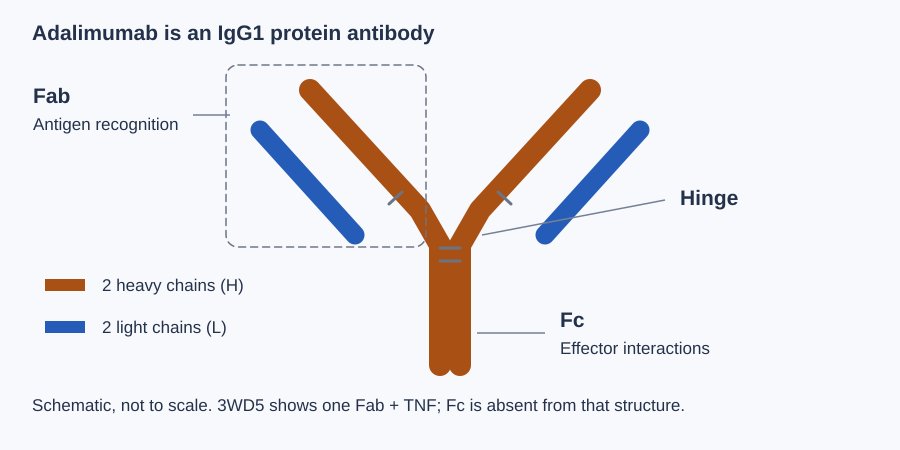
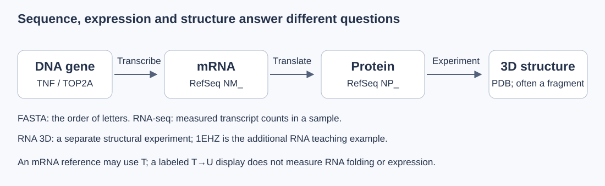
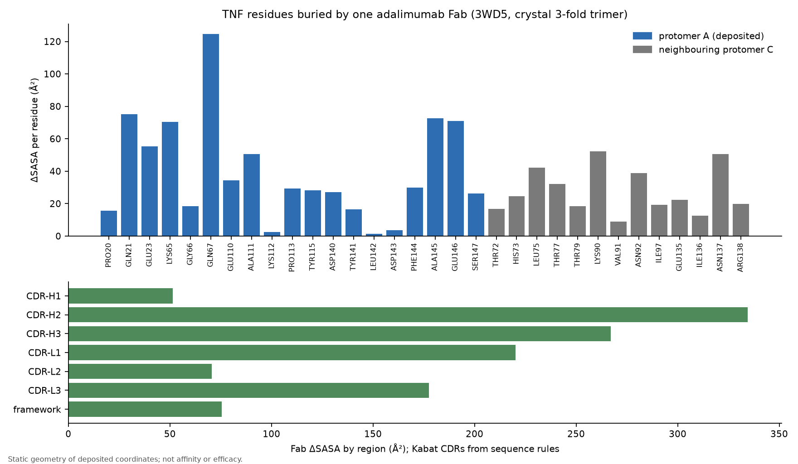
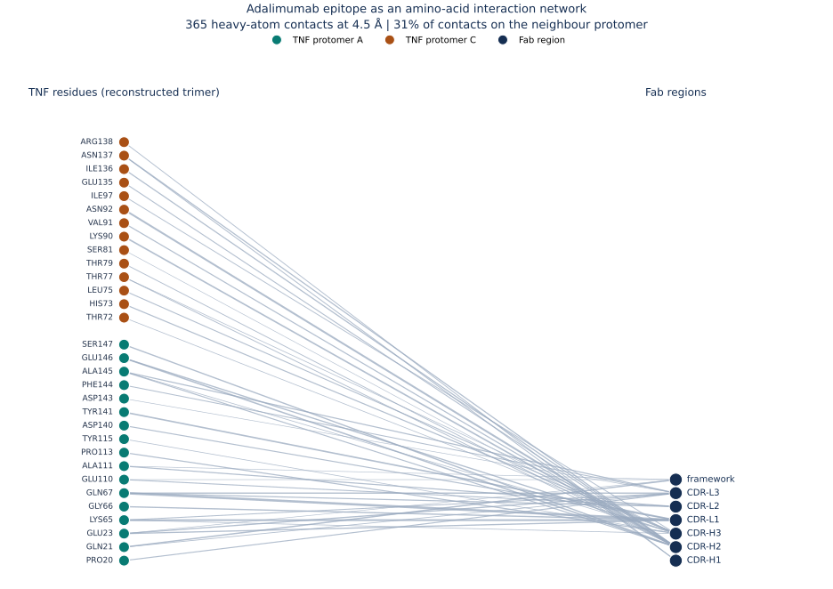

# درسنامهٔ بیوانفورماتیک ساختاری

بیوانفورماتیک ساختاری، رابطهٔ شکل مولکول‌های زیستی با کار آن‌ها را بررسی می‌کند. در این درس، ساختمان مولکول‌ها و روش‌های تحلیل ساختار را با مطالعهٔ اتصال آدالیموماب به TNF می‌آموزیم. [تمرین‌ها و ابزارهای تعاملی](../index.html) در صفحهٔ پروژه در دسترس‌اند.

**پرسش مورد مطالعه:** آدالیموماب چگونه به TNF متصل می‌شود و پژوهش‌ها دربارهٔ این اتصال چه یافته‌اند؟

## فصل 1. آشنایی با بیوانفورماتیک ساختاری

### مبحث 1. پرسش ساختاری و نقشهٔ راه پژوهش

پرسش: ما دقیقاً می‌خواهیم دربارهٔ اتصال چه بدانیم؟

#### ۱. درس

**التهاب:** پاسخ بدن که می‌تواند با درد، گرمی و تورم همراه شود؛ ادامهٔ نامناسب آن ممکن است آسیب‌زا باشد.

**خودایمنی:** حالتی که پاسخ ایمنی به اجزای خود بدن آسیب می‌رساند.

**هدف دارو:** مولکولی که دارو مستقیماً با آن برهم‌کنش می‌کند؛ با بیماری یا نتیجهٔ درمان یکی نیست.

در روماتوئید، بیمار مفصل متورم دارد؛ در سطح مولکولی، آدالیموماب به TNF متصل می‌شود. این دو توصیف دربارهٔ یک مقیاس نیستند.


سلول کوچک‌ترین واحد زنده‌ای است که می‌تواند مجموعه‌ای از فعالیت‌های حیاتی را انجام دهد. بدن از سلول‌های متفاوت ساخته شده است؛ سلول ایمنی در دفاع نقش دارد و سلول پوشانندهٔ مفصل کار دیگری انجام می‌دهد. درون سلول و اطراف آن، مولکول‌ها با یکدیگر برخورد و برهم‌کنش می‌کنند. اتم واحد سازندهٔ شیمیایی ماده است؛ مولکول مجموعه‌ای از اتم‌های پیوندخورده است. پروتئین نوعی مولکول زنجیره‌ای است که شکل و ویژگی‌های شیمیایی آن به کاری که انجام می‌دهد مربوط است.

در سلول‌های بدن ما، غشا مرز سلول را می‌سازد و بخش بزرگی از DNA در هسته نگه‌داری می‌شود. کروموزوم ساختار سازمان‌یافتهٔ DNA و پروتئین‌های همراه آن است. این واژه‌ها نام مقیاس‌های متفاوت‌اند: اتم‌ها مولکول می‌سازند و سلول از مولکول‌های فراوان تشکیل شده است.

ژن بخشی از DNA است که اطلاعات ساخت یک محصول کارکردی را حمل می‌کند؛ همهٔ ژن‌ها پروتئین نمی‌سازند. در ژن‌های پروتئین‌ساز، ابتدا RNA ساخته می‌شود و سپس ماشین سلولی از روی RNA، زنجیرهٔ پروتئین را می‌سازد. بنابراین اندازه‌گیری RNA با اندازه‌گیری مقدار پروتئین یکسان نیست. بیوانفورماتیک با داده و محاسبه به این فرایندها می‌پردازد؛ شاخهٔ ساختاری آن می‌پرسد مولکول چه شکل‌هایی دارد و این شکل‌ها چه چیزی را توضیح می‌دهند.

آرتریت روماتوئید بیماری التهابی خودایمنی است: پاسخ ایمنی به آسیب مفصل کمک می‌کند. TNF یکی از پیام‌رسان‌های پروتئینی التهاب است، نه تنها علت بیماری. گیرنده مولکولی است که می‌تواند پیام‌رسان را بگیرد و پاسخ سلولی را آغاز کند. آدالیموماب یک آنتی‌بادی درمانی است؛ آنتی‌بادی پروتئینی با بخش‌های شناسایی‌کنندهٔ هدف است. Fab نام قطعهٔ شناسایی‌کنندهٔ آن است؛ این قطعه با کل آنتی‌بادی یکسان نیست. اتصال آن به TNF می‌تواند بر پیام‌رسانی TNF اثر بگذارد. برای این توضیح به ادعای مهار مستقیم یک آنزیم دیگر مانند TOP2A احتیاج نداریم.

در این دوره ابتدا زبان لازم برای فهم شکل مولکول را می‌سازیم، بعد مشاهده و اندازه‌گیری را تمرین می‌کنیم و سپس مقاله‌ها را نقد می‌کنیم. هدف مقالهٔ ما مرور انتقادی شواهد اتصال آدالیموماب به TNF است. بازتحلیل عددیِ موجود یک مثال آموزشی در کنار مرور است؛ ساخت داروی تازه یا پیش‌بینی پاسخ بیمار هنوز نتیجهٔ این کار نیست.

###### از مفصل دردناک تا یک پرسش مولکولی

مفصل جایی است که دو استخوان به یکدیگر می‌رسند. در آرتریت روماتویید، التهابِ بافت پوشانندهٔ مفصل می‌تواند به درد، ورم و آسیب کمک کند. برای مطالعهٔ دارو، باید از این مقیاسِ بافتی به مولکول‌ها برسیم: سلول‌های مختلف پیام‌رسان می‌سازند و سلول‌های دیگر با گیرنده‌هایشان پیام را دریافت می‌کنند. TNF یکی از این پیام‌رسان‌هاست. آدالیموماب به TNF متصل می‌شود؛ بنابراین نخستین پرسش ساختاری ما دربارهٔ سطح تماس همین دو پروتئین است. برای فهم بیماری باید مسیر پیام‌رسانی را نیز بشناسیم، اما یک شکل سه‌بعدی تمام رفتار مفصل را توضیح نمی‌دهد.

در مرور مقاله‌ها، می‌خواهیم بفهمیم هر پژوهش چگونه به این داستان کمک می‌کند. بلورنگاری جای اتم‌ها را پیشنهاد می‌کند؛ سنجش اتصال می‌پرسد دو شریک در شرایط مشخص چگونه متصل و جدا می‌شوند؛ مطالعهٔ بیمار دربارهٔ پیامد درمان می‌پرسد. این سه روش به یک مسئلهٔ کلی مربوط‌اند، ولی سؤال و مقیاس اندازه‌گیری‌شان متفاوت است. هنگام ارائه، از بیماری به هدف دارو و سپس به پرسش مقاله برسید تا مخاطب دلیل دیدن مدل مولکولی را بداند.

##### منابع

- [RCSB 3WD5](https://data.rcsb.org/rest/v1/core/entry/3WD5)
- [Hu 2013، ساختار و SPR](https://pubmed.ncbi.nlm.nih.gov/23943614/)
- [Tao، شمارهٔ مجلهٔ 2021؛ RNA اولیه و پاسخ](https://pubmed.ncbi.nlm.nih.gov/32909363/)

- [زمینهٔ بیماری؛ NIAMS](https://www.niams.nih.gov/health-topics/rheumatoid-arthritis)
- [مبانی زیست‌شناسی مولکولی؛ NCBI Bookshelf](https://www.ncbi.nlm.nih.gov/books/NBK26830/)

#### ۲. پژوهش

##### ما دقیقاً می‌خواهیم دربارهٔ اتصال چه بدانیم؟

پرسش را از «درمان بیماری» به بررسی شواهد اتصال آدالیموماب–TNF محدود می‌کنیم. هنوز نتیجه‌ای دربارهٔ بهترین تغییر مهندسی نداریم. ابتدا باید ساختار، آزمایش اتصال و دادهٔ بیمار را از هم تشخیص دهیم.

##### تمرین

1. نام بیماری، دارو و هدف مستقیم آن را در سه جملهٔ جدا توضیح دهید.

2. برای پرسش محل اتصال، تغییر RNA و پاسخ بالینی، ورودی مناسب را جدا بنویسید.

3. یک جمله بنویسید که روشن کند این پروژه مرور شواهد است و فعلاً داروی جدیدِ آزموده‌شده ندارد.


تمرین عملی:


نصب و اجرای فرمان‌ها: [دفتر کار نرم‌افزار](software-workbook.fa.md).

یک دفتر با عنوان «دفتر یادگیری» بسازید. سه پرسش بنویسید: TNF کجا به آدالیموماب متصل می‌شود؟ مقدار RNA ژن TNF چقدر است؟ بیمار به درمان پاسخ داده است؟ روبه‌روی هر پرسش، به ترتیب مختصات سه‌بعدی، دادهٔ RNA-seq و سنجهٔ بالینی را بنویسید. سپس توضیح دهید چرا پاسخ یکی جای دو پاسخ دیگر را نمی‌گیرد.

برای شروع نیازی به نصب نرم‌افزار ندارید. در کارگاه همین فصل، نمودار سازوکار اتصال را باز کنید و با زبان خود بگویید آدالیموماب به چه پروتئینی متصل می‌شود. برای مشاهدهٔ اختیاری مدل واقعی، [کارگاه ساختار در فصل آنالیز](../index.html?unit=3&part=practice&tool=lab) در همین برنامه قرار دارد؛ روش خواندن و اندازه‌گیری مدل را در فصل مربوط یاد می‌گیریم. مشاهدهٔ مدل هنوز اندازه‌گیری یا شبیه‌سازی نیست.

##### معیار پایان تمرین

یک پرسش ساختاری و یک پرسش بیان ژن بنویسید؛ برای هرکدام دادهٔ لازم را نام ببرید.


**نوع شاهد:** تعیین پرسش و دامنه

در این قدم پرسش و حدود آن روشن می‌شود؛ هیچ سنجش تازه‌ای روی بیمار یا دارو انجام نمی‌دهیم.

**گزارش تمرین:** یک بند پرسش و یک شکل سه‌ستونیِ ساختار، RNA و بیمار.

#### ۳. ارائه

##### یادداشت ارائه

این پروژه را با یک پرسش محدود شروع می‌کنم: از شواهد موجود دربارهٔ اتصال آدالیموماب به TNF چه می‌فهمیم؟ برای پاسخ، اول زبان مولکول‌ها را یاد می‌گیریم، بعد داده و روش مقاله‌ها را بررسی می‌کنیم. روماتوئید زمینهٔ بیماری ماست، اما نتیجهٔ یک محاسبهٔ ساختاری پاسخ بیمار را تعیین نمی‌کند. خروجی امروز، پرسش دقیق و مشخص‌کردن دادهٔ لازم است؛ نه معرفی داروی تازه.

##### شکل یا جدول پیشنهادی

یک بند پرسش و یک شکل سه‌ستونیِ ساختار، RNA و بیمار.

##### پرسش و پاسخ

**چرا همین ابتدا RNA-seq را هم نشان می‌دهیم؟**

برای شناخت نوع داده و جلوگیری از اشتباه؛ این داده مسیر مکمل دارد و جای مختصات ساختاری را نمی‌گیرد.

##### ادامهٔ بحث

اکنون باید بفهمیم دارو و هدف از چه واحدهایی ساخته شده‌اند.

## فصل 2. ساختار مولکول‌های زیستی

### مبحث 1. مونومر، پلیمر و شیمی اسیدآمینه

پرسش: چرا همهٔ باقی‌مانده‌های رابط، نقش شیمیایی یکسانی ندارند؟

#### ۱. درس

**گروه جانبی:** بخشی از اسیدآمینه که میان انواع اسیدآمینه فرق می‌کند و بر اندازه و شیمی آن اثر دارد.

**قطبی:** دارای توزیع نامتقارن بار؛ ممکن است بار خالص صفر باشد.

**جهش:** تغییر توالی؛ در آزمایش این پروژه منظور جایگزینی یک اسیدآمینهٔ مشخص است.

کوتاه‌کردن Gln به Ala شبیه پاک‌کردن یک برچسب نیست؛ بخش آمیدی حذف می‌شود و اندازه و تماس با آب هم می‌تواند تغییر کند.


اتم واحد سازندهٔ شیمیایی ماده است. پیوند کووالانسی، اتم‌ها را با اشتراک الکترون در یک مولکول نگه می‌دارد. در محیط زیستی، آب و یون‌های حل‌شده هم بخشی از مسئله‌اند. یون ذرهٔ باردار است؛ بار مثبت و منفی می‌توانند بر یکدیگر اثر بگذارند، اما مقدار این اثر به فاصله و محیط بستگی دارد. گروه قطبی بار خالص لازم ندارد؛ توزیع نامتقارن بار هم می‌تواند با آب یا گروه قطبی دیگر برهم‌کنش کند.

قندهای ساده می‌توانند به زنجیره‌های قندی متصل شوند؛ نوکلئوتیدها سازندهٔ اسیدهای نوکلئیک و اسیدآمینه‌ها سازندهٔ پروتئین‌اند. لیپیدها هم گروه مهمی از مولکول‌های زیستی‌اند و در غشا نقش دارند، اما همهٔ آن‌ها پلیمرهای دارای مونومر تکراری مانند پروتئین نیستند. پس عبارت «مولکول زیستی» فقط پروتئین را شامل نمی‌شود.

مونومر واحد تکرارشونده و پلیمر زنجیره‌ای از این واحدهاست. اسیدآمینه مونومر معمول پروتئین است. اسیدآمینهٔ متداول یک کربن مرکزی، گروه آمینی، گروه کربوکسیلی، هیدروژن و گروه جانبی دارد؛ گلیسین ساده‌ترین گروه جانبی را دارد. در زنجیرهٔ پروتئین، بخش باقی‌مانده از هر اسیدآمینه را «باقی‌مانده» می‌گوییم. پس Gln21 یعنی باقی‌ماندهٔ گلوتامین با شمارهٔ ۲۱ در دستگاه شماره‌گذاری مشخص، نه ژن شمارهٔ ۲۱.

گروه جانبی Ala کوچک و عمدتاً ناقطبی است؛ Gln آمیدی و قطبی است؛ Glu در بسیاری از شرایط نزدیک به pH فیزیولوژیک بار منفی و Lys بار مثبت دارد. pH معیاری مرتبط با اسیدی‌بودن محیط است و می‌تواند حالت پروتون‌گیری این گروه‌ها را تغییر دهد. گفتن «این دو باقی‌مانده بار مخالف دارند» آغاز یک فرضیه است؛ آب‌پوشی، جهت گروه‌ها و هزینهٔ بیرون‌راندن آب هم باید بررسی شوند.

###### چرا جایگزینی یک اسیدآمینه ممکن است اتصال را عوض کند؟

اسیدآمینه‌های سازندهٔ پروتئین یک بخش اصلی مشابه و یک گروه جانبی متفاوت دارند. نام‌های یک‌حرفی، مانند Q برای گلوتامین و A برای آلانین، میان‌بری برای نوشتن توالی‌اند. گروه جانبی گلوتامین اتم‌های اکسیژن و نیتروژن دارد و می‌تواند در برهم‌کنش‌های قطبی شرکت کند؛ گروه جانبی آلانین یک گروه متیل کوچک است. تبدیل Q به A هم اندازه را عوض می‌کند و هم امکانات شیمیایی سطح را. ازاین‌رو یک «نقطه» در نمایش ساده، در واقع مجموعه‌ای از اتم‌ها و ویژگی‌هاست.

در محیط آبی، بعضی گروه‌ها با آب برهم‌کنش مناسب دارند و بعضی سطح‌های غیرقطبی معمولاً کمتر در معرض آب قرار می‌گیرند. بار گروه‌ها نیز به محیط و pH وابسته است؛ pH شاخص وضعیت اسیدی یا بازی محلول است. در تفسیر یک جهش باید امکان تغییر شکل، آب‌پوشی و پایداری را هم بررسی کنیم. اگر در Q21A اتصال ضعیف‌تر شود، نتیجهٔ مستقیم این است که آن جایگزینی در آن آزمایش اثر داشته است؛ برای نسبت‌دادن همهٔ اثر به یک پیوند خاص، شاهد بیشتری لازم داریم.

##### منابع

- [NCBI Bookshelf، ساختار و شکل پروتئین](https://www.ncbi.nlm.nih.gov/books/NBK26830/)
- [Hu 2013، ساختار و SPR](https://pubmed.ncbi.nlm.nih.gov/23943614/)

#### ۲. پژوهش

##### چرا همهٔ باقی‌مانده‌های رابط، نقش شیمیایی یکسانی ندارند؟

برای خواندن جدول جهش‌های Hu باید ابتدا معنی عوض‌کردن گروه جانبی را بفهمیم. این قدم کمک می‌کند یک تماس نزدیک را با یک برهم‌کنش مؤثر یا اثر قطعی بر اتصال برابر نگیریم.

##### تمرین

1. نام و ویژگی Ala، Gln، Glu و Lys را ثبت کنید.

2. در یک شکل، ستون فقرات مشترک و گروه جانبی متفاوت را مشخص کنید.

3. برای Q21A توضیح دهید چه چیزهایی ممکن است تغییر کند و کدام اثر فقط با آزمایش معلوم می‌شود.


تمرین عملی:


نصب و اجرای فرمان‌ها: [دفتر کار نرم‌افزار](software-workbook.fa.md).

چهار نام Ala، Gln، Glu و Lys را در یک جدول با نام کامل و ویژگی گروه جانبی ثبت کنید. سپس در کارگاه رابط، Gln21 و Glu23 از زنجیرهٔ A را انتخاب کنید و شمارهٔ زنجیره را همراه نام نگه دارید. برداشتن مجازی گروه جانبی در ابزار سایت فقط تماس‌های هندسی را حذف می‌کند؛ جایگزینی واقعی به آلانین به ساخت و اندازه‌گیری پروتئین جهش‌یافته نیاز دارد.

خروجی شما دو جملهٔ متفاوت است: «در مدل تماس دیدم» و «برای اثر آن بر اتصال باید آزمایش شود». اگر این دو را یک جمله نوشتید، جدول را اصلاح کنید.

##### معیار پایان تمرین

جدول چهار اسیدآمینه: ویژگی شیمیایی، تماس مشاهده‌شده، محدودیت تفسیر.


**نوع شاهد:** فعالیت یادگیری و بررسی روش

این یک تفسیر شیمیاییِ مداخله است؛ مقدار اثر جهش را در قدم جهش‌زایی از دادهٔ مقاله می‌خوانیم.

**گزارش تمرین:** جدول چهار اسیدآمینه و توضیح روشن معنی Q21A.

#### ۳. ارائه

##### یادداشت ارائه

پروتئین از اسیدآمینه‌ها ساخته می‌شود، اما همهٔ این واحدها شیمی یکسان ندارند. تفاوت اصلی را در گروه جانبی می‌بینیم. به همین دلیل تغییر یک جایگاه می‌تواند هم اندازه و هم نحوهٔ تماس با آب و شریک را تغییر دهد. هنوز از این توضیح مقدار اتصال را پیش‌بینی نمی‌کنم؛ این مقدمه‌ای برای فهم آزمایش جهش‌زایی مقاله است.

##### شکل یا جدول پیشنهادی

جدول چهار اسیدآمینه و توضیح روشن معنی Q21A.

##### پرسش و پاسخ

**آیا بار مخالف یعنی اتصال حتماً بهتر می‌شود؟**

خیر؛ آب، فاصله، جهت‌گیری و حالت پروتون‌گیری هم مهم‌اند.

##### ادامهٔ بحث

در قدم بعد این واحدها را در زنجیره و مجموعهٔ چندزنجیره‌ای قرار می‌دهیم.

### مبحث 2. پیوند پپتیدی و چهار سطح ساختار

پرسش: آیا تصویری که می‌بینیم مجموعهٔ زیستی لازم برای بررسی اتصال را دارد؟

#### ۱. درس

**زنجیره:** دنباله‌ای از باقی‌مانده‌های متصل با پیوند پپتیدی؛ نام زنجیره در فایل یک شناسه است.

**زیرواحد:** یکی از اجزای پروتئینیِ یک مجموعهٔ چندجزئی.

**سه‌تایی:** مجموعه‌ای با سه زیرواحد؛ سه زنجیرهٔ متفاوت در فایل الزاماً سه زیرواحد TNF نیست.

**مجموعهٔ زیستی:** آرایش چند شریک مولکولی که برای کار زیستی در نظر می‌گیریم؛ ممکن است با اجزای یک نمای فایل بلوری یکسان نباشد.

در 3WD5 سه نام A، H و L می‌بینیم: A مربوط به TNF و H/L مربوط به Fab هستند. پس شمار نام‌ها به‌تنهایی ساختار چهارم TNF را به ما نمی‌گوید.


وقتی گروه کربوکسیلی یک اسیدآمینه به گروه آمینی بعدی متصل می‌شود، پیوند پپتیدی ساخته می‌شود. زنجیره جهت دارد: از انتهای آمینی N به انتهای کربوکسیلی C خوانده می‌شود. حرف C در «انتهای C» با نام زنجیرهٔ C در فایل مولکولی متفاوت است. پیوند پپتیدی به‌دلیل ویژگی الکترونی‌اش تا حد زیادی مسطح است. چرخش‌های اصلی ستون فقرات را با زاویه‌های phi و psi توصیف می‌کنند؛ همهٔ ترکیب‌های این زاویه‌ها از نظر برخورد اتمی مناسب نیستند.

ساختار اول ترتیب اسیدآمینه‌هاست. ساختار دوم الگوی محلی ستون فقرات، مانند مارپیچ آلفا یا ورقهٔ بتاست. ساختار سوم آرایش سه‌بعدی یک زنجیره و ساختار چهارم آرایش چند زیرواحد در یک مجموعه است. این چهار سطح چهار پروتئین متفاوت نیستند؛ چهار راه توصیف سازمان یک مولکول یا مجموعه‌اند. پیوندهای هیدروژنی ستون فقرات به ساختار دوم کمک می‌کنند؛ گروه‌های جانبی و محیط در سازمان کلی نقش دارند.

TNF محلول می‌تواند مجموعه‌ای سه‌زیرواحدی بسازد. آنتی‌بادی IgG کامل دو زنجیرهٔ سنگین و دو زنجیرهٔ سبک دارد، اما Fab فقط بخش اتصال‌دهندهٔ آنتی‌ژن است و Fc کامل را ندارد. در مدل ثبت‌شدهٔ 3WD5، زنجیرهٔ A یک زیرواحد TNF و H/L دو زنجیرهٔ یک Fab هستند. بنابراین سه زنجیرهٔ دیده‌شده به معنی TNF سه‌تایی نیست.



این طرح، آناتومی مفهومی IgG است؛ فایل 3WD5 همهٔ این بخش‌ها را ندارد.

###### چهار سطح ساختار را روی یک مثال دنبال کنیم

ساختار اول، ترتیب اسیدآمینه‌ها در طول زنجیره است؛ مثل ترتیب مهره‌ها روی نخ. پیوند پپتیدی، گروه کربوکسیل یک اسیدآمینه را به گروه آمین بعدی وصل می‌کند. در زنجیره معمولاً جهت را از انتهای آمینی، N، به انتهای کربوکسیلی، C، می‌خوانیم. ساختار دوم به آرایش‌های محلی ستون اصلی، مانند مارپیچ آلفا و رشته‌های بتا، مربوط است. ساختار سوم، آرایش سه‌بعدی یک زنجیره را توصیف می‌کند و ساختار چهارم به کنارهم‌آمدن چند زنجیره مربوط است. یک پروتئین تک‌زنجیره‌ای الزاماً ساختار چهارم ندارد.

در TNF، سه زیرواحد کنار هم قرار می‌گیرند. در Fab، زنجیرهٔ سبک و بخشی از زنجیرهٔ سنگین آنتی‌بادی همراه‌اند. بنابراین شمارش سه زنجیرهٔ A/H/L در فایل 3WD5 به معنی «TNF سه‌تایی» نیست: این سه نام به سه جزء با نقش‌های متفاوت اشاره می‌کنند. برای دیدن سه زیرواحد TNF باید هویت هر زنجیره و نحوهٔ ساخت مجموعه را بررسی کنیم. این مثال نشان می‌دهد چرا پیش از هر محاسبه، باید بگوییم کدام مولکول و کدام سطح سازمان را مطالعه می‌کنیم.

##### منابع

- [NCBI Bookshelf، ساختار و شکل پروتئین](https://www.ncbi.nlm.nih.gov/books/NBK26830/)
- [RCSB 3WD5](https://data.rcsb.org/rest/v1/core/entry/3WD5)

#### ۲. پژوهش

##### آیا تصویری که می‌بینیم مجموعهٔ زیستی لازم برای بررسی اتصال را دارد؟

این مفهوم مستقیماً به پرسش پژوهش وصل است: بخشی از محل اتصال در همسایگی دو زیرواحد TNF قرار دارد. اگر فقط یک زیرواحد را ببینیم، ممکن است آن بخش را از تحلیل حذف کنیم. خودِ مقالهٔ Hu پیش‌تر این اصل را گزارش کرده بود.

##### تمرین

1. نقش A/H/L را روی مدل ثبت‌شده نام‌گذاری کنید.

2. مدل ثبت‌شده را با سه‌تایی بازسازی‌شده مقایسه کنید.

3. زیر هر شکل بنویسید چه چیزی ثبت‌شده و چه چیزی از تقارن بازسازی شده است.


تمرین عملی:


نصب و اجرای فرمان‌ها: [دفتر کار نرم‌افزار](software-workbook.fa.md).

در نمایش مولکولی، A را تنها نشان دهید، سپس H و L را اضافه کنید. یک تصویر از مدل ثبت‌شده و یک تصویر از مدل بازسازی‌شدهٔ سه‌تایی تهیه کنید. زیر هر تصویر نام فایل و معنای زنجیره‌ها را بنویسید. زنجیره‌های هم‌نام در فایل‌های مختلف لزوماً یک نقش ندارند.

برای سنجش فهم، بدون نگاه‌کردن به متن توضیح دهید چرا «۳ زنجیره در فایل» با «۳ زیرواحد TNF» فرق دارد. اگر فقط رنگ‌ها را به خاطر دارید، به نام فایل و نقش زنجیره‌ها برگردید.

##### معیار پایان تمرین

یک شکل برچسب‌دار از چهار سطح؛ فهرست بخش‌های غایب در 3WD5.


**نوع شاهد:** بازبینی تحلیل اجراشدهٔ مخزن

وجود زیرواحد همسایه بخشی از تفسیر رابط است. اینجا هنوز دربارهٔ انرژی یا بهترشدن دارو نتیجه نمی‌گیریم.

**گزارش تمرین:** دو شکل برچسب‌دار و یک جمله دربارهٔ تفاوت زنجیره با زیرواحد.

#### ۳. ارائه

##### یادداشت ارائه

چهار سطح ساختار، چهار راه توصیف یک مولکول یا مجموعه‌اند. در پروژهٔ ما ساختار چهارم اهمیت مستقیم دارد: TNF سه‌تایی است، ولی A/H/L در فایل به معنی سه TNF نیست. با مقایسهٔ نمای ثبت‌شده و مجموعهٔ بازسازی‌شده می‌فهمیم چرا انتخاب مجموعه پیش از شمارش تماس مهم است. این اصل کشف تازهٔ ما نیست؛ بازتحلیل ما آن را با ورودی و محاسبهٔ باز قابل پیگیری می‌کند.

##### شکل یا جدول پیشنهادی

دو شکل برچسب‌دار و یک جمله دربارهٔ تفاوت زنجیره با زیرواحد.

##### پرسش و پاسخ

**آیا تصویر Fab کل دارو را نشان می‌دهد؟**

خیر؛ بخش Fc و معماری کامل IgG در نمای Fab حضور ندارند.

##### ادامهٔ بحث

حالا می‌پرسیم کدام ناحیه‌های زنجیرهٔ آنتی‌بادی در شناسایی شرکت می‌کنند.

### مبحث 3. ساختار دوم، دمین و طبقه‌بندی تاخوردگی

پرسش: وقتی می‌گوییم یک CDR سهم بیشتری دارد، دقیقاً کدام ناحیه را شمرده‌ایم؟

#### ۱. درس

**ساختار دوم:** الگوی محلی ستون فقرات، مانند مارپیچ یا ورقه.

**دمین:** بخش سازمان‌یافتهٔ ساختار که می‌توان آن را یک واحد ساختاری دانست.

**CDR:** ناحیه‌هایی از آنتی‌بادی که در شناسایی هدف نقش دارند؛ مرز آن‌ها به قرارداد شماره‌گذاری وابسته است.

یک حلقه می‌تواند در اتصال مهم باشد، حتی اگر شبیه مارپیچ منظم نباشد. نام L1 یا L2 نیز بدون دانستن تعریف مرز، برای مقایسه کافی نیست.


مارپیچ آلفا یک آرایش تکرارشوندهٔ ستون فقرات است که در آن پیوندهای هیدروژنی منظم تشکیل می‌شود. رشتهٔ بتا بخش کشیدهٔ زنجیره است؛ چند رشته می‌توانند ورقهٔ بتا بسازند. حلقه‌ها و چرخش‌ها بخش‌های اتصال این عناصرند. حلقه الزاماً بی‌کارکرد یا بی‌ساختار نیست؛ حلقه‌های اتصال‌دهندهٔ آنتی‌بادی می‌توانند در شناسایی هدف نقش مستقیم داشته باشند.

دمین بخشی از ساختار پروتئین است که به‌صورت یک واحد سازمان‌یافته شناخته می‌شود و گاهی می‌تواند نسبتاً مستقل تا بخورد. تاخوردگی یا fold به آرایش کلی عناصر ساختاری اشاره دارد. طبقه‌بندی ساختاری مانند CATH به مقایسهٔ سازمان دامنه‌ها کمک می‌کند؛ شبیه‌بودن شکل به‌تنهایی برای اثبات کارکرد یکسان یا تاریخ تکاملی مشترک کافی نیست. CDR نام نواحی متغیرِ دخیل در شناسایی در آنتی‌بادی است. در نام CDR-H1، H زنجیرهٔ سنگین و ۱ نخستین ناحیهٔ تعریف‌شده در آن زنجیره را مشخص می‌کند؛ L برای زنجیرهٔ سبک است. مرز این نواحی به قرارداد شماره‌گذاری، مانند Kabat، وابسته است.

تصویر کارتونی نمایش ساده‌شدهٔ مسیر ستون فقرات است و همهٔ اتم‌ها را نشان نمی‌دهد. رنگ‌آمیزی آلفا و بتا هم یک اندازه‌گیری مستقل از ساختار نیست. برای انتساب قابل بازاجرا باید روش، مانند DSSP، و نسخهٔ آن ثبت شود. اختلاف نام‌گذاری CDR در دو مقاله ممکن است از تعریف متفاوت مرزها بیاید؛ پیش از نسبت‌دادن آن به اختلاف زیستی باید شماره‌گذاری بررسی شود.

###### مارپیچ، رشته، صفحه و دمین چه تفاوتی دارند؟

در مارپیچ آلفا، ستون اصلی زنجیره دور یک محور می‌پیچد و الگویی منظم از پیوندهای هیدروژنی آن را همراهی می‌کند. در ساختار بتا، قطعه‌های نسبتاً کشیدهٔ زنجیره کنار هم قرار می‌گیرند و صفحهٔ بتا می‌سازند؛ رشته‌های آن می‌توانند جهت موازی یا مخالف داشته باشند. رنگ یا پهنای نوارِ نمایشگر، اندازهٔ واقعی اتم‌ها نیست: این نوار برای نشان‌دادن مسیر و آرایش ستون اصلی رسم می‌شود. برای بررسی اتم و تماس باید نمایش اتمی را نیز ببینیم.

دمین بخش ساختاری مشخصی از پروتئین است و ممکن است از چند رشته و حلقه تشکیل شود. دمین‌های آنتی‌بادی عمدتاً آرایش بتایی دارند؛ حلقه‌های ناحیهٔ متغیر در شناسایی هدف نقش دارند. CDR نام نواحی تعریف‌شده‌ای در همین بخش متغیر است. تعریف مرز CDR در قراردادهای مختلف کاملاً یکسان نیست؛ پس پیش از گفتن اینکه «CDR دوم مهم‌تر است»، باید قرارداد شماره‌گذاری را مشخص کنیم. طبقه‌بندی CATH دربارهٔ سازمان ساختار است و تعیین DSSP دربارهٔ آرایش محلی؛ این دو پاسخ یکسانی تولید نمی‌کنند.

##### منابع

- [DSSP documentation](https://pdb-redo.eu/dssp/about)
- [CATH documentation](https://www.cathdb.info/wiki/doku/?id=faq)
- [RCSB 3WD5](https://data.rcsb.org/rest/v1/core/entry/3WD5)

#### ۲. پژوهش

##### وقتی می‌گوییم یک CDR سهم بیشتری دارد، دقیقاً کدام ناحیه را شمرده‌ایم؟

برای مقایسهٔ متن Hu با محاسبات خودمان باید تعریف CDR را ثابت کنیم. اختلاف میان عبارت مقاله و سهم‌های محاسبه‌شده می‌تواند به تعریف و شماره‌گذاری مرتبط باشد؛ ابتدا آن را بررسی می‌کنیم و بعد دربارهٔ اختلاف زیستی حرف می‌زنیم.

##### تمرین

1. مارپیچ، ورقه و حلقه را در یک تصویر ساده از هم جدا کنید.

2. مرز CDRها در گزارش محلی را با عنوان Kabat ثبت کنید.

3. عبارت مقاله دربارهٔ ناحیهٔ دخیل را کنار تعریف و خروجی محلی بگذارید.


تمرین عملی:


نصب و اجرای فرمان‌ها: [دفتر کار نرم‌افزار](software-workbook.fa.md).

مدل را یک‌بار کارتونی و یک‌بار اتمی ببینید. سه نقطه انتخاب کنید و توضیح دهید در تصویر کارتونی کدام جزئیات حذف شده‌اند. در جدول اپی‌توپ، CDR-L1 و CDR-L2 را پیدا کنید و تعریف Kabat را در یادداشت نگه دارید.

برای تمرین DSSP، صفحهٔ رسمی روش را باز کنید، ورودی موردنیاز و کدهای خروجی را بخوانید و نسخهٔ ابزار در دسترس خود را ثبت کنید. این مرحله تمرین خواندن روش است؛ تا فایل خروجی تولید نکرده‌اید ننویسید «ساختار دوم محاسبه شد».

##### معیار پایان تمرین

جدول «زنجیره، دمین، ساختار دوم، تاخوردگی» با تعریف جداگانه؛ بدون درصد ساختگی هلیکس.


**نوع شاهد:** بازبینی تحلیل اجراشدهٔ مخزن

محاسبات ناحیه‌ای مخزن به تعریف مشخص وابسته‌اند؛ یک نام ناحیه به‌تنهایی مدرک برتری عملکردی نیست.

**گزارش تمرین:** یک جدول نام ناحیه، تعریف مرز، سنجه و محدودیت.

#### ۳. ارائه

##### یادداشت ارائه

تصویر کارتونی مسیر کلی زنجیره را ساده می‌کند؛ همهٔ جزئیات تماس را نمی‌بینیم. برای بررسی نقش ناحیه‌های آنتی‌بادی ابتدا باید بدانیم CDR چیست و مرز آن چگونه تعیین شده است. در مقایسهٔ دو گزارش، یکسان‌بودن نام کافی نیست. امروز تعریف را ثبت می‌کنیم تا اختلاف عددی را پیش از بررسی روش به اختلاف زیستی نسبت ندهیم.

##### شکل یا جدول پیشنهادی

یک جدول نام ناحیه، تعریف مرز، سنجه و محدودیت.

##### پرسش و پاسخ

**آیا حلقه به معنی بی‌ساختار و بی‌کارکرد است؟**

خیر؛ حلقه می‌تواند سازمان و کارکرد مشخص داشته باشد.

##### ادامهٔ بحث

پیش از رسیدن به پایگاه توالی، زبان DNA و RNA را نیز روشن می‌کنیم.

### مبحث 4. DNA، RNA و پل کدون به پروتئین

پرسش: کدام نوع دادهٔ RNA واقعاً به پرسش ساختاری ما مربوط می‌شود؟

#### ۱. درس

**نوکلئوتید:** واحد قند، فسفات و باز که زنجیرهٔ DNA یا RNA را می‌سازد.

**کدون:** سه باز در چارچوب خواندن که در ترجمه یک اسیدآمینه یا پیام پایان را مشخص می‌کنند.

**RNA-seq:** نمونه‌برداری توالی‌یابی برای بررسی رونوشت‌ها؛ مختصات سه‌بعدی RNA را اندازه نمی‌گیرد.

حروف یک دستور پخت، تعداد نسخه‌های آن و شکل غذایی که ساخته می‌شود سه چیز متفاوت‌اند؛ این تشبیه فقط برای جداکردن توالی، فراوانی و ساختار است.


نوکلئوتید واحد سازندهٔ DNA و RNA است و از قند، فسفات و باز تشکیل می‌شود. توالی نوکلئوتیدی ترتیب بازهاست. اتصال فسفودی‌استر، قند یک نوکلئوتید را از راه فسفات به قند بعدی پیوند می‌دهد و ستون فقرات زنجیره را می‌سازد. گروه OH روی کربن ۲ قند RNA یکی از تفاوت‌های شیمیایی مهم آن با DNA است. DNA معمولاً دو رشتهٔ مکمل دارد؛ مکمل‌بودن یعنی الگوی جفت‌شدن بازها امکان کنارهم‌قرارگرفتن رشته‌ها را فراهم می‌کند. رشته‌ها جهت مخالف دارند. در RNA قند متفاوت است و اوراسیل معمولاً جای تیمین را می‌گیرد. RNA می‌تواند با جفت‌شدن بخش‌هایی از خودش، ساقه، حلقه و ساختار سه‌بعدی بسازد؛ همهٔ RNAها پیام‌رسان پروتئین نیستند.

در RNA پیام‌رسانِ پروتئین‌ساز، هر سه باز در چارچوب خواندن یک کدون است. کدون می‌تواند یک اسیدآمینه یا پیام پایان ترجمه را مشخص کند. شروع خواندن از جای نادرست کل تقسیم‌بندی را تغییر می‌دهد. توالی کامل RNA با ناحیهٔ کدکنندهٔ آن یکسان نیست؛ دو سوی ناحیهٔ کدکننده بخش‌های ترجمه‌نشونده وجود دارد. فایل مرجع نوکلئوتیدی ممکن است حروف T داشته باشد، حتی اگر رکورد مربوط به mRNA باشد؛ این قرارداد فایل را با نوع مولکول آزمایش‌شده اشتباه نگیرید.

RNA-seq روشی برای نمونه‌برداری از رونوشت‌های موجود است. شمارش خوانش‌ها در یک ژن، مختصات سه‌بعدی RNA را نمی‌دهد. بنابراین دو پرسش جدا داریم: ساختار سه‌بعدی یک RNA چیست، و فراوانی رونوشت‌ها میان نمونه‌ها چگونه فرق می‌کند؟ سیلابس این درس بر اولی در چارچوب ساختار مولکول‌ها تأکید دارد؛ تحلیل بیان ژن مسیر مکمل پروژه است.



توالی، مقدار RNA و ساختار سه‌بعدی داده‌های متفاوت‌اند. برای ساختار واقعی RNA از مثال 1EHZ در کارگاه همین مبحث استفاده کنید.

###### از نوکلئوتید به RNA و سپس پروتئین

هر نوکلئوتید از قند، فسفات و باز نیتروژنی ساخته می‌شود. در DNA، قند دئوکسی‌ریبوز و بازهای معمول A/C/G/T داریم؛ در RNA، قند ریبوز و معمولاً U به جای T است. نوکلئوتیدها با پیوند فسفودی‌استر زنجیره می‌سازند و جهت زنجیره را ۵′ به ۳′ می‌نویسیم. اتصال بازهای مکمل به شکل‌گیری مارپیچ DNA و بخش‌های جفت‌شدهٔ RNA کمک می‌کند. RNA می‌تواند ساقه، حلقه و آرایش سه‌بعدی پیچیده داشته باشد؛ تک‌رشته‌ای بودن به معنی بی‌شکل بودن نیست.

برای ترجمهٔ یک RNA پیام‌رسان، ریبوزوم سه باز را در یک قاب خواندن به صورت کدون می‌خواند. در مثال آموزشی `AUG GCU UAA`، کد استاندارد به متیونین، آلانین و توقف می‌رسد. کدون توقف اسیدآمینهٔ سوم نمی‌سازد. این مثال کوتاه، توالی واقعی آدالیموماب نیست. در دادهٔ واقعی باید آغاز ناحیهٔ کدکننده، نسخهٔ رونوشت و جهت را بدانیم. RNA-seq از خواندن قطعه‌های RNA برای مطالعهٔ فراوانی رونوشت‌ها استفاده می‌کند؛ حروف یک FASTA به‌تنهایی شمارش بیان ژن را در اختیار ما نمی‌گذارند.

##### منابع

- [NCBI Bookshelf، ساختار و شکل پروتئین](https://www.ncbi.nlm.nih.gov/books/NBK26830/)
- [RefSeq TNF NM_000594.4](https://www.ncbi.nlm.nih.gov/nuccore/NM_000594.4)
- [NCBI، کد استاندارد ژنتیکی](https://www.ncbi.nlm.nih.gov/Taxonomy/Utils/wprintgc.cgi#SG1)

#### ۲. پژوهش

##### کدام نوع دادهٔ RNA واقعاً به پرسش ساختاری ما مربوط می‌شود؟

برای اتصال آنتی‌بادی به TNF به ساختار و آزمایش اتصال نیاز داریم. یادگیری RNA کمک می‌کند رونوشت TNF، ساختار یک RNA واقعی و شمارش RNA را با هم قاطی نکنیم. بخش بیان ژن، مکمل زمینهٔ بیماری است و خودبه‌خود شاهد محل اتصال نیست.

##### تمرین

1. مثال کدون را در چارچوب درست و با جابه‌جایی یک باز بخوانید.

2. توالی مرجع TNF را از دادهٔ شمارش بیان جدا معرفی کنید.

3. در نمونهٔ RNA سه‌بعدی 1EHZ ساقه و حلقه را مشاهده و آن را tRNA، نه mRNA ژن TNF، معرفی کنید.


تمرین عملی:


نصب و اجرای فرمان‌ها: [دفتر کار نرم‌افزار](software-workbook.fa.md).

در ابزار کدون سایت، یک توالی کوتاه را در چارچوب درست و با جابه‌جایی یک باز بخوانید. خروجی هر دو را بنویسید و علت تفاوت را توضیح دهید. سپس صفحهٔ RefSeq ژن TNF را باز کنید و ناحیهٔ کدکننده را از کل رکورد جدا تشخیص دهید؛ شمارهٔ نسخهٔ accession را حفظ کنید.

برای شروع از [RNA سه‌بعدیِ 1EHZ در نمایشگر محلی](../assets/reference-viewer.html?pdb=1EHZ) و [رکورد رسمی آن](https://www.rcsb.org/structure/1EHZ) استفاده کنید. این tRNA، RNA پیام‌رسان TNF نیست. ساقه، حلقه و تاخوردگی کلی را پیدا کنید؛ نام و جایگاه‌های تغییر‌یافته را از رکورد بخوانید. چرخش دوربین، حرکت زمانی RNA نیست. سپس برای یافتن مثال مستقل در PDB، فیلتر polymer entity type را روی RNA بگذارید و یک رکورد تجربی انتخاب کنید. شناسه، روش تعیین ساختار و زنجیرهٔ RNA را ثبت و در نمایشگر رسمی آن ساقه و حلقه را پیدا کنید. این یک تکلیف بازیابی است؛ چهار مدل پژوهشی قبلی RNA ندارند؛ 1EHZ ورودی آموزشیِ جدا برای همین مبحث است.

##### معیار پایان تمرین

توالی مرجع، مقدار بیان و مختصات فضایی را با سه مثال جدا توضیح دهید.


**نوع شاهد:** فعالیت یادگیری و بررسی روش

این قدم سه نوع داده را تفکیک می‌کند؛ تحلیل بیان تفاضلی یا پیش‌بینی ساختار RNA تازه انجام نشده است.

**گزارش تمرین:** شکل سه‌ستونیِ توالی، شمارش و مختصات همراه با مثال واقعی.

#### ۳. ارائه

##### یادداشت ارائه

ژن، RNA و پروتئین واژه‌های جایگزین هم نیستند. کدون به ما کمک می‌کند بفهمیم چگونه یک ناحیهٔ کدکننده خوانده می‌شود؛ اما داشتن حروف RNA، مقدار آن یا شکل سه‌بعدی آن را تعیین نمی‌کند. به همین دلیل RNA-seq را شاهد مستقیم اتصال آدالیموماب نمی‌گیرم. این تفکیک باعث می‌شود بعداً پرسش درست را از هر دیتاست بپرسیم.

##### شکل یا جدول پیشنهادی

شکل سه‌ستونیِ توالی، شمارش و مختصات همراه با مثال واقعی.

##### پرسش و پاسخ

**آیا tRNA نمایش‌داده‌شده همان RNA ژن TNF است؟**

خیر؛ یک نمونهٔ آموزشیِ جدا برای دیدن ساختار RNA است.

##### ادامهٔ بحث

اکنون آماده‌ایم مختصات را با انتخاب‌های روشن در نرم‌افزار ببینیم.

## فصل 3. مشاهده و آنالیز ساختار پروتئین‌ها

### مبحث 1. شروع VMD و انتخاب اتم

پرسش: آیا انتخابی که روی صفحه می‌بینیم همان انتخاب محاسبهٔ پژوهشی است؟

#### ۱. درس

**مختصات:** سه عدد برای تعیین جای یک اتم در یک چارچوب مکانی.

**انتخاب اتم:** قاعده‌ای که مشخص می‌کند کدام اتم‌ها دیده یا اندازه‌گیری می‌شوند.

**اشغال‌پذیری:** سهم اشغال یک جایگاه در مدل ساختاری؛ با پاسخ بیمار ارتباط تعریفی ندارد.

اگر فقط CA را انتخاب کنیم، اتم‌های گروه جانبی را نمی‌بینیم؛ برای پرسش تماس جانبی، انتخاب مناسب دیگری لازم است.


نمایشگر مولکولی مختصات را به تصویر تبدیل می‌کند. تغییر دوربین موقعیت فیزیکی اتم‌ها را عوض نمی‌کند و پخش چرخش دوربین، دینامیک مولکولی نیست. VMD نرم‌افزاری برای مشاهده و تحلیل مختصات و مسیرهای زمانی است. molecule در VMD یک ورودی بارگذاری‌شده است و frame یک مجموعه مختصات در آن ورودی؛ یک فایل ایستا هم دست‌کم یک frame دارد.

انتخاب اتم یعنی تعریف مجموعه‌ای که می‌خواهیم ببینیم یا اندازه بگیریم. عبارت protein همهٔ اجزای ممکن فایل را انتخاب نمی‌کند؛ آب و لیگاند قواعد جدا دارند. chain A شناسهٔ زنجیره و name CA نام اتم کربن آلفا است. انتخاب اشتباه می‌تواند عددی کاملاً دقیق برای پرسش اشتباه تولید کند. پیش از هر محاسبه باید تعداد اتم انتخاب‌شده و دامنهٔ باقی‌مانده‌ها را ببینیم.

VMD و تحلیل Python ما الزاماً انتخاب یکسانی ندارند. در این پروژه محاسبات پژوهشی اتم‌های با occupancy صفر را کنار می‌گذارند. occupancy سهم اشغال یک جایگاه در مدل است، نه احتمال پاسخ بیمار. اگر انتخاب بصری همهٔ اتم‌ها را نشان دهد، مقایسهٔ مستقیم تعداد اتم با خروجی پژوهشی درست نیست.

###### انتخاب اتم، نخستین تصمیم تحلیل است

فایل ساختار را مانند جدولی ببینید که هر ردیف آن به یک اتم مربوط است. نام زنجیره، نام و شمارهٔ اسیدآمینه، نام اتم و سه مختصات در آن ثبت می‌شود. نمایشگر، این ردیف‌ها را به تصویر تبدیل می‌کند. انتخاب `protein and chain A` ردیف‌های پروتئینی زنجیرهٔ A را برمی‌دارد؛ افزودن `name CA` از هر اسیدآمینه اتم کربن آلفا را انتخاب می‌کند. CA نام اتم است، نه نماد یون کلسیم در همهٔ زمینه‌ها.

پیش از رنگ‌آمیزی، تعداد اتم و هویت زنجیره را بررسی کنید. اگر انتخاب خالی است، معمولاً شناسه یا عبارت انتخاب را باید کنترل کرد، نه اینکه نتیجه بگیریم مولکول وجود ندارد. در مدل‌هایی با جایگاه جایگزین یا اشغال صفر، همهٔ مختصات برای تحلیل یکسان مناسب نیستند. تصویر را می‌توان برای معرفی کل فایل استفاده کرد، ولی انتخاب تحلیلی و علت حذف اتم‌ها را باید جدا بنویسیم. همین انتخاب را تا انتهای مقایسه حفظ کنید تا تفاوت نتیجه از تغییر ناخواستهٔ ورودی نیاید.

##### منابع

- [VMD، دستور measure](https://www.ks.uiuc.edu/Research/vmd/vmd-1.9.3/ug/node138.html)
- [RCSB 3WD5](https://data.rcsb.org/rest/v1/core/entry/3WD5)

#### ۲. پژوهش

##### آیا انتخابی که روی صفحه می‌بینیم همان انتخاب محاسبهٔ پژوهشی است؟

پیش از اعتماد به نقشهٔ تماس باید هویت فایل، زنجیره و اتم‌های انتخاب‌شده را ثبت کنیم. نمایش VMD یا وب به‌خودی‌خود تحلیل نیست؛ انتخاب نادرست می‌تواند پاسخ دقیق به سؤال اشتباه بدهد.

##### تمرین

1. فایل 3WD5 و نقش زنجیره‌ها را کنترل کنید.

2. انتخاب A، H و L را جدا مشاهده و تعداد انتخاب را بررسی کنید.

3. تفاوت انتخاب تصویری با حذف اتم‌های occupancy صفر در محاسبهٔ محلی را بنویسید.


تمرین عملی:


نصب و اجرای فرمان‌ها: [دفتر کار نرم‌افزار](software-workbook.fa.md).

VMD را از سایت رسمی دریافت کنید و نسخه و سیستم‌عامل را در دفتر ثبت کنید. در File → New Molecule فایل assets/3wd5.pdb را باز کنید. در Graphics → Representations یک نمایش NewCartoon با انتخاب chain A بسازید؛ برای chain H و chain L نمایش جدا اضافه کنید. هر بار فقط یک زنجیره را روشن کنید و یک تصویر با برچسب بگیرید.

اگر VMD روی دستگاه اجرا نمی‌شود، همین انتخاب‌ها را در نمایشگر وب تمرین کنید و در تحویلی صریح بنویسید «تمرین وب انجام شد؛ VMD اجرا نشده». خروجی این مبحث تصویر انتخاب‌ها و نسخهٔ ابزار است، نه نتیجهٔ SASA.

##### معیار پایان تمرین

ثبت تعداد اتم انتخابی، شمارهٔ مدل و سیاست occupancy؛ انتظار برابری با نمایشگر دیگر بدون تطبیق انتخاب نداشته باشید.


**نوع شاهد:** فعالیت یادگیری و بررسی روش

هویت انتخاب برای بازاجرا آماده می‌شود؛ اجرای VMD روی دستگاه شما باید جدا ثبت شود.

**گزارش تمرین:** تصویر با نام فایل، انتخاب، زنجیره و نسخهٔ ابزار.

#### ۳. ارائه

##### یادداشت ارائه

قبل از اینکه عددی نشان بدهم مشخص می‌کنم چه چیزی را انتخاب کرده‌ام. یک نمایش سه‌بعدی می‌تواند اتم‌هایی را نگه دارد که در تحلیل عددی کنار گذاشته شده‌اند. بنابراین تصویر و محاسبه را بدون کنترل انتخاب یکسان نمی‌نامم. امروز هدف یادگیری مشاهدهٔ قابل توضیح است؛ نه معرفی چرخش دوربین به‌عنوان حرکت واقعی پروتئین.

##### شکل یا جدول پیشنهادی

تصویر با نام فایل، انتخاب، زنجیره و نسخهٔ ابزار.

##### پرسش و پاسخ

**چرا دو نرم‌افزار تعداد اتم متفاوت می‌دهند؟**

ممکن است انتخاب، آب‌ها، جایگاه جایگزین یا occupancy متفاوت باشد؛ اول این قواعد را مقایسه می‌کنیم.

##### ادامهٔ بحث

برای بازاجرا باید این انتخاب را به فرمان قابل ذخیره تبدیل کنیم.

### مبحث 2. Tcl و تحلیل قابل بازاجرا

پرسش: چگونه مطمئن شویم همکلاسی می‌تواند انتخاب و اندازه‌گیری ما را دوباره بسازد؟

#### ۱. درس

**فرمان:** درخواست مشخصی که نرم‌افزار اجرا می‌کند و آرگومان‌هایش ورودی آن‌اند.

**متغیر:** نامی برای نگه‌داشتن یک مقدار یا شیء.

**اسکریپت:** دنبالهٔ ذخیره‌شدهٔ فرمان‌ها که می‌توان دوباره اجرا کرد.

عکسِ یک انتخاب نشان نمی‌دهد دقیقاً کدام قاعده آن را ساخته است؛ چهار خط فرمان می‌تواند همان انتخاب را قابل بازاجرا کند.


Tcl زبان فرمان‌نویسی VMD است. فرمان، عملی را با آرگومان‌های مشخص انجام می‌دهد؛ متغیر یک مقدار را با نام نگه می‌دارد. در Tcl، set نام مقدار را می‌سازد و علامت $ مقدار متغیر را می‌خواند. کروشهٔ مربع نتیجهٔ یک فرمان داخلی را می‌گیرد. بنابراین set s [atomselect top "chain A and name CA"] یک شیء انتخاب می‌سازد؛ خودِ s مختصات نیست، راه دسترسی به انتخاب است.

بازاجراپذیری یعنی شخص دیگر بتواند با ورودی و تنظیمات ثبت‌شده همان محاسبه را انجام دهد. اگر انتخاب را فقط با ماوس تغییر داده باشید و ذخیره نکنید، تصویر به‌تنهایی برای بازاجرا کافی نیست. اسکریپت نیز بدون نام فایل، نسخه و معیار انتخاب کافی نیست. اشیای انتخاب باید پس از استفاده حذف شوند تا در حلقه‌های طولانی منابع انباشته نشوند.

خطا بخشی از یادگیری است. انتخاب خالی را نباید با اندازه‌گیری صفر اشتباه گرفت. نخست تعداد را با num ببینید، سپس مختصات یا اندازه‌گیری را بخواهید. کد مبحث بعد از همین توالی پیروی می‌کند؛ ترتیب بررسی انتخاب، محاسبه و ذخیره نتیجه مهم‌تر از حفظ‌کردن چند فرمان است.

###### یک دستور Tcl را واقعاً بخوانیم

در Tcl، `set` مقدار را به نامی می‌دهد و `$` مقدار ذخیره‌شده را می‌خواند. عبارت داخل کروشه اجرا می‌شود و نتیجهٔ آن به دستور بیرونی می‌رسد. برای نمونه، در `set s [atomselect top "protein and chain A and name CA"]`، ابتدا انتخاب اتم ساخته می‌شود و شناسهٔ آن در s قرار می‌گیرد. سپس `$s num` تعداد اتم‌های انتخاب‌شده را می‌دهد. فرمان `puts [$s num]` آن تعداد را در کنسول چاپ می‌کند. حفظ‌کردن سطر بدون فهم این سه مرحله، کار با اسکریپت را شکننده می‌کند.

فرمان را ابتدا روی یک فایل و یک انتخاب کوچک اجرا کنید. اگر فایل در پوشهٔ دیگری است، مسیر نسبی به پوشهٔ فعلی Terminal وابسته است؛ `pwd` آن پوشه را نشان می‌دهد. نوشتن انتخاب، مسیر و نسخه در ابتدای اسکریپت به همکلاسی اجازه می‌دهد کار شما را تکرار کند. تکرارپذیری به معنی گرفتن عدد مشابه با ورودی و روش معلوم است؛ بازتولید یک ادعای زیستی معمولاً به بررسی مستقل بیشتری نیاز دارد.

##### منابع

- [VMD، دستور measure](https://www.ks.uiuc.edu/Research/vmd/vmd-1.9.3/ug/node138.html)

#### ۲. پژوهش

##### چگونه مطمئن شویم همکلاسی می‌تواند انتخاب و اندازه‌گیری ما را دوباره بسازد؟

Tcl انتخاب تصویری را به دستور قابل بررسی تبدیل می‌کند. برای پژوهش، فایل ورودی، نسخه و متن انتخاب را کنار خروجی می‌گذاریم. اسکریپت موجود در مخزن دستورکار است؛ تا اجرا و خروجی ثبت نشده، اجرای دستگاه شما محسوب نمی‌شود.

##### تمرین

1. فرمان‌های انتخاب CA زنجیرهٔ A را خط‌به‌خط اجرا کنید.

2. num را پیش از محاسبه ببینید و انتخاب خالی را خطا بدانید.

3. اسکریپت و خروجی کنسول را با نام فایل و نسخه ذخیره کنید.


تمرین عملی:


نصب و اجرای فرمان‌ها: [دفتر کار نرم‌افزار](software-workbook.fa.md).

در Extensions → Tk Console این فرمان‌ها را خط‌به‌خط اجرا کنید:

```tcl
set s [atomselect top "protein and chain A and name CA and occupancy > 0"]
puts [$s num]
puts [lrange [$s get resid] 0 4]
$s delete
```

اگر عدد صفر شد، بارگذاری مدل و نام chain را بررسی کنید؛ دستور بعدی را کورکورانه ادامه ندهید. متن فرمان‌ها، خروجی و نسخهٔ VMD را در فایل ساده ذخیره کنید. سپس انتخاب را به chain H تغییر دهید و بگویید کدام ورودی عوض شد. این مثال اتم‌های CA را می‌گیرد و قواعد کامل انتخاب altloc پژوهشی Python را جایگزین نمی‌کند.

##### معیار پایان تمرین

فایل Tcl کوتاه با ورودی محلی، انتخاب و خروجی؛ نسخهٔ VMD در گزارش ثبت شود.


**نوع شاهد:** روش یا اجرای تازه تأیید نشده

اسکریپت VMD آماده است، اما اجرای آن در محیط توسعهٔ این پروژه تأیید نشده؛ فعالیت خودتان باید سند داشته باشد.

**گزارش تمرین:** فایل فرمان و خروجیِ واقعی یا گزارش دقیق علت اجرا‌نشدن.

#### ۳. ارائه

##### یادداشت ارائه

برای بازاجراپذیری فقط شکل نهایی را نشان نمی‌دهم. فرمان مشخص می‌کند کدام اتم‌ها انتخاب شده‌اند، تعدادشان چقدر است و چه عملی انجام شده است. اگر انتخاب خالی باشد، نتیجهٔ آن را صفرِ زیستی نمی‌نامم. در ارائه، ورودی و فرمان را کنار خروجی می‌آورم تا مسیر رسیدن به عدد روشن باشد.

##### شکل یا جدول پیشنهادی

فایل فرمان و خروجیِ واقعی یا گزارش دقیق علت اجرا‌نشدن.

##### پرسش و پاسخ

**آیا داشتن اسکریپت ثابت می‌کند آزمایش اجرا شده؟**

خیر؛ خروجی، نسخه و شرایط اجرای واقعی هم لازم‌اند.

##### ادامهٔ بحث

حالا می‌توانیم نخستین سنجهٔ مقایسهٔ ساختار را با یک کنترل ساده بیاموزیم.

### مبحث 3. RMSD و تطابق اتمی

پرسش: آیا اختلاف عددی دو مدل از تغییر شکل می‌آید یا فقط از جای قرارگرفتن آن‌ها؟

#### ۱. درس

**میانگین:** مجموع مقدارها تقسیم بر تعدادشان.

**RMSD:** جذر میانگین مربع فاصلهٔ جفت اتم‌های متناظر در دو مجموعه.

**برازش صلب:** جابه‌جایی و چرخش برای انطباق، بدون عوض‌کردن فاصله‌های داخلی مولکول.

اگر یک شکل را ده آنگستروم به کنار ببریم، شکلش عوض نشده است، ولی فاصلهٔ هر نقطه از جای قبلی ده آنگستروم می‌شود.


RMSD جذر میانگین مربع فاصلهٔ جفت اتم‌های متناظر در دو مجموعه است. متناظر یعنی از پیش بدانیم اتم اول در مدل اول با کدام اتم در مدل دوم مقایسه می‌شود. برابر بودن تعداد اتم شرط لازم است، اما برای درست‌بودن این جفت‌سازی کافی نیست. حذف‌شدن باقی‌مانده یا عوض‌شدن ترتیب زنجیره می‌تواند نتیجه را بی‌معنی کند.

اگر یک پروتئین را بدون تغییر شکل ده آنگستروم جابه‌جا کنیم، RMSD خام ده آنگستروم می‌شود. آنگستروم یک‌دهم نانومتر است. برای مقایسهٔ شکل، معمولاً انتقال و چرخش صلب را با برازش کمترین مربعات حذف می‌کنیم. صلب یعنی فاصله‌های داخلی دست‌نخورده بمانند. پس باید بگوییم RMSD پیش از برازش است یا پس از آن، روی کدام اتم‌ها و با کدام جفت‌سازی.

در بازتحلیل موجود، سه‌تایی بازسازی‌شده با 1TNF روی ۴۵۶ کربن آلفای متناظر مقایسه شده است. این عدد کنترل سازگاری هندسی مدل است؛ کوچک‌بودن RMSD به‌تنهایی کارکرد زیستی، کیفیت تمام حلقه‌ها یا قدرت اتصال را تأیید نمی‌کند. یک تغییر موضعی مهم ممکن است در میانگین کل پنهان بماند.

###### RMSD را با دست حساب کنیم

برای هر جفت اتم متناظر، فاصلهٔ سه‌بعدی را به توان دو می‌رسانیم، میانگین این مربع‌ها را می‌گیریم و در پایان ریشهٔ دوم می‌گیریم: `RMSD = sqrt(sum(d_i²)/N)`. اگر فاصلهٔ دو جفت اتم در یک مثال ساختگی صفر و ۲ آنگستروم باشد، RMSD برابر `sqrt(2)`، حدود ۱٫۴۱۴ آنگستروم است؛ میانگین سادهٔ فاصله‌ها ۱ است و پاسخ این فرمول نیست.

اگر همهٔ اتم‌های یک شکل را ده آنگستروم در یک جهت جابه‌جا کنیم، RMSD خام ده می‌شود. با حذف همین انتقال، دو مجموعه دوباره بر هم منطبق‌اند. در یک مقایسهٔ عمومی‌تر، برازش کمترین مربعات علاوه بر انتقال، چرخش صلب را نیز پیدا می‌کند. این عملیات، پیوندها را خم نمی‌کند و توالی را تغییر نمی‌دهد. اما پیش از برازش باید تناظر اتم‌ها را از روی هم‌ترازی و هویت انتخاب تعیین کنیم. عدد کوچک روی یک هستهٔ مشترک، دقت حلقه‌های حذف‌شده از انتخاب را تضمین نمی‌کند.

##### منابع

- [VMD، دستور measure](https://www.ks.uiuc.edu/Research/vmd/vmd-1.9.3/ug/node138.html)
- [RCSB 1TNF](https://data.rcsb.org/rest/v1/core/entry/1TNF)
- [full-epitope.json](../data/processed/full-epitope.json)

#### ۲. پژوهش

##### آیا اختلاف عددی دو مدل از تغییر شکل می‌آید یا فقط از جای قرارگرفتن آن‌ها؟

برای بررسی بازسازی TNF ابتدا معنی RMSD و تناظر اتم‌ها را کنترل می‌کنیم. مثال انتقالِ معلوم، تفاوت فاصلهٔ خام و اختلاف شکل را نشان می‌دهد. سپس می‌توانیم RMSD بازسازی با 1TNF را درست توضیح دهیم.

##### تمرین

1. فرمان geometry را با shift برابر ۱۰ و ۲۰ اجرا کنید.

2. پیش از اجرا، RMSD خام و پس از حذف انتقال را پیش‌بینی کنید.

3. در گزارش پژوهشی، انتخاب و تناظر ۴۵۶ CA برای مقایسه با 1TNF را پیدا کنید.


تمرین عملی:


نصب و اجرای فرمان‌ها: [دفتر کار نرم‌افزار](software-workbook.fa.md).

از ریشهٔ مخزن، محیط و مثال را اجرا کنید:

```sh
uv sync --project structural-bioinformatics --frozen
uv run --project structural-bioinformatics python structural-bioinformatics/scripts/course_lab.py geometry --shift 10
```

خروجی برای CA زنجیرهٔ A باید ۱۵۲ اتم، RMSD خام ۱۰ و RMSD پس از حذف انتقال نزدیک صفر داشته باشد. این مثال فقط انتقال را حذف می‌کند، نه چرخش عمومی را. shift را به ۲۰ تغییر دهید و پیش از اجرا خروجی را پیش‌بینی کنید. اگر uv پیدا نشد، راهنمای نصب رسمی آن را بخوانید؛ خطای نصب را نتیجهٔ علمی محسوب نکنید.

##### معیار پایان تمرین

نگاشت زنجیره‌ها، تعداد جفت‌ها، فاصلهٔ پیش/پس و توضیح گپ‌ها.


**نوع شاهد:** بازبینی تحلیل اجراشدهٔ مخزن

کنترل آموزشی اجراشده روی ۱۵۲ CA زنجیرهٔ A، انتقال ۱۰ را در RMSD خام نشان می‌دهد و پس از حذف انتقال نزدیک صفر می‌شود؛ این کنترل فقط انتقال را حذف می‌کند.

**گزارش تمرین:** جدول ورودی/انتخاب، RMSD خام و پس از حذف انتقال و تفسیر هر عدد.

#### ۳. ارائه

##### یادداشت ارائه

اول یک شکل یکسان را جابه‌جا می‌کنم تا ببینیم RMSD خام می‌تواند بزرگ شود بی‌آنکه مولکول تغییر شکل داده باشد. بعد معنای برازش و اتم متناظر را توضیح می‌دهم. در پژوهش، مقایسهٔ سه‌تایی با 1TNF کنترل هندسی است؛ از کوچک‌بودن یک RMSD، قدرت اتصال یا کیفیت همهٔ نواحی را نتیجه نمی‌گیرم.

##### شکل یا جدول پیشنهادی

جدول ورودی/انتخاب، RMSD خام و پس از حذف انتقال و تفسیر هر عدد.

##### پرسش و پاسخ

**آیا برابر بودن تعداد اتم‌ها برای تناظر کافی است؟**

خیر؛ ترتیب و هویت جفت اتم‌ها هم باید درست باشد.

##### ادامهٔ بحث

پس از مقایسهٔ شکل، اندازهٔ گستردگی و سطح رابط را بررسی می‌کنیم.

### مبحث 4. SASA، سطح رابط و شعاع دوران

پرسش: افزودن زیرواحد همسایه چه تغییری در سطحِ قابل بررسی رابط می‌دهد؟

#### ۱. درس

**Rg:** خلاصه‌ای از پخش‌شدن مختصات پیرامون مرکز؛ وزن‌دهی بخشی از تعریف آن است.

**SASA:** سطحی که کاوشگر فرضیِ حلال می‌تواند به آن دسترسی پیدا کند.

**ΔSASA:** تفاوت سطح در دو وضعیت؛ در رابط معمولاً سطح اجزای جدا با مجتمع مقایسه می‌شود.

دو جسم کنار هم بخشی از سطح یکدیگر را می‌پوشانند. کم‌شدن سطحِ در دسترس آب را می‌سنجیم، نه انرژی یا اثر درمانی را.


شعاع دوران یا Rg میزان پخش‌شدن مختصات پیرامون مرکز را خلاصه می‌کند. در تعریف جرم‌وزن، سهم هر اتم با جرمش وزن داده می‌شود. محاسبهٔ سادهٔ CA با وزن مساوی تقریب آموزشی متفاوتی است و باید همین‌طور نام‌گذاری شود. جابه‌جایی صلب نباید Rg را تغییر دهد؛ بازشدن زنجیره ممکن است آن را افزایش دهد، ولی یک عدد به‌تنهایی شکل کامل را توصیف نمی‌کند.

SASA مساحتی از سطح مولکول است که یک کرهٔ فرضیِ نمایندهٔ حلال می‌تواند به آن دسترسی پیدا کند. شعاع کاوشگر و شعاع اتم‌ها بخشی از تعریف محاسبه‌اند. در Shrake–Rupley سطح با نقاط نمونه‌برداری می‌شود؛ افزایش تعداد نقاط آزمون همگرایی عددی است. سطح دفن‌شده در رابط از تفاوت سطح اجزای جدا و مجتمع به دست می‌آید. نماد Δ یعنی تفاوت مقدار میان دو وضعیت؛ در اینجا ΔSASA نام کاهش دسترسی سطح بر اثر کنارهم‌بودن اجزاست. مجموع کاهش سطح دو طرف با نصف آن، که گاهی «مساحت رابط» نامیده می‌شود، دو قرارداد متفاوت‌اند.

در مطالعهٔ ما مجموع ΔSASA برای سه‌تایی و یک Fab حدود ۲۳۰۸ آنگستروم مربع است؛ نصف آن حدود ۱۱۵۴ است. این تفاوتِ قرارداد نباید به‌صورت اختلاف زیستی گزارش شود. دفن سطح نه انرژی آزاد است، نه آزمایش قدرت اتصال. کنترل جداسازی صلب باید کاهش سطح را به نزدیک صفر برگرداند، بی‌آنکه واقعاً مسیر جداشدن مولکول‌ها شبیه‌سازی شده باشد.

###### دو اندازه‌گیری متفاوت: گستردگی و سطح

شعاع دوران نشان می‌دهد جرم یا نقاط انتخاب‌شده چقدر پیرامون مرکز پخش‌اند. در حالت وزن برابر، مربع فاصلهٔ هر نقطه از مرکز را میانگین می‌گیریم و ریشه می‌گیریم. برای دو نقطهٔ ساختگی در مختصات یک‌بعدی ۱− و ۱، مرکز صفر و Rg برابر ۱ است. با انتقال هر دو نقطه به ۹ و ۱۱، مرکز به ۱۰ می‌رود ولی Rg همچنان ۱ می‌ماند. در محاسبهٔ جرم‌وزن، سهم هر اتم به جرم آن وابسته است.

SASA با حرکت فرضیِ کاوشگر حلال پیرامون اتم‌ها، سطح در دسترس را تقریب می‌زند. برای رابط دو شریک، `SASA(A)+SASA(B)-SASA(AB)` کاهش کل سطح دو طرف را می‌دهد. اگر این سه مقدار در یک مثال ساختگی ۱۰۰، ۸۰ و ۱۴۰ باشند، کاهش کل ۴۰ و نصف آن ۲۰ واحد سطح است. هر دو قرارداد در مقاله‌ها دیده می‌شود؛ باید قرارداد را کنار عدد بنویسیم. اندازه‌گیری سطح، توضیح هندسی رابط است و انرژی برهم‌کنش را مستقیماً محاسبه نمی‌کند.

##### منابع

- [VMD، دستور measure](https://www.ks.uiuc.edu/Research/vmd/vmd-1.9.3/ug/node138.html)
- [Biopython ShrakeRupley](https://biopython.org/docs/latest/api/Bio.PDB.SASA.html)
- [full-epitope.json](../data/processed/full-epitope.json)
- [مقایسهٔ اجراشدهٔ سطح با FreeSASA و دو روش عددی](../data/processed/surface-crosscheck.json)

#### ۲. پژوهش

##### افزودن زیرواحد همسایه چه تغییری در سطحِ قابل بررسی رابط می‌دهد؟

این سنجه اجازه می‌دهد تفاوت نمای تک‌زیرواحدی و سه‌تایی را عددی کنیم. باید قرارداد مجموع کاهش سطح دو طرف را از نصف آن جدا نگه داریم؛ در غیر این صورت دو عدد درست را اشتباهاً ناسازگار می‌خوانیم.

##### تمرین

1. Rgِ CA با وزن برابر را از Rg جرم‌وزن جدا نام‌گذاری کنید.

2. در فایل سطح، total و half را پیدا کنید و نسبتشان را بررسی کنید.

3. نتیجهٔ کنترل جداسازی و فرض شعاع کاوشگر را همراه عدد ثبت کنید.


تمرین عملی:


نصب و اجرای فرمان‌ها: [دفتر کار نرم‌افزار](software-workbook.fa.md).

فرمان geometry مبحث قبل را برای A و H اجرا و Rgهای CA را مقایسه کنید؛ برای A انتظار حدود ۱۷٫۰۳ آنگستروم داریم. سپس فایل data/processed/surface-crosscheck.json را باز کنید و total_delta_sasa و half_delta_sasa را پیدا کنید. با ماشین حساب نسبت دو عدد را بررسی کنید.

در VMD برای مقایسهٔ مستقل انتخاب خود، از measure rg و measure sasa با شعاع کاوشگر مشخص استفاده کنید. تا شعاع‌ها، تعداد نقاط و انتخاب دو ابزار را برابر نکرده‌اید اختلاف عدد را خطا ننامید. تحویلی این مبحث جدول تعریف، واحد، انتخاب و محدودیت هر سه کمیت است.

##### معیار پایان تمرین

جدول سنجه، واحد، انتخاب اتم، روش و محدودیت؛ VMD و Biopython را بدون تطبیق پارامتر یکسان فرض نکنید.


**نوع شاهد:** بازبینی تحلیل اجراشدهٔ مخزن

مجموع ΔSASA محلی برای سه‌تایی و Fab حدود ۲۳۰۸ Ų است؛ نصف آن حدود ۱۱۵۴ است. این عدد سطح است و نه KD یا انرژی آزاد.

**گزارش تمرین:** جدول سه کمیت RMSD، Rg و SASA با تعریف، واحد، انتخاب و محدودیت.

#### ۳. ارائه

##### یادداشت ارائه

برای هر عدد ابتدا می‌گویم به کدام پرسش پاسخ می‌دهد. RMSD اختلاف مختصات متناظر، Rg گستردگی و SASA دسترسی سطح را خلاصه می‌کنند. در رابط TNF–Fab، مجموع و نصف کاهش سطح دو قرارداد متفاوت‌اند. بزرگ‌ترشدن سطح دفن‌شده برای فهم هندسه مفید است، ولی به‌تنهایی اثبات اتصال بهتر نیست.

##### شکل یا جدول پیشنهادی

جدول سه کمیت RMSD، Rg و SASA با تعریف، واحد، انتخاب و محدودیت.

##### پرسش و پاسخ

**چرا FreeSASA و محاسبهٔ دیگر دقیقاً برابر نیستند؟**

الگوریتم، نمونه‌برداری و شعاع‌ها باید مقایسه شوند؛ توافق با ورودی مشترک هم آزمایش مستقل نیست.

##### ادامهٔ بحث

برای گزارش این انتخاب‌ها باید هویت توالی و شماره‌گذاری را پیدا کنیم.

## فصل 4. پایگاه داده‌های بیوانفورماتیک ساختاری

### مبحث 1. UniProt و RefSeq

پرسش: چگونه جایگاه‌های مقاله را به توالی مرجع و فایل ساختار وصل کنیم؟

#### ۱. درس

**شناسه یا accession:** نام پایدار رکورد در پایگاه؛ نسخه نیز ممکن است بخشی از هویت داده باشد.

**پیش‌ساز:** محصول اولیه‌ای که ممکن است پردازش شود تا بخش بالغ مورد مطالعه به دست آید.

**هم‌ترازی:** کنارهم‌گذاشتن واحدهای متناظر دو توالی با امکان درج فاصله.

شمارهٔ ۲۱ در یک قطعهٔ بریده‌شده با شمارهٔ ۲۱ در پروتئین پیش‌ساز الزاماً یک جایگاه نیست.


پایگاه توالی، رکوردی از ترتیب واحدهای مولکول و توضیحات مربوط به آن نگه می‌دارد. accession شناسهٔ رکورد است؛ نام رایج ژن به‌تنهایی شناسهٔ دقیق داده نیست. UniProt برای توالی و حاشیه‌نویسی پروتئین و RefSeq برای توالی‌های مرجع نوکلئوتیدی و پروتئینی کاربرد دارد. یک ژن ممکن است چند رونوشت یا محصول داشته باشد؛ بنابراین باید نسخه و ناحیهٔ مورد استفاده را بنویسیم.

توالی پیش‌ساز TNF با بخش بالغ محلولِ دیده‌شده در بلور یکسان نیست. بریدن یک بخش از پروتئین برای مطالعهٔ آزمایشگاهی، شماره‌گذاری سازه را از شماره‌گذاری مرجع متفاوت می‌کند. در تطبیق فعلی 3WD5، معمولاً افزودن ۷۶ به شمارهٔ TNF سازه آن را به جایگاه مرجع وصل می‌کند؛ این رابطه را باید با هم‌ترازی همان رکورد کنترل کرد، نه برای هر ساختار TNF تعمیم داد. هم‌ترازی یعنی کنارهم‌گذاشتن واحدهای متناظر با امکان درج فاصله.

FASTA قالب ساده‌ای با خط عنوان و خطوط توالی است. عنوان خوب شناسه، نسخه و محدوده را نگه می‌دارد. یکسان‌بودن حروف دو فایل بدون دانستن منبع، نوع مولکول و پردازش انجام‌شده برای پژوهش کافی نیست. جهش یا تعارض توالی نیز باید در دفتر داده ثبت شود، نه بی‌صدا اصلاح شود.

###### شناسه و شمارهٔ اسیدآمینه را چگونه دنبال کنیم؟

UniProt رکوردی دربارهٔ پروتئین و ویژگی‌های آن عرضه می‌کند؛ RefSeq توالی‌های مرجع را با شناسه و نسخه ارائه می‌دهد. یک ژن ممکن است چند رونوشت و محصول متفاوت داشته باشد. برای تطبیق، تنها نام «TNF» کافی نیست: گونه، شناسه، نسخه و محدودهٔ توالی را ثبت کنید. در FASTA، سطر آغازشونده با `>` توضیح رکورد است و سطرهای بعد توالی‌اند؛ اعداد یا فاصله‌های نمایشی نباید به عنوان اسیدآمینه خوانده شوند.

شمارهٔ اسیدآمینه در سازهٔ آزمایشگاهی ممکن است از ابتدای قطعهٔ تهیه‌شده شروع شود. در نگاشت ثبت‌شدهٔ این پروژه، افزودن ۷۶ به شمارهٔ 3WD5 جایگاه متناظر در پیش‌ساز TNF را می‌دهد؛ بنابراین ۲۱ به ۹۷ می‌رسد. این یک قاعدهٔ عمومی برای همهٔ PDBها نیست. حذف، درج یا تفاوت توالی می‌تواند نگاشت را عوض کند. قبل از انتقال یک جهش از جدول مقاله به نمایشگر، هم شماره و هم نوع اسیدآمینه را کنترل کنید.

##### منابع

- [UniProt P01375](https://rest.uniprot.org/uniprotkb/P01375.json)
- [RefSeq TNF NM_000594.4](https://www.ncbi.nlm.nih.gov/nuccore/NM_000594.4)
- [RCSB 3WD5](https://data.rcsb.org/rest/v1/core/entry/3WD5)

#### ۲. پژوهش

##### چگونه جایگاه‌های مقاله را به توالی مرجع و فایل ساختار وصل کنیم؟

پیشنهاد مهندسی بدون نگاشت شمارهٔ سازه به مرجع مبهم است. توالی را از UniProt و RefSeq با نسخه می‌گیریم، محدوده را مشخص می‌کنیم و اختلاف‌ها را ثبت می‌کنیم؛ یک جمع ثابت را بدون کنترل برای همهٔ ساختارها تعمیم نمی‌دهیم.

##### تمرین

1. P01375 و NM_000594.4 را با نوع مولکول ثبت کنید.

2. Gln21 سازه را با هم‌ترازی در مرجع پیدا کنید.

3. هر تعارض توالی را نگه دارید و از اصلاح خاموش آن بپرهیزید.


تمرین عملی:


نصب و اجرای فرمان‌ها: [دفتر کار نرم‌افزار](software-workbook.fa.md).

رکورد UniProt P01375 و RefSeq NM_000594.4 را از منابع همین مبحث باز کنید. برای هرکدام نوع مولکول و نسخه را بنویسید. از فایل‌های کوچک data/sequences برای مقایسه استفاده کنید و محل ناحیهٔ کدکننده را با رکورد مرجع تطبیق دهید.

Gln21 سازه را روی توالی مرجع پیدا کنید. هم شمارهٔ سازه و هم شمارهٔ مرجع را با نام accession ثبت کنید. اگر هم‌ترازی در بخشی نامطمئن است، همان بخش را علامت بزنید؛ محاسبهٔ یک جمع ثابت جای هم‌ترازی را نمی‌گیرد.

##### معیار پایان تمرین

جدول accession/version، دامنهٔ نگاشت، mismatch و بخش حل‌نشده.


**نوع شاهد:** بازبینی تحلیل اجراشدهٔ مخزن

نگاشت محلی TNF در این مقایسه از افزودن ۷۶ استفاده می‌کند، اما همین نگاشت باید با محدوده و توالی همان رکورد کنترل شود.

**گزارش تمرین:** یک ردیف نگاشت: زنجیره/شمارهٔ سازه، شناسهٔ مرجع، شمارهٔ مرجع و شاهد هم‌ترازی.

#### ۳. ارائه

##### یادداشت ارائه

وقتی یک مقاله نام Q21 را می‌آورد، اول می‌پرسم در کدام سازه و شماره‌گذاری. توالی مرجع و قطعهٔ بلوری طول یکسانی ندارند. با نگاشت روشن می‌توانیم دربارهٔ همان جایگاه حرف بزنیم و آزمایش تکراری را به‌اشتباه پیشنهاد تازه معرفی نکنیم. خروجی امروز جدول هویت جایگاه است، نه امتیاز اتصال.

##### شکل یا جدول پیشنهادی

یک ردیف نگاشت: زنجیره/شمارهٔ سازه، شناسهٔ مرجع، شمارهٔ مرجع و شاهد هم‌ترازی.

##### پرسش و پاسخ

**چرا فقط نام ژن کافی نیست؟**

رونوشت، نسخه، محدوده و پردازش سازه ممکن است متفاوت باشند.

##### ادامهٔ بحث

اکنون کیفیت دادهٔ ساختاریِ متصل به این توالی را ارزیابی می‌کنیم.

### مبحث 2. بلورنگاری پرتو X و کیفیت مدل

پرسش: آیا دادهٔ محلیِ یک تماس، برای تفسیر آن کافی است؟

#### ۱. درس

**پراش:** الگوی حاصل از برهم‌کنش پرتو با آرایش منظم نمونه که برای بازسازی اطلاعات ساختار استفاده می‌شود.

**چگالی الکترونی:** نقشه‌ای که مدل اتمی با تفسیر آن ساخته و پالایش می‌شود.

**تفکیک‌پذیری:** ویژگی داده دربارهٔ جزئیات مکانی؛ خطای یکسانِ همهٔ اتم‌ها نیست.

یک نقشه با جزئیات کمتر می‌تواند بخش کلی مسیر را نشان دهد، اما جای دقیق یک گروه جانبی را به همان اندازه روشن نکند.


در بلورنگاری پرتو X، پژوهشگر جای هر اتم را مستقیماً عکس نمی‌گیرد. بلور الگویی از پراش ایجاد می‌کند و از دادهٔ پراش، نقشهٔ چگالی الکترونی و سپس مدل اتمی ساخته و پالایش می‌شود. بنابراین فایل مختصات یک مدل تفسیرشده از داده است. بخش‌های نامنظم یا کم‌داده ممکن است مدل نشده باشند و نبودن آن‌ها در فایل لزوماً به معنی نبودن در مولکول واقعی نیست.

تفکیک‌پذیری با واحد آنگستروم یک ویژگی داده است؛ عدد کوچک‌تر معمولاً جزئیات مکانی بیشتری در اختیار می‌گذارد، اما به‌تنهایی کیفیت هر باقی‌مانده را تعیین نمی‌کند. R و Rfree میزان سازگاری مدل با دادهٔ پالایش و بخشی کنارگذاشته‌شده از داده را خلاصه می‌کنند. B-factor و occupancy نیز تفسیر زمینه‌ای لازم دارند؛ B-factor را بدون توجه به مدل و شرایط، میزان انعطاف قطعی در محلول ننامید.

برای ارزیابی رابط باید کیفیت همان ناحیه را هم دید: آیا اتم جانبی مدل شده، جایگاه جایگزین دارد، یا occupancy صفر است؟ فاصلهٔ ظاهراً مناسب در یک ناحیهٔ کم‌اطمینان، هم‌ارز مشاهدهٔ آزمایشگاهی یک پیوند نیست. گزارش validation در PDB به یافتن مشکلات هندسی و سازگاری محلی کمک می‌کند.

###### از پراش تا مدل اتمی

در بلورنگاری پرتو X، بلور مولکول‌ها پرتو را پراکنده می‌کند و الگوی پراش اندازه‌گیری می‌شود. از داده‌ها و محاسبات، نقشهٔ چگالی الکترونی به دست می‌آید و مدل اتمی با آن سازگار می‌شود. بنابراین فایل مختصات، خودِ عکس مستقیم اتم‌ها نیست؛ نتیجهٔ مدل‌سازی بر پایهٔ دادهٔ تجربی است. تفکیک‌پذیری، R-work و R-free جنبه‌های متفاوت کیفیت را توصیف می‌کنند. R-free روی مجموعه‌ای از بازتاب‌های کنارگذاشته‌شده از برازش محاسبه می‌شود و برای بررسی بیش‌برازش مفید است.

کیفیت کل مدل و اطمینان محلی یکسان نیستند. یک حلقه ممکن است چگالی ضعیف‌تر، آرایش جایگزین یا مختصات ناموجود داشته باشد. ضریب B با پراکندگی و مدل حرکت/بی‌نظمی مرتبط است، اما فیلم حرکت اتم نیست. برای ادعای پیوند هیدروژنی در رابط، باید هندسه، تفکیک‌پذیری و نقش هیدروژن‌های معمولاً دیده‌نشده را در نظر گرفت. عبارت «کاندیدای برهم‌کنش» زمانی مناسب است که تنها معیار هندسی را بررسی کرده‌ایم.

##### منابع

- [Hu 2013، ساختار و SPR](https://pubmed.ncbi.nlm.nih.gov/23943614/)
- [RCSB 3WD5](https://data.rcsb.org/rest/v1/core/entry/3WD5)

#### ۲. پژوهش

##### آیا دادهٔ محلیِ یک تماس، برای تفسیر آن کافی است؟

قبل از پیشنهاد نقش یک باقی‌مانده باید کیفیت همان محل را ببینیم. مدل بلوری مشاهدهٔ مستقیم تک‌تک اتم‌ها نیست و بخش غایب یا occupancy صفر محدودیت تفسیر ایجاد می‌کند.

##### تمرین

1. روش و گزارش validation رکورد 3WD5 را بازیابی کنید.

2. وجود اتم‌های جانبیِ سه جایگاه رابط را کنترل کنید.

3. کیفیت کلی و محلی را در دو خانهٔ جدا ثبت کنید.


تمرین عملی:


نصب و اجرای فرمان‌ها: [دفتر کار نرم‌افزار](software-workbook.fa.md).

صفحهٔ 3WD5 در RCSB را باز کنید. روش، تفکیک‌پذیری و پیوند گزارش validation را ثبت کنید. سه باقی‌ماندهٔ رابط را انتخاب و وجود اتم‌های جانبی‌شان را در فایل بررسی کنید. عددهای کیفیت را از همان رکورد بردارید؛ از حافظه یا تصویر مقاله حدس نزنید.

در فایل PDB، ستون‌های occupancy و B-factor را برای یک سطر ATOM مشخص کنید. توضیح دهید چرا کنارگذاشتن اتم occupancy صفر در تحلیل ما با نگه‌داشتن آن در تصویر خام دو کار متفاوت است.

##### معیار پایان تمرین

جدول تفاوت مقاله و رکورد ساختاری، بدون حدس‌زدن علت اختلاف.


**نوع شاهد:** فعالیت یادگیری و بررسی روش

این قدم کیفیت شاهد ساختاری را ثبت می‌کند؛ فاصلهٔ مناسب به‌تنهایی اثبات پیوند یا انرژی نیست.

**گزارش تمرین:** یک برگهٔ کیفیت ورودی با مثال از همان رابط.

#### ۳. ارائه

##### یادداشت ارائه

از پراش به نقشه و از نقشه به مدل می‌رسیم. پس وقتی فاصلهٔ دو اتم را گزارش می‌کنم، کیفیت جایگاه‌های همان دو اتم هم مهم است. تفکیک‌پذیریِ کل بلور را خطای ثابت همهٔ اتم‌ها نمی‌خوانم. در مرور، این محدودیت را کنار ادعای رابط می‌گذارم تا مخاطب بداند مدل چقدر از آن پشتیبانی می‌کند.

##### شکل یا جدول پیشنهادی

یک برگهٔ کیفیت ورودی با مثال از همان رابط.

##### پرسش و پاسخ

**آیا نبود یک بخش در مدل یعنی در بدن هم وجود ندارد؟**

خیر؛ سازه، نظم موضعی و کیفیت داده باید بررسی شوند.

##### ادامهٔ بحث

بعد باید معلوم کنیم این مدل چه مجموعه‌ای از مولکول‌ها را نمایش می‌دهد.

### مبحث 3. PDB، mmCIF و تقارن

پرسش: چرا تحلیل نمای ثبت‌شده می‌تواند بخشی از اپی‌توپ را از دست بدهد؟

#### ۱. درس

**واحد نامتقارن:** بخش مستقل مدل بلوری که با تقارن تکرار می‌شود.

**مجموعهٔ زیستی:** آرایش مولکول‌هایی که برای نقش زیستی پیشنهاد می‌شود.

**عملگر تقارن:** قاعدهٔ مشخص تبدیل مختصات، نه چرخش دلخواه تصویر.

کپی‌کردن یک صندلی در تصویر، سالن واقعی را بازسازی نمی‌کند؛ باید قاعدهٔ چیدمان و شاهد سازگاری را بدانیم.


PDB قدیمی قالبی ستونی است؛ جای هر فیلد اهمیت دارد. mmCIF قالبی با نام فیلدهای صریح و ظرفیت بیشتر است. مدل، زنجیره، باقی‌مانده و اتم چهار سطح متفاوت سازمان فایل‌اند. شناسهٔ زنجیرهٔ نویسنده با شناسهٔ داخلی پایگاه ممکن است فرق داشته باشد. درج باقی‌مانده، جایگاه جایگزین و شماره‌های ناپیوسته هم باید در خواندن فایل لحاظ شوند.

واحد نامتقارن کوچک‌ترین بخش مستقل مدل بلوری است که با عملگرهای تقارن تکرار می‌شود. مجموعهٔ زیستی، آرایشی است که برای کارکرد زیستی پیشنهاد می‌شود. این دو لزوماً برابر نیستند و هر همسایهٔ بلوری هم شریک زیستی نیست. بازسازی مجموعه نیازمند عملگر، سلول واحد و یک کنترل مستقل است؛ کپی‌کردن مدل و چرخاندن دلخواه آن بازسازی مستند نیست.

در 3WD5 ثبت موجود یک TNF و یک Fab را نشان می‌دهد و رکورد assembly آن identity-only است. بازتحلیل ما سه‌تایی را با تقارن بلوری می‌سازد و با 1TNF مقایسه می‌کند. Hu نیز مشارکت دو زیرواحد در اپی‌توپ را گزارش کرده بود. سهم بازتحلیل ما ثبت باز و عددی مسیر است، نه کشف نخست این مشارکت.



این شکل خروجی بازتحلیل عددی همین مخزن است؛ منبع دادهٔ تجربی و کشف اپی‌توپ دو زیرواحدی، مطالعهٔ Hu است.

###### چرا یک فایل کوچک می‌تواند بخشی از یک مجموعهٔ بزرگ باشد؟

بلور از تکرار منظم واحدها ساخته می‌شود. واحد نامتقارن کوچک‌ترین بخش مستقلی است که همراه عملگرهای تقارن، آرایش بلور را توصیف می‌کند. مجموعهٔ زیستی به آرایشی مربوط است که برای کار زیستی مولکول در نظر گرفته می‌شود. هر همسایهٔ بلوری شریک زیستی نیست و هر فایل دریافت‌شده لزوماً کل مجموعهٔ مورد نیاز سؤال ما را ندارد. نام فایل biological assembly نیز باید با عملگرها و زنجیره‌های واقعی آن کنترل شود.

برای بازسازی، عملگر تبدیل روی مختصات اعمال می‌شود. در یک تبدیل صلب، `x_new = R x + t` است؛ R چرخش و t انتقال را نشان می‌دهد. پس از ایجاد نسخه‌ها باید تماس‌ها، برخوردهای غیرواقعی و سازگاری با ساختار مرجع را بررسی کنیم. در 3WD5، تشخیص TNF همسایه برای توضیح کامل رابط اهمیت دارد. فایل اصلی را نگه دارید، نسخهٔ ساخته‌شده را با نام جدا ذخیره کنید و عملگرها را ثبت کنید تا شکل بازسازی‌شده با مدل سپرده‌شده اشتباه نشود.

##### منابع

- [RCSB، واحد نامتقارن و اسمبلی](https://pdb101.rcsb.org/learn/guide-to-understanding-pdb-data/biological-assemblies)
- [RCSB 3WD5](https://data.rcsb.org/rest/v1/core/entry/3WD5)
- [full-epitope.json](../data/processed/full-epitope.json)

#### ۲. پژوهش

##### چرا تحلیل نمای ثبت‌شده می‌تواند بخشی از اپی‌توپ را از دست بدهد؟

فایل 3WD5 در نمای ثبت‌شده یک TNF و یک Fab دارد. بازسازی مستند، همسایه را وارد می‌کند و کنترل با 1TNF سازگاری هندسی را می‌سنجد. این اصل را Hu هم گزارش کرده است؛ نقش ما بازتحلیل قابل پیگیری است.

##### تمرین

1. نقش A/H/L را با فرمان inspect کنترل کنید.

2. REMARKهای فایل بازسازی‌شده و عملگرها را بخوانید.

3. شاهد 1TNF و تماس همسایه را همراه محدودیت بازسازی ثبت کنید.


تمرین عملی:


نصب و اجرای فرمان‌ها: [دفتر کار نرم‌افزار](software-workbook.fa.md).

فرمان inspect را با همان پیشوند uv توضیح‌داده‌شده در [مبحث RMSD](../index.html?session=8&part=practice) اجرا کنید:

```sh
uv run --project structural-bioinformatics python structural-bioinformatics/scripts/course_lab.py inspect
```

A/H/L و نقش هرکدام را یادداشت کنید. سپس فایل assets/3wd5-trimer-3fab.pdb و REMARKهای آن را بخوانید. در گزارش full-epitope مسیر عملگرها و کنترل 1TNF را دنبال کنید. دو تصویر با عنوان «ثبت‌شده» و «بازسازی‌شده» تحویل دهید؛ هیچ‌کدام را بدون توضیح «ساختار کامل دارو» ننامید.

##### معیار پایان تمرین

عملگر، نام‌گذاری زنجیرهٔ ساخته‌شده و دلیل انتخاب همسایه‌ها.


**نوع شاهد:** بازبینی تحلیل اجراشدهٔ مخزن

در انتخاب محلی، تماسِ زیرواحد همسایه وجود دارد؛ هر همسایهٔ بلوری را خودکار شریک زیستی نمی‌گیریم.

**گزارش تمرین:** شکل ثبت‌شده/بازسازی‌شده و مسیر کنترل آن‌ها.

#### ۳. ارائه

##### یادداشت ارائه

ابتدا می‌گویم چه چیزی واقعاً در فایل ثبت شده است. سپس با عملگر مستند مجموعه را بازسازی و با یک ساختار مرجع مقایسه می‌کنیم. این کار توضیح می‌دهد چرا انتخاب مجموعه پیش از تحلیل تماس مهم است. آن را کشف اولیهٔ رابط دو زیرواحدی نمی‌نامم؛ این گزارش سهم مشخصِ بازتولید و اندازه‌گیری ماست.

##### شکل یا جدول پیشنهادی

شکل ثبت‌شده/بازسازی‌شده و مسیر کنترل آن‌ها.

##### پرسش و پاسخ

**چرا نزدیک‌ترین کپی بلوری همیشه انتخاب درست نیست؟**

نزدیکی تنها یکی از قرینه‌هاست؛ سازگاری مجموعه و شواهد دیگر لازم‌اند.

##### ادامهٔ بحث

پس از هویت ساختار، هویت لیگاند و دفتر داده را کامل می‌کنیم.

### مبحث 4. پایگاه مولکول کوچک و دفتر داده

پرسش: آیا خواننده می‌تواند دقیقاً همان ورودی پژوهش یا کنترل را پیدا کند؟

#### ۱. درس

**لیگاند:** شریک متصل‌شونده؛ در تمرین مولکول کوچک، ترکیب مشخص مورد بررسی است.

**بار:** ویژگی الکتریکی ذره؛ حالت شیمیایی و پروتون‌گیری می‌تواند آن را تغییر دهد.

**هش:** اثر انگشتِ بایت‌های فایل برای تشخیص یکسان‌بودن داده.

دو فایل با نام یک ترکیب، اگر بار یا هیدروژن متفاوت داشته باشند، الزاماً ورودی محاسباتی یکسان نیستند.


مولکول کوچک معمولاً در مقایسه با پروتئین از اتم‌های کمتری ساخته شده و زنجیرهٔ پلی‌پپتیدی نیست. همهٔ اجزای غیرپروتئینی فایل، دارو نیستند؛ آب، یون، افزودنی بلورسازی و لیگاند زیستی ممکن است در یک فایل کنار هم باشند. لیگاند در معنای عمومی چیزی است که به شریکش متصل می‌شود، اما در تمرین داکینگ این بخش منظورمان مولکول کوچک مشخص است.

Chemical Component Dictionary هویت و اتصال‌های شیمیایی اجزای ثبت‌شده در PDB را توصیف می‌کند. PubChem رکورد ترکیبات را فراهم می‌کند. نام متنی ممکن است مبهم باشد؛ شناسه، ساختار شیمیایی، بار و حالت پروتون‌گیری را باید ثبت کرد. دو فایل با نام یک ترکیب ممکن است هیدروژن، بار یا حالت فضایی متفاوت داشته باشند و برای محاسبه ورودی یکسانی نباشند.

دفتر داده پیوند بین ادعا و ورودی را حفظ می‌کند. URL، تاریخ دریافت UTC، SHA-256، مجوز، نام فایل و پردازش‌ها بخشی از آن‌اند. هش هویت بایت‌های فایل را کنترل می‌کند و صحت علمی محتوای آن را ثابت نمی‌کند. دادهٔ خام را از خروجی پردازش‌شده و نتیجهٔ تفسیرشده جدا نگه می‌داریم تا خطا قابل پیگیری بماند.

###### مولکول کوچک را با نامش شناسایی نکنیم

یک نام شیمیایی می‌تواند به چند حالت بار، شکل فضایی یا نمکی اشاره کند. SMILES راهی متنی برای نمایش اتصال اتم‌هاست؛ InChI و InChIKey نیز برای توصیف و جست‌وجوی هویت شیمیایی به کار می‌روند. این شناسه‌ها را همراه منبع بررسی می‌کنیم و از شباهت نام، یکسان‌بودن ماده را نتیجه نمی‌گیریم. PDB Chemical Component Dictionary دربارهٔ اجزای ثبت‌شده در ساختار اطلاعات می‌دهد؛ وجود یک جزء در یک بلور به‌تنهایی آن را داروی مؤثر نمی‌کند.

در مثال CRP و فسفوکولین، داشتن حالت اتصال تجربی به ما امکان می‌دهد روش داکینگ را با پاسخی معلوم امتحان کنیم. سؤال این تمرین این است که روش تا چه حد آن حالت را بازیابی می‌کند. برای آدالیموماب، با یک آنتی‌بادی پروتئینی سروکار داریم و فایل لیگاند کوچک جای آن را نمی‌گیرد. پیش از اجرا، در دفتر داده بنویسید گیرنده چیست، لیگاند چیست، کدام بخش‌ها حذف شده‌اند و چرا این سیستم برای کنترل انتخاب شده است.

##### منابع

- [RCSB PC chemical component](https://www.rcsb.org/ligand/PC)
- [PubChem](https://pubchem.ncbi.nlm.nih.gov/)
- [GEO GSE138746](https://www.ncbi.nlm.nih.gov/geo/query/acc.cgi?acc=GSE138746)

#### ۲. پژوهش

##### آیا خواننده می‌تواند دقیقاً همان ورودی پژوهش یا کنترل را پیدا کند؟

دفتر داده پیوند ادعا تا ورودی را حفظ می‌کند. برای مثال آموزشی داکینگ، هویت PC را از CCD می‌خوانیم؛ این ترکیب را بدون شاهد به داروی TNF تبدیل نمی‌کنیم.

##### تمرین

1. برای یک فایل، شناسه، URL، UTC و SHA-256 را ثبت کنید.

2. هویت PC و نقش آن در 1B09 را بررسی کنید.

3. ورودی اصلی را از فایل آماده‌سازی‌شده و خروجی جدا نگه دارید.


تمرین عملی:


نصب و اجرای فرمان‌ها: [دفتر کار نرم‌افزار](software-workbook.fa.md).

رکورد CCD با شناسهٔ PC را باز کنید و نام شیمیایی و بار اعلام‌شده را بخوانید. سپس در دادهٔ بازداکینگ 1B09 تشخیص دهید کدام فایل، لیگاند است و کدام بخش پروتئین یا یون است. این تمرین به معنی پیشنهاد PC برای درمان روماتوئید نیست.

برای فایل assets/3wd5.pdb در macOS فرمان shasum -a 256 را اجرا و با متادیتای پروژه مقایسه کنید. یک ردیف دفتر داده شامل شناسه، URL، هش و نقش ورودی بنویسید؛ هر تبدیل بعدی باید فایل و هش تازه داشته باشد.

##### معیار پایان تمرین

کارت داده برای 3WD5، PC و GSE138746 با نوع ورودی و کاربرد مجاز.


**نوع شاهد:** فعالیت یادگیری و بررسی روش

این قدم قابلیت یافتن و بازاجرا را فراهم می‌کند؛ هش درست، صحت تفسیر علمی را ثابت نمی‌کند.

**گزارش تمرین:** یک ردیف کامل دفتر داده که همکلاسی بتواند از آن فایل را بازیابی کند.

#### ۳. ارائه

##### یادداشت ارائه

نام فایل کافی نیست. مشخص می‌کنم داده از کجا آمده، چه تبدیلی روی آن انجام شده و فایل استفاده‌شده دقیقاً کدام است. مولکول کوچک در مثال کنترل را با داروی پیشنهادی اشتباه نمی‌گیرم. اگر این زنجیرهٔ هویت روشن نباشد، حتی نتیجهٔ عددی دقیق هم به‌آسانی بازاجرا نمی‌شود.

##### شکل یا جدول پیشنهادی

یک ردیف کامل دفتر داده که همکلاسی بتواند از آن فایل را بازیابی کند.

##### پرسش و پاسخ

**آیا هر جزء غیرپروتئینی داروست؟**

خیر؛ آب، یون و مواد بلورسازی هم ممکن است در ساختار باشند.

##### ادامهٔ بحث

اکنون می‌توانیم از هندسه به مفهوم انرژی برویم، بدون یکی‌گرفتن این دو.

## فصل 5. مناظر انرژی بیومولکولی

### مبحث 1. منظر انرژی و انرژی آزاد

پرسش: چرا از تماس و سطح، مستقیماً قدرت اتصال نتیجه نمی‌گیریم؟

#### ۱. درس

**انرژی پتانسیل:** مقداری وابسته به آرایش سیستم در مدل انتخاب‌شده.

**کمینهٔ محلی:** ناحیه‌ای که تغییر کوچک اطراف آن انرژی را بالا می‌برد؛ الزاماً بهترین حالت کل نیست.

**انرژی آزاد:** کمیتی وابسته به شرایط و مجموعهٔ حالت‌ها، نه فقط انرژی یک تصویر ثابت.

رسیدن به پایین یک درهٔ کوچک ثابت نمی‌کند پایین‌ترین درهٔ کل منطقه را یافته‌ایم.


انرژی پتانسیل تابعی از آرایش سیستم است. برای یک مولکول، هر نقطه در فضای بسیار پُربعدِ مختصات یک آرایش و یک مقدار انرژی دارد. نمودار دو‌بعدیِ تپه و دره فقط تصویری ساده از این منظر است؛ محور افقی معمولاً یک مختصه یا خلاصه‌ای از چند مختصه است، نه تمام شکل پروتئین.

کمینهٔ محلی جایی است که حرکت کوچک در اطراف آن انرژی را افزایش می‌دهد؛ وجود کمینهٔ محلی اثبات نمی‌کند پایین‌ترین کمینهٔ کل پیدا شده است. سد انرژی می‌تواند گذر میان دو ناحیه را کند کند. در دمای غیرصفر، سیستم فقط در نقطهٔ کمینه نمی‌ماند و مجموعه‌ای از حالت‌ها را می‌گردد. آنتروپی تعداد و وزن حالت‌های قابل دسترس را به توصیف اضافه می‌کند؛ انرژی آزاد، انرژی پتانسیل یک ساختار منفرد نیست.

در نتیجه، پایین‌تر بودن امتیاز یک pose داکینگ یا بیشتر بودن سطح دفن‌شده را نمی‌توان بی‌واسطه به میل اتصال یا پاسخ بیمار تبدیل کرد. ابتدا باید معلوم باشد کمیت محاسبه‌شده چیست و چه بخش‌هایی مانند آب، آزادی حرکت یا تغییر شکل در آن ساده شده‌اند.

###### پایین‌ترین انرژی همیشه پرجمعیت‌ترین حالت نیست

انرژی پتانسیل، کمیتی در مدل فیزیکی برای یک آرایش اتمی است. انرژی آزاد علاوه بر انرژی، سهم تعداد حالت‌های قابل دسترس را هم در نظر می‌گیرد. آنتروپی در این بحث به پراکندگی حالت‌های ممکن مربوط است. در دما و شرایط مشخص، جمعیت نسبی حالت‌ها با اختلاف انرژی آزاد مرتبط است. نمودار یک‌بعدیِ منظرهٔ انرژی، خلاصه‌ای از فضایی با مختصات بسیار بیشتر است؛ محور افقی آن را باید تعریف کنیم، مثلاً فاصلهٔ دو بخش مولکول.

برای یک مثال ساختگی، اگر اختلاف انرژی آزاد دو حالت یک `kBT` باشد، نسبت جمعیت حالت پرانرژی‌تر به کم‌انرژی‌تر حدود `exp(-1)` یا ۰٫۳۷ است. kB ثابت بولتزمن و T دمای مطلق است. این مثال دربارهٔ TNF اندازه‌گیری نشده است؛ فقط رابطهٔ جمعیت و انرژی آزاد را روشن می‌کند. یک تصویرِ دارای تماس بیشتر به ما نه اختلاف انرژی آزاد و نه سرعت جابه‌جایی میان حالت‌ها را مستقیماً می‌دهد.

##### منابع

- [Hu 2013، ساختار و SPR](https://pubmed.ncbi.nlm.nih.gov/23943614/)
- [NCBI Bookshelf، ساختار و شکل پروتئین](https://www.ncbi.nlm.nih.gov/books/NBK26830/)

#### ۲. پژوهش

##### چرا از تماس و سطح، مستقیماً قدرت اتصال نتیجه نمی‌گیریم؟

نقشهٔ ما عمدتاً هندسی است. برای خواندن پیشنهادهای مهندسی باید بدانیم کدام هزینه‌ها و حالت‌ها در سنجهٔ نویسنده محاسبه شده و کدام حذف شده‌اند.

##### تمرین

1. روی یک منظر ساده، دو کمینه و یک سد رسم کنید.

2. یک سنجهٔ هندسی پروژه را کنار کمیتی که اندازه نمی‌گیرد بنویسید.

3. در یک مقاله، نوع تابع انرژی یا امتیاز را مشخص کنید.


تمرین عملی:


نصب و اجرای فرمان‌ها: [دفتر کار نرم‌افزار](software-workbook.fa.md).

نمودار یک تابع ساده با دو دره را روی کاغذ بکشید. دو نقطهٔ شروع و مسیر پایین‌رفتن محلی را مشخص کنید. توضیح دهید چرا دو اجرا ممکن است در دو دره تمام شوند. سپس از گزارش داکینگ یک score بردارید و کنار آن بنویسید کدام کمیت آزمایشگاهی نیست.

تحویلی یک نمودار برچسب‌دار با تمایز انرژی پتانسیل، سد و انرژی آزاد است. اگر تعریف انرژی آزاد را فقط «کمترین انرژی» نوشته‌اید، آن را اصلاح کنید.

##### معیار پایان تمرین

شرح Glu135: سطح کم، اثر جهش بزرگ؛ پرهیز از تبدیل Ų به kcal/mol.


**نوع شاهد:** فعالیت یادگیری و بررسی روش

اینجا زبان تفسیر ساخته می‌شود؛ محاسبهٔ انرژی آزاد تازه‌ای گزارش نمی‌کنیم.

**گزارش تمرین:** شکل منظر انرژی و یک بند محدودیت هندسه.

#### ۳. ارائه

##### یادداشت ارائه

شکل رابط به ما می‌گوید چه بخش‌هایی نزدیک‌اند، ولی اتصال به یک مجموعهٔ حالت‌ها و شرایط وابسته است. به همین دلیل بیشترشدن تماس را به معنی انرژی آزاد بهتر نمی‌گیرم. این درس زبان لازم برای نقد ادعای طراحی را می‌دهد: نویسنده چه کمیتی را حساب کرده و چقدر از مسئله در مدلش حضور دارد؟

##### شکل یا جدول پیشنهادی

شکل منظر انرژی و یک بند محدودیت هندسه.

##### پرسش و پاسخ

**آیا پایین‌ترین score یک pose همان KD است؟**

خیر؛ این‌ها کمیت و روش اندازه‌گیری یکسانی ندارند.

##### ادامهٔ بحث

در قدم بعد به جای یک شکل ثابت، مجموعهٔ حالت‌ها را در نظر می‌گیریم.

### مبحث 2. تاشدن و بازآرایی اتصال

پرسش: کدام بخش پاسخ ما از ساختار ثابت فراتر می‌رود و به شاهد زمانی نیاز دارد؟

#### ۱. درس

**تاشدن:** سازمان‌یافتن زنجیره در مجموعه‌ای از حالت‌های ساختاری در شرایط مشخص.

**مجموعهٔ حالت‌ها:** چندین آرایش قابل دسترس، به‌جای فرض یک جسم کاملاً صلب.

**بازآرایی:** تغییر آرایش بخش‌های مولکول که ممکن است با اتصال همراه باشد.

یک عکس نشان می‌دهد دست کجا بوده است؛ از آن به‌تنهایی نمی‌دانیم دست از چه مسیر و با چه سرعتی به آنجا رسیده است.


تاشدن یعنی رسیدن زنجیره به مجموعه‌ای از آرایش‌های سازمان‌یافته در شرایط مشخص؛ همهٔ پروتئین‌ها یک شکل صلب یگانه ندارند. توالی، حلال، دما و شریک‌های مولکولی بر مجموعهٔ حالت‌ها اثر دارند. تشبیه تاخوردگی به امتحان‌کردن همهٔ شکل‌های ممکن در یک ردیف، تصویر مناسبی از مسیر واقعی نیست.

اتصال نیز برخورد دو جسم کاملاً صلب نیست. ممکن است حالت آمادهٔ اتصال از قبل در مجموعهٔ حالت‌ها حضور داشته باشد و انتخاب شود، یا پس از نزدیک‌شدن شریک بازآرایی رخ دهد. این دو تصویر، انتخاب ساختاری و سازگاری القایی، می‌توانند در یک سیستم سهم داشته باشند. ساختار بلوریِ متصل تنها یک مشاهده از وضعیت تثبیت‌شده در شرایط آزمایش است.

برای آدالیموماب، انعطاف حلقه‌ها و وضعیت TNF می‌تواند برای فهم اتصال مهم باشد، اما یک تصویر متصل مسیر زمانی را نشان نمی‌دهد. مقایسهٔ ساختار آزاد و متصل، شبیه‌سازی و سنجش سینتیکی هرکدام شواهد متفاوتی می‌آورند. مرور باید این شواهد را کنار هم بگذارد و تفاوت نوع مشاهده را حفظ کند.

###### پروتئین چگونه از زنجیره به مجموعه‌ای از شکل‌ها می‌رسد؟

تاشدن نتیجهٔ برهم‌کنش‌های فراوان درون زنجیره و با محیط است. منظور از حالت طبیعی، لزوماً یک آرایش کاملاً ثابت نیست؛ پروتئین می‌تواند پیرامون حالت‌های سازگار با کارکرد خود نوسان کند. هنگام اتصال نیز ممکن است شکل شریک‌ها تغییر کند. در توصیف «انتخاب شکل»، حالت مناسب پیش از اتصال در مجموعهٔ شکل‌ها وجود دارد؛ در «تطابق القایی»، اتصال با تغییر آرایش همراه می‌شود. برای تمایز مسیرهای زمانی، صرف دیدن دو ساختار پایانی کافی نیست.

اگر ساختار آزاد و متصل در یک حلقه متفاوت باشند، ابتدا تفاوت سازه، شرایط آزمایش و کیفیت مدل را بررسی می‌کنیم. سپس می‌پرسیم چه شاهدی دربارهٔ زمان و جمعیت حالت‌ها داریم. این ترتیب مانع آن می‌شود که هر اختلاف تصویری را فوراً حرکت ناشی از دارو معرفی کنیم. در مرور مقاله، فرضیهٔ مکانیزم تغییر شکل را کنار نوع آزمایش یا نمونه‌برداری مورد استفاده بنویسید.

##### منابع

- [Hu 2013، ساختار و SPR](https://pubmed.ncbi.nlm.nih.gov/23943614/)
- [full-epitope.json](../data/processed/full-epitope.json)

#### ۲. پژوهش

##### کدام بخش پاسخ ما از ساختار ثابت فراتر می‌رود و به شاهد زمانی نیاز دارد؟

ساختار متصل Hu برای رابط مهم است، اما مسیر زمانی را به‌تنهایی نشان نمی‌دهد. مطالعهٔ حرکت باید جدا با ورودی، نمونه‌برداری و کنترل مناسب خوانده شود.

##### تمرین

1. شاهدِ حالت ثابت را از شاهدِ زمان‌وابسته جدا کنید.

2. برای یک جمله دربارهٔ حرکت، نوع دادهٔ پشتیبان را پیدا کنید.

3. بخش نامعلومِ مسیر اتصال را به‌عنوان پرسش باز ثبت کنید.


تمرین عملی:


نصب و اجرای فرمان‌ها: [دفتر کار نرم‌افزار](software-workbook.fa.md).

از مقالهٔ Hu مشخص کنید کدام تصویر حالت متصل را نشان می‌دهد و آیا همان مقاله مسیر زمانی اتصال را مستقیماً اندازه می‌گیرد. سپس در مقالهٔ Bianchi جمله‌های مربوط به حرکت را از جمله‌های مربوط به اندازه‌گیری آزمایشگاهی جدا کنید.

جدولی با ستون‌های «حالت ثابت»، «مسیر شبیه‌سازی‌شده» و «آزمایش زمان‌وابسته» بسازید. اگر برای یک ستون داده ندارید، بنویسید گزارش نشده یا هنوز استخراج نشده؛ خانه را با حدس پر نکنید.

##### معیار پایان تمرین

تفاوت جهش تجربی، حذف هندسی و محاسبهٔ ΔΔG با مثال.


**نوع شاهد:** فعالیت یادگیری و بررسی روش

این مقایسه محدودیت عکس ساختاری را روشن می‌کند؛ هنوز مسیر واقعی اتصال را اجرا نکرده‌ایم.

**گزارش تمرین:** جدول شکل ثابت، مسیر محاسباتی و آزمایش زمانی.

#### ۳. ارائه

##### یادداشت ارائه

تصویر بلوریِ متصل پایان یک استدلال زمانی نیست. مولکول‌ها می‌توانند حالت‌های متفاوت داشته باشند و هنگام اتصال بازآرایی کنند. برای توضیح اینکه چه حرکتی رخ داده، شاهد دیگری لازم است. در مرور، ساختار و شبیه‌سازی را مکمل می‌خوانیم و تفاوت نوع مشاهده را حفظ می‌کنیم.

##### شکل یا جدول پیشنهادی

جدول شکل ثابت، مسیر محاسباتی و آزمایش زمانی.

##### پرسش و پاسخ

**آیا چرخش مدل در ارائه شاهد انعطاف است؟**

خیر؛ حرکت دوربین با تغییر مختصات زمانی فرق دارد.

##### ادامهٔ بحث

اکنون فرق کمینه‌سازی الگوریتمی با حرکت زمانی را تمرین می‌کنیم.

### مبحث 3. جست‌وجوی ساختاری و کمینه‌سازی

پرسش: وقتی مقاله می‌گوید مدل را بهینه کرد، دقیقاً چه کاری انجام داده است؟

#### ۱. درس

**شیب:** جهت و میزان تغییر تابع؛ در کمینه‌سازی برای انتخاب حرکت کاهنده استفاده می‌شود.

**اندازهٔ گام:** مقدار تغییر در هر تکرار الگوریتم.

**معیار توقف:** قاعده‌ای برای پایان محاسبه، مانند کوچکی نیرو یا تغییر انرژی.

در تابع U=x²/2، حرکت x به سمت صفر انرژی را کم می‌کند؛ تکرار الگوریتم را نباید زمان فیزیکی نامید.


جست‌وجوی ساختاری یعنی یافتن آرایش‌های مناسب در فضایی از حالت‌ها. کمینه‌سازی یکی از ابزارهای آن است و با استفاده از شیب انرژی، مختصات را به سمت پایین‌رفتن محلی تغییر می‌دهد. شیب جهت افزایش سریع‌تر تابع است؛ حرکت در خلاف آن می‌تواند انرژی را کاهش دهد. اندازهٔ گام اگر بزرگ باشد ممکن است ناپایدار شود و اگر کوچک باشد کند پیش برود.

کمینه‌سازی زمان فیزیکی تولید نمی‌کند. شمارهٔ iteration را نباید نانوثانیه نامید. هدف معمولاً برطرف‌کردن تماس نامناسب یا آماده‌سازی ورودی است، نه مشاهدهٔ طبیعی تاخوردن پروتئین. معیار توقف، مانند کوچکی نیرو یا تغییر انرژی، باید مشخص باشد. پایین‌رفتن انرژی هم تضمین نمی‌کند مدل شیمیایی یا انتخاب پروتون‌گیری درست بوده است.

این تمایز برای خواندن مقاله‌های طراحی مهم است: آیا نویسنده تنها مدل را relax کرده، یا یک مسیر زمانی با شرایط و تحلیل آماری ساخته است؟ آیا ارزیابی با همان تابعی انجام شده که مدل را تولید کرده یا کنترل بیرونی هم دارد؟ پاسخ‌ها تعیین می‌کنند ادعای مقاله چقدر قابل اتکاست.

###### کمینه‌سازی چه کاری انجام می‌دهد؟

گرادیان جهت تغییر سریع انرژی را در فضای مختصات نشان می‌دهد. در ساده‌ترین حرکت نزولی، مختصات را کمی در جهت مخالف گرادیان تغییر می‌دهیم: `x_new = x - alpha * gradient(U)`. alpha اندازهٔ قدم است. برای تابع آموزشی `U=x²/2`، گرادیان x است؛ شروع از x=۲ با alpha=۰٫۱، قدم بعد را به ۱٫۸ می‌رساند و انرژی از ۲ به ۱٫۶۲ کم می‌شود. این مثال بی‌بعد است و مسیر زمانی یک پروتئین نیست.

در مولکول واقعی، کمینه‌سازی برای رفع بعضی برخوردها یا یافتن یک کمینهٔ نزدیک مفید است. ممکن است در یک کمینهٔ محلی متوقف شود؛ نتیجه به نقطهٔ شروع و مدل انرژی وابسته است. کوچک‌شدن انرژی پس از کمینه‌سازی، به‌تنهایی کیفیت زیستی مدل را ثابت نمی‌کند. جست‌وجوی ساختاری باید چند آرایش را بررسی و معیار انتخاب را از پیش روشن کند؛ انتخاب صرفاً زیباترین تصویر، معیار محاسباتی قابل دفاعی نیست.

##### منابع

- [GROMACS reference manual](https://manual.gromacs.org/current/reference-manual/index.html)

#### ۲. پژوهش

##### وقتی مقاله می‌گوید مدل را بهینه کرد، دقیقاً چه کاری انجام داده است؟

برای ارزیابی مدل‌های مهندسی باید کمینه‌سازی، پالایش و MD را تفکیک کنیم. کاهش انرژی می‌تواند بخشی از آماده‌سازی باشد، نه اثبات حالت زیستی یا مسیر تاخوردن.

##### تمرین

1. پنج گام مثال تک‌متغیره را با ماشین حساب حساب کنید.

2. اندازهٔ گام را تغییر دهید و پایداری را توضیح دهید.

3. از روش مقاله، الگوریتم و معیار توقف را استخراج کنید.


تمرین عملی:


نصب و اجرای فرمان‌ها: [دفتر کار نرم‌افزار](software-workbook.fa.md).

تابع آموزشی U=x²/2 را در نظر بگیرید. از x=2 شروع و پنج بار x_new=x−0.1x را با ماشین حساب حساب کنید. انرژی هر گام را بنویسید و روند کاهش را ببینید. سپس اندازهٔ گام را ۲٫۱ بگذارید و توضیح دهید چرا قدرمطلق x رشد می‌کند.

این تمرین یک تابع تک‌متغیره است و کمینه‌سازی پروتئین نیست. در تحویلی دو ستون «شمارهٔ تکرار» و «انرژی بی‌واحد» داشته باشید؛ هیچ محور زمانی به آن اضافه نکنید.

##### معیار پایان تمرین

پروتکل اجرا‌نشده با خروجی مورد انتظار و معیار شکست، بدون عدد ساختگی.


**نوع شاهد:** فعالیت یادگیری و بررسی روش

تمرینِ تابع ساده، اجرای کمینه‌سازی پروتئین نیست.

**گزارش تمرین:** جدول شمارهٔ تکرار و انرژیِ بی‌واحد، بدون محور زمانیِ جعلی.

#### ۳. ارائه

##### یادداشت ارائه

می‌توان انرژی مدل را با حرکت در جهت کاهنده کم کرد، ولی شمارهٔ تکرار زمان نیست. امروز این فرق را روی یک تابع ساده می‌بینیم. در مقالهٔ مهندسی، بعداً می‌پرسم بهینه‌سازی کدام مشکل را حل کرده و با چه معیاری متوقف شده است. پایین‌آمدن انرژی به‌تنهایی درستی همهٔ ورودی‌ها را تضمین نمی‌کند.

##### شکل یا جدول پیشنهادی

جدول شمارهٔ تکرار و انرژیِ بی‌واحد، بدون محور زمانیِ جعلی.

##### پرسش و پاسخ

**آیا ده‌هزار iteration یعنی ده‌هزار پیکوثانیه؟**

خیر؛ تکرار کمینه‌سازی واحد زمانیِ دینامیکی نیست.

##### ادامهٔ بحث

پیش از مدل‌سازیِ هر ناحیه باید حدود نظم و اطمینان آن را هم بشناسیم.

### مبحث 4. پروتئین‌های بی‌نظم ذاتی

پرسش: با ناحیهٔ نامطمئن یا غایب در مدل رابط چگونه برخورد کنیم؟

#### ۱. درس

**بی‌نظمی ذاتی:** توصیف ناحیه با مجموعهٔ حالت‌ها، بدون یک ساختار یگانهٔ پایدار در شرایط بررسی.

**ناحیهٔ مدل‌نشده:** بخشی که برای آن مختصات در فایل نداریم؛ علتش باید بررسی شود.

**اعتماد پیش‌بینی:** برآورد روش از اطمینان مدل؛ شاهد مستقیم آزمایشگاهی نیست.

خالی‌بودن یک بخش نقشه می‌تواند چند علت داشته باشد؛ نمی‌توان فقط از جای خالی دربارهٔ تمام رفتار آن قضاوت کرد.


بی‌نظمی ذاتی یعنی یک ناحیه در شرایط مورد بررسی ساختار سه‌بعدی یگانه و پایدار ندارد و به‌صورت مجموعه‌ای از حالت‌ها توصیف می‌شود. این وضعیت با «پروتئین خراب» یکی نیست. نواحی انعطاف‌پذیر می‌توانند در تنظیم و اتصال نقش داشته باشند و بعضی هنگام اتصال سازمان‌یافته‌تر شوند.

وجود ناحیهٔ بدون مختصات در یک بلور می‌تواند با انعطاف مرتبط باشد، ولی علل دیگری مثل سازهٔ آزمایشگاهی یا کیفیت داده هم ممکن است وجود داشته باشد. اعتماد پایین یک مدل یادگیری ماشین نیز به‌تنهایی شاهد آزمایشگاهی بی‌نظمی نیست. باید توالی سازه، روش آزمایش و منابع مستقل، مانند رکوردهای مستند DisProt، بررسی شوند.

برای پروتئین چنددامنه‌ای ممکن است هر دامنه خوب پیش‌بینی شود، اما آرایش نسبی دامنه‌ها نامطمئن بماند. این مسئله را از بی‌نظمی کامل یک زنجیره جدا کنید. در مرور، از نامطمئن‌بودن مدل نتیجهٔ قطعی دربارهٔ حرکت یا کارکرد نگیرید.

###### بی‌نظمی ذاتی با نداشتن داده یکی نیست

بعضی نواحی پروتئین در شرایط مورد بررسی، مجموعه‌ای متنوع از آرایش‌ها دارند و یک ساختار پایدار منفرد توصیف کافی برای آن‌ها نیست. این ویژگی می‌تواند در تنظیم و اتصال نقش داشته باشد. از سوی دیگر، ممکن است یک حلقه در فایل بلوری مدل نشده باشد، چون داده برای تعیین مختصات آن کافی نبوده است. این مشاهده به‌تنهایی نشان نمی‌دهد که آن ناحیه در تمام شرایط بی‌نظم ذاتی است.

برای ارزیابی، توالی کامل را با بخش‌های مدل‌شده مقایسه کنید و شاهد آزمایشگاهی یا رکوردهای منابع تخصصی مانند DisProt را بخوانید. پیش‌بینی بی‌نظمی و اطمینان پایین یک مدل نیز باید با روش و محدودیت خود گزارش شوند. اگر ناحیه‌ای انعطاف‌پذیر نزدیک رابط است، در طراحی جهش باید احتمال تغییر جمعیت شکل‌ها را مطرح کنیم، نه اینکه از یک تصویر حذف‌شده نتیجه بگیریم آن قسمت هیچ نقشی ندارد.

##### منابع

- [DisProt documentation](https://disprot.org/about)
- [RCSB 3WD5](https://data.rcsb.org/rest/v1/core/entry/3WD5)

#### ۲. پژوهش

##### با ناحیهٔ نامطمئن یا غایب در مدل رابط چگونه برخورد کنیم؟

در مرور، مدل‌نشدن را خودکار بی‌نظمی نمی‌نامیم. اگر قرار است ناحیه‌ای برای طراحی انتخاب شود، کیفیت و نوع شاهدِ سازمان آن نیز باید روشن باشد.

##### تمرین

1. یک نمونهٔ مستند DisProt با روش آزمایشش بخوانید.

2. یک بخش غایب در مدل را با محدودهٔ سازه مقایسه کنید.

3. سه عبارت مدل‌نشده، اعتماد پایین و بی‌نظمی مستند را جدا بنویسید.


تمرین عملی:


نصب و اجرای فرمان‌ها: [دفتر کار نرم‌افزار](software-workbook.fa.md).

در DisProt یک رکورد دارای شواهد آزمایشگاهی باز کنید. ناحیه، روش آزمایش و ارجاع اصلی را ثبت کنید. سپس در یک رکورد PDB با بخش مدل‌نشده بررسی کنید که آیا علت حذف در توضیحات سازه آمده است.

یک بند بنویسید که در آن سه وضعیت «مدل نشده»، «اعتماد پیش‌بینی پایین» و «بی‌نظمی مستند» با سه جملهٔ متفاوت بیان شوند. شناسهٔ رکورد انتخابی خود را حفظ کنید تا همکلاسی بتواند آن را پیدا کند.

##### معیار پایان تمرین

جدول «مشاهده، فرضیه، شاهد مورد نیاز».


**نوع شاهد:** فعالیت یادگیری و بررسی روش

برای ناحیه‌های پروژه، ادعای تازهٔ بی‌نظمی فقط از تصویر صادر نمی‌شود.

**گزارش تمرین:** یک بند مقایسهٔ سه نوع عدم‌اطمینان با شناسهٔ نمونه.

#### ۳. ارائه

##### یادداشت ارائه

وقتی بخشی را نمی‌بینیم، نخست علت را می‌پرسیم. نبود مختصات و اعتماد پایینِ پیش‌بینی با بی‌نظمی آزمایشگاهی یکسان نیستند. این احتیاط برای پیشنهاد مهندسی مهم است، چون نباید یک بخش نامطمئن را با همان قطعیت بخش خوب‌داده تفسیر کنیم.

##### شکل یا جدول پیشنهادی

یک بند مقایسهٔ سه نوع عدم‌اطمینان با شناسهٔ نمونه.

##### پرسش و پاسخ

**آیا هر حلقه بی‌نظم ذاتی است؟**

خیر؛ حلقه می‌تواند ساختار و کارکرد مشخص داشته باشد.

##### ادامهٔ بحث

اکنون از هندسه به شاهد مستقیم‌ترِ تغییر توالی و اتصال می‌رسیم.

### مبحث 5. برهم‌کنش و مقایسهٔ ۱۴ جهش Hu

پرسش: آیا جایگاه‌های نزدیک در مدل با آزمایش جهش‌زایی هم پشتیبانی می‌شوند؟

#### ۱. درس

**نوع وحشی:** نمونهٔ مرجعِ مقایسه در آزمایش، پیش از تغییر موردنظر.

**KD:** ثابت تعادل جدایش در مدل سنجش مشخص؛ در مقایسهٔ هم‌شرایط، مقدار کوچک‌تر معمولاً اتصال محکم‌تر را نشان می‌دهد.

**نسبت تغییر:** تقسیم مقدار جهش‌یافته بر مرجع؛ واحد و شرایط باید یکسان باشند.

اگر KD جهش‌یافته را بر KD مرجع تقسیم کنیم، نسبت بزرگ‌تر از یک با اتصال ضعیف‌تر در همان سنجش همراه است؛ نسبت اثر درمانی نیست.


جهش‌زایی هدفمند اجازه می‌دهد نقش یک جایگاه را با تغییر توالی آزمایش کنیم. در alanine scanning معمولاً یک باقی‌مانده به آلانین تبدیل می‌شود تا سهم گروه جانبی بررسی شود. این کار فقط یک تماس را خاموش نمی‌کند؛ آب‌پوشی، شکل محلی یا پایداری پروتئین هم ممکن است تغییر کند. اگر جایگاه از قبل آلانین باشد، «جهش به آلانین» مداخلهٔ تازه‌ای نیست.

ثابت تعادل جدایش KD در یک مدل اتصال مشخص، نسبت حالت جدا به متصل را توصیف می‌کند؛ کوچک‌تر بودن آن معمولاً با اتصال محکم‌تر در همان شرایط و مدل همراه است. ka نرخ همراه‌شدن و kd نرخ جداشدن‌اند و واحدهای متفاوت دارند. نسبت KD جهش‌یافته به نوع وحشی برای مقایسهٔ همان آزمایش مفید است، ولی نسبت قدرت درمان در بیمار نیست.

جدول ۳ Hu چهارده جهش را گزارش می‌کند. Q67A و Q21A از قبل آزمایش شده‌اند، بنابراین پیشنهاد دوبارهٔ آن‌ها نوآوری نیست. همبستگی رتبه‌ای میان سطح دفن‌شده و تغییر KD در این مجموعه توصیفی است و مستقل از مطالعه یا اثبات علت نیست. ابهام‌های چاپی و تفاوت شماره‌گذاری باید همراه جدول منتقل شوند.

###### جدول اتصال را از روی واحدها بخوانیم

در یک مدل سادهٔ اتصال یک‌به‌یک، نرخ همراه‌شدن ka واحد معکوس غلظت و معکوس زمان دارد و نرخ جداشدن kd واحد معکوس زمان دارد. نسبت `kd/ka`، ثابت جدایش KD را با واحد غلظت می‌دهد. کوچک‌بودن KD در مقایسهٔ هم‌شرایط معمولاً با میل اتصال بیشتر همراه است. در آزمایش SPR، پاسخ حسگر هنگام ورود نمونه و سپس جداشدن دنبال می‌شود؛ شکل منحنی و مدل برازش برای تفسیر عدد اهمیت دارند.

در مثال Q21A مقالهٔ Hu، KD نوع وحشی حدود ۰٫۱۱۵۲ نانومولار و مقدار جهش حدود ۲۳٫۳۵ نانومولار گزارش شده است. تقسیم مقدار دوم بر اول حدود ۲۰۳ می‌شود. این نسبت، اندازهٔ تغییر KD در آن آزمایش است. وقتی آن را کنار سطح دفن‌شده می‌گذاریم، هندسه و سنجش اتصال را مقایسه می‌کنیم. جهش‌های اندازه‌گیری‌شده را می‌توان برای ارزیابی پیشنهادها استفاده کرد، ولی نباید آن‌ها را پیشنهاد تازهٔ خودمان معرفی کنیم.

##### منابع

- [Hu 2013، ساختار و SPR](https://pubmed.ncbi.nlm.nih.gov/23943614/)
- [hu-mutation-comparison.json](../data/processed/hu-mutation-comparison.json)

#### ۲. پژوهش

##### آیا جایگاه‌های نزدیک در مدل با آزمایش جهش‌زایی هم پشتیبانی می‌شوند؟

جدول ۳ Hu شاهدی متفاوت از هندسه می‌آورد. مقایسهٔ محلی چهارده جهش را کنار تماس و سطح می‌گذارد، اما اثر جهش را به یک تماس منفرد فرو نمی‌کاهیم و ابهام‌های چاپی را حفظ می‌کنیم.

##### تمرین

1. برای Q21A مقدار KD و مرجع را از جدول ثبت‌شده بخوانید.

2. نسبت را با واحدهای هماهنگ محاسبه و با گزارش مقایسه کنید.

3. برای Ala145 توضیح دهید چرا جایگزینی به آلانین مداخلهٔ تازه‌ای نیست.


تمرین عملی:


نصب و اجرای فرمان‌ها: [دفتر کار نرم‌افزار](software-workbook.fa.md).

جدول مقایسهٔ چهارده جهش را باز کنید. برای Q67A مقدار KD گزارش‌شده، مقدار نوع وحشی و نسبت آن‌ها را از همان فایل بردارید. در دادهٔ فعلی نسبت حدود ۱۷۳ است؛ روش گردکردن را توضیح دهید. برای جایگاه Ala145 توضیح دهید چرا آزمون آلانین مناسب نیست.

دو ردیف با سطح دفن‌شدهٔ متفاوت انتخاب کنید و فرق «رتبهٔ هندسی» و «اثر آزمایشگاهی» را بنویسید. جدول کامل مقاله را با هشدارهای چاپی بخوانید؛ دو ردیف تأییدشدهٔ PDF به معنی تأیید چشمی همهٔ ردیف‌ها نیست.

##### معیار پایان تمرین

جدول تطبیق با ستون منبع، عدد چاپی، محاسبهٔ ما و موارد حل‌نشده.


**نوع شاهد:** نتیجهٔ مقاله و مقایسهٔ محلی

در مقایسهٔ ثبت‌شده، نسبت Q21A حدود ۲۰۳ است؛ شاهد اتصال همان مطالعه است و نه سنجش بالینی ما.

**گزارش تمرین:** جدول جایگاه، مداخله، KD، هندسه و محدودیت تفسیر.

#### ۳. ارائه

##### یادداشت ارائه

بعد از دیدن رابط، سراغ آزمایشی می‌رویم که توالی را تغییر داده و اتصال را اندازه گرفته است. این آزمایش اثر تغییر توالی بر اتصال را می‌سنجد، در حالی که نقشهٔ تماس فقط نزدیکی اتم‌ها را در ساختار نشان می‌دهد. KD و تماس را یک عدد نمی‌گیریم. همچنین آزمایشی که Hu قبلاً انجام داده را پیشنهاد تازه معرفی نمی‌کنیم.

##### شکل یا جدول پیشنهادی

جدول جایگاه، مداخله، KD، هندسه و محدودیت تفسیر.

##### پرسش و پاسخ

**آیا جهش فقط یک خط تماس را خاموش می‌کند؟**

خیر؛ اندازه، شیمی، آب‌پوشی یا پایداری نیز ممکن است تغییر کند.

##### ادامهٔ بحث

برای خواندن شاهد محاسباتیِ حرکت، باید مدل فیزیکی آن را بفهمیم.

## فصل 6. شبیه‌سازی دینامیک مولکولی

### مبحث 1. مکانیک مولکولی و میدان نیرو

پرسش: آیا شبیه‌سازیِ نقل‌شده مدل و آماده‌سازی قابل ارزیابی دارد؟

#### ۱. درس

**میدان نیرو:** تابع‌ها و پارامترهایی که انرژی و نیرو را در مدل مکانیک مولکولی تعریف می‌کنند.

**توپولوژی:** شرح اتصال‌ها، نوع اتم، بار و پارامترها؛ با مختصات یکی نیست.

**پروتون‌گیری:** داشتن یا نداشتن پروتون در یک گروه شیمیایی که بر حالت آن اثر دارد.

دانستن جای مهره‌ها به‌تنهایی نمی‌گوید فنرها و نیروهای میان آن‌ها چه هستند؛ مختصات هم بدون مدل نیرو برای MD کافی نیست.


مکانیک مولکولی انرژی را با یک مدل ریاضی از اتم‌ها و برهم‌کنش‌ها تقریب می‌زند. میدان نیرو مجموعهٔ شکل تابع‌ها و پارامترهاست؛ معمولاً کشش پیوند، خم‌شدن زاویه، پیچش، برهم‌کنش الکترواستاتیک و واندروالس را در بر می‌گیرد. این مدل همهٔ الکترون‌ها را صریح محاسبه نمی‌کند و برای هر پرسش شیمیایی مناسب نیست.

مختصات فقط جای اتم‌ها را می‌دهد. توپولوژی مشخص می‌کند اتم‌ها چگونه به هم متصل‌اند، چه نوع و بار و پارامتری دارند. فایل PDB به‌تنهایی ورودی کامل MD نیست. آب، یون، انتهای زنجیره و حالت پروتون‌گیری باید تعیین شوند. مخلوط‌کردن بی‌بررسی پارامترهای ناسازگار می‌تواند خروجی ظاهراً مرتب اما بی‌معنی بسازد.

برای خواندن مقالهٔ MD، نام و نسخهٔ میدان نیرو، مدل آب، نرم‌افزار و شیوهٔ آماده‌سازی را استخراج کنید. انتخاب یک میدان نیرو تصمیم علمی است، نه انتخاب ظاهری نرم‌افزار. گزارش یک مسیر بدون این اطلاعات بازاجراپذیری کافی ندارد.

###### اجزای یک میدان نیرو را به زبان ساده بخوانیم

کشش پیوند را می‌توان نزدیک طول تعادل شبیه فنر تقریب زد: دورشدن از طول مطلوب، هزینهٔ انرژی دارد. جملهٔ زاویه، آرایش سه اتم متصل را توصیف می‌کند و جملهٔ پیچش به چرخش حول پیوند مربوط است. برای اتم‌های غیرمتصل، جمله‌های الکترواستاتیک و واندروالس به کار می‌روند. در مدل‌های رایج، این روابط تقریبی‌اند و پارامترهای آن‌ها برای دامنه‌های معینی تنظیم شده‌اند.

توپولوژی، نوع اتم و اتصال‌ها و بارها را مشخص می‌کند؛ مختصات می‌گوید همین اتم‌ها اکنون کجا هستند. مدل آب نیز انتخاب مستقلی در روش است، اما باید با مجموعهٔ پارامترها سازگار باشد. در خواندن روش یک مقاله، فقط عبارت «با GROMACS اجرا شد» کافی نیست: نرم‌افزار، میدان نیرو، مدل آب، شرایط مرزی و آماده‌سازی را جدا استخراج کنید. اگر جزئیاتی پیدا نشد، همان خلأ گزارش را ثبت کنید و مقدار معمول یک آموزش اینترنتی را به مقاله نسبت ندهید.

##### منابع

- [GROMACS reference manual](https://manual.gromacs.org/current/reference-manual/index.html)

#### ۲. پژوهش

##### آیا شبیه‌سازیِ نقل‌شده مدل و آماده‌سازی قابل ارزیابی دارد؟

در مقالهٔ Bianchi نام نرم‌افزار تنها بخشی از روش است. باید میدان نیرو، آب و آماده‌سازی را استخراج کنیم تا بفهمیم حرکت گزارش‌شده نتیجهٔ کدام مدل است.

##### تمرین

1. در روش مقاله، میدان نیرو و مدل آب را پیدا کنید.

2. مختصات و توپولوژی را با دو تعریف جدا توضیح دهید.

3. هر پارامتر پیدا‌نشده را نامعلوم ثبت کنید و حدس نزنید.


تمرین عملی:


نصب و اجرای فرمان‌ها: [دفتر کار نرم‌افزار](software-workbook.fa.md).

راهنمای رسمی GROMACS را باز و تفاوت coordinate و topology را پیدا کنید. در روش مقالهٔ Bianchi، نام‌های گزارش‌شدهٔ میدان نیرو و مدل آب را عیناً ثبت کنید و هر مورد پیدا‌نشده را علامت بزنید.

خروجی یک چک‌لیست آماده‌سازی است: زنجیره، اتم مفقود، پیوند، پروتون‌گیری، آب، یون و پارامتر. این چک‌لیست مجوز شروع تولید نیست؛ باید سازگاری هر ورودی بررسی شود. این درس ادعای اجرای MD پروتئین در مخزن ندارد.

##### معیار پایان تمرین

ورودی، نیرو، آب، یون، قیود و محدودیت‌ها با برچسب پیشنهادی.


**نوع شاهد:** روش یا اجرای تازه تأیید نشده

این مرحله استخراج روش است؛ MD کامل آنتی‌بادی را خودمان اجرا نکرده‌ایم.

**گزارش تمرین:** جدول آماده‌سازی و موارد گزارش‌شده/پیدا‌نشده.

#### ۳. ارائه

##### یادداشت ارائه

برای شبیه‌سازی باید علاوه بر جای اتم‌ها، مدل نیرو را هم مشخص کنیم. از نام نرم‌افزار نمی‌توان همهٔ فرض‌ها را فهمید. در خواندن مقاله، آماده‌سازی و پارامترها را ثبت می‌کنم تا معلوم شود نتیجه به کدام مدل وابسته است. این کار، اجرای تازهٔ MD از طرف ما نیست.

##### شکل یا جدول پیشنهادی

جدول آماده‌سازی و موارد گزارش‌شده/پیدا‌نشده.

##### پرسش و پاسخ

**آیا فایل PDB تمام ورودی MD را دارد؟**

خیر؛ توپولوژی، پارامترها و شرایط سیستم هم لازم‌اند.

##### ادامهٔ بحث

قدم بعد، مفهوم زمان‌گام و کنترل عددی را با یک مثال کوچک روشن می‌کند.

### مبحث 2. آماده‌سازی، تعادل‌یابی و زمان

پرسش: چگونه خطای عددی را از ادعای زیستی جدا کنیم؟

#### ۱. درس

**زمان‌گام:** فاصلهٔ زمانیِ دو به‌روزرسانی در انتگرال‌گیری دینامیکی.

**تعادل‌یابی:** مرحلهٔ آماده‌سازی شرایط سیستم پیش از تحلیل تولید؛ صرف صاف‌بودن یک نمودار اثبات کامل آن نیست.

**بی‌بعد:** کمیتی در مدل آموزشی که به واحد فیزیکیِ سیستم پروتئینی نسبت داده نشده است.

هزار گام ۰٫۰۱ و صد گام ۰٫۱ بازهٔ زمانی بی‌بعد یکسانی دارند، اما دقت عددی‌شان می‌تواند متفاوت باشد.


دینامیک مولکولی با نیرو و یک روش انتگرال‌گیری، موقعیت و سرعت را در گام‌های زمانی به‌روز می‌کند. زمان‌گام باید با حرکت‌های سریع سیستم سازگار باشد. تغییر آن فقط سرعت اجرا را عوض نمی‌کند؛ ممکن است خطای عددی و ناپایداری ایجاد کند. واحدهای نرم‌افزار هم مهم‌اند: GROMACS معمولاً طول را با نانومتر گزارش می‌کند، درحالی‌که فایل PDB آنگستروم به کار می‌برد.

آماده‌سازی، کمینه‌سازی، تعادل‌یابی و تولید چهار مرحله با نقش متفاوت‌اند. تعادل‌یابی تلاش می‌کند شرایطی مانند دما و چگالی با شرایط هدف سازگار شوند؛ یک نمودار صاف به‌تنهایی اثبات تعادل کامل نیست. thermostat و barostat روش‌های کنترل دما و فشارند و انتخابشان بر توزیع نمونه‌برداری اثر دارد.

برای آغاز یادگیری عددی، یک نوسانگر تک‌بعدی ساده‌تر از کمپلکس آنتی‌بادی است. تمرین موجود از velocity-Verlet برای جرم و ثابت فنر یک استفاده می‌کند؛ واحدهای آن بی‌بعد است و آب، دما یا پروتئین ندارد. هدف فقط دیدن اثر گام زمانی بر پایستگی انرژی است، نه ساختن نتیجهٔ زیستی.

###### یک گام زمانی با کل مدت شبیه‌سازی فرق دارد

دینامیک مولکولی با محاسبهٔ نیرو و به‌روزرسانی سرعت و جای اتم‌ها، مسیر حرکت را در گام‌های کوچک تقریب می‌زند. در انتگرال‌گیر velocity-Verlet، سرعت در دو نیم‌گام و مکان در یک گام به‌روزرسانی می‌شود. اگر زمان‌گام dt و تعداد گام‌ها N باشد، مدت کل `N*dt` است. افزایش dt راه بی‌هزینهٔ طولانی‌کردن شبیه‌سازی نیست؛ دقت و پایداری عددی باید بررسی شوند.

تمرین نوسانگر این مخزن یک مدل فنریِ بی‌بعد است. دو اجرای dt=۰٫۰۱ با هزار گام و dt=۰٫۱ با صد گام، هر دو مدت ۱۰ واحد دارند؛ بنابراین می‌توان اثر اندازهٔ گام را در مدت برابر مقایسه کرد. در یک MD پروتئینی، پس از آماده‌سازی و کمینه‌سازی، تعادل‌یابی و سپس بخش تولید را با کنترل‌های مناسب بررسی می‌کنیم. ترموستات و باروستات برای تنظیم دما و فشار به کار می‌روند؛ استفاده از آن‌ها به‌تنهایی تعادل‌یافتگی را اثبات نمی‌کند.

##### منابع

- [GROMACS reference manual](https://manual.gromacs.org/current/reference-manual/index.html)

#### ۲. پژوهش

##### چگونه خطای عددی را از ادعای زیستی جدا کنیم؟

پیش از تفسیر MD باید بفهمیم تنظیم زمان چگونه بر خروجی اثر می‌گذارد. نوسانگر مخزن برای همین کنترل است؛ دستورکار یوبیکوئیتین نیز آموزش روند کامل را نشان می‌دهد، نه MD تأییدشدهٔ آدالیموماب.

##### تمرین

1. دو زمان‌گام را با بازهٔ زمانی برابر اجرا کنید.

2. خطای انرژی را مقایسه و واحد بی‌بعد را روی خروجی بنویسید.

3. مراحل دستورکار MD را با معیار توقف و کنترل هر مرحله بخوانید.


تمرین عملی:


پس از تمرین ساده، [کارگاه MD واقعیِ یوبیکوئیتین](md-training-workshop.fa.md) مسیر نصب، توپولوژی، آب و یون، کمینه‌سازی، تعادل‌یابی و تحلیل را با دستورهای جدا توضیح می‌دهد. این دستورکار در محیط توسعه اجرا نشده و باید روی دستگاه شما مرحله‌به‌مرحله کنترل شود.

نصب و اجرای فرمان‌ها: [دفتر کار نرم‌افزار](software-workbook.fa.md).

دو فرمان را اجرا کنید:

```sh
uv run --project structural-bioinformatics python structural-bioinformatics/scripts/course_lab.py oscillator --dt 0.01
uv run --project structural-bioinformatics python structural-bioinformatics/scripts/course_lab.py oscillator --dt 0.1
```

initial_energy و maximum_absolute_energy_error را مقایسه کنید؛ با گام کوچک‌تر خطای این مثال باید کمتر باشد. خطا الزاماً رانش یکنواخت نیست. تعداد گام برابر به معنی زمان بی‌بعد برابر نیست؛ برای مقایسهٔ بازهٔ زمانی برابر، حاصل steps×dt را برابر بگیرید. خروجی‌ها را با عنوان «نوسانگر آموزشی» ذخیره کنید.

##### معیار پایان تمرین

چک‌لیست شرایط با همهٔ موارد نامعلوم؛ بدون ادعای اجرای موفق.


**نوع شاهد:** فقط مدل آموزشی اجرا شده

نوسانگر آموزشی اجرا شده است؛ دستورکار GROMACS پروتئین در این محیط اجرا و تأیید نشده است.

**گزارش تمرین:** جدول زمان‌گام/بازه/خطا و یک بند تفکیک آن از MD پروتئین.

#### ۳. ارائه

##### یادداشت ارائه

برای فهم خطای عددی از یک سیستم بسیار کوچک شروع می‌کنم. با بازهٔ زمانی برابر می‌بینیم اندازهٔ گام بر خطا اثر دارد. این نتیجه دربارهٔ دقت همان مثال است و پایداری دارو را نمی‌سنجد. مسیر MD واقعی آماده‌سازی و کنترل بیشتری لازم دارد و وضعیت اجرای آن باید صریح بماند.

##### شکل یا جدول پیشنهادی

جدول زمان‌گام/بازه/خطا و یک بند تفکیک آن از MD پروتئین.

##### پرسش و پاسخ

**آیا این انیمیشن یا نوسانگر، MDِ TNF است؟**

خیر؛ سیستم و واحدها و پرسش متفاوت‌اند.

##### ادامهٔ بحث

حالا می‌توانیم دربارهٔ کیفیت نمونه‌برداری مسیرهای واقعی سؤال کنیم.

### مبحث 3. MD معمولی و نمونه‌برداری پیشرفته

پرسش: آیا مسیرِ گزارش‌شده برای ادعای حرکت یا پایداری کافی است؟

#### ۱. درس

**فریم:** یک مجموعه مختصات از مسیر زمانی.

**تکرار مستقل:** اجرایی با شروع مستقل برای بررسی پایداری نتیجه؛ با فریم بیشتر یکی نیست.

**همگرایی:** کافی‌بودن نمونه‌برداری برای کمیت و دقتِ موردنظر، نه فقط صاف‌شدن یک نمودار.

عکس‌های پشت‌سرهم از یک نفر، افراد مستقلِ تازه نیستند؛ فریم‌های نزدیک MD هم می‌توانند وابسته باشند.


مسیر MD دنباله‌ای از مختصات وابسته به زمان است. frameهای پیاپی معمولاً مستقل نیستند؛ اگر هر فریم را نمونهٔ مستقل فرض کنیم، عدم‌قطعیت را کمتر از واقع برآورد می‌کنیم. چند تکرار مستقل با شروع یا سرعت‌های متفاوت می‌تواند پایداری نتیجه را بهتر از یک مسیر منفرد نشان دهد، ولی تعداد لازم به پرسش و مقیاس زمانی بستگی دارد.

در MD معمولی، سدهای انرژی ممکن است عبورهای نادر را در زمان موجود ناممکن کنند. روش‌های نمونه‌برداری پیشرفته مانند replica exchange یا metadynamics تلاش می‌کنند دسترسی به حالت‌ها را بهتر کنند، اما هرکدام فرض و تنظیم خاص دارند. در روش‌های بایاس‌دار، خواندن مستقیم جمعیت حالت‌ها بدون بازوزن‌دهی مناسب می‌تواند نادرست باشد.

RMSD ثابت یا نوسان کوچک یک کمیت، گواه کافی همگرایی نیست. باید چند مشاهده، تکرارها، طول مؤثر و وابستگی نتیجه به انتخاب تحلیل بررسی شود. در مرور مقاله، وجود انیمیشن یا مسیر طولانی را معادل نتیجهٔ قطعی نگذارید؛ بپرسید آیا فرایند مورد ادعا اصلاً در زمان و روش نمونه‌برداری‌شده قابل مشاهده بوده است.

###### چرا یک مسیر طولانی ممکن است کافی نباشد؟

حالت‌های یک مسیر زمانی معمولاً به هم وابسته‌اند؛ هزار تصویر پیاپی لزوماً هزار نمونهٔ مستقل نیست. اگر سیستم در یک ناحیهٔ فضای شکل‌ها گیر کرده باشد، طولانی‌شدن مسیر ممکن است همچنان بخش‌های دیگر را نبیند. اجرای تکرارهای مستقل با شروع یا سرعت‌های اولیهٔ متفاوت به ارزیابی وابستگی نتیجه به یک مسیر کمک می‌کند. همگرایی باید نسبت به کمیتی که می‌خواهیم گزارش کنیم بررسی شود.

روش‌های نمونه‌برداری پیشرفته تلاش می‌کنند عبور میان حالت‌ها را آسان‌تر کنند. در روش‌های دارای بایاس، جمعیت خام حالت‌ها الزاماً جمعیت تعادلیِ بی‌بایاس نیست و تفسیر ممکن است به بازوزن‌دهی و کنترل‌های دیگر نیاز داشته باشد. برای نقد یک مقاله، بپرسید چرا آن روش انتخاب شده، کدام کمیت مقایسه شده و عدم‌قطعیت چگونه برآورد شده است. رسم صاف RMSD به‌تنهایی پاسخ همهٔ این پرسش‌ها را نمی‌دهد.

##### منابع

- [Bianchi، انتشار آنلاین 2026-01-08](https://www.frontiersin.org/journals/immunology/articles/10.3389/fimmu.2025.1680199/full)
- [GROMACS reference manual](https://manual.gromacs.org/current/reference-manual/index.html)

#### ۲. پژوهش

##### آیا مسیرِ گزارش‌شده برای ادعای حرکت یا پایداری کافی است؟

در مرور، طول مسیر، تعداد تکرار و کمیت‌های تحلیل را کنار هم می‌خوانیم. یک RMSD آرام به‌تنهایی نشان نمی‌دهد همهٔ حالت‌های مهم دیده شده‌اند.

##### تمرین

1. طول تولید و تعداد تکرار را از مقاله جدا استخراج کنید.

2. فریم را از نمونهٔ مستقل جدا نام ببرید.

3. برای یک ادعای زمانی توضیح دهید کدام کنترل هنوز لازم است.


تمرین عملی:


نصب و اجرای فرمان‌ها: [دفتر کار نرم‌افزار](software-workbook.fa.md).

سه اجرای نوسانگر را با بازهٔ زمانی بی‌بعد برابر و زمان‌گام متفاوت مقایسه کنید. توضیح دهید این‌ها آزمون دقت عددی‌اند، نه سه تکرار آماری یک سیستم در حلال.

در مقالهٔ MD، تعداد تکرار، طول تولید و کمیت‌های تحلیل را در سه ستون استخراج کنید. اگر بخشی گزارش نشده است، با عبارت «در بخش بررسی‌شده پیدا نشد» ثبت کنید و از حدس‌زدن بپرهیزید. برای اجرای واقعی پروتئین ابتدا دستورکار اختصاصی و کامل آماده‌سازی لازم است؛ این تمرین جای آن نیست.

##### معیار پایان تمرین

جدول روش مقاله و آنچه در پروژه بازاجرا نشده است.


**نوع شاهد:** روش یا اجرای تازه تأیید نشده

ارزیابی نمونه‌برداری انجام می‌دهیم؛ مسیر مستقل تازه‌ای از کمپلکس در مخزن تولید نشده است.

**گزارش تمرین:** برگهٔ نقد نمونه‌برداری و حد ادعای زمانی.

#### ۳. ارائه

##### یادداشت ارائه

طول فایل یا تعداد زیاد فریم را به‌جای استقلال آماری نمی‌گذارم. برای فهم نتیجهٔ زمانی باید بدانیم چه حالت‌هایی و با چه تکرارهایی بررسی شده‌اند. در مرور، این اطلاعات را کنار نتیجه می‌آورم تا مخاطب بتواند دربارهٔ حد شواهد قضاوت کند.

##### شکل یا جدول پیشنهادی

برگهٔ نقد نمونه‌برداری و حد ادعای زمانی.

##### پرسش و پاسخ

**آیا RMSD ثابت یعنی پاسخ پرسش پژوهشی قطعی است؟**

خیر؛ این فقط یک مشاهده است و به پرسش، انتخاب و نمونه‌برداری بستگی دارد.

##### ادامهٔ بحث

با این معیارها اکنون یک مقالهٔ مشخص را قدم‌به‌قدم می‌خوانیم.

### مبحث 4. خواندن انتقادی Bianchi

پرسش: Bianchi چه چیزی دربارهٔ آنتی‌بادی به شاهد ساختاری Hu اضافه می‌کند؟

#### ۱. درس

**ادعا:** جمله‌ای که نویسنده می‌خواهد با داده از آن پشتیبانی کند.

**کنترل:** مقایسه‌ای برای فهم اینکه روش یا تفسیر در شرایط مشخص چه توان و محدودیتی دارد.

**هم‌بستگی حرکت:** همراهی تغییرات در داده؛ به‌تنهایی سازوکار علّی را ثابت نمی‌کند.

اگر دو بخش در یک مسیر با هم تغییر کنند، هنوز باید پرسید این همراهی از چه مدل و تحلیلی آمده است.


خواندن انتقادی مقاله با پیدا‌کردن عددهای جذاب تمام نمی‌شود. ابتدا پرسش را از عنوان جدا استخراج می‌کنیم: نویسنده واقعاً چه چیزی را مقایسه کرده است؟ سپس سیستم، دادهٔ ورودی، روش و کنترل را دنبال می‌کنیم. در مقالهٔ محاسباتی، خروجی مدل را باید از اندازه‌گیری تجربی جدا نام‌گذاری کرد.

مقالهٔ Bianchi در مسیر ما نمونه‌ای برای خواندن تحلیل دینامیکی رابط است. برای استفاده از هر نتیجه باید مشخص شود کدام ساختار و کدام مجموعهٔ زیستی ورودی بوده، آماده‌سازی چگونه انجام شده و کدام نتیجه با آزمون بیرونی مقایسه شده است. نقل جملهٔ بحث نویسندگان به‌تنهایی تأیید نتیجه نیست. اگر بخشی از روش یا داده در دسترس نیست، حدود فهم ما باید در جدول شواهد بماند.

سوروی خوب فقط خلاصهٔ پشت‌سرهم مقاله‌ها نیست. باید توضیح دهد چرا دو مقاله با روش متفاوت به نتیجهٔ نزدیک یا متفاوت رسیده‌اند و کدام تفاوت از ورودی، انتخاب، تعریف کمیت یا شواهد اعتبارسنجی می‌آید. این درس تمرین ساختن چنین مقایسه‌ای است، نه رأی‌دادن به درست یا غلط بودن کل مقاله.

###### یک نتیجهٔ محاسباتی را چگونه از شکل مقاله استخراج کنیم؟

در مطالعهٔ Bianchi، پرسش به ارتباط اتصال آنتی‌ژن با آرایش بخش‌های دورتر آنتی‌بادی مربوط است. برای خواندن شکل، ابتدا سازهٔ مدل را شناسایی کنید: Fab است یا آنتی‌بادی کامل، آزاد است یا متصل؟ سپس کمیت محور را بخوانید؛ فاصلهٔ دو دمین، زاویه یا شاخص دیگری می‌تواند هرکدام معنای متفاوتی داشته باشد. فاصلهٔ بیشتر الزاماً فعالیت ایمنی بیشتر نیست و باید تفسیر نویسنده را از مقدار محاسبه‌شده جدا خواند.

یک برگهٔ استخراج بسازید که در آن «مقایسهٔ سیستم‌ها»، «روش نمونه‌برداری»، «خروجی شکل» و «توضیح جایگزین» چهار خانهٔ جدا باشند. Hu ساختار رابط و آزمایش جهش را عرضه می‌کند؛ Bianchi پرسش حرکت و ارتباط دوربرد را با مدل محاسباتی بررسی می‌کند. ارزش کنارهم‌گذاشتن آن‌ها در مرور، فهم تفاوت سؤال و روش است. از این کنارهم‌گذاشتن نباید وانمود کنیم که مدل ما آنتی‌بادی کامل را شبیه‌سازی کرده است.

##### منابع

- [Bianchi، انتشار آنلاین 2026-01-08](https://www.frontiersin.org/journals/immunology/articles/10.3389/fimmu.2025.1680199/full)

#### ۲. پژوهش

##### Bianchi چه چیزی دربارهٔ آنتی‌بادی به شاهد ساختاری Hu اضافه می‌کند؟

این دو مقاله را به‌دلیل پرسش مشترکِ اتصال کنار هم می‌گذاریم، نه برای یکسان‌نامیدن داده‌هایشان. Hu رابط و آزمایش اتصال می‌دهد؛ Bianchi نمونه‌ای برای بررسی مدل کامل و رفتار محاسباتیِ مرتبط با اتصال است.

##### تمرین

1. یک ادعای Bianchi را تا شکل، روش و سیستم دنبال کنید.

2. همان فرم را برای یک ادعای Hu پر کنید.

3. مشاهده، تفسیر نویسنده و محدودیت مقایسه را جدا ثبت کنید.


تمرین عملی:


نصب و اجرای فرمان‌ها: [دفتر کار نرم‌افزار](software-workbook.fa.md).

مقالهٔ Bianchi را از منبع این مبحث باز کنید. یک ادعای مشخص را انتخاب و مسیر آن را از متن بحث به شکل، روش و دادهٔ ورودی دنبال کنید. در جدول شش‌ستونی بنویسید: پرسش، سیستم، روش، نتیجه، کنترل، محدودیت. شمارهٔ شکل و بخش را حفظ کنید.

همان جدول را برای Hu پر کنید و فقط روی یک موضوع مشترک، مانند رابط اتصال، مقایسه کنید. اگر دادهٔ دو مقاله هم‌نوع نیست، این ناهمگنی را نتیجهٔ مقایسه بنویسید؛ اعداد نامتجانس را در یک رتبه‌بندی ادغام نکنید.

##### معیار پایان تمرین

خلاصهٔ شش‌بندی مقاله: سؤال، داده، مدل، نتیجه، محدودیت، ارتباط با پروژه.


**نوع شاهد:** گزارش نویسندگان مقاله

نتیجهٔ محاسباتی مقاله، اندازه‌گیری بالینی یا اجرای تازهٔ ما نیست؛ نوع شاهد در جدول حفظ می‌شود.

**گزارش تمرین:** دو ردیف استخراج و یک بند مقایسهٔ واقعی، نه دو خلاصهٔ مستقل.

#### ۳. ارائه

##### یادداشت ارائه

اکنون از مفهوم به خواندن مقاله می‌رسیم. برای هر ادعا می‌پرسم نویسنده چه سیستم و روشی داشته و کدام شکل از نتیجه پشتیبانی می‌کند. سپس تفاوت این شاهد با ساختار و جهش‌زایی Hu را توضیح می‌دهم. هدف، ترکیب انتقادی است: چه چیزی اضافه شد و چه چیزی همچنان نامعلوم است؟

##### شکل یا جدول پیشنهادی

دو ردیف استخراج و یک بند مقایسهٔ واقعی، نه دو خلاصهٔ مستقل.

##### پرسش و پاسخ

**چرا فقط چکیده را ارائه نکنیم؟**

چکیده معمولاً جزئیات ورودی، کنترل و محدودیت لازم برای ارزیابی ادعا را کامل نمی‌دهد.

##### ادامهٔ بحث

برای نقد مدل کامل باید روش ساخت و اعتماد پیش‌بینی را هم یاد بگیریم.

## فصل 7. پیش‌بینی ساختار پروتئین‌ها

### مبحث 1. پیش‌بینی ساختار دوم و همولوژی

پرسش: مدل کاملِ استفاده‌شده در مقاله چقدر از الگو و هم‌ترازی حمایت می‌گیرد؟

#### ۱. درس

**هدف مدل‌سازی:** توالی یا ناحیه‌ای که ساختارش را می‌خواهیم برآورد کنیم.

**الگو:** ساختارِ استفاده‌شده برای کمک به ساخت مدل.

**پوشش:** بخشی از هدف که با الگو یا هم‌ترازی حمایت می‌شود.

الگوی خوب برای نیمی از یک زنجیره، خودبه‌خود مدل معتبر برای تمام زنجیره نمی‌سازد.


پیش‌بینی ساختار دوم، برآورد حالت محلی مانند مارپیچ یا رشته از توالی است؛ این کار با نسبت‌دادن ساختار دوم از مختصات آزمایشگاهی فرق دارد. در مدل‌سازی همولوژی، از توالی هدف و ساختار یک یا چند الگوی مناسب برای ساخت مدل سه‌بعدی استفاده می‌شود. همولوژی یعنی رابطهٔ تکاملی مشترک؛ درصد یکسانی توالی یک کمیت است و به‌تنهایی تمام کیفیت مدل را تعیین نمی‌کند.

چهار گام اصلی عبارت‌اند از یافتن الگو، هم‌ترازی، ساخت مدل و ارزیابی. اشتباه هم‌ترازی می‌تواند کل حلقه یا ناحیهٔ فعال را جابه‌جا کند. پوشش الگو نیز مهم است: شباهت خوب در بخشی کوتاه به معنی مدل معتبر برای همهٔ طول هدف نیست. وضعیت مجموعهٔ چندزنجیره‌ای و لیگاندها هم باید جدا بررسی شود.

آدالیموماب و TNF ساختار تجربی مرتبط دارند، بنابراین تولید مدل فقط برای داشتن یک تصویر تازه توجیه کافی نیست. در این دوره مدل‌سازی تمرین روش و سنجش عدم‌قطعیت است. برای استفادهٔ پژوهشی باید پرسش مشخصی وجود داشته باشد که مدل تجربی موجود پاسخ آن را نمی‌دهد.

###### از هم‌ترازی تا مدل همولوژی

هم‌ترازی مشخص می‌کند کدام جایگاه‌های دو توالی را متناظر در نظر می‌گیریم. همسانی درصدی، تعداد حروف یکسان در محدودهٔ تعریف‌شدهٔ هم‌ترازی را توصیف می‌کند؛ پوشش می‌گوید چه بخشی از هدف در آن مقایسه حضور دارد. در مثال ساختگی، تطابق کامل ۲۰ اسیدآمینه از یک هدف ۲۰۰اسیدآمینه‌ای می‌تواند همسانی محلی بسیار بالا و پوشش فقط ده درصد داشته باشد. بنابراین گزارش یک درصد بدون محدوده، گمراه‌کننده است.

در مدل‌سازی همولوژی، الگوی ساختاری را می‌یابیم، هدف و الگو را هم‌تراز می‌کنیم، مدل می‌سازیم و کیفیت آن را بررسی می‌کنیم. حلقه‌ها، درج‌ها و جایگاه‌های متفاوت در رابط می‌توانند از هستهٔ حفاظت‌شده نامطمئن‌تر باشند. پیش‌بینی ساختار دوم نیز فقط آرایش محلی را پیشنهاد می‌کند و جای مختصات سه‌بعدی کامل نیست. هنگام انتخاب مدل آنتی‌بادی، کیفیت حلقهٔ تماس را جدا از کیفیت کلی سازه بررسی کنید.

##### منابع

- [Bianchi، انتشار آنلاین 2026-01-08](https://www.frontiersin.org/journals/immunology/articles/10.3389/fimmu.2025.1680199/full)
- [SWISS-MODEL documentation](https://swissmodel.expasy.org/docs/help)

#### ۲. پژوهش

##### مدل کاملِ استفاده‌شده در مقاله چقدر از الگو و هم‌ترازی حمایت می‌گیرد؟

وجود ساختار تجربی برای TNF و Fab باعث نمی‌شود هر مدلِ کامل یا ناحیهٔ اضافه همان سطح شاهد را داشته باشد. برای مرور، مدل تجربی و پیش‌بینی‌شده را با نقش و عدم‌قطعیت متفاوت معرفی می‌کنیم.

##### تمرین

1. ورودی و محدودهٔ توالی را ثبت کنید.

2. در جست‌وجوی الگو، پوشش و هم‌ترازی را بررسی کنید.

3. اگر مدل ساخته شد، گزارش و نواحی کم‌اطمینان را نگه دارید؛ در غیر این صورت اجرا‌نشدن را ثبت کنید.


تمرین عملی:


نصب و اجرای فرمان‌ها: [دفتر کار نرم‌افزار](software-workbook.fa.md).

در SWISS-MODEL صفحهٔ راهنما و سپس بخش template search را باز کنید. توالی TNF مرجع را با محدودهٔ بالغِ موردنظر مشخص کنید؛ پیش از ارسال، هویت ورودی را کنترل کنید. در نتایج الگو، شناسه، پوشش، identity و حالت oligomer را ثبت کنید.

اگر کار مدل‌سازی را اجرا کردید، گزارش، هم‌ترازی و فایل مدل را ذخیره کنید و نواحی کم‌اطمینان را مشخص کنید. اگر سرویس در دسترس نبود، فقط تحلیل الگو تحویل دهید و وضعیت «مدل ساخته نشد» را حفظ کنید. شباهت با خودِ الگویی که ورودی بوده، اعتبارسنجی مستقل نیست.

##### معیار پایان تمرین

جدول بخش، منبع مختصات، روش و uncertainty؛ مدل‌سازی تازه اجرا نشده است.


**نوع شاهد:** روش یا اجرای تازه تأیید نشده

تمرینِ مدل‌سازی پیشنهادی است؛ مدل تازهٔ تأییدشده‌ای برای طراحی اتصال گزارش نمی‌کنیم.

**گزارش تمرین:** جدول هدف/الگو/پوشش/ناحیهٔ نامطمئن.

#### ۳. ارائه

##### یادداشت ارائه

پیش‌بینی فقط ساختن تصویر نیست. باید معلوم باشد چه بخش از مدل از الگو حمایت می‌گیرد و هم‌ترازی کجا نامطمئن است. در پژوهش ما، مدل را برای یک پرسش مشخص می‌خوانیم و شباهت با همان الگوی ورودی را اعتبارسنجی مستقل نمی‌نامیم.

##### شکل یا جدول پیشنهادی

جدول هدف/الگو/پوشش/ناحیهٔ نامطمئن.

##### پرسش و پاسخ

**آیا identity بالا به‌تنهایی کیفیت کل مدل را تعیین می‌کند؟**

خیر؛ پوشش، هم‌ترازی، نواحی افزوده و وضعیت مجموعه هم مهم‌اند.

##### ادامهٔ بحث

وقتی شباهت توالی آشکار کم است، تشخیص تاخوردگی را بررسی می‌کنیم.

### مبحث 2. Threading و تشخیص تاخوردگی

پرسش: آیا نام روش به‌درستی نوع شاهد ساخت مدل را توضیح می‌دهد؟

#### ۱. درس

**Threading:** بررسی سازگاری یک توالی با الگوهای ساختاری شناخته‌شده.

**تاخوردگی:** آرایش کلی عناصر ساختاری؛ با شکل دقیق همهٔ اتم‌ها یکی نیست.

**تابع امتیاز:** قاعدهٔ محاسباتی مقایسه یا رتبه‌بندی حالت‌ها؛ لزوماً انرژی فیزیکی نیست.

قرارگرفتن یک توالی در یک قالب کلی، جزئیات همهٔ حلقه‌ها و گروه‌های جانبی را ثابت نمی‌کند.


Threading یا تشخیص تاخوردگی تلاش می‌کند توالی را با ساختارهای شناخته‌شده سازگار کند، حتی وقتی شباهت توالی آشکار کم است. ایده این است که تعداد الگوهای کلی تاخوردگی محدودتر از تعداد توالی‌های ممکن است. سازگاری توالی و محیط ساختاری با یک تابع امتیاز سنجیده می‌شود؛ این امتیاز خودِ مشاهدهٔ تجربی ساختار هدف نیست.

روش‌های واقعی ممکن است تشخیص الگو، هم‌ترازی، جمع‌آوری قطعات و پالایش را ترکیب کنند. بنابراین مرز همولوژی، threading و روش‌های جدید همیشه با یک نام تجاری روشن نمی‌شود. باید مسیر روش را از مستندات همان نسخه خواند و نوع اطلاعات ورودی را ثبت کرد.

در مرور، عنوان «بدون الگو» را بی‌بررسی تکرار نکنید. ممکن است کاربر الگویی نداده باشد اما روش از دادهٔ ساختاری آموخته یا جست‌وجوی الگو انجام داده باشد. پرسش درست این است که چه اطلاعاتی در ساخت و ارزیابی مدل دخیل بوده و دادهٔ آزمون تا چه حد مستقل بوده است.

###### تردینگ چه چیزی را امتحان می‌کند؟

در تشخیص تاخوردگی یا تردینگ، می‌پرسیم توالی هدف تا چه حد با محیط‌های یک آرایش ساختاری شناخته‌شده سازگار است. برای مثال، جایگاه‌های درون هسته معمولاً محیط متفاوتی از سطح رو به آب دارند. روش می‌تواند از اطلاعات توالی، ساختار و امتیازهای سازگاری استفاده کند؛ هدف فقط یافتن طولانی‌ترین رشتهٔ حروف مشترک نیست. بااین‌حال یک امتیاز خوب همچنان باید با پوشش، هم‌ترازی و ارزیابی مدل بررسی شود.

اگر دو مدل هستهٔ مشابه ولی حلقهٔ تماس متفاوت داشته باشند، برای پرسش اتصال نمی‌توان صرفاً مدلِ دارای امتیاز کلی بهتر را قطعی دانست. ابتدا ناحیه‌ای را که سؤال به آن وابسته است مشخص کنید. سرورهایی مانند I-TASSER چند مرحله، از تشخیص الگو تا گردآوری و پالایش مدل، دارند؛ نام یک سرور را به یک الگوریتم منفرد فرو نکاهید. خروجی سرور را با ورودی، تاریخ و فایل نتیجه نگه دارید تا بعداً معلوم باشد دقیقاً کدام مدل نقد شده است.

##### منابع

- [I-TASSER documentation](https://zhanggroup.org/I-TASSER/about.html)

#### ۲. پژوهش

##### آیا نام روش به‌درستی نوع شاهد ساخت مدل را توضیح می‌دهد؟

برای نقد مطالعهٔ مهندسی باید بدانیم چه داده‌ای در یافتن شکل و چه داده‌ای در ارزیابی آن استفاده شده است. روش‌های ترکیبی را فقط بر اساس نامشان دسته‌بندی نمی‌کنیم.

##### تمرین

1. شرح رسمی مسیر I-TASSER را بخوانید.

2. یافتن الگو، ساخت مدل و ارزیابی را در سه مرحله جدا کنید.

3. کاربرد و محدودیت مدل را برای پرسش رابط بنویسید.


تمرین عملی:


نصب و اجرای فرمان‌ها: [دفتر کار نرم‌افزار](software-workbook.fa.md).

در توضیح رسمی I-TASSER مسیر ورودی تا مدل را بخوانید. سه نقش «یافتن الگو»، «سرهم‌کردن ساختار» و «ارزیابی» را مشخص کنید. امتیاز اطمینان را از انرژی فیزیکی جدا نام‌گذاری کنید.

یک جدول مقایسهٔ همولوژی و threading بسازید که ورودی، نوع الگو، خروجی و خطر خطای هم‌ترازی را نشان دهد. این تمرین نیاز به ارسال خودکار کار به سرور ندارد؛ اجرای اختیاری را با شناسهٔ job و تاریخ ثبت کنید.

##### معیار پایان تمرین

نقشهٔ تصمیم انتخاب روش پیش‌بینی با دلایل.


**نوع شاهد:** روش یا اجرای تازه تأیید نشده

در این پروژه اجرای تازهٔ threading گزارش نشده است.

**گزارش تمرین:** جدول مقایسهٔ اطلاعات ورودی و خروجی همولوژی و threading.

#### ۳. ارائه

##### یادداشت ارائه

وقتی شباهت توالی روشن نیست، می‌توان سازگاری با تاخوردگی‌های شناخته‌شده را بررسی کرد. اما تشخیص قالب کلی با تضمین جزئیات رابط یکسان نیست. در مرور به اطلاعاتی که روش استفاده کرده توجه می‌کنم، نه فقط نام تجاری ابزار.

##### شکل یا جدول پیشنهادی

جدول مقایسهٔ اطلاعات ورودی و خروجی همولوژی و threading.

##### پرسش و پاسخ

**آیا ندادن الگوی دستی یعنی روش از هیچ اطلاعات ساختاری استفاده نکرده؟**

خیر؛ ممکن است جست‌وجوی الگو یا اطلاعات آموخته‌شده دخیل باشد.

##### ادامهٔ بحث

همین پرسش را برای روش‌های یادگیری ماشین دقیق‌تر مطرح می‌کنیم.

### مبحث 3. یادگیری ماشین و ارزیابی مدل

پرسش: آیا اعتماد پیش‌بینی برای ادعای طراحی اتصال کافی است؟

#### ۱. درس

**یادگیری ماشین:** ساختن قاعدهٔ پیش‌بینی از الگوهای دادهٔ آموزشی.

**pLDDT:** برآورد اطمینان موضعی مدل در روش مربوط؛ RMSD آزمایشگاهی نیست.

**نشت داده:** دخالت اطلاعات مرتبط با آزمون در ساخت یا انتخاب مدل به‌گونه‌ای که استقلال ارزیابی کم شود.

اطمینان خوب برای دو بخش جدا، به‌تنهایی اطمینان به جهت نسبی همان دو بخش را نمی‌دهد.


روش‌های یادگیری ماشین از الگوهای دادهٔ آموزشی برای پیش‌بینی استفاده می‌کنند. پیش‌بینی ساختار با این روش‌ها به معنی شبیه‌سازی مستقیم مسیر فیزیکی تاشدن نیست. بعضی سامانه‌ها از هم‌ترازی چندتوالی، الگوهای ساختاری و اطلاعات آموخته‌شده استفاده می‌کنند؛ نوع ورودی به مدل و نسخه بستگی دارد.

در خانوادهٔ AlphaFold، pLDDT اطمینان موضعی پیش‌بینی و PAE برآوردی از خطای آرایش نسبی بخش‌هاست. این کمیت‌ها RMSD اندازه‌گیری‌شده با یک ساختار تجربی در دسترس نیستند. اعتماد بالای یک دامنه می‌تواند با عدم‌اطمینان در جهت نسبی دو دامنه همراه باشد. همچنین ساختارِ با اعتماد بالا لزوماً حالت متصل زیستی یا میل اتصال درست را نشان نمی‌دهد.

نشت داده زمانی رخ می‌دهد که اطلاعاتی نزدیک به آزمون در ساخت یا انتخاب مدل دخیل شده باشد و ارزیابی استقلال لازم را نداشته باشد. برای نقد ادعای طراحی، علاوه بر اعتماد پیش‌بینی باید کنترل تجربی یا دست‌کم آزمون مستقل و مناسب پرسش وجود داشته باشد. مدل جذاب پایان استدلال نیست.

###### اطمینان مدل چه چیزی را می‌سنجد؟

روش‌های یادگیری ماشین از الگوهای آموخته‌شده در داده‌ها برای پیش‌بینی ساختار استفاده می‌کنند. در مدل‌های AlphaFold، pLDDT بیانگر اطمینان محلیِ پیش‌بینی است و PAE دربارهٔ خطای نسبی مورد انتظار میان بخش‌های مدل اطلاعات می‌دهد. اطمینان خوب یک بخش، اطمینان خوب همهٔ جهت‌گیری‌های میان دمین‌ها را تضمین نمی‌کند. این کمیت‌ها میل اتصال، اثر جهش در بیمار یا احتمال درمان‌شدن را گزارش نمی‌کنند.

برای ارزیابی یک مدل، سه پرسش را جدا پاسخ دهید: آیا توالی و سازه همان چیزی است که می‌خواهیم؟ آیا ناحیهٔ مورد سؤال با اطمینان مناسب پیش‌بینی شده؟ آیا شاهد مستقلی برای آرایش یا تماس‌ها وجود دارد؟ مقایسه با ساختار تجربی مرتبط، توجه به تاریخ داده‌ها و کنترل شباهت به الگوها اهمیت دارد. زیبایی نوار رنگی، پاسخ این پرسش‌ها نیست؛ در ارائه رنگ‌ها را با تعریف شاخص و دامنهٔ آن توضیح دهید.

##### منابع

- [AlphaFold methods](https://doi.org/10.1038/s41586-021-03819-2)

#### ۲. پژوهش

##### آیا اعتماد پیش‌بینی برای ادعای طراحی اتصال کافی است؟

مدلِ با اعتماد بالا جای سنجش اتصال را نمی‌گیرد. برای پیشنهادی دربارهٔ آدالیموماب، علاوه بر مدل باید کنترل مناسبِ پرسش و ترجیحاً آزمون بیرونی داشته باشیم.

##### تمرین

1. نوع امتیاز اطمینان و نسخهٔ مدل را ثبت کنید.

2. اطمینان درون ناحیه و آرایش نسبی بخش‌ها را جدا بخوانید.

3. ادعای ساختار، اتصال و اثر درمان را در سه ردیف قرار دهید.


تمرین عملی:


نصب و اجرای فرمان‌ها: [دفتر کار نرم‌افزار](software-workbook.fa.md).

یک رکورد AlphaFold DB با شناسهٔ مرجع مشخص باز کنید. محدودهٔ توالی، تاریخ نسخه و توزیع pLDDT را ثبت کنید. اگر PAE در دسترس است، تفاوت اطمینان درون یک دامنه و بین دو بخش را توصیف کنید.

در کنار مدل یک جدول سه‌ردیفی بسازید: «پیش‌بینی با اعتماد بالا»، «ساختار تجربی»، «اندازه‌گیری اتصال». بنویسید کدام داده در دست است و کدام نیست. از مدل TNF به‌تنهایی دربارهٔ میل اتصال یک آنتی‌بادی تازه نتیجه نگیرید.

##### معیار پایان تمرین

گزارش confidence و پوشش با پرچم فرضیه؛ پیش‌بینی تازه در این درس اجرا نشده است.


**نوع شاهد:** فعالیت یادگیری و بررسی روش

اعتماد پیش‌بینی شاهد اختصاصیِ خود مدل است؛ داروی تازه یا میل اتصال تأییدشده تولید نمی‌کند.

**گزارش تمرین:** یک شکل اعتماد با تفسیر محدود و جدول نوع شاهد.

#### ۳. ارائه

##### یادداشت ارائه

رنگ اعتماد مدل کمک می‌کند بدانیم کجا باید محتاط‌تر باشیم. این رنگ را با اندازه‌گیری اتصال یا تحرک واقعی یکی نمی‌گیرم. برای مرور مهندسی، هم نوع دادهٔ ورودی و هم استقلال ارزیابی را بررسی می‌کنم. مدل جذاب، آغاز یک فرضیهٔ قابل آزمون است.

##### شکل یا جدول پیشنهادی

یک شکل اعتماد با تفسیر محدود و جدول نوع شاهد.

##### پرسش و پاسخ

**آیا اعتماد بالا یعنی مولکول پیشنهادی در بیمار مؤثر است؟**

خیر؛ این دو ادعا در مقیاس و نوع شاهد متفاوت‌اند.

##### ادامهٔ بحث

حالا می‌فهمیم چرا داکینگ هم پیش از کاربرد به کنترل نیاز دارد.

## فصل 8. Docking مولکولی

### مبحث 1. داکینگ پروتئین–مولکول کوچک

پرسش: پیش از استفاده از امتیاز داکینگ، توان روش را چگونه بسنجیم؟

#### ۱. درس

**Pose:** حالت قرارگیری و آرایش فضایی شریک در داکینگ.

**جعبهٔ جست‌وجو:** ناحیه‌ای که نرم‌افزار اجازهٔ جست‌وجو در آن را دارد.

**بازداکینگ:** آزمودن روش با تلاش برای بازیابی حالتِ تجربیِ ازپیش‌معلوم.

اگر فقط یک اتاق را بگردیم، نیافتن چیزی در اتاق دربارهٔ کل ساختمان نتیجه نمی‌دهد؛ جعبهٔ داکینگ هم دامنهٔ جست‌وجو را محدود می‌کند.


داکینگ مولکول کوچک جست‌وجوی حالت‌های قرارگیری یک ترکیب در کنار پروتئین و امتیازدادن به آن‌هاست. pose هم موقعیت و هم آرایش فضایی مولکول را شامل می‌شود. جعبهٔ جست‌وجو بخش فضای بررسی‌شده را محدود می‌کند؛ انتخاب جعبه می‌تواند نتیجه را تغییر دهد. مولکول پیدا‌نشده بیرون جعبه را روش اصلاً جست‌وجو نکرده است.

آماده‌سازی شامل هیدروژن، بار، پروتون‌گیری، چرخش پیوندها و تصمیم دربارهٔ آب و یون است. حذف یک یون مهم فقط برای ساده‌کردن فایل می‌تواند مسئله را عوض کند. امتیاز Vina تقریبِ یک تابع رتبه‌بندی است؛ عدد منفی‌تر الزاماً KD بهتر در آزمایش یا اثر درمانی بهتر نیست.

پیش از غربالگری باید پروتکل در همان نوع سیستم آزموده شود. بازداکینگ لیگاند معلوم یک کنترل هندسی مفید است؛ ولی حتی بازیابی pose به‌تنهایی قدرت تمایز ترکیب فعال و کنترل را ثابت نمی‌کند. در پروژهٔ ما 1B09 یک مثال آموزشی جدا از TNF است و نتیجهٔ آن برای ادعای داروی روماتوئید منتقل نمی‌شود.

###### جست‌وجو و امتیازدهی دو بخش متفاوت داکینگ‌اند

داکینگ آرایش‌های ممکن یک شریک نسبت به شریک دیگر را جست‌وجو و با یک تابع، امتیازدهی می‌کند. آرایش یا pose شامل موقعیت، جهت و در لیگاند انعطاف‌پذیر، پیچش‌های داخلی است. فضای جست‌وجو با جعبه و تنظیم‌ها محدود می‌شود. اگر جایگاه واقعی بیرون جعبه باشد، روش حتی فرصت پیدا‌کردن آن را ندارد. آماده‌سازی گیرنده و لیگاند، حالت بار و پروتون‌گیری نیز مسئله را تغییر می‌دهد.

امتیاز کمتر در یک تابع مشخص یعنی ترجیح همان تابع، نه اندازه‌گیری مستقیم آزمایشگاهی. برای اعتبارسنجی، لیگاند ساختار تجربی را کنار می‌گذاریم و می‌پرسیم روش تا چه حد حالت شناخته‌شده را بازیابی می‌کند. این بازداکینگ با یافتن مولکول تازه فرق دارد. در پروژهٔ ما مثال CRP برای تمرین و کنترل روش به کار می‌رود؛ پاسخ آن را نمی‌توان مستقیماً به رابط آنتی‌بادی–TNF منتقل کرد.

##### منابع

- [AutoDock Vina basic docking](https://autodock-vina.readthedocs.io/en/latest/docking_basic.html)
- [RCSB PC chemical component](https://www.rcsb.org/ligand/PC)
- [docking-redock-1b09.json](../data/processed/docking-redock-1b09.json)

#### ۲. پژوهش

##### پیش از استفاده از امتیاز داکینگ، توان روش را چگونه بسنجیم؟

مثال 1B09 یک کنترل آموزشی جدا از TNF است. هدف آن سنجش روش است، نه تبدیل لیگاند آن به داروی روماتوئید. آماده‌سازی و انتخاب جعبه بخشی از مسئله‌اند.

##### تمرین

1. گیرنده، لیگاند، بار و یون‌های مهم را از دستورکار بخوانید.

2. مرکز و اندازهٔ جعبه و seed را ثبت کنید.

3. پیش از دیدن نتیجه، معیار موفقیت هندسی و امتیازی را بنویسید.


تمرین عملی:


نصب و اجرای فرمان‌ها: [دفتر کار نرم‌افزار](software-workbook.fa.md).

راهنمای رسمی basic docking در Vina را باز کنید. ورودی گیرنده، لیگاند، مرکز و اندازهٔ جعبه و exhaustiveness را در یک جدول استخراج کنید. سپس تنظیمات ثبت‌شدهٔ آزمایش 1B09 پروژه را با همین جدول تطبیق دهید.

اگر نرم‌افزار نصب نیست، این مرحله مطالعهٔ پروتکل است. برای اجرای واقعی، از دستورکار و ورودی‌های موجود در گزارش docking-redock استفاده کنید و seed و نسخه را ذخیره کنید. فایل PDB را صرفاً با تغییر پسوند به PDBQT تبدیل نکنید؛ قالب دوم اطلاعات متفاوتی دارد.

##### معیار پایان تمرین

جدول فرض‌ها و کنترل‌ها، با نتیجهٔ هر دروازه جداگانه.


**نوع شاهد:** بازبینی تحلیل اجراشدهٔ مخزن

پروتکل و نمونهٔ بازداکینگ موجود است؛ کاربرد آن برای غربالگری TNF تأیید نشده است.

**گزارش تمرین:** یک برگهٔ روش با کنترل و معیار ازپیش‌نوشته‌شده.

#### ۳. ارائه

##### یادداشت ارائه

داکینگ جست‌وجو و امتیازدهیِ حالت‌های قرارگیری است. برای اعتماد به کاربردش ابتدا از یک مسئلهٔ با پاسخ معلوم شروع می‌کنیم. نمونهٔ 1B09 صرفاً برای کنترل روش است و از آن داروی آدالیموماب یا TNF نتیجه نمی‌گیریم. معیارها را پیش از انتخاب زیباترین pose مشخص می‌کنیم.

##### شکل یا جدول پیشنهادی

یک برگهٔ روش با کنترل و معیار ازپیش‌نوشته‌شده.

##### پرسش و پاسخ

**چرا score را مستقیماً KD نمی‌نامیم؟**

تابع امتیاز و سنجش اتصال تعریف و اعتبار یکسانی ندارند.

##### ادامهٔ بحث

در قدم بعد نتیجهٔ موفق و ناموفقِ کنترل موجود را با هم گزارش می‌کنیم.

### مبحث 2. بازداکینگ و نتیجهٔ منفی

پرسش: کدام قسمت پروتکل داکینگ موجود پشتیبانی شده و کدام قسمت نه؟

#### ۱. درس

**کنترل منفی:** مقایسه‌ای برای آزمودن اینکه روش چیزی را بی‌دلیل موفق تشخیص نمی‌دهد.

**تمایز امتیازی:** توان جداکردن حالت‌های مورد انتظار با سنجهٔ امتیاز.

**نتیجهٔ منفی:** خروجی‌ای که فرض یا معیار مورد انتظار را پشتیبانی نمی‌کند و باید گزارش شود.

روش می‌تواند جای قرارگیری را خوب پیدا کند، ولی در رتبه‌بندی حالت درست و کنترل شکست بخورد؛ این دو آزمون یکی نیستند.


بازداکینگ تلاش می‌کند یک لیگاند با حالت تجربی معلوم را پس از جداسازی محاسباتی، به حالت نزدیک برگرداند. مقایسهٔ هندسی معمولاً RMSD اتم‌های سنگین با نگاشت صحیح اتم‌هاست. تقارن شیمیایی می‌تواند نگاشت را مبهم کند. باید معلوم باشد لیگاند پس از ثابت‌کردن چارچوب گیرنده مقایسه شده یا با برازش آزاد خودش؛ این دو آزمون یکسان نیستند.

در مثال 1B09 این مخزن، بازیابی هندسی با RMSD حدود ۱٫۱۵۵ آنگستروم قابل قبول بود، اما تمایز امتیازی کنترل منفی شکست خورد: کنترل امتیاز اندکی بهتر گرفت. بنابراین می‌توانیم از موفقیت محدود هندسی حرف بزنیم، ولی مجاز نیستیم همان پروتکل را غربالگری معتبر بنامیم. داشتن هم‌زمان یک کنترل موفق و یک کنترل ناموفق تناقض نیست؛ هرکدام بخش متفاوت روش را می‌سنجند.

گزارش نتیجهٔ منفی برای سوروی ارزش دارد، چون نشان می‌دهد کدام پل استدلال هنوز ساخته نشده است. اگر فقط تصویر pose موفق را انتخاب کنیم و شکست کنترل را حذف کنیم، خواننده دربارهٔ توان روش برداشت نادرست می‌کند.

###### چرا یک RMSD خوب هنوز کافی نیست؟

بازداکینگ می‌تواند نشان دهد جست‌وجو یک حالت شبیه ساختار تجربی پیدا کرده است. اما برای کاربرد غربالگری، باید بپرسیم امتیاز روش آیا میان حالت یا مولکول مرتبط و کنترل‌های نامرتبط تفاوت مفیدی ایجاد می‌کند. اگر پاسخ درست پیدا شود ولی کنترل‌ها هم امتیازهای مشابه یا بهتر بگیرند، رتبه‌بندی برای آن کاربرد هنوز پشتیبانی کافی ندارد. بازیابی هندسه و تشخیص پاسخ درست، دو معیارند.

در کنترل ثبت‌شدهٔ این پروژه، RMSD بازداکینگ حدود ۱٫۱۵۵ آنگستروم است، اما معیار جدایی امتیازِ کنترل‌های منفی قبول نشده است. بنابراین گزارش نتیجه باید هر دو بخش را همراه داشته باشد. نتیجهٔ منفی نیز به مرور روش‌ها کمک می‌کند: نشان می‌دهد کدام استفاده از ابزار هنوز توجیه نشده است. حذف این نتیجه و نشان‌دادن فقط بهترین تصویر، توان روش را بیش از داده نمایش می‌دهد.

##### منابع

- [AutoDock Vina basic docking](https://autodock-vina.readthedocs.io/en/latest/docking_basic.html)
- [docking-redock-1b09.json](../data/processed/docking-redock-1b09.json)

#### ۲. پژوهش

##### کدام قسمت پروتکل داکینگ موجود پشتیبانی شده و کدام قسمت نه؟

در گزارش 1B09، کنترل هندسی و کنترل امتیازی را جدا می‌خوانیم. موفقیت محدود را به موفقیت کامل تبدیل نمی‌کنیم؛ این الگو در نقد مقاله‌های طراحی نیز به کار می‌آید.

##### تمرین

1. نتیجهٔ سه دروازهٔ گزارش را جدا استخراج کنید.

2. RMSD و نتیجهٔ کنترل امتیاز را کنار هم نشان دهید.

3. قدم بعدی را متناسب با شکست کنترل بنویسید، نه با تصویرِ خوبِ pose.


تمرین عملی:


نصب و اجرای فرمان‌ها: [دفتر کار نرم‌افزار](software-workbook.fa.md).

فایل data/processed/docking-redock-1b09.json و گزارش مربوط به آن را باز کنید. معیار هندسی، کنترل یون و آزمون تمایز امتیاز را جدا استخراج کنید. برای هرکدام وضعیت pass/fail و معنای همان آزمون را بنویسید.

یک اسلاید با دو ستون «چه چیزی پشتیبانی شد» و «چه چیزی پشتیبانی نشد» بسازید. عدد اختلاف امتیاز را با واحد و علامت مطابق گزارش بیاورید. نتیجهٔ شکست را با عوض‌کردن معیار پس از دیدن خروجی پنهان نکنید.

##### معیار پایان تمرین

جدول دو موفق و یک ناموفق؛ بدون تبدیل score به KD.


**نوع شاهد:** بازبینی تحلیل اجراشدهٔ مخزن

RMSD pose حدود ۱٫۱۵۵ Å بود، اما کنترل منفی امتیاز بهتری گرفت؛ بنابراین تمایز امتیازی قبول نشد.

**گزارش تمرین:** اسلایدی با موفقیت هندسی و شکست امتیازی و حد کاربرد روش.

#### ۳. ارائه

##### یادداشت ارائه

همهٔ کنترل‌ها را نشان می‌دهم، حتی وقتی نتیجهٔ یکی نامطلوب است. اینجا pose برگشتی نزدیک بود، اما امتیاز نتوانست مقایسهٔ کنترل را درست جدا کند. پس از موفقیت محدود هندسی حرف می‌زنم و غربالگری معتبر یا داروی تازه ادعا نمی‌کنم. این شکست یک بخش مفید از نتیجهٔ پژوهش است.

##### شکل یا جدول پیشنهادی

اسلایدی با موفقیت هندسی و شکست امتیازی و حد کاربرد روش.

##### پرسش و پاسخ

**آیا یک کنترل موفق اجازه می‌دهد شکست کنترل دیگر را حذف کنیم؟**

خیر؛ هر کنترل توان مشخصی از روش را می‌سنجد.

##### ادامهٔ بحث

اکنون می‌توانیم پیشنهاد طراحی پروتئینی را با همین منطق محدود کنیم.

### مبحث 3. داکینگ پروتئین–پروتئین و طراحی

پرسش: از نقشهٔ رابط چه پیشنهاد محدودی می‌توان ساخت، بدون ادعای ساخت دارو؟

#### ۱. درس

**اپی‌توپ:** بخشی از هدف که آنتی‌بادی آن را شناسایی می‌کند.

**پاراتوپ:** بخش اتصال‌دهنده در خود آنتی‌بادی.

**فرضیهٔ طراحی:** پیشنهاد تغییر با مشاهدهٔ پشتیبان و آزمونی که می‌تواند آن را رد کند.

نزدیک‌بودن یک گروه به هدف، نقطهٔ شروع یک پیشنهاد است؛ برای اثر آن باید پایداری، اتصال و کارکرد بررسی شوند.


داکینگ پروتئین–پروتئین باید دو سطح بزرگ، انعطاف‌پذیری و گاهی مجموعهٔ چندزیرواحدی را در نظر بگیرد. این مسئله نسخهٔ بزرگ‌شدهٔ سادهٔ داکینگ یک مولکول کوچک نیست. اپی‌توپ ناحیهٔ هدفِ شناسایی‌شده و پاراتوپ ناحیهٔ اتصال در آنتی‌بادی است. در نرم‌افزار داکینگ ممکن است یکی از شریک‌ها receptor و دیگری ligand نامیده شود؛ این نقش محاسباتی را با گیرندهٔ پیام‌رسان سلولی یکی نگیرید. iRMSD مقایسهٔ مختصات ناحیهٔ رابط با مرجع طبق انتخاب و برازش مشخص است. اطلاعات تجربی دربارهٔ این نواحی می‌تواند جست‌وجو را محدود کند؛ اگر همان اطلاعات برای ارزیابی استفاده شود استقلال آزمون کاهش می‌یابد.

طراحی یعنی تغییر هدفمند یک مولکول با معیار ارزیابی روشن. پیشنهاد تغییر یک باقی‌مانده پس از دیدن یک تماس، فرضیهٔ طراحی است؛ تا ساخت مدل مناسب، کنترل پایداری، آزمون اتصال و سنجش کارکرد، مولکول مؤثرِ تازه نداریم. بیشترشدن تماس‌ها ممکن است با هزینهٔ آب‌زدایی یا افت پایداری همراه باشد.

پرسش مرور ما این است که شواهد ساختاری و جهش‌زایی چه قیود و چه محدودیت‌هایی برای بهینه‌سازی آدالیموماب می‌گذارند. مزیت این صورت‌بندی آن است که هم نتیجهٔ مثبت و هم کنترل ناموفق را جا می‌دهد و نیازی به ادعای کشف درمان جدید ندارد. تحلیل حفاظت توالی یا داکینگ می‌تواند مطالعهٔ بعدی باشد، نه نتیجهٔ انجام‌شدهٔ سوروی.

###### از رابط شناخته‌شده تا یک پیشنهاد قابل آزمون

در داکینگ پروتئین–پروتئین، سطح‌های بزرگ‌تر، انعطاف حلقه‌ها و آرایش چندزنجیره‌ای اهمیت دارند. برای آنتی‌بادی، محل‌های شناسایی در ناحیهٔ متغیر و ساختار هدف باید با هم بررسی شوند. یک پیشنهاد تغییر توالی زمانی روشن است که جایگاه، جانشینی، دلیل شیمیایی و آزمون مورد نیاز مشخص باشند. عبارت کلی «اتصال را بهتر می‌کنیم» هنوز طرح آزمایش نیست.

می‌توان نوشت: «برای یک جایگاهِ انتخاب‌شده، فرض می‌کنیم تغییر گروه جانبی شبکهٔ تماس و آب‌پوشی را عوض می‌کند؛ ابتدا پایداری و سپس اتصال را با نمونهٔ مرجع مقایسه می‌کنیم.» این یک فرضیه است و افزایش یا کاهش اتصال هر دو پاسخ مجازند. پیش از پیشنهاد، جدول جهش‌های قبلی را بخوانید تا آزمایش منتشرشده را ایدهٔ تازه معرفی نکنید. اثر روی اتصال، خنثی‌سازی و ویژگی‌های تولید دارو نیز آزمون‌های یکسانی ندارند.

##### منابع

- [CAPRI assessment](https://www.ebi.ac.uk/msd-srv/capri/)
- [Hu 2013، ساختار و SPR](https://pubmed.ncbi.nlm.nih.gov/23943614/)
- [full-epitope.json](../data/processed/full-epitope.json)

#### ۲. پژوهش

##### از نقشهٔ رابط چه پیشنهاد محدودی می‌توان ساخت، بدون ادعای ساخت دارو؟

قیود دو زیرواحد، شیمی گروه‌ها و جهش‌های قبلاً آزموده‌شده را کنار هم می‌گذاریم. پیشنهاد باید مشخص کند کدام شاهد موجود است و کدام آزمون هنوز انجام نشده؛ محاسبهٔ تازهٔ پروتئین–پروتئین را گزارش نمی‌کنیم.

##### تمرین

1. مشاهدهٔ پشتیبان را با منبع ثبت کنید.

2. مداخله، آزمون و نتیجهٔ ردکننده را بنویسید.

3. پیش از نامیدن پیشنهاد به‌عنوان نوآوری، جدول جهش‌های Hu را بررسی کنید.


تمرین عملی:


نصب و اجرای فرمان‌ها: [دفتر کار نرم‌افزار](software-workbook.fa.md).

یک فرضیهٔ طراحی را در پنج خانه بنویسید: مشاهده، سازوکار پیشنهادی، مداخله، آزمون، نتیجهٔ ردکننده. برای نمونه، اگر مجاورت دو زیرواحد مهم است، کنترل باید حذف یا تغییر همان همسایگی را بررسی کند؛ تماس صرف برای تعیین اثر کافی نیست.

جدول Hu را پیش از پیشنهاد جهش بخوانید تا آزمایش انجام‌شده را نوآوری معرفی نکنید. برای هر تغییر، شمارهٔ سازه و مرجع را نگه دارید و وضعیت را «پیشنهاد آزمون‌نشده» بنویسید.

##### معیار پایان تمرین

پروتکل قابل تصمیم‌گیری برای استاد؛ هیچ نتیجهٔ اجرای تازه یا مولکول جدید ادعا نشود.


**نوع شاهد:** پیشنهاد آزمون‌نشده

خروجی این قدم یک فرضیهٔ آزمون‌نشده است، نه مولکول مؤثرِ تازه.

**گزارش تمرین:** جدول مشاهده، فرض، مداخله، آزمون و نتیجهٔ ردکننده.

#### ۳. ارائه

##### یادداشت ارائه

به‌جای گفتن اینکه تماس بیشتر داروی بهتر می‌سازد، یک فرضیهٔ محدود می‌نویسم. مشخص می‌کنم چه مشاهده‌ای از آن پشتیبانی می‌کند و چه نتیجه‌ای آن را رد خواهد کرد. طراحی واقعی به مراحل و آزمایش‌های بیشتری نیاز دارد. مرور ما می‌تواند این فاصلهٔ میان شاهد و پیشنهاد را روشن کند.

##### شکل یا جدول پیشنهادی

جدول مشاهده، فرض، مداخله، آزمون و نتیجهٔ ردکننده.

##### پرسش و پاسخ

**آیا پیشنهاد دوبارهٔ Q67A به‌خودی‌خود نوآوری است؟**

خیر؛ این جهش در Hu آزمایش شده و باید سابقه را بررسی کنیم.

##### ادامهٔ بحث

برای خلاصه‌کردن رابط به زبان شبکه، تعریف گره و یال را روشن می‌کنیم.

## فصل 9. شبکه در بیوانفورماتیک ساختاری

### مبحث 1. شبکهٔ تماس اسیدآمینه‌ای

پرسش: آیا خلاصهٔ شبکه‌ای همان چیزی را می‌شمارد که در جدول تماس گزارش کرده‌ایم؟

#### ۱. درس

**گره:** واحدی که در شبکه نمایش می‌دهیم؛ اینجا می‌تواند یک باقی‌مانده باشد.

**یال:** رابطهٔ تعریف‌شده میان دو گره، مانند تماس طبق آستانهٔ مشخص.

**درجه:** تعداد همسایه‌های یکتا در گراف ساده، نه تعداد همهٔ جفت‌اتم‌ها.

شانزده تماس اتمی با دو باقی‌مانده می‌تواند فقط دو همسایه در گراف ساده بسازد.


شبکه مجموعه‌ای از گره‌ها و یال‌هاست. در شبکهٔ تماس باقی‌مانده‌ای، گره می‌تواند یک باقی‌مانده و یال نشان‌دهندهٔ نزدیکی طبق قاعدهٔ مشخص باشد. انتخاب CA با آستانهٔ هشت آنگستروم با انتخاب هر اتم سنگین در چهارونیم آنگستروم، دو شبکهٔ متفاوت می‌سازد. تعریف یال بخشی از نتیجه است.

درجهٔ گره تعداد همسایه‌های آن در شبکه است. درجهٔ بالا نشان می‌دهد طبق همین تعریف همسایه‌های زیادی دارد؛ این عدد به‌تنهایی hot spot انرژی یا جایگاه علت‌ساز را ثابت نمی‌کند. تغییر آستانه می‌تواند ترتیب درجه‌ها را عوض کند، پس پایداری رتبه در چند آستانه باید بررسی شود.

در تمرین این دوره شبکهٔ درون‌زنجیره‌ای CA زنجیرهٔ A را می‌سازیم و همسایه‌های فوری توالی را حذف می‌کنیم. این شبکه با نقشهٔ رابط Fab متفاوت است. جداکردن این دو به خواننده کمک می‌کند بفهمد «مرکزی» درون پروتئین با «مهم در اتصال دارو» یکی نیست.



این تصویر شبکهٔ رابط پژوهشی است. تمرین این مبحث گراف درون‌زنجیره‌ای CA با تعریف دیگری می‌سازد؛ پیش از مقایسه، گره و یال را مشخص کنید.

###### یک شبکهٔ کوچک را با دست بسازیم

گره نام واحدی است که نمایش می‌دهیم و یال رابطهٔ تعریف‌شده میان دو گره است. برای سه باقی‌ماندهٔ ساختگی A، B و C، فرض کنید فقط A–B و B–C تماس دارند. درجهٔ A و C برابر یک و درجهٔ B برابر دو است؛ جمع درجه‌ها چهار و دو برابر تعداد یال‌هاست. B در این تعریف محلی تماس بیشتری دارد؛ هنوز نمی‌توان گفت جهش آن الزاماً بیشترین اثر زیستی را دارد.

در شبکهٔ پروتئین، گره می‌تواند باقی‌مانده و یال می‌تواند فاصلهٔ Cα یا تماس اتم سنگین باشد. این انتخاب‌ها شبکه‌های متفاوت می‌سازند. باید بگوییم همسایه‌های مستقیم توالی حذف شده‌اند یا نه و حد فاصله چقدر است. با تغییر آستانه، تعداد یال‌ها و رتبهٔ گره‌ها را بررسی کنید. اگر نتیجه فقط در یک آستانه ظاهر شود، این حساسیت بخشی از تفسیر است. شبکه راه خلاصه‌کردن داده است؛ تعریف زیستیِ رابطه را از قبل به ما هدیه نمی‌دهد.

##### منابع

- [full-epitope.json](../data/processed/full-epitope.json)
- [RINalyzer، تعریف شبکهٔ باقی‌مانده](https://rinalyzer.de/)

#### ۲. پژوهش

##### آیا خلاصهٔ شبکه‌ای همان چیزی را می‌شمارد که در جدول تماس گزارش کرده‌ایم؟

شبکه کمک می‌کند رابط را خلاصه کنیم، اما تعریف گره، یال و وزن باید پیش از نتیجه روشن باشد. گراف CA آموزشی با نقشهٔ رابطِ هر اتم سنگین یکسان نیست.

##### تمرین

1. گراف CA را در دو آستانه اجرا کنید.

2. کنترل مجموع درجه‌ها برابر دو برابر تعداد یال را انجام دهید.

3. سه رتبهٔ بالاتر را مقایسه کنید و از نامیدن آن‌ها به‌عنوان hot spot قطعی خودداری کنید.


تمرین عملی:


نصب و اجرای فرمان‌ها: [دفتر کار نرم‌افزار](software-workbook.fa.md).

فرمان زیر را در آستانه‌های ۸ و ۱۰ اجرا کنید:

```sh
uv run --project structural-bioinformatics python structural-bioinformatics/scripts/course_lab.py network --cutoff 8
```

تعداد گره، تعداد یال و مجموع درجه‌ها را بردارید. در گراف بدون‌جهت ساده باید مجموع درجه‌ها دو برابر تعداد یال باشد. سه گره با درجهٔ زیاد را پیدا و ثبات رتبه‌شان را در آستانهٔ دوم بررسی کنید. شمارهٔ گره‌ها شمارهٔ باقی‌ماندهٔ نویسنده در A است، نه اندیس آرایه.

##### معیار پایان تمرین

جدول گره، یال، وزن، cutoff و سطح تجمیع؛ برای مرکزیت ابتدا همین قرارداد ثبت شود.


**نوع شاهد:** بازبینی تحلیل اجراشدهٔ مخزن

گراف آموزشی اجرا شده است؛ نزدیکی هندسی وزن انرژی یا علیت نمی‌سازد.

**گزارش تمرین:** تعریف شبکه، کنترل سازگاری و مقایسهٔ حساسیت آستانه.

#### ۳. ارائه

##### یادداشت ارائه

قبل از نمایش شبکه، می‌گویم گره و یال چه هستند. اگر تعریف عوض شود، درجه و رتبه هم ممکن است عوض شود. در این پروژه شمار جفت اتم را با شمار شریک یکتا یکی نمی‌گیرم و مرکزیت هندسی را خودکار اهمیت انرژی نمی‌نامم. این خلاصه به گزارش منسجم کمک می‌کند، نه اینکه جای آزمایش را بگیرد.

##### شکل یا جدول پیشنهادی

تعریف شبکه، کنترل سازگاری و مقایسهٔ حساسیت آستانه.

##### پرسش و پاسخ

**آیا شبکهٔ تماس همان شبکهٔ انرژی است؟**

خیر؛ انرژی به مدل و تعریف جدا نیاز دارد.

##### ادامهٔ بحث

در پایان، همین تمایزهای آموخته‌شده را به جدول شواهد و جمع‌بندی مرور می‌بریم.

### مبحث 2. شبکهٔ انرژی و دفاع از نتیجه

پرسش: با کنارهم‌گذاشتن قدم‌های درس، اکنون چه پاسخی می‌توانیم به پرسش اصلی بدهیم؟

#### ۱. درس

**سوروی انتقادی:** مروری که علاوه بر شرح مطالعات، روش‌ها، توافق‌ها، اختلاف‌ها و حدود شواهد را ترکیب می‌کند.

**استخراج شواهد:** ثبت منظم ادعا، روش، نتیجه، محل منبع و محدودیت.

**شکاف شواهد:** پرسشی که داده‌های بررسی‌شده هنوز پاسخ کافی برای آن ندارند.

دو خلاصهٔ جدا از دو مقاله هنوز مقایسه نیست؛ باید بگوییم چرا روش‌های متفاوت به پاسخ‌های نزدیک یا متفاوت رسیده‌اند.


شبکهٔ انرژی زمانی معنا دارد که وزن یا تعریف یال از یک مدل انرژی مشخص بیاید. فاصلهٔ نزدیک به‌تنهایی انرژی نیست. در تجزیهٔ انرژی، سهم‌های جفتی ممکن است به روش، حلال و قرارداد تقسیم وابسته باشند؛ همهٔ اثرهای جمعی را نمی‌توان به یال‌های مستقل تبدیل کرد. بنابراین شبکهٔ تماس، شبکهٔ هم‌بستگی حرکت و شبکهٔ انرژی باید نام‌های جدا داشته باشند.

اکنون می‌توانیم مسیر مقاله را یک‌پارچه کنیم. سؤال محدود را می‌نویسیم، مطالعات مرتبط را با پروتکل شفاف پیدا می‌کنیم، نوع شواهد و کنترل‌هایشان را استخراج می‌کنیم و به‌جای رتبه‌بندی ناموجه، توافق‌ها و اختلاف‌ها را توضیح می‌دهیم. بازتحلیل 3WD5 یک مثال بازاجراپذیر از این منطق است و جای پوشش ادبیات را نمی‌گیرد.

دفاع خوب با گفتن «نمی‌دانیم» در جای درست ضعیف نمی‌شود. باید معلوم باشد کدام نتیجه گزارش نویسنده، کدام حاصل اجرای ما و کدام پیشنهاد آینده است. سوروی تا وقتی جست‌وجو و استخراج و نقد پوشش کافی ندارد، پیش‌نویس است. آزمون نرم‌افزاری هم نمی‌تواند یادگیری کامل دانشجو یا صحت صددرصد همهٔ تفسیرهای علمی را گواهی کند.

###### چگونه از جدول مقاله‌ها به یک نتیجهٔ مرور برسیم؟

یک مقالهٔ مرور با پشت‌سرهم‌گذاشتن خلاصه‌ها کامل نمی‌شود. برای ادعای «این جایگاه در اتصال مهم است»، ابتدا می‌پرسیم کدام ساختار نزدیکی آن را نشان داده، آیا جهش آن سنجیده شده و آیا شرایط مطالعات قابل مقایسه‌اند. سپس توافق، اختلاف و دادهٔ ناکافی را توضیح می‌دهیم. شبکهٔ تماس می‌تواند برای یافتن جایگاه‌های مورد توجه کمک کند، اما شبکهٔ انرژی به تعریف وزن بر اساس مدل انرژی نیاز دارد؛ هیچ‌کدام به‌تنهایی آزمون علّی نیستند.

در جمع‌بندی کلاس، با پرسش آغازین شروع کنید، دو شاهد متفاوت را با روششان توضیح دهید و بگویید ترکیب آن‌ها چه چیزی به فهم اتصال اضافه می‌کند. سپس یک پرسش باز مشخص انتخاب کنید. برای مثال، نبود سنجش یک جانشینی پیشنهادی را با نبود ساختار کامل یا کمبود نمونه‌برداری یکی نگیرید؛ هر خلأ، روش پاسخ‌گویی متفاوتی می‌خواهد. نتیجهٔ مقاله باید به ردیف‌های جدول شواهد برگردد تا هم استاد و هم خواننده بتوانند مسیر استدلال را دنبال کنند.

##### منابع

- [RINalyzer، تعریف شبکهٔ باقی‌مانده](https://rinalyzer.de/)
- [full-epitope.json](../data/processed/full-epitope.json)
- [hu-mutation-comparison.json](../data/processed/hu-mutation-comparison.json)

#### ۲. پژوهش

##### با کنارهم‌گذاشتن قدم‌های درس، اکنون چه پاسخی می‌توانیم به پرسش اصلی بدهیم؟

ساختار، جهش، حرکت و کنترل روش را در یک جدول می‌آوریم. نتیجه‌گیری باید از ردیف‌های شواهد بیاید. بازتحلیل 3WD5 نمونهٔ همراه است و جای جست‌وجو و پوشش ادبیات را نمی‌گیرد.

##### تمرین

1. برای هر نتیجهٔ مورد استفاده، منبع و محل دقیق را در جدول نگه دارید.

2. شواهد نویسنده، اجرای مخزن و پیشنهاد آینده را جدا نشان دهید.

3. ارائهٔ پنج‌دقیقه‌ای را ضبط و هر واژهٔ تعریف‌نشده و هر پرش استدلال را اصلاح کنید.


تمرین عملی:


نصب و اجرای فرمان‌ها: [دفتر کار نرم‌افزار](software-workbook.fa.md).

یک ارائهٔ پنج‌دقیقه‌ای ضبط کنید: یک دقیقه مسئله و مفاهیم، دو دقیقه دو مقاله با شواهد متفاوت، یک دقیقه مقایسه و یک دقیقه برنامهٔ بعدی. پس از شنیدن، هر واژه‌ای را که پیش از تعریف استفاده شده علامت بزنید.

جدول شواهد سوروی را با سه مقالهٔ اصلی آغاز کنید. برای هر ادعا شمارهٔ شکل یا جدول و وضعیت خواندن متن کامل را ثبت کنید. سپس یک صفحه بنویسید که چه شواهدی برای پیشنهاد مهندسی کافی است و چه شواهدی هنوز کم داریم. فایل‌های خروجی، نسخه و محدودیت اجرا باید همراه این صفحه باشند.

##### معیار پایان تمرین

پیش‌نویس با موارد حل‌نشدهٔ صریح؛ RNA-seq و طرح داروی جدید به‌عنوان مسیرهای تکمیلی مستقل گزارش شوند.


**نوع شاهد:** مرور در حال تکمیل

مرور هنوز به تکمیل غربالگری و استخراج مطالعات واجدشرایط نیاز دارد؛ پایان مباحث آموزشی به معنی آمادگی مقاله برای ارسال نیست.

**گزارش تمرین:** جدول شواهد، جمع‌بندی محدود و فهرست کارهای باز برای استاد.

#### ۳. ارائه

##### یادداشت ارائه

به پرسش آغازین برمی‌گردم. اکنون می‌توانم توضیح دهم چه چیزی از ساختار و جهش‌زایی می‌دانیم، شبیه‌سازی چه نوع شاهدی اضافه می‌کند و کدام پیشنهاد هنوز آزموده نشده است. جمع‌بندی مرور از همین زنجیره ساخته می‌شود، نه از تعداد فایل‌ها یا زیبایی مدل. هرجا داده کافی نداریم، حد نتیجه را روشن می‌گویم و قدم بعدی را با آزمون متناسب پیشنهاد می‌کنم.

##### شکل یا جدول پیشنهادی

جدول شواهد، جمع‌بندی محدود و فهرست کارهای باز برای استاد.

##### پرسش و پاسخ

**چه زمانی می‌توان متن را آمادهٔ ارسال دانست؟**

وقتی جست‌وجو و تصمیم انتخاب در دامنهٔ اعلام‌شده روشن، استخراج کامل و هر نتیجه به شاهد قابل پیگیری وصل شده باشد.

##### ادامهٔ بحث

از اینجا کار بعدی تکمیل شواهد مرور و اصلاح با بازخورد استاد است، نه افزودن بی‌هدف ابزار تازه.
