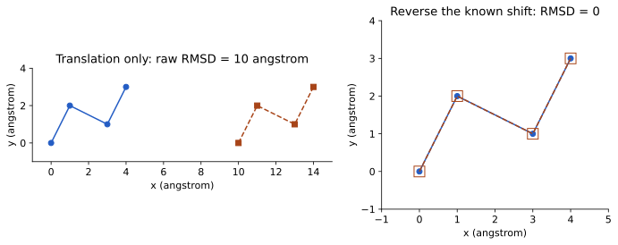

# RMSD، هم‌ترازی و اتم‌های متناظر

RMSD ریشهٔ میانگین مربع فاصلهٔ اتم‌های متناظر در دو مجموعه مختصات است. ابتدا باید تعیین کنیم کدام اتمِ مدل اول با کدام اتمِ مدل دوم مقایسه می‌شود. برابربودن تعداد اتم‌ها کافی نیست؛ نام، ترتیب، زنجیره و نگاشت باقی‌مانده‌ها باید سازگار باشند.

پیش از مقایسهٔ شکل، معمولاً انتقال و چرخش صلب را با هم‌ترازی کم می‌کنیم. در هم‌ترازی، شکل داخلی زنجیره تغییر نمی‌کند؛ فقط دستگاه مختصات آن نسبت به مرجع تنظیم می‌شود. اگر دو فایل فقط جای متفاوتی در فضا داشته باشند، RMSD خام می‌تواند بزرگ و RMSD پس از تطابق تقریباً صفر باشد.

واحد RMSD همان واحد مختصات است؛ اغلب آنگستروم. انتخاب ستون فقرات، CA یا همهٔ اتم‌ها پاسخ یکسانی نمی‌دهد. یک RMSD کلی نیز ممکن است حرکت یک ناحیهٔ کوچک را پنهان کند؛ برای پرسش موضعی، ناحیهٔ مورد نظر را جدا تحلیل کنید.

## ابتدا «متناظر» را تعریف کنیم

RMSD فاصلهٔ مختصات متناظر را خلاصه می‌کند. اگر دو مدل هر کدام ۷۶ اتم داشته باشند، هنوز معلوم نیست اتم اول یکی با اتم اول دیگری متناظر است. نگاشت می‌تواند از هویت باقی‌مانده‌ها، هم‌ترازی توالی و نام اتم ساخته شود. جهش، حذف، کد درج، زنجیرهٔ اضافی و ترتیب فایل می‌توانند این نگاشت را تغییر دهند. پیش از محاسبه، جدولی با شناسهٔ جفت‌ها بسازید یا روشن کنید چرا دو فایل ترتیب کاملاً یکسانی دارند.

برای N جفت، ابتدا فاصلهٔ هر جفت را حساب می‌کنیم، مربع فاصله‌ها را جمع می‌کنیم، بر N تقسیم می‌کنیم و ریشه می‌گیریم. به همین دلیل RMSD واحد طول دارد. میانگین فاصله و ریشهٔ میانگین مربع فاصله یکسان نیستند؛ مربع‌کردن باعث می‌شود فاصله‌های بزرگ‌تر اثر بیشتری داشته باشند. اگر یک حلقه بسیار جابه‌جا شود، عدد کل ممکن است افزایش یابد حتی وقتی هستهٔ پروتئین نزدیک است.

## هم‌ترازی، سؤال محاسبه را تغییر می‌دهد

دو ساختار یکسان را می‌توان در دو جای متفاوت دستگاه مختصات قرار داد. RMSD خام این جابه‌جایی را می‌بیند. برای مقایسهٔ شکل، معمولاً انتقال و چرخش صلبی می‌یابیم که مجموع مربع فاصله‌ها را کمینه کند. صلب یعنی طول‌ها و زاویه‌های داخلی در این مرحله عوض نمی‌شوند. الگوریتمی مانند Kabsch این مسئله را برای نگاشت مشخص حل می‌کند؛ هم‌ترازی توالی کار دیگری است.

مجموعهٔ اتم‌های fit ممکن است با مجموعهٔ report فرق داشته باشد. مثلاً هسته را هم‌تراز می‌کنیم و سپس حرکت دمین دوم را در همان دستگاه می‌سنجیم. اگر هر دمین را جداگانه fit کنیم، بخشی از حرکت نسبی آن‌ها حذف می‌شود. بنابراین عبارت «RMSD کم بود» بدون انتخاب fit، انتخاب سنجش و نگاشت ناقص است.

## مثال آموزشی

فرض کنید مختصات سه اتم متناظر را بر حسب آنگستروم داریم. نام‌های A، B و C فقط شناسهٔ آموزشی‌اند؛ هر سطر یک جفت اتم متناظر است، نه صرفاً دو اتم هم‌شماره در فایل. مدل دوم نسخهٔ انتقال‌یافتهٔ مدل مرجع است:

| جفت اتم | مختصات مرجع `(x, y, z)` | مختصات مدل پیش از fit | اختلاف مدل با مرجع | مربع فاصله `d²` |
| --- | --- | --- | --- | --- |
| A | `(0, 0, 0)` | `(3, 4, 0)` | `(3, 4, 0)` | `3² + 4² = 25` |
| B | `(1, 0, 0)` | `(4, 4, 0)` | `(3, 4, 0)` | `25` |
| C | `(0, 1, 0)` | `(3, 5, 0)` | `(3, 4, 0)` | `25` |

فاصلهٔ هر جفت، طبق قضیهٔ فیثاغورس، `√25 = 5` آنگستروم است. پس RMSD خام برابر است با `√((25 + 25 + 25) / 3) = 5` آنگستروم. ابتدا مربع فاصله‌ها واحد آنگستروم مربع دارد؛ پس از ریشه‌گیری، واحد نتیجه دوباره آنگستروم است. به طور کلی برای N جفت، فرمول `RMSD = √((d₁² + ... + dN²) / N)` است.

برای هم‌ترازی، بردار انتقال `(−3, −4, 0)` را به **همهٔ** نقاط مدل اعمال می‌کنیم. مختصات جدید A، B و C به‌ترتیب `(0, 0, 0)`، `(1, 0, 0)` و `(0, 1, 0)` می‌شوند. هر سه فاصله اکنون صفر و RMSD پس از هم‌ترازی `√((0 + 0 + 0) / 3) = 0` آنگستروم است. چون فاصله نمی‌تواند منفی باشد، صفر کمینه است؛ در این مثال خاص چرخشی لازم نیست. در حالت کلی fit به دنبال انتقال و چرخش صلب مناسب می‌گردد، نه تغییر مستقل مختصات هر اتم. در محاسبات رایانه‌ای ممکن است به‌جای صفر عددی بسیار کوچک ببینیم.

این مثال فقط نشان می‌دهد اختلاف اولیه با یک انتقال توضیح داده می‌شود. RMSD پس از fit فقط شباهت هندسی اتم‌های انتخاب‌شده را خلاصه می‌کند: به نگاشت و انتخاب fit و سنجش وابسته است، حرکت موضعی را ممکن است پنهان کند و به‌تنهایی دربارهٔ عملکرد یا شباهت همهٔ بخش‌های ساختار نتیجه نمی‌دهد. برای مقایسهٔ دو عدد، انتخاب اتم‌ها، تعداد جفت‌ها، مرجع، روش fit و واحد را گزارش کنید.

دو فاصلهٔ متناظرِ ۰ و ۲ آنگستروم را در نظر بگیرید. میانگین فاصله ۱ است، ولی RMSD ریشهٔ `(0²+2²)/2`، حدود ۱٫۴۱۴ آنگستروم می‌شود. اکنون فرض کنید همهٔ اتم‌های یک مدل را ۱۰ آنگستروم در جهت x جابه‌جا کرده‌ایم. RMSD خام دقیقاً ۱۰ است. اگر همان انتقال را معکوس کنیم، شکل و مختصات اولیه بازمی‌گردند و RMSD در حد خطای عددی صفر می‌شود.

برای انجام واقعی این کنترل روی فایل آموزشی، از ریشهٔ مخزن اجرا کنید:

```sh
python3 structural-bioinformatics/assets/course/learning_lab.py geometry
```

برنامه ۷۶ اتم Cα را می‌خواند و RMSD خام ۱۰ را گزارش می‌کند. مقدار پس از معکوس‌کردن انتقال ممکن است حدود `10^-15` باشد؛ این اثر حساب اعشاری است. این برنامه معکوس انتقال معلوم را انجام می‌دهد و ادعای پیاده‌سازی fit عمومی یا MD ندارد. [فایل برنامه](../../assets/course/learning_lab.py) قابل دریافت و خواندن است.

[](../../assets/course/figures/translation.svg)

شکل آموزشی با چهار نقطهٔ ساختگی: در چپ همهٔ نقاط ده آنگستروم به راست رفته‌اند؛ فاصله‌های درونی ثابت است ولی RMSD خام ده می‌شود. در راست همان جابه‌جایی معلوم را برگردانده‌ایم و نقاط منطبق‌اند. این تصویر حرکت واقعی پروتئین یا الگوریتم عمومی هم‌ترازی را نشان نمی‌دهد.

## کار عملی: سه مقایسه، سه تفسیر

ابتدا خروجی برنامه را ذخیره کنید و قبل از اجرا توضیح دهید چرا انتظار ۱۰ و تقریباً صفر دارید. سپس [اسکریپت VMD](../../assets/course/vmd-geometry.tcl) را بخوانید و با مسیر واقعی 1UBQ اجرا کنید؛ توضیح بالای فایل دربارهٔ شکل فرمان است و هر فایل سازگار با انتخاب مشخص باید جدا بررسی شود. اسکریپت دو نسخهٔ همان ورودی را می‌خواند، یکی را جابه‌جا می‌کند و با `measure fit` هم‌تراز می‌کند.

در مرحلهٔ دوم، انتخاب Cα را به backbone تغییر دهید و شمار جفت‌ها را ثبت کنید. چون در این کنترل فقط انتقال صلب داده‌ایم، نتیجهٔ منطقی باید حفظ شود. در مرحلهٔ سوم، روی کاغذ فرض کنید فقط یک حلقه جابه‌جا شده است. پیش‌بینی کنید fit کل زنجیره و fit هسته چه تفاوتی خواهند داشت. لازم نیست عددی که محاسبه نکرده‌اید بسازید؛ فرض خود را با طرح نشان دهید.

گزارش نهایی شامل ورودی، انتخاب‌ها، واحد، RMSD پیش و پس از fit و توضیح دو خطای احتمالی باشد. اگر VMD نصب نیست، بخش محاسبهٔ Python و تحلیل انتخاب را کامل کنید و اجرای VMD را انجام‌شده ننویسید. ابزار جای استدلال دربارهٔ نگاشت را نمی‌گیرد.

## خودآزمایی

۱. آیا RMSD صفر ثابت می‌کند دو پروتئین در همهٔ شرایط یک عملکرد دارند؟ ۲. چرا گزارش RMSD برای ۱۰ اتم و ۱۰۰۰ اتم بدون توضیح انتخاب قابل مقایسه نیست؟ ۳. تفاوت fit هسته و fit همهٔ زنجیره چیست؟ ۴. برای فاصله‌های ۱، ۱ و ۴ آنگستروم RMSD چقدر است؟

۵. سه اتم متناظر مرجع به‌ترتیب `(0, 0, 0)`، `(1, 0, 0)` و `(0, 1, 0)` آنگستروم‌اند. مختصات مدل به‌ترتیب `(0, 2, 0)`، `(1, 2, 0)` و `(0, 3, 0)` است. RMSD خام را حساب کنید؛ سپس یک انتقال صلب برای هم‌ترازی پیشنهاد دهید و RMSD پس از آن را به دست آورید. آیا می‌توان بدون دانستن متناظربودن سطرها به نتیجه اعتماد کرد؟

### توضیح پاسخ

۱. فقط انطباق مجموعهٔ انتخاب‌شده در شرایط محاسبه را نشان می‌دهد. ۲. ممکن است بخش‌ها و نوع اتم‌ها متفاوت باشند و نواحی مشکل حذف شده باشند. ۳. دستگاه مرجع بر اساس مجموعهٔ متفاوتی تعیین می‌شود و حرکت نسبی نواحی می‌تواند متفاوت دیده شود. ۴. ریشهٔ `(1+1+16)/3`، یعنی ریشهٔ ۶ و حدود ۲٫۴۴۹ آنگستروم. نتیجه را با میانگین فاصلهٔ ۲ مقایسه کنید و اثر مربع‌کردن را توضیح دهید.

۵. اختلاف مدل و مرجع در هر سه جفت `(0, 2, 0)` است؛ بنابراین هر فاصله ۲ آنگستروم و هر مربع فاصله ۴ آنگستروم مربع است. RMSD خام `√((4 + 4 + 4) / 3) = 2` آنگستروم می‌شود. با افزودن `(0, −2, 0)` به هر سه مختصات مدل، هر نقطه روی مرجع متناظر خود می‌افتد؛ فاصله‌ها و RMSD پس از هم‌ترازی صفرند. این صفر کمینه است. اگر سطرها واقعاً متناظر نباشند، محاسبه فاصلهٔ جفت‌های نادرست را خلاصه می‌کند و برای مقایسهٔ مورد نظر قابل اعتماد نیست.

## منابع برای ادامهٔ مطالعه

- [راهنمای رسمی VMD؛ نمایش، انتخاب اتم و اندازه‌گیری](https://www.ks.uiuc.edu/Research/vmd/current/ug/)
- [راهنمای رسمی VMD برای ترتیب اتم‌ها و هم‌ترازی RMSD](https://www.ks.uiuc.edu/Research/vmd/current/ug/node203.html)
- [راهنمای آموزشی داده‌های ساختاری، RCSB PDB-101](https://pdb101.rcsb.org/learn/guide-to-understanding-pdb-data/introduction)
