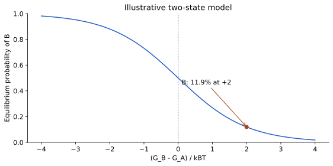

# منظر انرژی و انرژی آزاد

یک مولکول می‌تواند آرایش‌های متفاوتی داشته باشد. اگر برای هر آرایش یک مقدار انرژی در نظر بگیریم، مجموعهٔ آن‌ها تصویری از منظر انرژی می‌سازد. محورهای این منظر معمولاً بسیار بیشتر از دو یا سه بعدند؛ شکل تپه و دره صرفاً تشبیهی برای فهم آن است.

انرژی پتانسیلِ یک مختصات با انرژی آزادِ یک حالت یکسان نیست. انرژی آزاد هم سهم انرژی و هم تعداد حالت‌های قابل دسترس و محیط را در بر می‌گیرد. کمینهٔ محلی حالتی است که تغییر کوچک اطرافش انرژی را افزایش می‌دهد؛ الزاماً کمینهٔ سراسری نیست. سد میان دو ناحیه می‌تواند عبور را کند کند، حتی اگر حالت نهایی از نظر ترمودینامیکی مطلوب باشد.

برای تفسیر محاسبه بپرسید: چه متغیرهایی تغییر کرده‌اند، انرژی با چه مدلی محاسبه شده، حلال چگونه در نظر گرفته شده و نمونه‌برداری چقدر بوده است؟ یک امتیاز دلخواه را بدون تعریف و واحد، انرژی آزاد آزمایشگاهی ننامید.

## چرا یک مختصات برای توصیف حالت کافی نیست؟

برای N اتم، موقعیت‌ها در حالت کلی به 3N مؤلفه نیاز دارند. اگر شکل یک پروتئین را با یک محور مانند فاصلهٔ دو دمین توصیف کنیم، اطلاعات بسیار زیادی را فشرده کرده‌ایم. محور افقیِ یک نمودار انرژی معمولاً چنین توصیفِ کم‌بعدی‌ای است، نه همهٔ مختصات سامانه. دو حالت با همان فاصلهٔ دمین‌ها ممکن است جهت گروه‌های جانبی یا آرایش آب متفاوتی داشته باشند.

انرژی پتانسیل U در یک مدل مولکولی از مختصات و پارامترهای مدل محاسبه می‌شود. اگر فقط U را کمینه کنیم، یک آرایش کم‌انرژی در همان مدل پیدا می‌کنیم. در دمای غیرصفر، سامانه مجموعه‌ای از حالت‌ها را می‌بیند. اهمیت یک ناحیه فقط به پایین‌بودن یک نقطه بستگی ندارد؛ شمار و گستردگی حالت‌های قابل دسترس نیز مهم است. اینجا مفهوم انرژی آزاد وارد می‌شود.

## انرژی، آنتروپی و احتمال

آنتروپی با تعداد و توزیع حالت‌های ممکن مرتبط است. در شرایط دما و فشار ثابت، انرژی آزاد گیبس به صورت G=H−TS نوشته می‌شود؛ H آنتالپی، T دما و S آنتروپی است. در شرایط مناسب دیگر، انرژی آزاد هلمهولتز F=U−TS به کار می‌رود. بنابراین باید بدانیم نمودار مربوط به چه شرایط و چه تعریفی از حالت است. «کمترین انرژی» بدون نام انرژی و شرایط جملهٔ دقیقی نیست.

برای دو حالت تعریف‌شده در تعادل، اختلاف انرژی آزاد با نسبت جمعیت‌ها ارتباط دارد. اگر ΔG=G_B−G_A باشد، نسبت P_B/P_A برابر exp(−ΔG/kBT) برای انرژی هر ذره است؛ برای انرژی مولی RT به کار می‌رود. وقتی ΔG مثبت است، B کم‌جمعیت‌تر است. این رابطه دربارهٔ جمعیت تعادلی است، نه اینکه سامانه در یک زمان کوتاه حتماً به آن رسیده باشد.

## دره، سد و مختصات واکنش

درهٔ انرژی ناحیه‌ای از حالت‌های پایدارتر در توصیف انتخابی است. برای رفتن از یک دره به دیگری ممکن است عبور از ناحیه‌ای نامطلوب‌تر لازم باشد. ارتفاع سد به سرعت گذار مرتبط است و با اختلاف عمق دو دره یکسان نیست. دو سامانه می‌توانند جمعیت تعادلی مشابه ولی سرعت رسیدن به تعادل متفاوت داشته باشند.

یک مختصات واکنش، متغیری است که برای دنبال‌کردن پیشرفت گذار انتخاب می‌کنیم. انتخاب نامناسب می‌تواند سدها را پنهان کند یا دو حالت متفاوت را روی هم بیندازد. بنابراین نمودار یک‌بعدی یک توضیح مفید است اما به تنهایی نقشهٔ کامل رفتار مولکول نیست. در تحلیل باید بگویید چرا این متغیر برای سؤال شما مناسب است.

## مثال آموزشی

در مدل فرضی دوحالتی، ΔG برابر ۲kBT است. نسبت جمعیت B به A حدود exp(−2)=0.135 می‌شود. اگر فقط همین دو حالت وجود داشته باشند، سهم B برابر `0.135/(1+0.135)` یا حدود ۱۱٫۹ درصد است. این مثال واحد ندارد چون انرژی را بر kBT تقسیم کرده‌ایم. آن را به مقدار انرژی اتصال یک پروتئین واقعی نسبت ندهید.

برنامهٔ همراه این محاسبه را بازتولید می‌کند:

```sh
python3 structural-bioinformatics/assets/course/learning_lab.py energy
```

سپس خودتان برای ΔG برابر صفر و منفی ۲kBT حساب کنید. در حالت صفر، جمعیت‌ها برابرند؛ برای منفی ۲، B پرجمعیت‌تر می‌شود. علامت اختلاف را در ابتدای پاسخ تعریف کنید تا نتیجه برعکس تعبیر نشود.



منحنی از رابطهٔ همین مثال محاسبه شده است. محور افقی اختلاف انرژی آزاد تقسیم بر kBT و محور عمودی احتمال حالت B است. در اختلاف صفر دو حالت احتمال برابر دارند؛ در اختلاف مثبت دو، سهم B حدود ۱۱٫۹ درصد می‌شود. ارتفاع سد و سرعت گذار در این نمودار وجود ندارند.

## کار عملی: دو منظر با یک تعادل

دو نمودار فرضی بکشید که عمق دره‌های A و B در آن‌ها یکسان باشد ولی ارتفاع سد فرق کند. برای هر نمودار، جمعیت تعادلی نسبی و دشواری گذار را به زبان ساده توضیح دهید. سپس محور افقی را از «فاصلهٔ دو بخش» به «زاویهٔ یک پیوند» تغییر دهید و بگویید چه اطلاعاتی حذف یا آشکار می‌شود. هدف رسم منحنی زیبا نیست؛ باید معنای هر محور و هر استنتاج روشن باشد.

برای بخش عددی جدولی از ΔG/kBT برابر −۲، −۱، ۰، ۱ و ۲ بسازید. نسبت و سهم B را محاسبه و نمودار کنید. یک خطا عمداً امتحان کنید: استفاده از نسبت به جای احتمال. توضیح دهید چرا نسبت می‌تواند از یک بزرگ‌تر شود ولی احتمال نمی‌تواند. خروجی نهایی شامل دو نمودار منظر، جدول جمعیت و یک پاراگراف دربارهٔ فرض تعادل است.

## خودآزمایی

۱. چرا کمینه‌سازی U همان محاسبهٔ G نیست؟ ۲. آیا سد بزرگ الزاماً یعنی حالت نهایی کم‌جمعیت است؟ ۳. اگر ΔG=0 باشد، زمان رسیدن به تعادل معلوم است؟ ۴. چرا واحد kcal/mol را نمی‌توان بی‌تبدیل کنار kBT هر ذره گذاشت؟

### توضیح پاسخ

۱. انرژی آزاد اثر توزیع حالت‌ها و شرایط ترمودینامیکی را نیز دارد. ۲. سد به مسیر و سرعت مربوط است؛ اختلاف انرژی آزاد به نسبت جمعیت تعادلی. ۳. خیر؛ اطلاعات سینتیکی لازم است. ۴. انرژی مولی و انرژی هر ذره مقیاس متفاوت دارند و باید با RT یا kBT سازگار شوند. پاسخ کامل، تعریف حالت و شرایط را هم ذکر می‌کند.

## منابع برای ادامهٔ مطالعه

- [راهنمای مرجع GROMACS؛ الگوریتم دینامیک مولکولی](https://manual.gromacs.org/current/reference-manual/algorithms/molecular-dynamics.html)
- [پایهٔ شیمی و ساختمان پروتئین](https://www.ncbi.nlm.nih.gov/books/NBK26830/)
