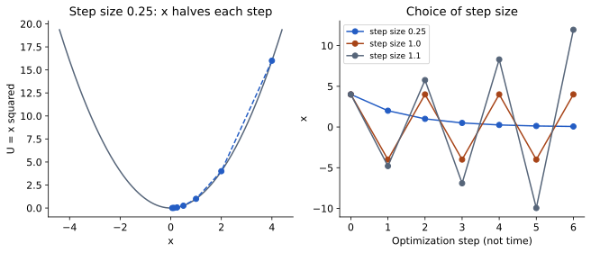

# بهینه‌سازی هندسی و جست‌وجوی ساختاری

بهینه‌سازی هندسی مختصات را با هدف کاهش تابع هدف، مانند انرژی یک میدان نیرو، تغییر می‌دهد. در روش‌های گرادیانی، جهت تغییر از شیب تابع به دست می‌آید. کمینه‌سازی برای رفع برخورد شدید و آماده‌سازی مفید است، اما پاسخ نهایی به مدل و نقطهٔ شروع وابسته است.

جست‌وجوی ساختاری به کاوش آرایش‌های متفاوت مربوط است. با داشتن چند کمینهٔ محلی، شروع از یک نقطه کافی نیست تا بهترین حالت پیدا شود. جست‌وجوی چندشروعی، روش‌های تصادفی یا نمونه‌برداری می‌توانند نواحی بیشتری را بررسی کنند؛ هزینه و معیار توقف باید روشن باشند.

در کمینه‌سازی، شمارهٔ تکرار لزوماً زمان فیزیکی نیست. الگوریتم برای پایین‌آوردن تابع حرکت می‌کند، نه برای بازسازی مسیر واقعیِ حرکت در دمای معین. پس از بهینه‌سازی، کیفیت هندسی و سازگاری با داده را بررسی کنید؛ کاهش تابع هدف به‌تنهایی درستی مدل را ثابت نمی‌کند.

## کمینهٔ محلی دقیقاً چیست؟

یک تابع انرژی می‌تواند چند نقطهٔ کمینه داشته باشد. در کمینهٔ محلی، حرکت کوچک در جهت‌های اطراف انرژی را کاهش نمی‌دهد؛ این الزاماً پایین‌ترین مقدار کل فضا نیست. نقطهٔ آغاز الگوریتم و مسیر انتخاب گام‌ها بر کمینهٔ یافته‌شده اثر دارند. اگر دو شروع مختلف به دو خروجی برسند، الزاماً یکی از اجراها خطای نرم‌افزاری ندارد؛ ممکن است تابع چند حوضه داشته باشد.

گرادیان برداری است که جهت بیشترین افزایش محلی تابع را نشان می‌دهد. در گرادیان کاهشی، در جهت مخالف آن حرکت می‌کنیم. اندازهٔ گام تعیین می‌کند چقدر جلو برویم. گام کوچک می‌تواند همگرایی کند بدهد و گام بزرگ می‌تواند از دره عبور کند یا ناپایداری بسازد. برای سامانهٔ مولکولی، نیرو با منفی مشتق انرژی نسبت به مختصات مرتبط است؛ کمینه‌سازی معمولاً بزرگی نیرو و تغییر انرژی را کنترل می‌کند.

## معیار توقف و دامنهٔ نتیجه

توقف ممکن است به رسیدن نیروی بیشینه به آستانه، کوچک‌شدن تغییر انرژی یا رسیدن به تعداد گام مجاز مربوط باشد. «برنامه تمام شد» با «معیار همگرایی مورد نظر برقرار شد» برابر نیست. اگر به حد گام رسیدیم ولی نیروی بزرگی باقی مانده، گزارش باید همین را بگوید. افزایش بی‌بررسی تعداد گام یا خاموش‌کردن هشدار، تشخیص مشکل را جایگزین نمی‌کند.

کمینه‌سازی برای برطرف‌کردن بعضی تماس‌های نامطلوب و آماده‌سازی مفید است. اما مسیر آن زمان فیزیکیِ تاخوردن نیست. برای دانستن جمعیت حرارتی یا سرعت گذار به روش مناسب دیگری نیاز داریم. حتی یک ساختار با انرژی پایین می‌تواند از نظر شیمی، پروتوناسیون یا سامانهٔ انتخابی نامناسب باشد؛ الگوریتم فقط مسئله‌ای را که تعریف کرده‌ایم حل می‌کند.

## مثال آموزشی

تابع فرضی `U(x)=x²` را بگیرید. مشتق آن 2x است. با قاعدهٔ `x_new=x−α(2x)` و α=0.25، هر گام x نصف می‌شود. از x=4 به 2، سپس 1 و 0.5 می‌رسیم. انرژی‌ها به‌ترتیب 16، 4، 1 و 0.25 هستند. این مدل بی‌بعد است و یک پروتئین را شبیه‌سازی نمی‌کند.

در [برنامهٔ همراه](../../assets/course/learning_lab.py)، فرمان `energy` همین دنباله را چاپ می‌کند. اگر α=1 بگذارید، x فقط بین 4 و −4 جابه‌جا می‌شود و انرژی پایین نمی‌آید. برای α بزرگ‌تر از 1، مقدار مطلق x رشد می‌کند. با همین تابع ساده می‌توان نقش اندازهٔ گام را دید، بدون اینکه نتیجهٔ یک موتور پیچیده را حفظ کنیم.

## جست‌وجوی ساختاری با کمینه‌سازی فرق دارد

جست‌وجو می‌کوشد نواحی متفاوت فضای حالت را ببیند؛ کمینه‌سازی محلی معمولاً اطراف یک شروع را پایین می‌رود. می‌توان چند کانفورمر ساخت، هرکدام را کمینه کرد و خروجی‌ها را خوشه‌بندی کرد. خوشه‌بندی یعنی گروه‌کردن پاسخ‌های شبیه بر اساس یک معیار معلوم. تعداد زیاد خروجی‌های تقریباً یکسان، پوشش مستقل تمام فضا نیست.

در انتخاب بهترین خروجی، انرژی یک معیار است ولی شیمی، برخوردها و سازگاری با داده نیز مهم‌اند. اگر تابع امتیاز بعضی اثرهای فیزیکی را خوب مدل نکند، جست‌وجوی بیشتر همان تابع الزاماً پاسخ زیستی بهتر نمی‌دهد. باید کیفیت تابع و کیفیت نمونه‌برداری را جدا ارزیابی کرد.

[](../../assets/course/figures/minimization.svg)

در سمت چپ مسیر کمینه‌سازی روی تابع فرضی U=x² دیده می‌شود. در راست اندازهٔ گام ۰٫۲۵ به صفر نزدیک می‌شود، گام ۱ بین دو مقدار نوسان می‌کند و گام ۱٫۱ دورتر می‌شود. شمارهٔ محور افقی تعداد تکرار الگوریتم است، نه زمان شبیه‌سازی؛ انرژی‌ها نیز واحد فیزیکی ندارند.

## کار عملی: جدول شکست و موفقیت الگوریتم

برای αهای 0.1، 0.25، 1 و 1.1، از x=4 شش گام دستی یا با صفحه‌گسترده حساب کنید. نمودار x و U را در برابر شمارهٔ گام بکشید. شمارهٔ گام را «پیکوثانیه» نام‌گذاری نکنید. سپس معیار توقف `|2x|<0.1` را اعمال کنید و تعداد گام لازم را برای یک اندازهٔ گام مناسب بیابید.

در بخش دوم تابعی با دو دره روی کاغذ بکشید و سه نقطهٔ آغاز انتخاب کنید. پیش‌بینی کنید کمینه‌ساز محلی به کجا می‌رود. برای فرار از وابستگی به نقطهٔ آغاز، یک طرح چندشروع پیشنهاد دهید. خروجی کار شامل نمودارها، جدول معیار توقف و توضیح یک حالت شکست است. این گزارش به شما یاد می‌دهد «کمینه کردیم» را به جمله‌ای قابل ارزیابی تبدیل کنید.

## خودآزمایی

۱. کمینهٔ محلی و سراسری چه فرقی دارند؟ ۲. چرا شمارهٔ گام بهینه‌سازی زمان فیزیکی نیست؟ ۳. با α=0.25 از x=1 به کجا می‌رویم؟ ۴. اگر اجرا به سقف گام رسید، چه چیزی باید گزارش شود؟

### توضیح پاسخ

۱. اولی فقط در همسایگی و دومی در کل دامنه پایین‌ترین مقدار است. ۲. حرکت را قاعدهٔ بهینه‌سازی تعیین می‌کند، نه لزوماً معادلهٔ حرکت با جرم و زمان. ۳. x=0.5 و U=0.25. ۴. مقدار نهایی انرژی، نیرو یا معیار توقف و این‌که همگرایی حاصل نشده است. [مرجع کمینه‌سازی GROMACS](https://manual.gromacs.org/current/reference-manual/algorithms/energy-minimization.html) تعریف معیارهای ابزار واقعی را توضیح می‌دهد.

## از شکل مولکول تا جستجوی چندشروعی

اتمها را مانند نقاطی تصور کنید که با پیوند به هم وصل هستند. چرخش حول بعضی پیوندها میتواند بدون تغییر اتصال اتمها شکل فضایی متفاوتی بسازد. هر آرایش از این نوع یک کانفورمر است. زاویه پیچشی با چهار اتم تعریف میشود و تغییر آن راهی برای توصیف این چرخش است. همه پیوندها آزادانه نمیچرخند و حلقه و مانع فضایی حرکت را محدود میکنند.

میدان نیرو یک مدل ریاضی تقریبی برای انرژی بر حسب مختصات است؛ جمله های آن میتوانند کشش پیوند، زاویه و برهمکنش اتمهای دورتر را توصیف کنند. کمینه ساز از یک آرایش شروع میکند و معمولا به دره نزدیک همان شروع میرسد. جستجو چند آرایش اولیه میسازد و میتواند هر کدام را جداگانه کمینه کند. سپس با معیار مشخص مانند انرژی و شباهت هندسی آنها را مقایسه میکنیم. حتی اگر همه اجراها همگرا شوند، تضمینی برای یافتن پایین ترین حالت در کل فضای ممکن وجود ندارد.

برای نمونه یک زنجیر فرضی چهار اتمی را در نظر بگیرید: چرخش پیوند میانی دو آرایش متفاوت ایجاد میکند. ممکن است هر آرایش پس از کمینه سازی به دره متفاوتی برسد. شکل دقیق و رتبه انرژی به نوع اتمها، محیط و مدل بستگی دارد؛ این مثال عدد تجربی یا نتیجه واقعی یک مولکول نیست.

## تمرین نرم افزاری آفلاین: دو دره

از ریشه مخزن با Python 3 اجرا کنید؛ هیچ بسته یا فایل داده اضافی لازم نیست. فایل [تمرین مبحث ۱۶](../../assets/course/topic16_search.py) نیز جداگانه در دسترس است:

```sh
python3 structural-bioinformatics/assets/course/topic16_search.py
python3 structural-bioinformatics/assets/course/topic16_search.py --starts -1.5 0.5 0 --max-steps 2
```

برنامه تابع بدون واحد `U(x)=(x²-1)²` را با گرادیان `4x(x²-1)` و نرخ 0.05 بررسی میکند. ستونها به ترتیب نقطه شروع، تعداد گام، موقعیت نهایی، انرژی، قدر مطلق گرادیان و وضعیت هستند. دو شروع اول به نزدیک 1- و 1 میرسند؛ انرژی هر دو نزدیک صفر است. شروع صفر همان جا میماند، اما صفر قله است: در آن نقطه مشتق صفر است و این شرط به تنهایی کمینه بودن را ثابت نمیکند. در اجرای دوم، رسیدن به سقف گام با `step_limit` گزارش میشود؛ نقطه صفر همچنان `stationary` است.

اکنون با `--starts -1.5 -0.5` فقط سمت چپ را نمونه برداری کنید، سپس شروع مثبت را برگردانید. جدول دو اجرا را مقایسه کنید و بنویسید چرا شروعهای بیشتر میتوانند دره دیگری را آشکار کنند، اما پوشش کامل را ثابت نمیکنند. نرخ، آستانه `1e-6`، سقف 500 گام و نسخه Python را همراه نتیجه ثبت کنید. مقادیر چاپی گرد شده اند. این تابع یک تصویر آموزشی تک بعدی است: x زاویه واقعی نیست، انرژی واحد فیزیکی ندارد و گامها زمان یا جمعیت مولکولی نیستند.

در کار مولکولی واقعی، تولید کانفورمر و بهینه سازی مراحل جداگانه اند. مقاله اصلی [Riniker و Landrum در سال 2015](https://pubmed.ncbi.nlm.nih.gov/26575315/) روش تولید کانفورمر مبتنی بر هندسه فاصله و اطلاعات تجربی پیچش را معرفی میکند. [کتاب رسمی RDKit](https://www.rdkit.org/docs/RDKit_Book.html#conformer-generation) توضیح میدهد که ETKDG چگونه از این اطلاعات استفاده میکند؛ [راهنمای کمینه سازی GROMACS](https://manual.gromacs.org/current/reference-manual/algorithms/energy-minimization.html) معیار نیرو و روشهای کمینه سازی را شرح میدهد. تمرین بالا هیچ کدام از این دو نرم افزار را اجرا نمیکند.

## منابع برای ادامهٔ مطالعه

- [راهنمای مرجع GROMACS؛ الگوریتم دینامیک مولکولی](https://manual.gromacs.org/current/reference-manual/algorithms/molecular-dynamics.html)
