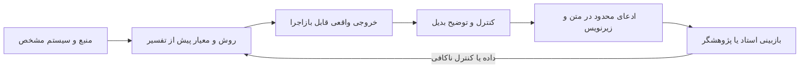

# راهنمای نگارش گزارش و مقالهٔ قابل دفاع

**نسخهٔ درسی؛ ۲۰۲۶-۱۰-۱۳.** این هفته، هدف **انتخاب پروتئین و سه مقاله و خلاصهٔ قابل فهم برای کلاس** است. نوشتن مقالهٔ کامل و اجرای MD تعهد این هفته نیست. محاسبه‌های انجام‌شده، پیوست اختیاریِ دفتر پژوهش‌اند؛ این راهنما مسیر نگارش تدریجی گزارش و مقالهٔ احتمالی آینده را نشان می‌دهد. قالب مقاله به‌تنهایی تازگی، اثبات مکانیسم یا قابلیت پذیرش مجله را تضمین نمی‌کند.

## ۱. عنوانی که با دادهٔ واقعی هماهنگ است

**عنوان سادهٔ ارائهٔ این هفته:** «آدالیموماب و پروتئین هدف TNF-α: ساختار، مکانیسم و پرسشِ ارتباط با TOP2A».

**عنوان پیشنهادی برای گزارش پژوهشیِ ادامه:** «تحلیل بازتولیدپذیر رابط جزئی TNF–Fab آدالیموماب و ارزیابی شواهد ارتباط غیرمستقیم با TOP2A».

عنوان گزارش دو سهم را روشن می‌کند: یک محاسبهٔ ساختاری محدود که انجام شده و یک ارزیابی شواهد برای پرسشی که هنوز پاسخ تجربی کامل ندارد. «مهار TOP2A با آدالیموماب» یا «درمان سرطان با آدالیموماب» عنوان مناسب داده‌های حاضر نیست. رابطهٔ با TOP2A را در سؤال، بحث و طرح آزمون نگه می‌داریم؛ آن را نتیجهٔ ساختار `3WD5` نمی‌نویسیم.

**نوع تحویل اکنون:** پیشنهاد موضوع و مرور متمرکز برای کلاس. دادهٔ موجود می‌تواند بعداً گزارش درسیِ بازتحلیل/مرور انتقادی را پشتیبانی کند. این کار هنوز «مرور نظام‌مند» نیست؛ جست‌وجوی جامع، معیارهای غربالگری و فرایند مستقل انتخاب به آن شکل اجرا نشده‌اند. برای مقالهٔ پژوهشی اصیل، باید سهم تازهٔ روشن، روش مناسب و شواهد/اعتبارسنجی متناسب ایجاد و با استاد ارزیابی شود.

## ۲. چه چیزی را نتیجه می‌نامیم؟

| عبارت در متن | وضعیت مجاز در پروژه |
| --- | --- |
| «در این مطالعه محاسبه کردیم…» | فقط خروجی اجراشده با ورودی، کد و روش ثبت‌شده |
| «Hu/Marguerie/Gehin گزارش کردند…» | نتیجهٔ منبع؛ با سیستم، مداخله و محدودیت آن |
| «این یافته فرضیهٔ… را مطرح می‌کند» | تفسیر اکتشافی با ذکر حلقهٔ مفقود و توضیح بدیل |
| «پیشنهاد می‌کنیم بررسی شود…» | روش آینده؛ خارج از نتایج انجام‌شده |
| «MD یا آزمایش نشان داد…» | تا اجرای واقعی و تحلیل معتبر آن، در متن نتایج وارد نمی‌شود |

تأیید DOI و خواندن روش مقاله، بازتولید نتیجهٔ آن نیست. موفقیت آزمون کد یا نمایشگر نیز اثبات اثر درمانی نیست. کمک هوش مصنوعی می‌تواند برای یافتن ایراد، آموزش و ویرایش مفید باشد؛ تأیید علمی نهایی باید بر داده و بازبینی پژوهشگر متکی باشد. ادعای مرجعیت، جای کنترل منابع را نمی‌گیرد.

## ۳. چکیدهٔ اولیه، فقط با یافته‌های موجود

متن زیر **پیش‌نویس چکیدهٔ گزارش پژوهشیِ ادامه** است؛ جای خلاصهٔ سه مقالهٔ این هفته را نمی‌گیرد. پیش از تحویل با نسخهٔ نهایی فایل‌های خروجی تطبیق داده شود. تحلیل مکمل سطح و کنترل هندسی اکنون نیز [گزارش پیوست اجراشده](structural-feasibility-results.fa.md) دارند؛ چکیدهٔ زیر بر بخش تماس و ممیزی شواهد متمرکز است:

**زمینه:** آدالیموماب آنتی‌بادی ضد TNF است؛ تفسیر ساختار اتصال آن برای فهم مکانیسم و تفکیک فرضیه‌های غیرمستقیم مرتبط با TOP2A اهمیت آموزشی دارد.

**هدف:** توصیف بازتولیدپذیر رابط جزئی TNF–Fab در `3WD5` و تعیین حدود شواهد پیوند آدالیموماب با TOP2A.

**روش:** مختصات مدل اول و زنجیره‌های نویسندهٔ `A/H/L` با انتخاب صریح اتم سنگین و اشغال‌پذیری مثبت تحلیل شدند. تماس در حد `≤4.5 Å` و حساسیت در `4.0/5.0 Å` گزارش شد. منابع ساختاری، سلولی و بالینی به‌طور متمرکز از نظر مداخله، خروجی و حدود تعمیم ارزیابی شدند.

**نتایج:** در رابط جزئی و حد `4.5 Å`، ۲۵۲ جفت اتم سنگین، ۴۰ جفت باقی‌مانده و ۱۷ باقی‌ماندهٔ TNF شناسایی شدند. تعداد جفت اتم در حدهای `4.0/5.0 Å` به‌ترتیب ۱۲۶ و ۴۴۵ بود. بررسی منابع نشان داد مشاهدهٔ تغییر SIRPG پس از آدالیموماب و مشاهدهٔ تغییر TOP2A پس از حذف SIRPG از آزمایش‌های جدا آمده‌اند؛ اثر دارو بر TOP2A در همین سیستم از این دو نتیجه اثبات نمی‌شود.

**نتیجه‌گیری:** این بازتحلیل، هندسهٔ رابط موجود و وابستگی سنجه به تعریف تماس را قابل بررسی می‌کند. پیوند غیرمستقیم با TOP2A فرضیه‌ای نیازمند آزمون مستقل باقی می‌ماند؛ MD، آزمایش دارو→TOP2A و اثربخشی ضدسرطان در این پروژه اجرا نشده‌اند. [اعداد و روش](structural-method.fa.md)، [تفکیک شواهد](connection-evidence.fa.md)

اگر دامنهٔ مقاله با تحلیل‌های بعدی گسترش یافت، فقط پس از کنترل روش و فایل خروجی چکیده بازنویسی می‌شود؛ جملهٔ خالی یا نتیجهٔ مورد انتظار وارد نسخهٔ تحویلی نمی‌شود.

## ۴. اسکلت مقاله و وظیفهٔ هر بخش

**مقدمه:** از آدالیموماب و هدف TNF شروع کنید؛ سپس اهمیت ساختار Fab و محدودیت نمای موجود را توضیح دهید. نقش TOP2A/چرخهٔ سلولی و علت بررسی پیوند غیرمستقیم را در یک بند بیاورید. بند آخر، سؤال محدود، سؤال توسعه‌ای و سهم دقیق این مطالعه باشد. هر سه منبع محوری دلیل حضور متفاوتی دارند؛ [ممیزی انتخاب منابع](literature-selection-audit.fa.md) این دلیل را مستند کرده است.

**مواد و روش‌ها:** شناسه/نسخهٔ ساختار، منبع، SHA، مدل و زنجیره، انتخاب اتم، altloc، حد تماس و قرارداد شمارش را بنویسید. کیفیت ساختار، اتم غایب و رابط جزئی ذکر شوند. برای مرور منابع، پایگاه‌های واقعاً بررسی‌شده، تاریخ، عبارات جست‌وجوی واقعاً استفاده‌شده و معیار انتخاب در دفتر جست‌وجو ثبت شوند؛ جست‌وجویی که اجرا نشده به روش اضافه نشود. روش را به‌اندازه‌ای دقیق بنویسید که خواننده بتواند محاسبه را بازاجرا کند. [راهنمای ICMJE برای روش و گزارش](https://www.icmje.org/recommendations/browse/manuscript-preparation/preparing-for-submission.html)

**نتایج:** نخست توصیف ورودی و محدودیت پوشش، سپس تماس/حساسیت و شکل، و بعد جدول «منبع–مداخله–خروجی–حد ادعا». نتایج منبع دیگر با فاعل همان پژوهشگران بیان شوند. در تحلیل ثابت یک ساختار، به تعداد اتم‌ها برچسب `n` بیمار نزنید و آزمون آماری اثر دارو از آن نسازید.

**بحث:** یافته را در چارچوب شواهد پیشین تفسیر کنید. چرا تحلیل رابط برای مکانیسم شناخته‌شده مفید است؟ چرا اتصال TNF→Fab با RNA TOP2A یکی نیست؟ تفاوت Fab و IgG کامل، نوع سلول، سازه و چرخهٔ سلولی چه بدیل‌هایی می‌سازند؟ محدودیت و آزمون بعدی کنار همان ادعا مطرح شوند. بخش نتیجه‌گیری باید سؤال واقعاً پاسخ‌داده‌شده را پاسخ دهد.

**داده، کد و مشارکت‌ها:** مسیر کد و ورودی، محیط قفل‌شده، خروجی‌های کوچک و فرمان بازتولید را معرفی کنید. دریافت فایل‌های بزرگ را مستند کنید. نقش دانشجو، استاد و ابزارهای کمکی دقیق و مطابق واقع ثبت شود؛ شرایط افشای استفاده از هوش مصنوعی با دستور درس یا مجلهٔ مقصد تطبیق داده شود.

## ۵. قالب نتیجه برای کارهای هنوز اجرا نشده

این قالب‌ها **یادداشت برنامه‌ریزی** هستند؛ هنگام تحویل، بخش اجراشده تکمیل یا بخش اجرا‌نشده از «نتایج» حذف می‌شود:

- **هر تحلیل تازهٔ هنوز اجرا نشده:** «سنجهٔ [نام و قرارداد] با روش [نسخه/پارامتر] در [ورودی/زنجیره] محاسبه شد: [مقدار واقعی و واحد]. کنترل [نام/نتیجه] و حساسیت [روش/نتیجه] انجام شد.» تا آن زمان هیچ مقدار فرضی یا تفسیر عددی نداریم.
- **MD؛ فقط طرح پیشنهادی:** «سیستم [اجزای تأییدشده] با [شرایط/میدان نیرو/نسخه] در [تکرارها و seedهای واقعی] اجرا شد. پس از [روش انتخاب بازهٔ تولید]، [سنجه] برابر [مقدار با عدم قطعیت و پراکندگی اجراها] بود. محدودیت نمونه‌برداری [شرح واقعی] است.»
- **آزمون TOP2A؛ دادهٔ مناسب هنوز ندارد:** «در [نوع سلول/حالت]، تفاوت [RNA/پروتئین/فعالیت؛ دقیقاً یکی] بین [دارو/کنترل] با واحد زیستی [اهداکننده] اندازه‌گیری شد: [اثر و عدم قطعیت].» گروه SIRPG KO/WT را به‌جای دارو/کنترل ننویسید.

پارامتر برازش‌شده، نتیجهٔ مشاهده‌شده و مقدار صرفاً انتخاب‌شده برای مثال باید جدا ثبت شوند. بازهٔ اطمینان ساختگی، `p` حدسی یا عبارت «احتمالاً معنی‌دار» برای پرکردن متن مجاز نیست. مقالهٔ MD به گزارش شرایط، نمونه‌برداری و اعتبارسنجی متناسب نیاز دارد. [راهنمای JCIM](https://doi.org/10.1021/acs.jcim.3c00599)

## ۶. شکل‌هایی که استدلال را حمل می‌کنند

| شکل | نقش علمی و زیرنویس ضروری |
| --- | --- |
| آنتی‌بادی کامل | شماتیک آموزشی IgG/Fab/Fc؛ مختصات واقعی `3WD5` یا شبیه‌سازی اتصال نامیده نشود |
| رابط `3WD5` | مختصات تجربی، زنجیره‌های `A/H/L`، رابط جزئی، حد تماس و واحد؛ رنگ نقش زیستی ثابت باشد |
| نقشهٔ تماس و حساسیت | تعریف محور/تماس، حدها و انتخاب اتم؛ تعداد بیشتر با حد بزرگ‌تر، اثر بیشتر درمان نیست |
| `TOP2A–DNA / 4FM9` | مقایسهٔ ساختار/هدف؛ هستهٔ برش و DNA مصنوعی، نه کمپلکس آدالیموماب یا RNA بیمار |
| نقشهٔ شواهد | خط پیوسته برای مشاهدهٔ مشخص و خط‌چین برای فرضیه؛ سیستم و منبع هر پیوند روشن باشد |
| نمودار زمانی MD، فقط پس از اجرا | بازهٔ تولید، انتخاب اتم، اجراهای جدا و روش عدم قطعیت؛ یک تصویر آخر مسیر کافی نیست |

**نمونهٔ زیرنویس رابط:** «نمای مختصات تجربی `3WD5` با TNF زنجیرهٔ `A` و Fab زنجیره‌های `H/L`. تماس اتم‌های سنگین با اشغال‌پذیری مثبت در حد `≤4.5 Å` تعریف شد. این تحلیل یک زیرواحد TNF و یک Fab را پوشش می‌دهد؛ Fc و رابط همسایه‌های تقارن در آن نیستند. رنگ و زاویهٔ دوربین، دادهٔ فیزیکی تازه تولید نمی‌کنند.» [ساختار RCSB](https://www.rcsb.org/structure/3WD5)

## ۷. ارائهٔ پنج‌دقیقه‌ای قابل تمرین

این متن، پیشنهاد تمرین برای معرفی موضوع و منابع این هفته است؛ پیوست عددی فقط برای سؤال تکمیلی استفاده می‌شود.

**دقیقهٔ ۰ تا ۱ — سؤال:** «آدالیموماب خودش پروتئینِ آنتی‌بادی است و هدف شناخته‌شده‌اش TNF است. هدف من ابتدا توضیح ساختار این اتصال است؛ سپس بررسی می‌کنم آیا برای ارتباط غیرمستقیم با TOP2A شواهدی داریم.» روی شماتیک، Fab و Fc را نشان دهید.

**دقیقهٔ ۱ تا ۲ — داده:** «`3WD5` ساختار بلوری است؛ در فایل تحلیل من یک زیرواحد TNF و Fab وجود دارد. `A` برای TNF و `H/L` برای Fab هستند. مدل تماس را از اتم‌های سنگین با سیاست مشخص می‌سازم.» واحد آنگستروم و تفاوت یک اتم/باقی‌مانده را توضیح دهید.

**دقیقهٔ ۲ تا ۳ — سه مقاله و علت انتخاب:** «Bianchi برای شکل و مدل‌سازی آنتی‌بادی کامل است؛ Marguerie برای سرنخ سلولی SIRPG/TOP2A؛ Gehin برای زمینهٔ بالینی دارو و CRP. هیچ‌کدام به‌تنهایی هر سه سطح را اثبات نمی‌کنند. Hu ۲۰۱۳ هم منبع بنیادی قدیمیِ ساختار واقعی اتصال است.» کارت هر مقاله را همراه یک نتیجه و یک محدودیت نشان دهید. [خلاصه و نقد](literature-review.fa.md)

**دقیقهٔ ۳ تا ۴ — ارتباط و حلقهٔ مفقود:** «TOP2A با DNA و چرخهٔ سلولی مرتبط است. در مقالهٔ SIRPG، یک آزمایش اثر آدالیموماب بر SIRPG و آزمایش دیگری اثر حذف SIRPG بر TOP2A را نشان می‌دهد. هنوز نمی‌توان این دو را به اثر اثبات‌شدهٔ دارو بر TOP2A تبدیل کرد.» روی نقشه، دو آزمایش جدا و خط‌چین فرضیه را نشان دهید.

**دقیقهٔ ۴ تا ۵ — آزمون بعدی:** «برای پرسش ساختاری، MD معتبر می‌تواند رفتار تماس‌های مدل را بررسی کند. برای اثر بر TOP2A، به گروه واقعی دارو/کنترل در همان سلول و سنجش TOP2A نیاز داریم. اگر داده یا کنترل کافی نداشتیم، نتیجهٔ این مرحله محدودیت شواهد و طرح آزمون خواهد بود.» [جزئیات فرضیه و دروازه‌های اجرا](academic-study-plan.fa.md)

**اگر دربارهٔ کار محاسباتی موجود پرسیدند:** «در رابط جزئی و حد ۴٫۵ آنگستروم ۲۵۲ جفت اتم و ۴۰ جفت باقی‌مانده داریم؛ تحلیل پوشیدگی سطح و کنترل هندسی نیز در پیوست ثبت شده است. این‌ها محاسبه‌های مختصات ثابت هستند، نه MD یا آزمایش پاسخ بیمار.» فایل خروجی و [پیوست روش/نتیجه](structural-feasibility-results.fa.md) را نشان دهید.

اگر دربارهٔ جزئی که هنوز بررسی نشده سؤال شد، بگویید: «این بخش در مطالعهٔ من اجرا نشده؛ برای پاسخ باید [داده یا کنترل مشخص] را بررسی کنم.» پاسخ دقیقِ محدود، قابل دفاع‌تر از پاسخ قطعی بدون داده است.

## ۸. کنترل نهایی پیش از تحویل

1. هر عدد به خروجی واقعی و هر ادعای زیستی به منبع درست وصل باشد؛ عنوان و چکیده فراتر از نتایج نروند.
2. منبع اصلی داده (`3WD5`، مطالعهٔ سلولی یا مطالعهٔ بالینی) با نقش شکل/جدول تطبیق داده شود؛ یافته‌های چند سیستم یک آزمایش واحد معرفی نشوند.
3. روش، فرمان، نسخه، واحد و محدودیت برای بازاجرا کافی باشند؛ تفاوت سازه‌ها و رابط جزئی پنهان نشوند.
4. نتیجهٔ مخالف، عدم کفایت داده و توضیح بدیل ثبت شوند؛ بخش آینده و مثال نمایشی وارد نتایج انجام‌شده نشوند.
5. دانشجو بتواند هر شکل و اصطلاح ضروری را بدون خواندن متن بلند توضیح دهد؛ استاد دامنه، استدلال و نوع تحویل نهایی را بررسی کند.

این روند امکان نگارش تدریجی یک متن علمی منسجم را فراهم می‌کند. گذار از گزارش درسی به مقالهٔ قابل ارسال، با ایجاد شواهد و سهم متناسب تصمیم‌گیری می‌شود؛ نتیجهٔ مثبت و پذیرش، پیش‌فرض طرح نیستند.
