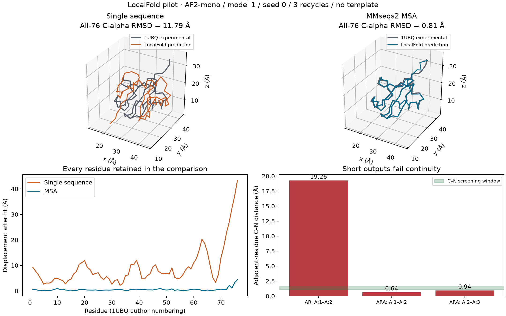

# از ترکیب آمینواسیدها تا مدل سه‌بعدی پپتید

آدالیموماب آنتی‌بادیِ مرجع این پژوهش است. این دارو به TNF-α متصل می‌شود؛ TNF-α پیام‌رسان پروتئینی است که با اتصال به گیرنده‌های TNFR1 و TNFR2 در سلول پیام ایجاد می‌کند. پرسش ما این است که کدام پپتیدها را می‌توان با الهام از رابط آدالیموماب–TNF برای اتصال به TNF و بررسی مهار تعامل آن با گیرنده‌ها پیشنهاد کرد. کاهش هزینهٔ تولید هدف طراحی است و باید جدا سنجیده شود. در این مسیر، ساخت توالی، پیش‌بینی شکل مولکول، اتصال به شریک و مهار عملکرد چهار مرحلهٔ متفاوت‌اند. ([ساختار و مطالعهٔ Hu](https://www.rcsb.org/structure/3WD5))

## ۱. دو آمینواسید یعنی چه چیزی را ترکیب می‌کنیم؟

پپتید زنجیره‌ای از آمینواسیدهاست و توالی آن معمولاً از انتهای N به انتهای C نوشته می‌شود. در الفبای پروتئین، A یعنی آلانین و R یعنی آرژینین؛ این حروف را با بازهای DNA اشتباه نگیرید. توالی AR با RA فرق دارد، چون ترتیب زنجیره عوض شده است. تکرار مجاز است: AA و RR هم توالی‌های متفاوت‌اند. در این مرحله حروف را تولید می‌کنیم؛ اتم، پیوند، شکل فضایی و دست‌سانی هنوز ساخته یا کنترل نشده‌اند.

اگر برای هر جایگاه ۲۰ آمینواسید استاندارد مجاز باشد، تعداد توالی‌های مرتبِ طول L برابر 20^L است. این جدول برای هر طول جداست:

| طول زنجیره | تعداد توالی‌ها |
|---|---:|
| ۲ | ۴۰۰ |
| ۳ | ۸٬۰۰۰ |
| ۴ | ۱۶۰٬۰۰۰ |
| ۵ | ۳٬۲۰۰٬۰۰۰ |
| ۶ | ۶۴٬۰۰۰٬۰۰۰ |

از طول ۲ تا ۶ جمعاً ۶۷٬۳۶۸٬۴۰۰ توالی داریم. شمردن این فضا به معنی ساخت و داکینگ همهٔ اعضا نیست. برای تبدیل آن به آزمایش عملی باید آمینواسیدهای مجاز، طول، محل‌های قابل تغییر و بودجه را محدود کنیم. اسکن تک‌جهشیِ یک توالی مادر مسئلهٔ جداست: برای طول L و ۲۰ حرف، L×19 جایگزینی داریم.

## ۲. نخست فضا را بشمارید، سپس کتابخانهٔ کوچک بسازید

دستورها از ریشهٔ نسخهٔ محلی مخزن اجرا می‌شوند. [راهنمای آماده‌کردن محیط](software-workbook.fa.md) را در صورت نیاز بخوانید.

```sh
uv sync --project structural-bioinformatics --frozen
uv run --project structural-bioinformatics peptide-lab plan --min-length 2 --max-length 6
```

این دستور فقط برنامهٔ شمارش را چاپ می‌کند. برای تمرین، به‌جای ۲۰ حرف فقط A و R را مجاز کنید و طول‌های ۲ و ۳ را بسازید:

```sh
uv run --project structural-bioinformatics peptide-lab generate --alphabet AR --min-length 2 --max-length 3 --max-sequences 12 --output-dir structural-bioinformatics/results/peptide-demo-01
```

باید ۱۲ توالی داشته باشید: چهار توالی دوتایی و هشت توالی سه‌تایی. فایل `sequences.fasta` حروف هر توالی را نگه می‌دارد. فایل `manifest.json` تنظیمات، شمار، نسخه، زمان UTC و SHA-256 فایل را ثبت می‌کند. برای بازاجرای تمرین، نام پوشهٔ تازه انتخاب کنید؛ ابزار خروجی موجود را بازنویسی نمی‌کند.

سقف پیش‌فرض تولید ۱۰۰۰ توالی و سقف این نسخه ۱۰هزار است. اگر تعداد کامل از بودجه بیشتر باشد، ابزار پیش از نوشتن خروجی متوقف می‌شود؛ چند توالی ابتدای فهرست را مخفیانه جای کل کتابخانه نمی‌گذارد. طول‌های ۱ تا ۵۰ برای شمارش پشتیبانی می‌شوند. این‌ها حدود ابزار تولید توالی‌اند و اعتبار زیستی یک نامزد را تعیین نمی‌کنند.

در گزارش، `structure_generation` و `docking` و `functional_test` باید `not_run` باشند. این وضعیت درستِ همین مرحله است. فایل FASTA مختصات ندارد و صرفاً با بازکردن آن در یک نمایشگر، ساختار سه‌بعدی معتبر تولید نمی‌شود.

## ۳. LocalFold را در مسیر ساخت مدل قرار دهید

[LocalFold](https://localfold.org/) مسیر نخستِ کارگاه پیش‌بینی ساختار است. یک توالی منتخب را به‌صورت Protein وارد کنید؛ نام مدل، Seed و تنظیم MSA را ثبت کنید. برای مدل کمپلکس، هر شریک ورودی جدا دارد؛ خروجی تک‌زنجیره‌ای محل اتصال به شریک را نشان نمی‌دهد. خروجی کامل را با Download All نگه دارید. طبق مستندات سازنده، جست‌وجوی MSA توالی را به ColabFold می‌فرستد؛ Single Sequence آن جست‌وجو را کنار می‌گذارد. نسخهٔ مدل و فایل‌های خروجی را همراه درخواست حفظ کنید. ([مستندات سازنده](https://github.com/sokrypton/localfold/blob/0724b7fcebd9a83d263d9d9c485f818dce0242a1/README.md))

چهار اجرای واقعیِ این کارگاه در بخش ۶ ثبت شده‌اند: پروتئین مرجع با و بدون MSA، و دو توالی کوتاه AR و ARA. این آزمایش نشان می‌دهد پذیرفتن ورودی و تولید فایل، با ساخت مدل قابل استفاده یکسان نیست. اجرای دسته‌ای هنوز خودکار نشده است.

امتیازهای pLDDT، PAE و ipTM دربارهٔ اطمینان پیش‌بینی ساختارند؛ قدرت اتصال، مهار یا قیمت تولید را اندازه نمی‌گیرند. معیارهای مبتنی بر TM برای زنجیره‌های خیلی کوتاه وابستگی مهمی به طول دارند؛ امتیاز کوچک به‌تنهایی شاهد عدم اتصال نیست. در هر مقایسه، نوع امتیاز و طول توالی کنار عدد نگه داشته می‌شوند. چهار اجرای گزارش‌شده در این صفحه AF2-mono هستند و ipTM ندارند؛ آن معیار در ارزیابی رابطِ کمپلکس مطرح می‌شود. ([تعریف رسمی خروجی AlphaFold 3](https://github.com/google-deepmind/alphafold3/blob/main/docs/output.md))

برای خودکارسازی، رابط فایل ورودی/خروجی را مبنا قرار می‌دهیم. راهنمای توسعهٔ LocalFold، API کتابخانه را هنوز ناپایدار و بدون نقطهٔ ورود واحد توالی‌به‌ساختار معرفی می‌کند؛ بنابراین اتصال پایدار batch را قابلیت آماده فرض نمی‌کنیم. ([راهنمای اجرای LocalFold](https://github.com/sokrypton/localfold/blob/0724b7fcebd9a83d263d9d9c485f818dce0242a1/docs/RUNNING.md))

## ۴. فایل PDB را باز کنید و بفهمید چه می‌بینید

اسم نرم‌افزار نمایش استاد معلوم نیست. برای تمرین همسو با درس، VMD را استفاده می‌کنیم؛ آموزش عمومی آن در [مبحث مشاهدهٔ ساختار](../course.html?topic=6) و [مبحث Tcl](../course.html?topic=7) قرار دارد. LocalFold برای پیش‌بینی مدل و VMD برای این تمرینِ بازرسی ساختار نقش دارند.

۱. [فایل تجربی 3WD5](../assets/3wd5.pdb) را دریافت کنید. در VMD از File → New Molecule، Browse و سپس Load استفاده کنید. نام فایل و نسخهٔ برنامه را در دفتر اجرا بنویسید. ([راهنمای رسمی بارگذاری](https://www.ks.uiuc.edu/Research/vmd/current/ug/node25.html))

۲. در Graphics → Representations، انتخاب `protein and chain A` را با نمایش NewCartoon ببینید. برای زنجیره‌های H و L نمایش جدا بسازید. در این فایل، A مربوط به TNF و H/L زنجیره‌های سنگین/سبک Fab آدالیموماب‌اند؛ Fab قطعهٔ اتصال‌دهندهٔ آنتی‌بادی است. ([رکورد ساختار](https://www.rcsb.org/structure/3WD5))

۳. از توالی به یک باقی‌ماندهٔ مشخص برسید: زنجیره، شماره و نام آن را ثبت کنید و نمایش Licorice را برای بخش کوچکی انتخاب کنید. فهرست اتم‌ها و مختصات را با همان شناسه‌ها در فایل تطبیق بدهید. نمای روبانی برای دیدن مسیر کلی زنجیره مفید است؛ بررسی تماس به اتم‌های همان مدل نیاز دارد.

۴. در دفتر اجرا بنویسید چه چیزی واقعاً در فایل وجود دارد و چه چیزی غایب است. نمای سپرده‌شدهٔ 3WD5 شامل یک TNF و Fab است. بررسی رابط کامل به بازسازی همسایه‌های لازم با روش ثبت‌شده نیاز دارد؛ چرخاندن دوربین تعداد زیرواحدها را تغییر نمی‌دهد. [گزارش بازسازی موجود](full-epitope-results.fa.md) و [ممیزی نمایش](molecular-display-audit.fa.md) مرجع این تفاوت‌اند.

۵. فایل مختصات، وضعیت نمایش، شناسهٔ باقی‌مانده و تصویر را با هم نگه دارید. برای مدل پیش‌بینی‌شده، نام مدل و اطمینان آن را هم اضافه کنید. تصویرِ یک مولکول، گزارش اجرای داکینگ یا آزمون عملکرد نیست.

## ۵. توالی، ساختار و آزمایش را به هم وصل کنید

شناسهٔ هر نامزد باید از FASTA تا مدل پیش‌بینی‌شده، فایل داکینگ و ردیف گزارش ثابت بماند. اگر سازندهٔ مدل زنجیره‌ها را دوباره نام‌گذاری کرد، نگاشت آن ثبت می‌شود. انتخاب یک ردیف باید همان مدل را در نمایشگر باز کند و کلیک روی باقی‌مانده، جایگاه توالی و شریک تماس را نشان بدهد. اتصال سراسریِ شناسه‌ها به نمایشگر و اجرای دسته‌ای مدل هنوز بخش پیشنهادیِ توسعه‌اند. کنترل فایل ساختار در بخش ۷ اکنون قابل اجراست.

مسیر عملی چنین است: تعریف داروی مرجع و عملکرد مطلوب، شمارش و انتخاب کتابخانهٔ محدود، تولید مدل و کنترل هندسه، بررسی اتصال در برابر شریک مناسب و کنترل‌ها، و ارزیابی جداگانهٔ عملکرد و هزینه. خروجی داکینگ نامزد را برای بررسی بیشتر پیشنهاد می‌کند؛ از آن جایگزینی بالینی نتیجه نمی‌گیریم.

**وضعیت اجرای این کارگاه:** شمارش و تولید توالی، چهار پیش‌بینی در LocalFold و کنترل عددی خروجی‌ها اجرا شده‌اند. اجرای رابط VMD، پیش‌بینی کمپلکس پپتید–TNF، داکینگ پپتید، آزمایش مهار و سنجش هزینه هنوز انجام نشده‌اند.


## ۶. اجرای واقعی LocalFold چه چیزی به ما یاد داد؟

در ۲ نوامبر ۲۰۲۶، توالی ۷۶آمینواسیدی اوبیکویتین را از [فایل مرجع محلی](../assets/course/gromacs/1ubq-protein.pdb) گرفتیم. ساختار تجربی آن، [1UBQ](https://www.rcsb.org/structure/1UBQ)، با بلورنگاری پرتو X در تفکیک ۱٫۸۰ آنگستروم تعیین شده است. این نمونه، کنترلِ مسیر نرم‌افزاری است؛ اوبیکویتین را به‌عنوان جایگزین آدالیموماب پیشنهاد نکرده‌ایم. این ساختار قدیمی و شناخته‌شده نیز آزمون مستقلی از توان تعمیم مدل به مولکول‌های تازه نیست.

```text
MQIFVKTLTGKTITLEVEPSDTIENVKAKIQDKEGIPPDQQRLIFAGKQLEDGRTLSDYNIQKESTLHLVLRLRGG
```

در LocalFold یک ورودی Protein و Copies=1 ساختیم. تنظیمات هر چهار اجرا AF2-mono، Model #1، Seed=0، Recycles=3، Early Stop=0.1 و بدون Template بود. بار اول Single Sequence را انتخاب کردیم. در اجرای دومِ اوبیکویتین، فقط حالت MSA را به MMseqs2 تغییر دادیم؛ Max MSA در رابط 128:256 بود. در این حالت جست‌وجو بیرون مرورگر انجام می‌شود و مدل‌سازی طبق سازوکار ابزار روی WebGPU مرورگر اجرا می‌شود. عدد زمان در جدول همان گزارش رابط است؛ زمان کلِ دانلود وزن‌ها و آماده‌سازی را مستقل اندازه نگرفته‌ایم.

| ورودی و تنظیم | میانگین pLDDT فایل خروجی | RMSD نسبت به مرجع | زمان گزارش‌شدهٔ رابط | نتیجهٔ کنترل پیوستگی |
|---|---:|---:|---:|---|
| اوبیکویتین، بدون MSA | 48.65 | 11.7914 Å | 4.6 s | در محدودهٔ غربال C–N |
| اوبیکویتین، با MMseqs2 | 94.56 | 0.8063 Å | 14.5 s | در محدودهٔ غربال C–N |
| AR، بدون MSA | 37.30 | مرجع تجربی انتخاب نشده | 1.0 s | رد؛ C–N = 19.2628 Å |
| ARA، بدون MSA | 68.87 | مرجع تجربی انتخاب نشده | 1.0 s | رد؛ C–N = 0.6416 و 0.9439 Å |

اعداد جدول از فایل مدل و اطمینانِ Download All خوانده شده‌اند. نوار چرخه‌ها در نمایشگر می‌تواند آخرین چرخه را نشان بدهد، در حالی که ابزار چرخهٔ دیگری را بهترین خروجی ذخیره کرده است؛ برای نمونه، در اجرای با MSA وضعیت بالای صفحه «saved pass 3 of 4» دارد. عدد گوشهٔ نمایشگر هنگام عوض‌کردن چرخه ممکن است فرق کند. این چرخه‌ها بازپردازش مدل‌اند و مسیر دینامیک مولکولی نیستند.

pLDDT برآورد اطمینان محلیِ مدل است. RMSD در این آزمایش از تطبیق همهٔ ۷۶ اتم Cα با وزن برابر محاسبه شد؛ ابتدا دو مدل با چرخش و انتقال روی هم قرار گرفتند، سپس فاصلهٔ اتم‌های متناظر سنجیده شد. هیچ انتهای زنجیره یا باقی‌ماندهٔ دورافتاده‌ای حذف نشده است. هر دو اجرای اوبیکویتین توالی درست و مختصات متناهی دارند؛ با این حال مدل بدون MSA از مرجع بسیار دور است. پس عبور از کنترل پیوند، درستیِ تاخوردگی را اثبات نمی‌کند.

اتم C یک باقی‌مانده باید با اتم N باقی‌ماندهٔ بعدی پیوند پپتیدی داشته باشد. برای شناسایی خطاهای بزرگ، فاصلهٔ ۱٫۱ تا ۱٫۶ آنگستروم را پنجرهٔ غربال قرار دادیم. این حدود، انتخاب عملیِ همین بررسی‌اند؛ تعریف کامل اعتبار شیمیایی نیستند. AR و ARA از این غربال رد شدند و رابط LocalFold نیز هشدار شکست زنجیره داد. در ARA، pLDDT نسبتاً بالاتر مانع این خطای هندسی نشده است. این نتایج فقط دربارهٔ همین مدل، تنظیمات و اجراهاست؛ ناممکن‌بودن مدل‌سازی تمام دی‌پپتیدها یا تری‌پپتیدها را نشان نمی‌دهد.



در دو نمای بالایی، خط خاکستری مرجع تجربی و خط رنگی پیش‌بینی پس از تطبیق است. نمودار پایینِ چپ خطای هر باقی‌مانده را نشان می‌دهد؛ نمودار پایینِ راست فاصله‌های C–N دو توالی کوتاه را با پنجرهٔ سبز غربال مقایسه می‌کند.

فایل‌ها را مستقیم بررسی کنید:

| نمونه | مختصات واقعی خروجی | درخواست ورودی | اطمینان مدل |
|---|---|---|---|
| اوبیکویتین بدون MSA | [PDB](../assets/localfold-pilot/ubiquitin-single-sequence.pdb) | [JSON](../assets/localfold-pilot/ubiquitin-single-sequence-request.json) | [JSON](../assets/localfold-pilot/ubiquitin-single-sequence-confidence.json) |
| اوبیکویتین با MSA | [PDB](../assets/localfold-pilot/ubiquitin-msa.pdb) | [JSON](../assets/localfold-pilot/ubiquitin-msa-request.json) | [JSON](../assets/localfold-pilot/ubiquitin-msa-confidence.json) |
| AR | [PDB با هندسهٔ ردشده](../assets/localfold-pilot/ar.pdb) | [JSON](../assets/localfold-pilot/ar-request.json) | [JSON](../assets/localfold-pilot/ar-confidence.json) |
| ARA | [PDB با هندسهٔ ردشده](../assets/localfold-pilot/ara.pdb) | [JSON](../assets/localfold-pilot/ara-request.json) | [JSON](../assets/localfold-pilot/ara-confidence.json) |

[گزارش عددی کامل](../data/processed/localfold-pilot.json)، [منشأ و SHA-256 فایل‌ها](../data/metadata/localfold-pilot-provenance.json) و [تصویر واقعی نتیجهٔ با MSA](../assets/localfold-pilot/ubiquitin-msa-browser.jpg) را کنار هم بخوانید. خروجی اصلی Download All در پوشهٔ نتایج محلی نگه داشته شده است؛ فایل هم‌ترازی چندتوالی در انتشار عمومی کپی نشده است. گزارش منشأ، هش آن را نیز ثبت می‌کند. کامیت مشاهده‌شدهٔ مخزن سازنده را با نسخهٔ قطعیِ سایت یا هش وزن‌های بارشده یکسان فرض نکرده‌ایم؛ این دو در خروجی ابزار معلوم نیستند.

برای بازتولید محاسبهٔ گزارش و شکل از فایل‌های همین مخزن، بدون اجرای دوبارهٔ مدل:

```sh
uv run --project structural-bioinformatics python structural-bioinformatics/scripts/analyze_localfold_pilot.py
```

برای ارائهٔ کلاسی، می‌توانید با همین نمونه توضیح بدهید توالی چیست، MSA چه داده‌ای اضافه می‌کند، یک فایل ساختار چه دارد، RMSD چه چیزی را می‌سنجد و چرا امتیاز اطمینان جای بررسی پیوندها را نمی‌گیرد. این یک تمرین واقعی و قابل بازبینی است؛ هنوز آزمایش اتصال دارو نیست.

## ۷. کدام بخش را می‌توان خودکار کرد؟

تولید کتابخانهٔ محدود اکنون خودکار است. کنترل اولیهٔ ساختار هم اکنون با دستور زیر اجرا می‌شود:

```sh
uv run --project structural-bioinformatics python -m peptide_lab.structure --pdb structural-bioinformatics/assets/localfold-pilot/ar.pdb --sequence AR
```

برای AR، گزارش JSON چاپ می‌شود و کد خروج ۱ یعنی ردشدن کنترل هندسه. در یک خط لوله، این وضعیت باید اجرای داکینگ آن نامزد را متوقف کند. توالی اشتباه، اتم اصلیِ فاقد مختصات اشغال‌شده یا ورودی چندزنجیره‌ایِ خارج از دامنهٔ این ابزار نیز خطا می‌دهد. این نسخه فقط یک مدل و یک زنجیرهٔ پروتئینیِ دارای آمینواسیدهای استاندارد را می‌خواند؛ ابزار بررسی کمپلکس نیست. مختصات با اشغال صفر حذف و یک حالت جایگزین برای هر باقی‌مانده انتخاب می‌شود.

برای مقایسهٔ نمونهٔ مناسب با مرجع:

```sh
uv run --project structural-bioinformatics python -m peptide_lab.structure --pdb structural-bioinformatics/assets/localfold-pilot/ubiquitin-msa.pdb --sequence MQIFVKTLTGKTITLEVEPSDTIENVKAKIQDKEGIPPDQQRLIFAGKQLEDGRTLSDYNIQKESTLHLVLRLRGG --reference structural-bioinformatics/assets/course/gromacs/1ubq-protein.pdb
```

عبور از غربال با وضعیت `requires_further_validation` ثبت می‌شود. این نام عمداً اجازهٔ خودکارِ داکینگ نمی‌دهد؛ برخورد اتمی، دست‌سانی، شیمی دو انتها، پروتون‌گذاری و آماده‌سازی شریک اتصال هنوز بررسی نشده‌اند.

| مرحلهٔ سامانه | وضعیت فعلی | شرط پیشروی |
|---|---|---|
| شمارش و تولید توالی | خودکار و آزموده‌شده | کتابخانه در بودجه و دارای شناسهٔ ثابت باشد. |
| پیش‌بینی LocalFold | چهار نمونه به‌صورت تعاملی اجرا شده؛ batch آماده نیست | ورودی، تنظیمات و خروجی هر نامزد حفظ شود. |
| تطبیق توالی و غربال C–N | خودکار و آزموده‌شده | خطای هندسی یا ورودی مبهم، پردازش را متوقف کند. |
| آماده‌سازی و داکینگ پپتید–TNF | برای این نامزدها اجرا نشده | روش با کمپلکس تجربی و کنترل‌های مناسب اعتبارسنجی شود. |
| بررسی رابط TNF–گیرنده | در طرح ارزیابی است | تماس یا هم‌پوشانی فضایی از آزمون واقعی مهار جدا گزارش شود. |
| اثر زیستی و هزینه | اندازه‌گیری نشده | آزمایش عملکرد و برآورد مستند تولید لازم است. |

LocalFold به مسئلهٔ پپتید مربوط است، ولی موتور تولید و آزمون همهٔ ترکیب‌های 20^L نیست. یک مطالعهٔ روش‌شناختیِ [Tsaban و همکاران، ۲۰۲۲](https://www.nature.com/articles/s41467-021-27838-9) مدل‌سازی کمپلکس پپتید–پروتئین با روش‌های مبتنی بر AlphaFold را بررسی کرد؛ پپتیدهای مجموعهٔ آزمون آن ۴ تا ۲۵ باقی‌مانده داشتند. اعتبار آن روش و مجموعه را نمی‌توان به همین پورت مرورگری، همهٔ طول‌ها یا توالی‌های دوتایی و سه‌تایی تعمیم داد.

همچنین طول زنجیره با تعداد نسخه‌ها فرق دارد: AR یک زنجیرهٔ دوآمینواسیدی است؛ Copies=2 یعنی دو نسخه از همان زنجیره در ورودی، نه یک زنجیرهٔ چهارآمینواسیدی. برای نامزدهای خیلی کوتاه، ممکن است سازندهٔ شیمیایی و نمونه‌برداری از چند حالت فضایی مناسب‌تر باشد؛ انتخاب آن مسیر به شیمی نامزد و اعتبارسنجی نیاز دارد. پس از کنترل ساختار، پرسش اصلی همچنان این است که نامزد چگونه به TNF متصل می‌شود و آیا واقعاً تعامل TNF با گیرنده را تغییر می‌دهد.

## ۸. نمونهٔ تجربی پپتید–TNF: آماده‌سازی مدل

برای آغاز مسیر داکینگ، [7TA3](https://www.rcsb.org/structure/7TA3) را انتخاب کردیم؛ ساختار تجربیِ کمپلکس α-peptide-3 با TNF، از مطالعهٔ [Niu و همکاران، ۲۰۲۲](https://doi.org/10.1021/jacs.1c13717). این پپتید به شکل تک‌زیرواحدی TNF متصل می‌شود. بنابراین سازوکار آن را با پوشاندن سطح اتصال گیرنده توسط آدالیموماب یکسان فرض نمی‌کنیم.

فهرست PDB برای زنجیرهٔ پپتید طول ۳۲ ثبت می‌کند، اما این عدد شامل گروه انتهایی NH2 است: **۳۱ آمینواسید و یک انتهای آمیدی** داریم. بین Cys2 و Cys31 نیز پیوند دی‌سولفیدی وجود دارد. حذف این پیوند یا تبدیل انتهای آمیدی به اسید آزاد، مولکول را عوض می‌کند.

```text
ECGWRIGEAGTDPNLNHQQFRAKILSIWEEC
```

در مرحلهٔ آماده‌سازی، زنجیرهٔ A پپتید و زنجیرهٔ B مربوط به TNF از مدل تجربی جدا می‌شوند. این کار **استخراج مدلِ متصل از ساختار تجربی** است؛ پیش‌بینی ساختار از روی توالی نیست. مولکول‌های آب و مختصات با اشغال صفر حذف می‌شوند؛ مختصات گمشدهٔ گیرنده ساخته نمی‌شوند. مدل متصل برای بازداکینگ یک کنترل آسان‌تر از گیرنده و پپتیدِ مستقل است و محدودیت آن باید در گزارش بماند.

```sh
uv run --project structural-bioinformatics python structural-bioinformatics/scripts/prepare_tnf_peptide.py
```

[فایل تجربی](../assets/tnf-peptide/7ta3.pdb) و [رکورد آماده‌سازی و هش‌ها](../data/metadata/tnf-peptide-preparation.json) منتشر شده‌اند. خروجی‌های جداشده در پوشهٔ محلی `structural-bioinformatics/results/tnf-peptide/prepared` قرار می‌گیرند. این مرحله هنوز ادعای اجرای داکینگ ندارد؛ کنترل شیمی و اجرای موتور مرحله‌های بعدند.

## ۹. کنترل پپتید و بازسازی محدود گیرنده

در زنجیرهٔ A، ۳۱ آمینواسید، گروه آمیدی انتهایی و پیوند دی‌سولفیدی Cys2–Cys31 بررسی شدند. همهٔ اتم‌های سنگینِ مورد انتظار پپتید در فایل استخراج‌شده وجود دارند. فاصلهٔ هر پیوند C–N در ستون فقرات بین ۱٫۱ و ۱٫۶ آنگستروم است و دست‌سانی کربن‌های آلفا با توالی استاندارد L مطابقت دارد. این بررسی، جایگزین ارزیابی کامل همهٔ زاویه‌ها و دست‌سانی زنجیره‌های جانبی نیست.

گیرندهٔ B پنج زنجیرهٔ جانبی ناقص داشت. برای هرکدام، همان باقی‌مانده در نسخهٔ تجربی D با چهار اتم N، CA، C و CB بر نسخهٔ B منطبق شد و فقط اتم‌های گمشده منتقل شدند. این اتم‌ها **مدل‌سازی‌شده** هستند؛ مختصات اتم‌های مشاهده‌شدهٔ B جابه‌جا نشده‌اند و حلقه‌های گمشده بازسازی نشده‌اند. راهکار اولیهٔ دیگری به برخورد شدید منتهی شد و کنار گذاشته شد. [جزئیات اتم‌ها و خطای تطبیق](../data/processed/tnf-receptor-repair.json)

[پپتید استخراج‌شده](../assets/tnf-peptide/peptide.pdb) و [گیرندهٔ بازسازی‌شده](../assets/tnf-peptide/receptor-repaired.pdb) برای بازرسی جداگانه در دسترس‌اند. در مقایسهٔ اولیهٔ اتم‌های سنگین پپتید و گیرنده، فاصلهٔ کمتر از ۲ آنگستروم دیده نشد؛ کمترین فاصله ۲٫۶۹ آنگستروم بود. این غربال سادهٔ فاصله‌ای، اعتبار کامل شیمی یا مناسب‌بودن مدل برای هر روش داکینگ را تضمین نمی‌کند.

```sh
uv run --project structural-bioinformatics python structural-bioinformatics/scripts/prepare_tnf_peptide.py
uv run --project structural-bioinformatics python structural-bioinformatics/scripts/repair_tnf_receptor.py
conda run -n tnf-docking python structural-bioinformatics/scripts/check_tnf_peptide.py
```

دستور سوم به محیط جداگانهٔ `docking/environment.yml` نیاز دارد و فایل آمادهٔ بررسی را می‌سازد. وضعیت و محدودیت کنترل‌ها در [گزارش پپتید](../data/processed/tnf-peptide-quality.json) آمده است. دست‌کاری شکل داخلی پپتید در نخستین بازداکینگ غیرفعال است؛ این آزمایش فقط جست‌وجوی جابه‌جایی و چرخش شکل تجربی در اطراف محل شناخته‌شده را می‌سنجد.

برای بررسی بصری، فایل‌های PDB بالا را در [PyMOL](https://www.pymol.org/) باز و اتم‌های اضافه‌شده و محل اتصال را انتخاب کنید. [Nanome](https://help.nanome.ai/nanome_v2/whatsnew) نیز برای مشاهده و ارائهٔ تعاملی مناسب است. نمایش زیبا یا رنگ‌بندی، خودْ تأیید داکینگ یا آزمون زیستی نیست.

## ۱۰. بازداکینگ نمونهٔ 7TA3

در این آزمون، شکل داخلی پپتیدِ موجود در ساختار تجربی ثابت نگه داشته شد و AutoDock Vina 1.2.7 فقط موقعیت و جهت آن را در یک جعبهٔ محدود در اطراف محل شناخته‌شده جست‌وجو کرد. گیرنده نیز ثابت بود. جعبه با استفاده از محدودهٔ همان پپتید تجربی ساخته شد؛ بنابراین پاسخِ تقریبی از ابتدا در طراحی آزمایش وجود داشت.

دو اجرا با یک هسته و `exhaustiveness=4` انجام شدند. در اجرای اول، Seed برابر ۴۲ بود. برای اجرای دوم، پپتید ابتدا چرخانده و جابه‌جا شد؛ RMSD حالت اولیه با مرجع، روی ۲۵۳ اتم سنگین، ۱۳٫۲۳ آنگستروم بود و Seed به ۴۳ تغییر کرد. حالت برتر ذخیره‌شده در هر دو اجرا **۰٫۱۳۶۸ آنگستروم RMSD** با مرجع دارد. محاسبه در دستگاه مختصات ثابت گیرنده و بدون هم‌ترازی دوباره انجام شده است؛ بنابراین جابه‌جایی اتصال از عدد حذف نشده است. از پنج حالت درخواست‌شده در هر اجرا، یک حالت در فایل خروجی ذخیره شد.

[گزارش عددی و تنظیمات](../data/processed/tnf-peptide-redock.json) · [حالت داک‌شده به شکل PDB](../assets/tnf-peptide/native-pose.pdb) · [فایل خروجی PDBQT](../assets/tnf-peptide/native-pose.pdbqt) · [ورودی گیرنده](../assets/tnf-peptide/receptor.pdbqt) · [ورودی پپتید](../assets/tnf-peptide/reference.pdbqt)

این نتیجه نشان می‌دهد **همین محاسبهٔ محدود** توانسته حالت مرجع را بازتولید کند؛ یک بار تکرار مستقل آماری، آزمون کور، داکینگ پپتید انعطاف‌پذیر یا غربال توالی تازه نیست. شکل داخلی پپتید همان شکل حل‌شده در کمپلکس است و جعبه از همان مرجع ساخته شده است. شماره‌گذاری اتم‌ها برای RMSD ثابت مانده و تقارن اتم‌های هم‌ارز لحاظ نشده است. وضعیت پروتون‌گذاری جداگانه اعتبارسنجی نشده، پنج زنجیرهٔ جانبی گیرنده مدل‌سازی شده‌اند و حلقه‌های گمشده دست‌نخورده مانده‌اند. امتیاز Vina اندازه‌گیریِ میل اتصال یا اثر درمانی نیست. [مقالهٔ روش Vina](https://doi.org/10.1021/acs.jcim.1c00203)

برای دیدن نتیجه در PyMOL، مخزن را از پوشهٔ اصلی اجرا کنید و فایل [compare-pymol.pml](../assets/tnf-peptide/compare-pymol.pml) را با دستور زیر باز کنید. خاکستری پپتید تجربی، نارنجی پپتید داک‌شده و آبی گیرنده است:

```pymol
@structural-bioinformatics/assets/tnf-peptide/compare-pymol.pml
```

در Nanome نیز می‌توان فایل گیرنده و هر دو فایل پپتید را به‌عنوان سه مدل باز کرد و نمای سه‌بعدی را مقایسه کرد. این دو مسیر نمایش در این اجرا با رابط برنامه آزمون نشده‌اند؛ فایل‌ها و نگاشت اتم‌ها به‌صورت آفلاین بررسی شده‌اند.

برای اجرای دوبارهٔ بازداکینگ با ورودی‌های منتشرشده، پس از نصب محیط Vina مسیر اجرایی برنامه را پیدا کنید و در دستور دوم به‌جای `/path/to/vina` قرار دهید. نام پوشهٔ خروجی باید تازه باشد؛ ابزار روی نتیجهٔ قبلی نمی‌نویسد.

```sh
conda run -n tnf-docking which vina
uv run --project structural-bioinformatics python structural-bioinformatics/scripts/run_tnf_redock.py --input-dir structural-bioinformatics/assets/tnf-peptide --output-dir structural-bioinformatics/results/tnf-peptide/replay-01 --vina /path/to/vina
```

پیش از اجرای موتور، یکسان‌بودن هویت و مختصات اتم‌های سنگین در PDB و PDBQT و برخوردهای خیلی نزدیک میان پپتید و گیرنده بررسی می‌شود. در انتهای LEU157، Meeko نام دو اکسیژن O و OXT را جابه‌جا کرده است؛ برنامه فقط همین جابه‌جاییِ متقابل مختصات را ثبت و می‌پذیرد. اگر موتور خطا بدهد، گزارش با وضعیت شکست ذخیره می‌شود و نتیجهٔ موفق جعل نمی‌شود. اجرای اولیهٔ گزارش‌شده در این بخش مستقیماً با CLI انجام شده؛ دستور بالا مسیر قابل تکرار این کنترل است.

## ۱۱. یک غربال کوچک از توالی تا داکینگ

برای یادگیری مسیر خودکار، چهار دی‌پپتید `AA`، `AR`، `RA` و `RR` با استفاده از دو آمینواسید آلانین و آرژینین انتخاب شدند. برای هر توالی یک مدل سه‌بعدی با RDKit ساخته و با MMFF94 بهینه شد؛ سپس Meeko ورودی PDBQT را آماده کرد. AutoDock Vina 1.2.7 هر مدل را در جعبهٔ شناخته‌شدهٔ نمونهٔ 7TA3 روی زیرواحد TNF بررسی کرد. شکل و بار اولیه فقط یک انتخاب محاسباتی‌اند؛ حالت‌های دیگر هنوز بررسی نشده‌اند.

| توالی | امتیاز نخست Vina (kcal/mol) | کمترین فاصلهٔ اتم سنگین پپتید و TNF (Å) |
|---|---:|---:|
| AA | −3.415 | 2.829 |
| AR | −3.954 | 2.839 |
| RA | −4.114 | 2.933 |
| RR | −4.301 | 2.834 |

اعداد جدول خروجی یک جست‌وجوی کم‌هزینه‌اند، نه میل اتصال اندازه‌گیری‌شده. هر چهار توالی فقط یک شکل و یک حالت پروتون‌گذاری داشتند؛ گیرنده در ساختار متصل تثبیت شده و بخشی از زنجیره‌های جانبی آن مدل‌سازی شده است. جعبه از جایگاه یک پپتید متفاوتِ ۳۱آمینواسیدی به دست آمده و کنترل تجربی مثبت برای این دی‌پپتیدها یا کنترل جایگاه نامرتبط نداریم. بنابراین از ترتیب امتیازها نمی‌توان نتیجه گرفت که کدام توالی واقعاً بهتر متصل می‌شود، TNF را مهار می‌کند یا داروی ارزان‌تری خواهد شد. غربال فاصلهٔ کمتر از ۲ آنگستروم نیز بررسی کامل هندسه و شیمی نیست.

[گزارش تنظیمات و نتایج](../data/processed/tnf-ar-screen.json) و فایل‌های هر نامزد در `assets/tnf-peptide/screen/` قابل بررسی‌اند. اسکریپت اجرای ثبت‌شده همان `scripts/screen_ar_peptides.py` است و فقط توالی‌های A/R با طول ۲ یا ۳ و حداکثر چهار توالی را می‌پذیرد. اجرای مجدد به محیط `docking/environment.yml`، گیرندهٔ آمادهٔ این نمونه، Vina و یک پوشهٔ خروجی جدید نیاز دارد:

```bash
conda run -n tnf-docking python structural-bioinformatics/scripts/screen_ar_peptides.py \
  --sequence AA --sequence AR --sequence RA --sequence RR \
  --receptor structural-bioinformatics/assets/tnf-peptide/receptor.pdbqt \
  --output-dir structural-bioinformatics/results/tnf-peptide/ar-repeat-01 \
  --vina /path/to/vina
```

این اسکریپت نمونهٔ پژوهشی محدود است؛ برای جست‌وجوی عمومیِ همهٔ آمینواسیدها، کنترل کامل استریوشیمی و پروتون‌گذاری، چند ساختار اولیه، کنترل‌های مثبت و منفی و اعتبارسنجی در برابر داده‌های تجربی باید جداگانه توسعه و بررسی شوند. اجرای نرم‌افزارهای PyMOL و Nanome برای این چهار خروجی هنوز تأیید نشده است.

### اجرای دسته‌ایِ محدود

اسکریپت `run_peptide_batches.py` همهٔ ترکیب‌های خواسته‌شده از الفبای A/R را برای طول ۲ یا ۳ تولید می‌کند؛ سپس آنها را در دسته‌های حداکثر چهارتایی به اجرای آزمایشی بالا می‌دهد. سقف کل ۱۲ توالی است و اگر شمار از سقف درخواستی بیشتر شود هیچ دسته‌ای آغاز نمی‌شود. هر دسته گزارش، مختصات و خروجی موتور خودش را دارد؛ یک خطای موتور یا برخورد کمتر از ۲ آنگستروم وضعیت کل اجرا را «شکست» ثبت می‌کند. پوشهٔ خروجی قبلی بازنویسی نمی‌شود.

```bash
conda run -n tnf-docking python structural-bioinformatics/scripts/run_peptide_batches.py \
  --alphabet AR --length 2 --length 3 --max-sequences 12 \
  --receptor structural-bioinformatics/assets/tnf-peptide/receptor.pdbqt \
  --vina /path/to/vina --output-dir structural-bioinformatics/results/tnf-peptide/batch-01
```

برای کنترل این مسیر، اجرای واقعی دیگری با الفبای `A` و طول‌های ۲ و ۳ انجام شد: توالی‌های AA و AAA در [گزارش دسته](../data/processed/tnf-batch-demo.json) و فایل‌های پوشهٔ `assets/tnf-peptide/batch-demo/` ثبت شده‌اند. وضعیت نهایی `requires_further_validation` یعنی اجرای محاسباتی کامل است ولی هنوز برای نتیجه‌گیری زیستی تأیید نشده است. این نسخه فقط گیرنده و جعبهٔ آمادهٔ 7TA3 و پپتیدهای ساخته‌شده از A/R را پشتیبانی می‌کند؛ بارگذاری هر PDB دلخواه و غربال همهٔ آمینواسیدها هنوز پشتیبانی نمی‌شوند.
