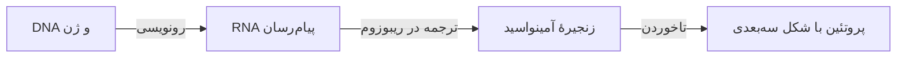
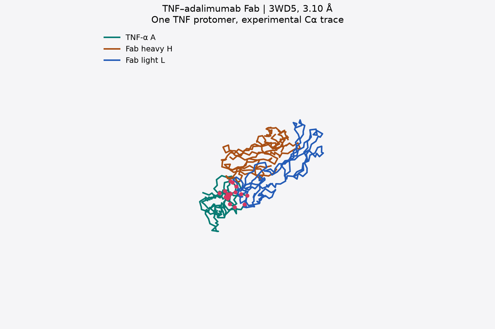
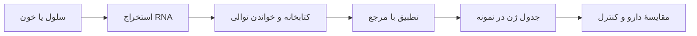
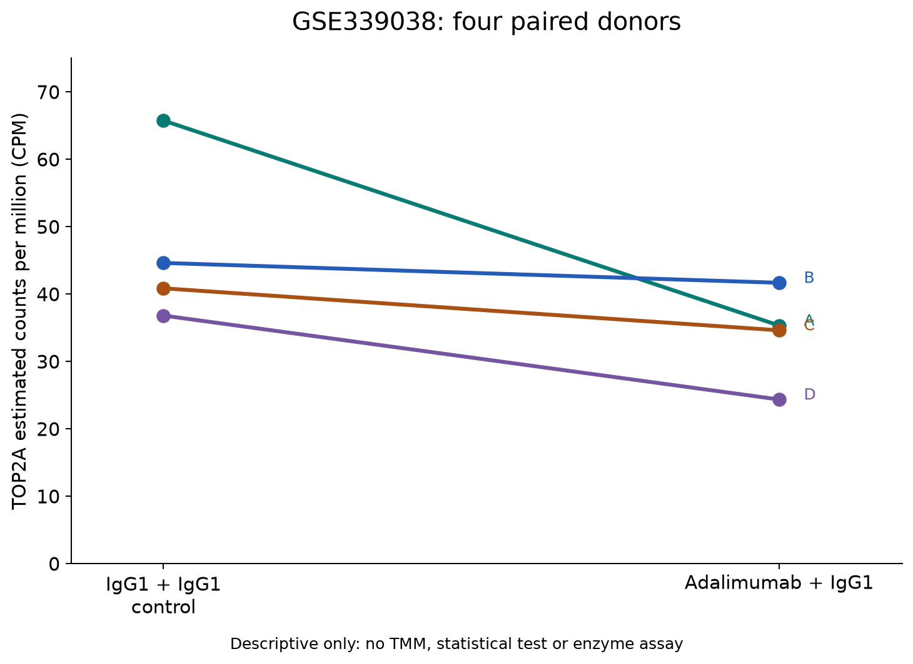

# جزوه آمادگی روماتوئید آدالیموماب و خواندن داده‌های RNA-seq

**درس بیوانفورماتیک ساختاری · حسام شینی · پاییز ۱۴۰۵**  
**استاد راهنما: دکتر فرزانه محمدی فارسانی**  
بازبینی منابع و داده‌ها: ۱۴ اکتبر ۲۰۲۶. زمان پیشنهادی مطالعه: سه نوبت ۲۰ دقیقه‌ای.

از شناخت سلول، مفصل و التهاب شروع می‌کنیم؛ سپس می‌فهمیم TNF، گیرنده و آدالیموماب چه هستند و دارو چگونه پیام‌رسانی TNF را محدود می‌کند. بعد ساختار واقعی و یک دیتاست RNA-seq بیماران روماتوئید را می‌خوانیم. TOP2A در یک مسیر موازی معرفی می‌شود تا پیش از طرح ارتباط دارویی، نقش خود آنزیم روشن باشد.

هدف فعلی، فهم مبانی و تشخیص معنای هر اندازه‌گیری است. سؤال دربارهٔ اثر آدالیموماب بر TOP2A یا سرطان، بعد از این شناخت و تأیید دادهٔ مناسب انتخاب می‌شود. [مسیر مرحله‌به‌مرحله](learning-path.fa.md) این ترتیب و خروجی هر بخش را مشخص می‌کند.

## ۱. سلول ژن RNA و پروتئین چه هستند

سلول واحد زندهٔ سازندهٔ بدن است. غشای سلول مرز آن با محیط اطراف است. در بیشتر سلول‌های انسانی، هسته محل نگهداری DNA است؛ DNA اطلاعات وراثتی را در خود دارد. **ژن** بخشی از DNA است که دستور ساخت یک محصول زیستی را فراهم می‌کند. بعضی ژن‌ها به ساخت پروتئین می‌انجامند و بعضی محصول RNA دارند.

برای ساخت یک پروتئین، سلول ابتدا از اطلاعات ژن نسخه‌ای به نام **RNA پیام‌رسان یا mRNA** تهیه می‌کند. سپس ریبوزوم، دستگاه ساخت پروتئین، این دستور را می‌خواند و زنجیره‌ای از واحدهای کوچک به نام **آمینواسید** می‌سازد. زنجیره تا می‌خورد و شکل سه‌بعدی پیدا می‌کند. این شکل و ویژگی‌های شیمیایی آن تعیین می‌کنند با چه مولکول‌هایی تعامل کند.

می‌توان DNA را به کتاب دستورها و mRNA را به نسخهٔ یک دستور تشبیه کرد. داشتن نسخه‌های بیشتر از یک دستور ممکن است با تولید بیشتر محصول همراه باشد، اما تعداد نسخه‌ها همان مقدار محصول یا کیفیت کار آن نیست. بنابراین **RNA بیشتر، لزوماً به معنی پروتئین بیشتر یا فعالیت بیشتر نیست**. این تفاوت در تفسیر TOP2A مهم است. [تعریف ژن](https://www.genome.gov/genetics-glossary/Gene)، [RNA پیام‌رسان](https://www.genome.gov/genetics-glossary/messenger-rna)

این نمودار یک مسیر آموزشی است. حروف توالی RNA، تعداد RNA در سلول و شکل سه‌بعدی پروتئین، سه نوع دادهٔ متفاوت‌اند.

## ۲. التهاب و روماتوئید چه ارتباطی با TNF دارند

التهاب بخشی از پاسخ دفاعی بدن است؛ مثلاً هنگام آسیب، سلول‌های ایمنی پیام‌هایی می‌فرستند تا دفاع و ترمیم آغاز شود. در آرتریت روماتوئید، دستگاه ایمنی به بافت‌های خود بدن حمله می‌کند. پوشش داخلی مفصل، **سینوویوم**، دچار التهاب پایدار می‌شود و این وضعیت می‌تواند به غضروف و استخوان آسیب بزند. **TNF** یکی از پروتئین‌های پیام‌رسان ایمنی است که در این فرایند نقش دارد. نام آن در منابع قدیمی‌تر اغلب TNF-α است. [NIAMS، روماتوئید](https://www.niams.nih.gov/health-topics/rheumatoid-arthritis)

**گیرنده** پروتئینی است که پیام یک مولکول را دریافت می‌کند. گیرنده‌های TNF روی سطح سلول قرار دارند. وقتی TNF به گیرندهٔ مناسب متصل می‌شود، مجموعه‌ای از واکنش‌ها درون سلول آغاز می‌شود؛ مثلاً برنامهٔ ساخت بعضی مولکول‌های التهابی تغییر می‌کند. TNF تمام التهاب را به‌تنهایی ایجاد نمی‌کند و مهار آن همهٔ مسیرهای ایمنی را خاموش نمی‌کند. [UniProt، TNF](https://www.uniprot.org/uniprotkb/P01375/entry)

**CRP** پروتئینی است که مقدار آن در خون برای بررسی التهاب اندازه‌گیری می‌شود. CRP در این پروژه یک نشانگر آزمایشگاهی است؛ هدف اتصال آدالیموماب نیست. مقدار CRP خون را نمی‌توان از حروف توالی ژن یا یک تصویر سه‌بعدی به دست آورد. نمرهٔ DAS28-CRP نیز یک شاخص ترکیبی است و با مقدار خام CRP یکسان نیست. [MedlinePlus، آزمایش CRP](https://medlineplus.gov/lab-tests/c-reactive-protein-crp-test/)

## ۳. آدالیموماب چگونه پیام TNF را مهار می‌کند

آدالیموماب خودش یک پروتئین دارویی از نوع **آنتی‌بادی انسانی [IgG1](glossary.fa.md?chapter=chapter-2)** است. آنتی‌بادی را می‌توان به یک مولکول Yشکل تشبیه کرد: دو زنجیرهٔ سنگین و دو زنجیرهٔ سبک دارد. انتهای بازوها بخش‌هایی دارند که شکل و شیمی سطحشان برای اتصال به یک هدف مناسب است. بخش **[Fab](glossary.fa.md?chapter=chapter-4)** بازوی اتصال به هدف است و **[Fc](glossary.fa.md?chapter=chapter-5)** بخش دیگر آنتی‌بادی با نقش‌های مرتبط با سیستم ایمنی است. [برچسب رسمی Humira، بخش‌های ۱۱ و ۱۲.۱](https://dailymed.nlm.nih.gov/dailymed/drugInfo.cfm?setid=608d4f0d-b19f-46d3-749a-7159aa5f933d)

**شکل آموزشی:** این تصویر نقشهٔ اجزای آنتی‌بادی است؛ مختصات اتمی یک آنتی‌بادی کامل نیست.

آدالیموماب به TNF محلول و TNF متصل به غشا می‌چسبد و مانع تعامل آن با گیرنده‌هایش می‌شود. تشبیه «قفل و کلید» به فهم انتخاب هدف کمک می‌کند، ولی اتصال واقعی بر اثر سازگاری سطح‌ها، بارهای الکتریکی و دیگر برهم‌کنش‌های شیمیایی رخ می‌دهد. مولکول‌ها نیز کاملاً خشک و ثابت نیستند.

دارو قرار نیست TNF را مانند یک ویروس بکشد. با اتصال به پیام‌رسان، امکان رسیدن آن پیام به گیرنده را کاهش می‌دهد. پیام‌رسانی کمتر می‌تواند التهاب را کاهش دهد؛ میزان پاسخ درمانی در بیمار به عوامل دیگری نیز وابسته است. برای فهم تصویری این فرایند، [نمای تعاملی سازوکار اتصال](../?tab=basics#binding-explainer) و [شرح مفصل اتصال](binding-mechanism.fa.md) را ببینید.

## ۴. از ساختار 3WD5 چه می‌توان فهمید

PDB پایگاهی برای نگهداری ساختارهای مولکولی است. فایل **3WD5** مختصات تجربی بخشی از کمپلکس TNF و Fab آدالیموماب را دارد. در فایل استفاده‌شده، یک زنجیرهٔ TNF و زنجیره‌های سنگین و سبک Fab دیده می‌شوند. آنتی‌بادی کامل، بخش Fc، گیرندهٔ TNF و RNA در این مدل نیستند. [RCSB، 3WD5](https://www.rcsb.org/structure/3WD5)

**شکل بر پایهٔ مختصات واقعی:** رنگ‌ها برای تشخیص زنجیره‌ها هستند؛ رنگ طبیعی مولکول نیستند. نما مربوط به مدل جزئیِ ذخیره‌شده است.

سؤال قابل اندازه‌گیری این است: **کدام قسمت‌های TNF و Fab به هم نزدیک‌اند؟** در تحلیل موجود، فاصلهٔ اتم‌های سنگین، یعنی اتم‌های غیرهیدروژنی، با آستانهٔ ۴٫۵ آنگستروم بررسی شده است. هر آنگستروم یک ده‌میلیاردم متر است. آستانه تعریف عملی «نزدیکی» در این تحلیل است؛ هر جفت نزدیک لزوماً پیوند شیمیایی ندارد.

در این مدل جزئی، ۲۵۲ جفت اتم و ۴۰ جفت باقی‌ماندهٔ آمینواسیدی در این محدوده قرار گرفته‌اند. این‌ها شمارش تماس هندسی‌اند و قدرت اتصال یا میزان درمان بیمار را اندازه نمی‌گیرند. چرخاندن مدل در مرورگر نیز حرکت دوربین است؛ شبیه‌سازی دینامیک مولکولی نیست. [خروجی محاسبه](../data/processed/interface-summary.json)، [روش تحلیل](structural-method.fa.md)

## ۵. آشنایی موازی با TOP2A و کار آنزیم

**TOP2A** نام ژن سازندهٔ پروتئین **توپوایزومراز IIα** است. این آنزیم به مدیریت پیچ‌خوردگی و درهم‌رفتگی DNA کمک می‌کند. هنگام تکثیر و تقسیم سلول، DNA باید باز و سپس به‌درستی میان سلول‌های جدید توزیع شود؛ این آنزیم بخشی از کار را با بریدن موقت و اتصال دوبارهٔ DNA انجام می‌دهد. [UniProt، TOP2A](https://www.uniprot.org/uniprotkb/P11388/entry)

TOP2A با تقسیم سلول ارتباط دارد؛ به همین دلیل در پژوهش تکثیر سلول‌های ایمنی و سرطان بررسی می‌شود. اما وجود TOP2A در دو بیماری، آن دو را یک بیماری نمی‌کند. کاهش RNA آن نیز می‌تواند نشان دهد وضعیت تقسیم سلول تغییر کرده است؛ لازم نیست دارو به خود آنزیم متصل شده باشد.

آدالیموماب TNF را هدف می‌گیرد؛ TOP2A آنزیمی عمدتاً داخل هسته است. یک آنتی‌بادی معمولی مسیر اثبات‌شده‌ای برای رسیدن به این هدف در هستهٔ سلول سالم ندارد. برای ادعای مهار مستقیم، باید دسترسی، اتصال و کاهش فعالیت آنزیم با مقدار ثابت پروتئین، جداگانه نشان داده شوند. RNA-seq هیچ‌یک از این سه آزمایش را جایگزین نمی‌کند. [طرح آزمون مهار مستقیم](top2a-inhibition-feasibility.fa.md)

ساختار **4FM9** بخش مرکزی TOP2A همراه DNA را نشان می‌دهد. هدف آموزشی آن فهم تعامل آنزیم با DNA است؛ مدل موجود آدالیموماب ندارد. بعضی داروهای ضدسرطان مانند اتوپوزاید به سازوکار توپوایزومراز II مربوط‌اند؛ این به معنی سازوکار یکسان آدالیموماب نیست. [RCSB، 4FM9](https://www.rcsb.org/structure/4FM9)، [NCI، اتوپوزاید](https://www.cancer.gov/publications/dictionaries/cancer-drug/def/etoposide)

## ۶. RNA-seq دقیقاً چه چیزی اندازه می‌گیرد

RNA-seq یا توالی‌یابی RNA روشی برای بررسی RNAهای موجود در یک نمونه است. در بسیاری از روش‌ها، RNA استخراج و به DNA مکمل تبدیل می‌شود؛ دستگاه قطعه‌های کوتاهی از توالی را می‌خواند. این قطعه‌ها **read** نام دارند. با مقایسهٔ آن‌ها با مرجع، برآورد می‌کنیم چه مقدار از داده به هر ژن مربوط است. [NHGRI، RNA-seq](https://www.genome.gov/genetics-glossary/RNA-seq)

خروجی سادهٔ تحلیل، جدولی است که هر ردیف آن یک ژن و هر ستون آن یک نمونه است. خانه‌های جدول **شمارش یا count** هستند. یک نمونهٔ زیستی ممکن است چند فایل فنی داشته باشد؛ تعداد فایل‌ها تعداد افراد مستقل نیست. در این پروژه، برای شروع از جدول شمارش عمومی استفاده می‌کنیم تا لازم نباشد همهٔ فایل‌های بزرگ توالی‌یابی را از ابتدا پردازش کنیم.

**کتابخانه** مجموعهٔ آماده‌شده برای توالی‌یابی یک نمونه است. **Bulk RNA-seq** مجموع RNA بسیاری از سلول‌ها را می‌خواند؛ **single-cell RNA-seq** RNA سلول‌ها را جدا بررسی می‌کند. برای شروع، bulk ساده‌تر است. حتی پس از جداسازی سلول‌های T، نسبت زیرگروه‌ها و حالت فعال‌سازی آن‌ها می‌تواند متفاوت باشد.

**کدون، پل توالی به پروتئین:** در CDS، هر سه باز RNA یک کدون‌اند. پنج کدون نخست TNF مرجع، `AUG AGC ACU GAA AGC`، به متیونین، سرین، ترئونین، گلوتامات و سرین (`MSTES`) ترجمه می‌شوند. CDS این مرجع از جایگاه ۱۷۸ mRNA شروع می‌شود؛ از اول کل فایل دلخواه ترجمه نمی‌کنیم. برای TOP2A، آغاز پروتئین مرجع `MEVSP` است. [درس کدون با جدول و مثال واقعی](codons-primer.fa.md)، [نمای تعاملی](../?tab=sequences#codon-lesson)

فایل FASTA حروف یک توالی را نگه می‌دارد؛ جدول RNA-seq مقدار RNA را برآورد می‌کند. داشتن توالی TOP2A به‌تنهایی نشان نمی‌دهد دارو بیان آن را تغییر داده است. همچنین در نام ژن TNF، وجود RNA بیشتر یا کمتر مستقیماً میزان TNF فعال یا اتصال دارو را تعیین نمی‌کند.

## ۷. هدف فعلی و ترتیب یادگیری

**موضوع فعلی:** شناخت آرتریت روماتوئید، ساختار آدالیموماب و سازوکار مهار پیام TNF، همراه با خواندن داده‌های واقعیِ مطالعات دارو.

پرسش آموزشی این است: **آدالیموماب در RA چگونه عمل می‌کند و ساختار، دادهٔ بیمار و RNA-seq هرکدام چه بخش متفاوتی از ماجرا را نشان می‌دهند؟** این مرحله مرور و یادگیریِ مبتنی بر داده است؛ ادعای مکانیسم تازه مطرح نمی‌کند.

ترتیب کار: **بیماری و سلول → TNF و گیرنده → دارو و Fab → ساختار 3WD5 → اندازه‌گیری بالینی → RNA-seq و برچسب نمونه‌ها**. هم‌زمان، DNA و کار آنزیم TOP2A را در [درس مستقل TOP2A](top2a-primer.fa.md) می‌آموزیم.

در پایان باید روشن باشد یک فایل چه چیزی دارد و چه مقایسه‌ای را ممکن می‌کند. سپس می‌توان یک سؤال محاسباتی محدود انتخاب کرد. افزایش یا کاهش RNA و مهار فعالیت آنزیم، خروجی یکسانی نیستند؛ انتخاب سؤال پیشرفته به فهم این تفاوت نیاز دارد.

## ۸. یک دیتاست پایه‌ای از بیماران روماتوئید

[GSE138746](https://www.ncbi.nlm.nih.gov/geo/query/acc.cgi?acc=GSE138746) از مطالعهٔ BiOCURA می‌آید. **۸۰ بیمار RA** بررسی شده‌اند: ۳۸ نفر آدالیموماب و ۴۲ نفر اتانرسپت دریافت کرده‌اند. **RNA پیش از شروع این داروها گرفته شده است**؛ پاسخ بالینی شش ماه بعد با معیار EULAR، دسته‌بندی استاندارد پاسخ درمان، ثبت شده است.

از خون، PBMC یا مجموعهٔ سلول‌های تک‌هسته‌ای خون جدا شده است؛ این مجموعه چند نوع سلول ایمنی دارد. مونوسیت‌ها، یک گروه از سلول‌های ایمنی، و سلول‌های T دارای نشانگر CD4 نیز جدا بررسی شده‌اند. مجموع ۲۴۰ کتابخانه از سه بخش سلولیِ همین ۸۰ نفر داریم؛ ۲۴۰ بیمار مستقل نداریم.

| پرسش هنگام خواندن رکورد | پاسخ این مجموعه |
| --- | --- |
| نمونه از کجا آمده؟ | خون بیماران روماتوئید و بخش‌های سلولی جداشده |
| RNA در چه زمانی گرفته شده؟ | پیش از آغاز آدالیموماب یا اتانرسپت |
| دارو و پاسخ مشخص‌اند؟ | نام دارو و پاسخ خوب، متوسط یا بدون پاسخ در متادیتا آمده‌اند |
| پاسخ چه زمانی ارزیابی شده؟ | شش ماه پس از شروع درمان |
| RNA پس از درمان هم داریم؟ | در این مجموعه خیر |
| نخستین تمرین چیست؟ | پیدا کردن نام ستون، نوع سلول، دارو و زمان نمونه؛ بدون آزمون اثر دارو |

برای شروع فقط فایل **PBMC پردازش‌شدهٔ نویسندگان** را می‌خوانیم: ۷۹ ستون نمونه و ۱۸٬۳۳۳ ردیف ژن دارد؛ ۳۷ ستون آن مربوط به گروه آدالیموماب است. برچسب‌های این ۳۷ نفر، ۱۰ پاسخ خوب، ۹ متوسط و ۱۸ بدون پاسخ‌اند. یک نمونهٔ PBMC در فایل پردازش‌شده کنار گذاشته شده است؛ شمار فایل خام و پردازش‌شده برابر فرض نمی‌شود.

[فایل متادیتا](https://ftp.ncbi.nlm.nih.gov/geo/series/GSE138nnn/GSE138746/matrix/GSE138746_series_matrix.txt.gz) کوچک است و معنی نمونه‌ها را می‌دهد. [فایل PBMC نویسندگان](https://ftp.ncbi.nlm.nih.gov/geo/series/GSE138nnn/GSE138746/suppl/GSE138746_Counts_Normalization_PBMC.csv.gz)، حدود ۲٫۳ مگابایت فشرده، مقادیر تنظیم‌شدهٔ بیان را دارد. این فایل، FASTQ خام یا نرمال‌سازیِ تازهٔ ما نیست. در بررسی فعلی، نام ستون‌ها به متادیتا نگاشت شد؛ تحلیل رابطهٔ بیان و پاسخ یا مدل پیش‌بینی اجرا نشد. [ثبت بررسی و هش‌ها](../data/metadata/ra-rnaseq-learning.json)

**معنی مهم:** «RNA اولیهٔ افراد با پاسخ متفاوت» با «RNA قبل و بعد از دارو در یک فرد» فرق دارد. این مطالعه برای پرسش پاسخ‌پذیری درمان کاربرد دارد؛ برای محاسبهٔ تغییر RNA پس از دارو، دادهٔ زمان بعد لازم است. [Tao و همکاران، ۲۰۲۱](https://doi.org/10.1002/art.41516)

## ۹. دادهٔ بیماران روماتوئید کجاست

[GSE129705](https://www.ncbi.nlm.nih.gov/geo/query/acc.cgi?acc=GSE129705) RNA-seq خون بیماران روماتوئید پیش از درمان و سه ماه بعد را دارد. در بررسی متادیتای فعلی، ۱۲۸ کتابخانه متعلق به ۷۶ بیمار دیده شد؛ فقط **۵۲ بیمار هر دو زمان را دارند**. گروه اول ۳۲ جفت و گروه دوم ۲۰ جفت کامل دارد. ۱۲۸ کتابخانه را نباید ۱۲۸ بیمار یا ۶۴ جفت کامل معرفی کرد.

| ویژگی | نتیجهٔ بررسی |
| --- | --- |
| درمان مطالعه | آدالیموماب یا اینفلیکسیماب، همراه متوترکسات |
| بافت | خون کامل؛ ترکیبی از چند نوع سلول |
| دادهٔ در دسترس | جدول شمارش و شاخص‌های کنترل کیفیت |
| جدول شمارش | ۲۵٬۳۷۰ ردیف ژن، ۱۲۸ ستون نمونه؛ TOP2A وجود دارد |
| فایل‌های خام خوانش | به دلیل محدودیت رضایت شرکت‌کنندگان منتشر نشده‌اند |
| نام داروی هر بیمار در فیلدهای نمونهٔ GEO | دیده نشد؛ جداسازی گروه آدالیموماب هنوز تأیید نشده است |

پس فعلاً این مجموعه برای سؤال **تغییر همراه درمان ضد TNF در بیماران RA** یک منبع تکمیلی است؛ برای ادعای اثر ویژهٔ آدالیموماب باید نگاشت دارو به بیمار از اطلاعات مجاز مکمل پیدا شود. دو گروه مطالعه نیز تفاوت فنی دارند و نباید بدون بررسی با هم ادغام شوند. در تحلیل جفتی، فقط بیماران دارای هر دو زمان وارد می‌شوند.

تغییر RNA خون ممکن است از تغییر تعداد انواع سلول‌های خون ناشی شود، نه فقط تغییر فعالیت ژن در هر سلول. داروی همراه و نبود گروه تصادفیِ بدون درمان نیز استنباط علت را محدود می‌کنند. این دیتاست به‌تنهایی آزمایش مستقیم مهار TOP2A نیست. [Farutin و همکاران، ۲۰۱۹](https://doi.org/10.1186/s13075-019-1999-3)، [فایل عمومی شمارش](https://ftp.ncbi.nlm.nih.gov/geo/series/GSE129nnn/GSE129705/suppl/GSE129705_c12-ra-wb-bl-mo3-processed-data-file.txt.gz)، [ثبت بررسی و هش منابع](../data/metadata/preparation-guide-datasets.json)

## ۱۰. نخستین تمرین خواندن جدول RNA-seq

**قدم اول، شناخت فایل:** یک ردیف ژن و یک ستون نمونه را پیدا می‌کنیم. از متادیتا می‌خوانیم نمونه از چه سلولی، چه بیماری و چه زمانی آمده است. نام ستون به‌تنهایی کافی نیست؛ فایل پردازش‌شده ممکن است بعضی نمونه‌های فایل اولیه را نداشته باشد.

**قدم دوم، معنی عدد:** شمارش‌ها نشان می‌دهند چه مقدار از داده به RNA مربوط به یک ژن نسبت داده شده است. RNA-seq ساختار سه‌بعدی RNA را نشان نمی‌دهد. فایل «دارو» هم نیست؛ اطلاعات سلول‌های بررسی‌شده را دارد.

**قدم سوم، انتخاب مقایسه:** فعلاً یک بخش سلولی، PBMC، و گروه دارویی آدالیموماب را جدا می‌شناسیم. از یک بیمار، سلول‌های متفاوت را بیمارهای مستقل نمی‌شماریم. اگر RNA فقط در آغاز درمان گرفته شده، مقایسهٔ قبل/بعد نمی‌سازیم.

**قدم چهارم، عمق خوانش:** نمونه‌ای که بیشتر توالی‌یابی شده باشد، ممکن است شمارش بزرگ‌تری داشته باشد. برای یک مثال آموزشی، CPM شمارش را بر مجموع شمارش کتابخانه تقسیم و در یک میلیون ضرب می‌کند:

$$\mathrm{CPM}_{g,s}=\frac{\mathrm{count}_{g,s}}{\sum_h\mathrm{count}_{h,s}}\times10^6$$

CPM فقط یک تنظیم ساده است. آن را دوباره و بی‌دلیل روی فایل نرمال‌شدهٔ نویسندگان اعمال نمی‌کنیم. مثال فصل بعد از فایل شمارش دیگری آمده است. برای فایل PBMC فعلی، نخست معنی روش پردازش خود مطالعه را می‌خوانیم.

**قدم پنجم، ثبت چیزی که فهمیده‌ایم:** نوع فایل، تعداد نمونهٔ قابل استفاده، زمان نمونه‌گیری، نام دارو و محدودیت مقایسه را یادداشت می‌کنیم. هنوز لازم نیست هزاران ژن، پیش‌بینی پاسخ یا آزمون مهار آنزیم انجام دهیم.

**مرحلهٔ پیشرفته‌تر:** QC یعنی بررسی کیفیت داده. پس از شناخت ورودی و انتخاب سؤال، فیلتر ژن‌ها، روش تنظیم شمارش و مدل آماری مناسب بررسی می‌شوند. ابزارهایی مانند edgeR و limma به این مرحله تعلق دارند؛ صرف نصب آن‌ها نتیجهٔ معتبر ایجاد نمی‌کند. [edgeR](https://bioconductor.org/packages/release/bioc/html/edgeR.html)، [limma](https://bioconductor.org/packages/release/bioc/html/limma.html)

## ۱۱. پیوست آموزشی پایلوت قبلی TOP2A

این مثال از GSE339038، یک مدل آزمایشگاهیِ سلول‌های T در روز پنجم است؛ RNA خونِ بیماران RA نیست. هدف خواندن نمودار است و این پایلوت، سؤال اصلیِ مرحلهٔ یادگیری نیست. چهار اهداکننده در گروه `Ada + IgG1` و کنترل `IgG1+IgG1` مقایسه شدند. ردیف TOP2A و CPM ساده قبلاً استخراج شده‌اند. بازخوانی فایل رسمی در این بازبینی همان چهار جفت را بازتولید کرد. جدول زیر **نتیجهٔ توصیفی اجراشده** است؛ مدل آماری کامل بخش قبل اجرا نشده است.

| اهداکننده | CPM کنترل | CPM دارو | نسبت دارو به کنترل |
| --- | --- | --- | --- |
| A | 65.75 | 35.33 | 0.537 |
| B | 44.62 | 41.67 | 0.934 |
| C | 40.86 | 34.62 | 0.847 |
| D | 36.81 | 24.36 | 0.662 |

**شکل دادهٔ واقعی:** چهار نقطهٔ دارو CPM کمتری از کنترل همان فرد دارند؛ اندازهٔ تغییر یکسان نیست. هنوز p-value، FDR، مقدار پروتئین یا فعالیت آنزیم گزارش نشده است. برای مثال، نسبت ۰٫۵۳۷ برای فرد A یعنی CPM دارو حدود ۵۴ درصد کنترل است؛ به معنی «۵۴ درصد مهار آنزیم» نیست. [روش و بازاجرا](top2a-count-inspection.fa.md)، [خروجی عددی](../data/processed/top2a-count-inspection.json)

## ۱۲. سه مطالعه برای فهم پایه‌ها

**Hu و همکاران، ۲۰۱۳؛ DOI: 10.1074/jbc.M113.491530.** با بلورنگاری، اتصال Fab آدالیموماب به TNF را بررسی کردند و اهمیت بعضی اسیدآمینه‌ها را با آزمایش اتصال سنجیدند. نقش این مقاله، توضیح شکل و هدف اتصال دارو است. این منبع قدیمی‌تر، پایهٔ ساختار تجربیِ 3WD5 است؛ از آن پاسخ RNA یا نتیجهٔ درمان بیمار به دست نمی‌آید. [مقالهٔ ساختاری](https://doi.org/10.1074/jbc.M113.491530)

**Gehin و همکاران، ۲۰۲۴؛ DOI: 10.1136/rmdopen-2024-004888.** داده‌های بیماران RA را برای ارتباط غلظت خونِ آدالیموماب و پاسخ درمان بررسی کردند. غلظت دارو با مقدار تزریق و CRP با هدف اتصال دارو یکسان نیست. ارتباط غلظت و پاسخ گزارش شد؛ این مقاله منبع RNA-seq یا شاهد مهار TOP2A نیست. [مقالهٔ بالینی و شرح آزمایش](https://doi.org/10.1136/rmdopen-2024-004888)، [شرح سادهٔ مقاله](paper-explanations.fa.md)

**Tao و همکاران، شمارهٔ مجلهٔ ۲۰۲۱؛ DOI: 10.1002/art.41516.** RNA سلول‌های خونِ بیماران RA را پیش از آدالیموماب یا اتانرسپت خواندند و آن را در کنار پاسخ درمانِ شش‌ماهه بررسی کردند. سؤال مقاله دربارهٔ شناسایی پاسخ‌پذیری پیش از درمان بود. برای ما، نقش اولیهٔ آن شناخت دادهٔ بیمار، نوع سلول و زمان است؛ مدل‌های پیش‌بینی مقاله در پروژه بازتولید نشده‌اند. [مقالهٔ مرتبط با GSE138746](https://doi.org/10.1002/art.41516)

**مطالعهٔ بعدی، پس از مبانی:** Bianchi 2026 برای مدل‌سازی حرکت آنتی‌بادی، Marguerie 2025 برای دو آزمایش جدا دربارهٔ SIRPG و TOP2A، و Veerasubramanian 2026 برای گروه‌های آزمایشگاهیِ دارو/کنترل، در کتابخانه باقی می‌مانند. وجود این منابع، ارتباط کامل آدالیموماب و TOP2A را مشخص نمی‌کند. [شرح و نقد منابع پیشرفته](paper-explanations.fa.md)، [مرور کتابخانه](literature-review.fa.md)

## ۱۳. تمرین مرور و پاسخ کوتاه

۱. **آدالیموماب به کدام پروتئین متصل می‌شود؟** به TNF؛ هدف شناخته‌شدهٔ آن TOP2A نیست.

۲. **اگر RNA ژن TOP2A کم شود چه می‌دانیم؟** فراوانی نسبی RNA در همان نمونه و روش تغییر کرده است؛ مقدار پروتئین و فعالیتش هنوز نیاز به اندازه‌گیری دارد.

۳. **هشت کتابخانهٔ منتخب چند تکرار زیستی دارند؟** چهار اهداکننده؛ دو وضعیت از هر فرد.

۴. **چرا همهٔ گروه‌های دارای Ada را یکی نمی‌کنیم؟** بعضی داروهای دیگری هم دارند و پاسخشان می‌تواند حاصل ترکیب درمان باشد.

۵. **چرا چرخاندن مدل سه‌بعدی آزمایش اثر دارو نیست؟** مختصات ثابت‌اند و دوربین جابه‌جا می‌شود؛ فعالیت سلول یا انرژی اتصال محاسبه نشده است.

۶. **آیا پاسخ درمان در ماه ششم یعنی RNA ماه ششم داریم؟** خیر؛ در GSE138746، RNA پیش از آغاز درمان گرفته شده و پاسخ بالینی بعداً ثبت شده است.

۷. **وجود TOP2A در جدول یعنی دارو به آن متصل شده است؟** خیر؛ مقدار RNA و اتصال دارو، اندازه‌گیری‌های جدا هستند.

۸. **کدون پایان چه آمینواسیدی می‌سازد؟** آمینواسید اضافه نمی‌کند؛ پایان ترجمه را علامت می‌دهد.

## ۱۴. جمع‌بندی قابل ارائه و مسیر مطالعه

«موضوع اصلی، آرتریت روماتوئید و سازوکار آدالیموماب است. ابتدا سلول، التهاب، TNF و آنتی‌بادی را می‌شناسیم؛ سپس ساختار واقعی اتصال و مطالعهٔ بالینی را می‌خوانیم. در RNA-seq، پیش از هر محاسبه، مشخص می‌کنیم نمونه از چه کسی، چه سلولی و چه زمانی آمده است. در کنار این مسیر، DNA و نقش TOP2A را یاد می‌گیریم. پس از این شناخت و تأیید یک دیتاست مناسب، می‌توان سؤال محدودتری دربارهٔ ارتباط احتمالی دارو و TOP2A انتخاب کرد.»

**نوبت اول:** فصل‌های ۱ تا ۴؛ بیماری، مولکول‌ها و اتصال را توضیح بدهید. **نوبت دوم:** فصل‌های ۶ تا ۱۰؛ معنی RNA-seq و طراحی هر دیتاست را بخوانید. **مسیر موازی:** فصل ۵ و [درس TOP2A](top2a-primer.fa.md). **نوبت سوم:** مقاله‌های فصل ۱۲ و تمرین‌های فصل ۱۳. فصل ۱۱ پیوست آموزشیِ پایلوت قبلی است و شروع کار از آن نیست.

برای ادامه: [مسیر یادگیری](learning-path.fa.md)، [نمایش اسلایدی](../presentation.html#slide-1)، [درس مفصل اتصال](binding-mechanism.fa.md)، [توالی‌ها](sequences-primer.fa.md)، [طرح نگارش گزارش](paper-writing-guide.fa.md). ادعاهای جدید را به آزمایش یا دادهٔ اندازه‌گیری‌شده وصل می‌کنیم؛ حدس، جای آشنایی با پایه‌ها را نمی‌گیرد.
