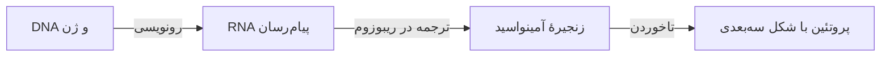
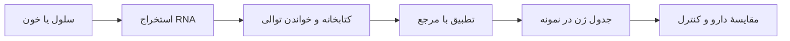

# جزوه آمادگی آدالیموماب TNF و پژوهش با RNA-seq

**درس بیوانفورماتیک ساختاری · حسام شینی · پاییز ۱۴۰۵**  
**استاد راهنما: دکتر فرزانه محمدی فارسانی**  
بازبینی منابع و داده‌ها: ۱۴ اکتبر ۲۰۲۶. زمان پیشنهادی مطالعه: سه نوبت ۲۰ دقیقه‌ای.

این پژوهش از یک رابطهٔ شناخته‌شده شروع می‌شود: آدالیموماب به پروتئین TNF متصل می‌شود و پیام‌رسانی آن را مهار می‌کند. سپس می‌پرسیم آیا در یک آزمایش مشخص، RNA ژن TOP2A نیز تغییر می‌کند. برای پاسخ، شکل مولکول را از ساختار تجربی و مقدار RNA را از دادهٔ RNA-seq می‌خوانیم؛ هر کدام بخش متفاوتی از مسئله را نشان می‌دهد.

هدف، شناخت سازوکار دارو و طراحی یک بررسی کوچک و قابل دفاع است. نتیجه می‌تواند افزایش، کاهش یا تغییر نامشخص RNA باشد. از این بررسی نمی‌توان به‌تنهایی نتیجه گرفت دارو مستقیماً TOP2A را مهار می‌کند یا سرطان را درمان می‌کند.

## ۱ سلول ژن RNA و پروتئین چه هستند

سلول واحد زندهٔ سازندهٔ بدن است. غشای سلول مرز آن با محیط اطراف است. در بیشتر سلول‌های انسانی، هسته محل نگهداری DNA است؛ DNA اطلاعات وراثتی را در خود دارد. **ژن** بخشی از DNA است که دستور ساخت یک محصول زیستی را فراهم می‌کند. بعضی ژن‌ها به ساخت پروتئین می‌انجامند و بعضی محصول RNA دارند.

برای ساخت یک پروتئین، سلول ابتدا از اطلاعات ژن نسخه‌ای به نام **RNA پیام‌رسان یا mRNA** تهیه می‌کند. سپس ریبوزوم، دستگاه ساخت پروتئین، این دستور را می‌خواند و زنجیره‌ای از واحدهای کوچک به نام **آمینواسید** می‌سازد. زنجیره تا می‌خورد و شکل سه‌بعدی پیدا می‌کند. این شکل و ویژگی‌های شیمیایی آن تعیین می‌کنند با چه مولکول‌هایی تعامل کند.

می‌توان DNA را به کتاب دستورها و mRNA را به نسخهٔ یک دستور تشبیه کرد. داشتن نسخه‌های بیشتر از یک دستور ممکن است با تولید بیشتر محصول همراه باشد، اما تعداد نسخه‌ها همان مقدار محصول یا کیفیت کار آن نیست. بنابراین **RNA بیشتر، لزوماً به معنی پروتئین بیشتر یا فعالیت بیشتر نیست**. این تفاوت در تفسیر TOP2A مهم است. [تعریف ژن](https://www.genome.gov/genetics-glossary/Gene)، [RNA پیام‌رسان](https://www.genome.gov/genetics-glossary/messenger-rna)

این نمودار یک مسیر آموزشی است. حروف توالی RNA، تعداد RNA در سلول و شکل سه‌بعدی پروتئین، سه نوع دادهٔ متفاوت‌اند.

## ۲ التهاب و روماتوئید چه ارتباطی با TNF دارند

التهاب بخشی از پاسخ دفاعی بدن است؛ مثلاً هنگام آسیب، سلول‌های ایمنی پیام‌هایی می‌فرستند تا دفاع و ترمیم آغاز شود. در آرتریت روماتوئید، این پاسخ به‌طور نامناسب ادامه می‌یابد و می‌تواند به بافت مفصل آسیب بزند. **TNF** یکی از پروتئین‌های پیام‌رسان ایمنی است که در این فرایند نقش دارد. نام آن در منابع قدیمی‌تر اغلب TNF-α است. [NIAMS، روماتوئید](https://www.niams.nih.gov/health-topics/rheumatoid-arthritis)

**گیرنده** پروتئینی است که پیام یک مولکول را دریافت می‌کند. گیرنده‌های TNF روی سطح سلول قرار دارند. وقتی TNF به گیرندهٔ مناسب متصل می‌شود، مجموعه‌ای از واکنش‌ها درون سلول آغاز می‌شود؛ مثلاً برنامهٔ ساخت بعضی مولکول‌های التهابی تغییر می‌کند. TNF تمام التهاب را به‌تنهایی ایجاد نمی‌کند و مهار آن همهٔ مسیرهای ایمنی را خاموش نمی‌کند. [UniProt، TNF](https://www.uniprot.org/uniprotkb/P01375/entry)

**CRP** پروتئینی است که مقدار آن در خون برای بررسی التهاب اندازه‌گیری می‌شود. CRP در این پروژه یک نشانگر آزمایشگاهی است؛ هدف اتصال آدالیموماب نیست. مقدار CRP خون را نمی‌توان از حروف توالی ژن یا یک تصویر سه‌بعدی به دست آورد. نمرهٔ DAS28-CRP نیز یک شاخص ترکیبی است و با مقدار خام CRP یکسان نیست. [MedlinePlus، آزمایش CRP](https://medlineplus.gov/lab-tests/c-reactive-protein-crp-test/)

## ۳ آدالیموماب چگونه پیام TNF را مهار می‌کند

آدالیموماب خودش یک پروتئین دارویی از نوع **آنتی‌بادی انسانی IgG1** است. آنتی‌بادی را می‌توان به یک مولکول Yشکل تشبیه کرد: دو زنجیرهٔ سنگین و دو زنجیرهٔ سبک دارد. انتهای بازوها بخش‌هایی دارند که شکل و شیمی سطحشان برای اتصال به یک هدف مناسب است. بخش **Fab** بازوی اتصال به هدف است و **Fc** بخش دیگر آنتی‌بادی با نقش‌های مرتبط با سیستم ایمنی است. [برچسب رسمی Humira، بخش‌های ۱۱ و ۱۲.۱](https://dailymed.nlm.nih.gov/dailymed/drugInfo.cfm?setid=608d4f0d-b19f-46d3-749a-7159aa5f933d)

**شکل آموزشی:** این تصویر نقشهٔ اجزای آنتی‌بادی است؛ مختصات اتمی یک آنتی‌بادی کامل نیست.

آدالیموماب به TNF محلول و TNF متصل به غشا می‌چسبد و مانع تعامل آن با گیرنده‌هایش می‌شود. تشبیه «قفل و کلید» به فهم انتخاب هدف کمک می‌کند، ولی اتصال واقعی بر اثر سازگاری سطح‌ها، بارهای الکتریکی و دیگر برهم‌کنش‌های شیمیایی رخ می‌دهد. مولکول‌ها نیز کاملاً خشک و ثابت نیستند.

دارو قرار نیست TNF را مانند یک ویروس بکشد. با اتصال به پیام‌رسان، امکان رسیدن آن پیام به گیرنده را کاهش می‌دهد. پیام‌رسانی کمتر می‌تواند التهاب را کاهش دهد؛ میزان پاسخ درمانی در بیمار به عوامل دیگری نیز وابسته است. برای فهم تصویری این فرایند، [نمای تعاملی سازوکار اتصال](../?tab=basics#binding-explainer) و [شرح مفصل اتصال](binding-mechanism.fa.md) را ببینید.

## ۴ از ساختار 3WD5 چه می‌توان فهمید

PDB پایگاهی برای نگهداری ساختارهای مولکولی است. فایل **3WD5** مختصات تجربی بخشی از کمپلکس TNF و Fab آدالیموماب را دارد. در فایل استفاده‌شده، یک زنجیرهٔ TNF و زنجیره‌های سنگین و سبک Fab دیده می‌شوند. آنتی‌بادی کامل، بخش Fc، گیرندهٔ TNF و RNA در این مدل نیستند. [RCSB، 3WD5](https://www.rcsb.org/structure/3WD5)

**شکل بر پایهٔ مختصات واقعی:** رنگ‌ها برای تشخیص زنجیره‌ها هستند؛ رنگ طبیعی مولکول نیستند. نما مربوط به مدل جزئیِ ذخیره‌شده است.

سؤال قابل اندازه‌گیری این است: **کدام قسمت‌های TNF و Fab به هم نزدیک‌اند؟** در تحلیل موجود، فاصلهٔ اتم‌های سنگین، یعنی اتم‌های غیرهیدروژنی، با آستانهٔ ۴٫۵ آنگستروم بررسی شده است. هر آنگستروم یک ده‌میلیاردم متر است. آستانه تعریف عملی «نزدیکی» در این تحلیل است؛ هر جفت نزدیک لزوماً پیوند شیمیایی ندارد.

در این مدل جزئی، ۲۵۲ جفت اتم و ۴۰ جفت باقی‌ماندهٔ آمینواسیدی در این محدوده قرار گرفته‌اند. این‌ها شمارش تماس هندسی‌اند و قدرت اتصال یا میزان درمان بیمار را اندازه نمی‌گیرند. چرخاندن مدل در مرورگر نیز حرکت دوربین است؛ شبیه‌سازی دینامیک مولکولی نیست. [خروجی محاسبه](../data/processed/interface-summary.json)، [روش تحلیل](structural-method.fa.md)

## ۵ TOP2A چرا وارد سؤال ما می‌شود

**TOP2A** نام ژن سازندهٔ پروتئین **توپوایزومراز IIα** است. این آنزیم به مدیریت پیچ‌خوردگی و درهم‌رفتگی DNA کمک می‌کند. هنگام تکثیر و تقسیم سلول، DNA باید باز و سپس به‌درستی میان سلول‌های جدید توزیع شود؛ این آنزیم بخشی از کار را با بریدن موقت و اتصال دوبارهٔ DNA انجام می‌دهد. [UniProt، TOP2A](https://www.uniprot.org/uniprotkb/P11388/entry)

TOP2A با تقسیم سلول ارتباط دارد؛ به همین دلیل در پژوهش تکثیر سلول‌های ایمنی و سرطان بررسی می‌شود. اما وجود TOP2A در دو بیماری، آن دو را یک بیماری نمی‌کند. کاهش RNA آن نیز می‌تواند نشان دهد وضعیت تقسیم سلول تغییر کرده است؛ لازم نیست دارو به خود آنزیم متصل شده باشد.

آدالیموماب TNF را هدف می‌گیرد؛ TOP2A آنزیمی عمدتاً داخل هسته است. یک آنتی‌بادی معمولی مسیر اثبات‌شده‌ای برای رسیدن به این هدف در هستهٔ سلول سالم ندارد. برای ادعای مهار مستقیم، باید دسترسی، اتصال و کاهش فعالیت آنزیم با مقدار ثابت پروتئین، جداگانه نشان داده شوند. RNA-seq هیچ‌یک از این سه آزمایش را جایگزین نمی‌کند. [طرح آزمون مهار مستقیم](top2a-inhibition-feasibility.fa.md)

ساختار **4FM9** بخش مرکزی TOP2A همراه DNA را نشان می‌دهد. هدف آموزشی آن فهم تعامل آنزیم با DNA است؛ مدل موجود آدالیموماب ندارد. بعضی داروهای ضدسرطان مانند اتوپوزاید به سازوکار توپوایزومراز II مربوط‌اند؛ این به معنی سازوکار یکسان آدالیموماب نیست. [RCSB، 4FM9](https://www.rcsb.org/structure/4FM9)، [NCI، اتوپوزاید](https://www.cancer.gov/publications/dictionaries/cancer-drug/def/etoposide)

## ۶ RNA-seq دقیقاً چه چیزی اندازه می‌گیرد

RNA-seq یا توالی‌یابی RNA روشی برای بررسی RNAهای موجود در یک نمونه است. در بسیاری از روش‌ها، RNA استخراج و به DNA مکمل تبدیل می‌شود؛ دستگاه قطعه‌های کوتاهی از توالی را می‌خواند. این قطعه‌ها **read** نام دارند. با مقایسهٔ آن‌ها با مرجع، برآورد می‌کنیم چه مقدار از داده به هر ژن مربوط است. [NHGRI، RNA-seq](https://www.genome.gov/genetics-glossary/RNA-seq)

خروجی سادهٔ تحلیل، جدولی است که هر ردیف آن یک ژن و هر ستون آن یک نمونه است. خانه‌های جدول **شمارش یا count** هستند. یک نمونهٔ زیستی ممکن است چند فایل فنی داشته باشد؛ تعداد فایل‌ها تعداد افراد مستقل نیست. در این پروژه، برای شروع از جدول شمارش عمومی استفاده می‌کنیم تا لازم نباشد همهٔ فایل‌های بزرگ توالی‌یابی را از ابتدا پردازش کنیم.

**کتابخانه** مجموعهٔ آماده‌شده برای توالی‌یابی یک نمونه است. **Bulk RNA-seq** مجموع RNA بسیاری از سلول‌ها را می‌خواند؛ **single-cell RNA-seq** RNA سلول‌ها را جدا بررسی می‌کند. برای شروع، bulk ساده‌تر است. حتی پس از جداسازی سلول‌های T، نسبت زیرگروه‌ها و حالت فعال‌سازی آن‌ها می‌تواند متفاوت باشد.

فایل FASTA حروف یک توالی را نگه می‌دارد؛ جدول RNA-seq مقدار RNA را برآورد می‌کند. داشتن توالی TOP2A به‌تنهایی نشان نمی‌دهد دارو بیان آن را تغییر داده است. همچنین در نام ژن TNF، وجود RNA بیشتر یا کمتر مستقیماً میزان TNF فعال یا اتصال دارو را تعیین نمی‌کند.

## ۷ سؤال پژوهشی قابل اجرا با دادهٔ واقعی

**عنوان پیشنهادی:** بررسی ساختار اتصال آدالیموماب به TNF و ارزیابی اکتشافی تغییر بیان TOP2A در سلول‌های T با داده‌های RNA-seq.

**سؤال ساختاری:** در مدل تجربی 3WD5، کدام آمینواسیدهای TNF و Fab نزدیک‌اند و نتیجه با تغییر آستانهٔ فاصله چگونه تغییر می‌کند؟ دادهٔ این سؤال، مختصات PDB است.

**سؤال RNA-seq:** در سلول‌های T آزمایش GSE339038 در روز پنجم، آیا بیان TOP2A در گروه «`Ada + IgG1`» با کنترل «`IgG1+IgG1`» همان اهداکننده تفاوت دارد، و الگوی آن در کنار ژن‌های تقسیم سلولی مانند MKI67 و PCNA چگونه است؟

TOP2A خروجی اصلیِ ازپیش‌مشخص‌شده است؛ ژن‌های دیگر زمینهٔ تفسیر را فراهم می‌کنند. آزمایش بررسی می‌کند تغییر RNA وجود دارد یا نه؛ جهت تغییر از پیش تعیین نمی‌شود. «مهار مستقیم TOP2A» یا «اثبات درمان سرطان» نام مناسبی برای خروجی این تحلیل نیست.

این دو سؤال مکمل‌اند: ساختار، هدف اتصال شناخته‌شدهٔ دارو را توضیح می‌دهد؛ RNA-seq پیامد احتمالی مداخله را در یک مدل سلولی بررسی می‌کند. سلول‌های این دیتاست بیمار روماتوئید نیستند و ساختار PDB نیز متعلق به همان اهداکنندگان نیست؛ دو جدول را بر اساس شناسهٔ فرد به هم متصل نمی‌کنیم.

## ۸ دیتاست اصلی و مقایسهٔ دقیق نمونه‌ها

[GSE339038](https://www.ncbi.nlm.nih.gov/geo/query/acc.cgi?acc=GSE339038) شامل ۶۴ کتابخانه از چهار اهداکننده، در ۱۶ وضعیت آزمایش است. در **MLR**، سلول‌های T با سلول‌های تحریک‌کنندهٔ فرد دیگری هم‌کشت می‌شوند تا پاسخ ایمنی ایجاد شود. RNA سلول‌های T جداشده در روز پنجم بررسی شده است.

برای سؤال ما فقط هشت کتابخانه، یعنی چهار جفت دارو/کنترل انتخاب می‌شود. **IgG1 کنترل** یک آنتی‌بادی برای مقایسه است؛ منظور این نیست که خودش درمان هدفمند TNF است. گروه‌های دارای داروهای ترکیبی مانند «`Ada + Dapiro`» با گروه آدالیموماب تنها یکی نیستند و وارد همین مقایسه نمی‌شوند.

| اهداکننده | کنترل `IgG1+IgG1` | دارو `Ada + IgG1` |
| --- | --- | --- |
| A | GSM9887325 | GSM9887341 |
| B | GSM9887327 | GSM9887343 |
| C | GSM9887329 | GSM9887345 |
| D | GSM9887331 | GSM9887347 |

**فایل قابل دریافت:** [ماتریس شمارش GSE339038](https://ftp.ncbi.nlm.nih.gov/geo/series/GSE339nnn/GSE339038/suppl/GSE339038_Gene_counts_MLR.tsv.gz)، حدود ۳٫۶ مگابایت فشرده؛ ۶۳٬۲۴۱ ردیف ژن. ستون‌ها به متادیتای GEO نگاشت شده‌اند و ردیف TOP2A با شناسهٔ ENSG00000131747 وجود دارد. شمارش‌ها برآورد Salmon هستند و می‌توانند اعشاری باشند.

روش مقاله برای غربال ترکیب‌ها غلظت ۵۰ نانومولار را گزارش می‌کند؛ برای بازاجرای نهایی، جزئیات غلظت گروه‌های RNA-seq و کنترل هم‌مقدار باید با روش و مکمل‌ها تطبیق داده شوند. چهار اهداکننده برای تحلیل اکتشافی مناسب‌اند؛ قدرت کشف اثر کوچک محدود است. [Veerasubramanian و همکاران، ۲۰۲۶](https://doi.org/10.3389/fimmu.2026.1867995)

## ۹ دادهٔ بیماران روماتوئید کجاست

[GSE129705](https://www.ncbi.nlm.nih.gov/geo/query/acc.cgi?acc=GSE129705) RNA-seq خون بیماران روماتوئید پیش از درمان و سه ماه بعد را دارد. در بررسی متادیتای فعلی، ۱۲۸ کتابخانه متعلق به ۷۶ بیمار دیده شد؛ فقط **۵۲ بیمار هر دو زمان را دارند**. گروه اول ۳۲ جفت و گروه دوم ۲۰ جفت کامل دارد. ۱۲۸ کتابخانه را نباید ۱۲۸ بیمار یا ۶۴ جفت کامل معرفی کرد.

| ویژگی | نتیجهٔ بررسی |
| --- | --- |
| درمان مطالعه | آدالیموماب یا اینفلیکسیماب، همراه متوترکسات |
| بافت | خون کامل؛ ترکیبی از چند نوع سلول |
| دادهٔ در دسترس | جدول شمارش و شاخص‌های کنترل کیفیت |
| جدول شمارش | ۲۵٬۳۷۰ ردیف ژن، ۱۲۸ ستون نمونه؛ TOP2A وجود دارد |
| فایل‌های خام خوانش | به دلیل محدودیت رضایت شرکت‌کنندگان منتشر نشده‌اند |
| نام داروی هر بیمار در فیلدهای نمونهٔ GEO | دیده نشد؛ جداسازی گروه آدالیموماب هنوز تأیید نشده است |

پس فعلاً این مجموعه برای سؤال **تغییر همراه درمان ضد TNF در بیماران RA** یک منبع تکمیلی است؛ برای ادعای اثر ویژهٔ آدالیموماب باید نگاشت دارو به بیمار از اطلاعات مجاز مکمل پیدا شود. دو گروه مطالعه نیز تفاوت فنی دارند و نباید بدون بررسی با هم ادغام شوند. در تحلیل جفتی، فقط بیماران دارای هر دو زمان وارد می‌شوند.

تغییر RNA خون ممکن است از تغییر تعداد انواع سلول‌های خون ناشی شود، نه فقط تغییر فعالیت ژن در هر سلول. داروی همراه و نبود گروه تصادفیِ بدون درمان نیز استنباط علت را محدود می‌کنند. این دیتاست به‌تنهایی آزمایش مستقیم مهار TOP2A نیست. [Farutin و همکاران، ۲۰۱۹](https://doi.org/10.1186/s13075-019-1999-3)، [فایل عمومی شمارش](https://ftp.ncbi.nlm.nih.gov/geo/series/GSE129nnn/GSE129705/suppl/GSE129705_c12-ra-wb-bl-mo3-processed-data-file.txt.gz)، [ثبت بررسی و هش منابع](../data/metadata/preparation-guide-datasets.json)

## ۱۰ تحلیل RNA-seq را چگونه انجام می‌دهیم

**۱. طراحی پیش از محاسبه:** مقایسه، ژن اصلی، روز آزمایش و واحد تکرار را ثبت می‌کنیم. در GSE339038 واحد زیستی چهار اهداکننده است. هر فرد کنترل خودش را دارد؛ تفاوت طبیعی افراد با اثر دارو یکی فرض نمی‌شود.

**۲. کنترل کیفیت یا QC:** بررسی می‌کنیم ستون‌ها درست نام‌گذاری شده باشند، مقدار منفی یا ستون خالی نداشته باشیم و نمونهٔ بسیار متفاوت وجود نداشته باشد. نمودار PCA نمونه‌هایی را که از نظر الگوی کلی RNA شبیه‌اند نزدیک هم قرار می‌دهد؛ علت تفاوت را به‌تنهایی ثابت نمی‌کند. حذف یک نمونه فقط به دلیل نامطلوب بودن نتیجه مجاز نیست.

**۳. قابل مقایسه کردن شمارش‌ها:** اگر یک نمونه بیشتر توالی‌یابی شود، بسیاری از شمارش‌هایش بزرگ‌تر خواهند بود. برای یک نگاه اولیه، CPM شمارش را بر مجموع شمارش کتابخانه تقسیم و در یک میلیون ضرب می‌کند:

$$\mathrm{CPM}_{g,s}=\frac{\mathrm{count}_{g,s}}{\sum_h\mathrm{count}_{h,s}}\times10^6$$

CPM تفاوت عمق کتابخانه را ساده تنظیم می‌کند؛ تفاوت ترکیب RNA را به‌طور کامل اصلاح نمی‌کند. برای تحلیل استنباطی، باید فیلتر ژن‌های کم‌بیان، تنظیم ترکیب کتابخانه مانند TMM و مدل آماری مناسب اجرا شود. برای شمارش‌های برآوردی Salmon، روش ورود و پیش‌پردازش باید مستند باشد؛ اعشار را خودسرانه گرد نمی‌کنیم. [راهنمای رسمی edgeR](https://bioconductor.org/packages/release/bioc/html/edgeR.html)، [راهنمای limma](https://bioconductor.org/packages/release/bioc/html/limma.html)

**۴. مدل جفتی:** یک گزینهٔ پیشنهادی، تحلیل limma-voom با اثر اهداکننده و اثر تیمار است؛ طرح `~ donor + treatment` تفاوت بین افراد را در مقایسه لحاظ می‌کند. این مدل هنوز در پروژه اجرا نشده است. انتخاب نهایی باید با نوع شمارش و کیفیت داده هماهنگ باشد.

**۵. اندازه و اطمینان تغییر:** نسبت دوبرابر، log2 fold-change برابر با ۱؛ نسبت نصف، برابر با منفی ۱ دارد. اندازهٔ تغییر با اطمینان آماری یکسان نیست. اگر هزاران ژن بررسی شوند، بعضی اختلاف‌ها تصادفی خواهند بود؛ FDR روشی برای محدودکردن سهم کشف‌های نادرست میان نتیجه‌های انتخاب‌شده است. ژن‌هایی که پس از دیدن نتیجه انتخاب شده‌اند را «از پیش مشخص‌شده» معرفی نمی‌کنیم.

**۶. تفسیر با زمینهٔ تقسیم سلول:** TOP2A را کنار MKI67 و PCNA می‌خوانیم. تغییر هم‌جهت می‌تواند با برنامهٔ تقسیم سازگار باشد، ولی مسیر علّی را اثبات نمی‌کند. تغییر چرخهٔ سلولی ممکن است بخشی از اثر دارو باشد؛ حذف خودکار آن با مدل آماری لزوماً پاسخ بهتری نمی‌دهد.

**۷. گزارش قابل بازاجرا:** نمودار چهار جفت، اندازهٔ تغییر، عدم قطعیت، کیفیت نمونه‌ها و محدودیت‌ها را همراه نسخهٔ ابزار و هش ورودی‌ها نگه می‌داریم. اگر اثر نامشخص بود، همین را گزارش می‌کنیم؛ «معنادار نشد» با «اثر ندارد» یکی نیست.

## ۱۱ چه نتیجه‌ای تا امروز واقعاً داریم

ردیف TOP2A و CPM ساده قبلاً استخراج شده‌اند. بازخوانی فایل رسمی در این بازبینی همان چهار جفت را بازتولید کرد. جدول زیر **نتیجهٔ توصیفی اجراشده** است؛ مدل آماری کامل بخش قبل اجرا نشده است.

| اهداکننده | CPM کنترل | CPM دارو | نسبت دارو به کنترل |
| --- | --- | --- | --- |
| A | 65.75 | 35.33 | 0.537 |
| B | 44.62 | 41.67 | 0.934 |
| C | 40.86 | 34.62 | 0.847 |
| D | 36.81 | 24.36 | 0.662 |

**شکل دادهٔ واقعی:** چهار نقطهٔ دارو CPM کمتری از کنترل همان فرد دارند؛ اندازهٔ تغییر یکسان نیست. هنوز p-value، FDR، مقدار پروتئین یا فعالیت آنزیم گزارش نشده است. برای مثال، نسبت ۰٫۵۳۷ برای فرد A یعنی CPM دارو حدود ۵۴ درصد کنترل است؛ به معنی «۵۴ درصد مهار آنزیم» نیست. [روش و بازاجرا](top2a-count-inspection.fa.md)، [خروجی عددی](../data/processed/top2a-count-inspection.json)

## ۱۲ مقاله‌ها را چگونه بفهمیم و توضیح بدهیم

**Hu و همکاران، ۲۰۱۳؛ DOI: 10.1074/jbc.M113.491530.** با بلورنگاری، اتصال Fab آدالیموماب به TNF را بررسی کردند. برای ما مهم است چون به‌جای شکل خیالی، یک ساختار تجربی برای توضیح هدف دارو می‌دهد. مطالعه، پاسخ RNA ژن TOP2A را اندازه نگرفته است. توضیح در کلاس: «این مقاله نشان می‌دهد دارو از کدام سطح به هدف شناخته‌شده‌اش می‌چسبد.» [مقالهٔ ساختاری](https://doi.org/10.1074/jbc.M113.491530)

**Veerasubramanian و همکاران، ۲۰۲۶؛ DOI: 10.3389/fimmu.2026.1867995.** سلول‌های ایمنی را در MLR تحریک کردند و مهارکننده‌های TNF و مسیرهای دیگر را، تنها و ترکیبی، مقایسه کردند. بعضی ترکیب‌ها، به‌ویژه مهار TNF همراه CD40L، سرکوب بیشتری در پیام‌های ایمنی و الگوهای RNA نشان دادند. برای ما، ارزش اصلی وجود گروه مشخص آدالیموماب و جدول شمارش عمومی است. نتیجهٔ ترکیب دو دارو را به آدالیموماب تنها نسبت نمی‌دهیم. توضیح در کلاس: «از دادهٔ این مقاله، گروه داروی مورد نظرمان را از گروه‌های ترکیبی جدا می‌کنیم.» [مقاله و روش](https://doi.org/10.3389/fimmu.2026.1867995)

**Farutin و همکاران، ۲۰۱۹؛ DOI: 10.1186/s13075-019-1999-3.** RNA خون دو گروه بیمار RA را پیش و پس از درمان ضد TNF بررسی کردند. ارتباط ترکیب سلول‌های ایمنی با پاسخ، از یافته‌های مهم مطالعه بود. این مقاله برای توضیح فاصلهٔ آزمایش سلولی و بیمار واقعی مفید است. گروه دارویی مخلوط، درمان همراه و ناقص بودن جفت‌های RNA، محدودیت طراحی ما هستند. توضیح در کلاس: «در خون، تغییر تعداد انواع سلول‌ها می‌تواند بخشی از تغییر بیان ژن را توضیح بدهد.» [مقالهٔ بیماران](https://doi.org/10.1186/s13075-019-1999-3)

**سرنخ تکمیلی، Marguerie و همکاران، ۲۰۲۵.** افزایش SIRPG پس از آدالیموماب و کاهش TOP2A پس از حذف SIRPG، در دو آزمایش جدا گزارش شده‌اند. کنار هم گذاشتن آن‌ها هنوز اثر آدالیموماب بر TOP2A را نشان نمی‌دهد؛ دیتاست RNA این مقاله گروه دارویی آدالیموماب ندارد. [شرح ساده و نقد مقاله‌ها](paper-explanations.fa.md)، [مقاله](https://doi.org/10.3389/fimmu.2025.1668361)

## ۱۳ تمرین مرور و پاسخ کوتاه

۱. **آدالیموماب به کدام پروتئین متصل می‌شود؟** به TNF؛ هدف شناخته‌شدهٔ آن TOP2A نیست.

۲. **اگر RNA ژن TOP2A کم شود چه می‌دانیم؟** فراوانی نسبی RNA در همان نمونه و روش تغییر کرده است؛ مقدار پروتئین و فعالیتش هنوز نیاز به اندازه‌گیری دارد.

۳. **هشت کتابخانهٔ منتخب چند تکرار زیستی دارند؟** چهار اهداکننده؛ دو وضعیت از هر فرد.

۴. **چرا همهٔ گروه‌های دارای Ada را یکی نمی‌کنیم؟** بعضی داروهای دیگری هم دارند و پاسخشان می‌تواند حاصل ترکیب درمان باشد.

۵. **چرا چرخاندن مدل سه‌بعدی آزمایش اثر دارو نیست؟** مختصات ثابت‌اند و دوربین جابه‌جا می‌شود؛ فعالیت سلول یا انرژی اتصال محاسبه نشده است.

۶. **چرا ۱۲۸ کتابخانهٔ دیتاست RA به معنی ۶۴ جفت نیست؟** بعضی بیماران فقط یک زمان دارند؛ در متادیتای بررسی‌شده ۵۲ جفت کامل وجود دارد.

۷. **اگر نتیجه از نظر آماری روشن نبود چه می‌نویسیم؟** با این تعداد نمونه و روش، شواهد کافی برای جهت یا اندازهٔ اثر پیدا نشد؛ نبود اثر قطعی نتیجه نمی‌گیریم.

۸. **برای ادعای مهار مستقیم چه کم داریم؟** رسیدن دارو به آنزیم، اتصال در برابر کنترل مناسب و آزمون فعالیت با مقدار ثابت آنزیم.

## ۱۴ جمع‌بندی قابل ارائه و مسیر مطالعه

«آدالیموماب یک آنتی‌بادی ضد TNF است. ابتدا ساختار تجربی اتصال آن را بررسی می‌کنیم. سپس در یک دیتاست RNA-seq دارای گروه آدالیموماب و کنترل، تغییر بیان TOP2A را در چهار اهداکننده می‌سنجیم و کنار ژن‌های تقسیم سلولی می‌خوانیم. دادهٔ بیماران روماتوئید برای مقایسهٔ زمینهٔ بیماری مفید است، ولی اثر ویژهٔ آدالیموماب در آن هنوز به برچسب داروی هر بیمار نیاز دارد. هدف این مرحله شناخت سازوکار و آزمون یک تغییر RNA است؛ مهار مستقیم TOP2A و درمان سرطان آزمایش‌های دیگری می‌خواهند.»

**نوبت اول:** فصل‌های ۱ تا ۵؛ بتوانید نقش هر مولکول را با یک جمله توضیح بدهید. **نوبت دوم:** فصل‌های ۶ تا ۹؛ بتوانید بگویید هر داده چه چیزی اندازه می‌گیرد. **نوبت سوم:** فصل‌های ۱۰ تا ۱۴؛ سؤال، مقایسه، نتیجهٔ موجود و محدودیت را تمرین کنید.

برای ادامهٔ مطالعه: [نمایش اسلایدی](../presentation.html#slide-1)، [درس مفصل اتصال](binding-mechanism.fa.md)، [راهنمای توالی‌ها](sequences-primer.fa.md)، [طرح نگارش مقاله](paper-writing-guide.fa.md). دانلودها و شناسه‌ها در فصل‌های داده و [ثبت منشأ منابع](../data/metadata/preparation-guide-datasets.json) آمده‌اند؛ تازه‌بودن مقاله به‌تنهایی معیار تناسب آن با سؤال نیست.
