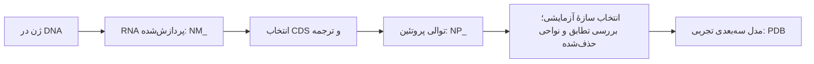

# از توالی RNA تا ساختار پروتئین

این بخش برای آموزش مرحله‌ای است: ابتدا باز، کدون و آمینواسید را در TNF و زنجیره‌های Fab می‌شناسیم؛ TOP2A مسیر آشنایی موازی است و بررسی اثر دارو بر آن بعد از مبانی انجام می‌شود. فایل‌های کوچک مرجع واقعاً دریافت شده‌اند؛ وجود یک توالی، مقدار بیان آن در بیمار یا شکل سه‌بعدی RNA را نشان نمی‌دهد.

[درس مقدماتی کدون با مثال‌های واقعی](codons-primer.fa.md) و [نمای تعاملی کدون‌ها](../?tab=sequences#codon-lesson) برای شروع در دسترس‌اند.

## سه پرسش متفاوت

- **توالی:** ترتیب نوکلئوتیدها در RNA یا آمینواسیدها در پروتئین چیست؟ FASTA به این پرسش پاسخ می‌دهد.
- **بیان:** چه مقدار RNA در یک نمونهٔ مشخص وجود دارد؟ پاسخ به اندازه‌گیری و اطلاعات بیمار، بافت و زمان نمونه‌گیری نیاز دارد؛ فایل‌های این بخش چنین داده‌ای ندارند.
- **ساختار:** اتم‌ها در فضا کجا هستند؟ فایل PDB/mmCIF مختصات مدل تجربی یک سازهٔ مشخص را می‌دهد. توالی به‌تنهایی مختصات نیست.

در [RefSeq](https://www.ncbi.nlm.nih.gov/books/NBK50679/) پیشوند `NM_` برای RNA پیام‌رسانِ کدکننده و `NP_` برای پروتئین مرجع به‌کار می‌رود. شمارهٔ نسخه، مانند `.4`، باید در گزارش حفظ شود. این‌ها مرجع انسانی منتخب هستند، نه توالی اندازه‌گیری‌شده از بیمار این پروژه.

## RNAهای واقعیِ مرجع در پروژه

همهٔ بازه‌های زیر **از ۱ شروع می‌شوند، دو انتها را شامل می‌شوند و کدون پایان را در CDS حساب می‌کنند**. مقادیر از رکوردهای GenBank دریافت‌شده در ۱۳ اکتبر ۲۰۲۶ استخراج شدند.

| مولکول | RNA مرجع | طول RNA | بازهٔ CDS | پروتئین حاصل | طول پروتئین |
| --- | --- | ---: | --- | --- | ---: |
| TNF | [NM_000594.4](https://www.ncbi.nlm.nih.gov/nuccore/NM_000594.4) | ۱۶۷۸ نوکلئوتید | ۱۷۸–۸۷۹؛ ۷۰۲ نوکلئوتید | [NP_000585.2](https://www.ncbi.nlm.nih.gov/protein/NP_000585.2) | ۲۳۳ آمینواسید |
| TOP2A | [NM_001067.4](https://www.ncbi.nlm.nih.gov/nuccore/NM_001067.4) | ۵۶۹۵ نوکلئوتید | ۱۰۶–۴۷۰۱؛ ۴۵۹۶ نوکلئوتید | [NP_001058.2](https://www.ncbi.nlm.nih.gov/protein/NP_001058.2) | ۱۵۳۱ آمینواسید |

CDS بخش ترجمه‌شوندهٔ رونوشت است. بخش‌های پیش و پس از آن، UTR نام دارند و به همین پروتئین ترجمه نمی‌شوند. هر سه نوکلئوتید یک کدون می‌سازند؛ کدون پایان آمینواسید اضافه نمی‌کند. بنابراین برای TNF، `702 / 3 - 1 = 233` است. ترجمهٔ هر دو CDS با حذف فقط علامت پایان، با فایل پروتئینی `NP_` که جداگانه دریافت شد **دقیقاً مطابقت داشت**.

فایل‌های RNA دریافت‌شده از NCBI با حروف `A/C/G/T` ذخیره شده‌اند. گزینهٔ نمایشی `T→U` فقط تبدیل محاسباتی حروف به الفبای RNA است؛ RNA زیستی اوراسیل دارد، ولی این تبدیل ساختار ثانویه، تاخوردگی یا مختصات تجربی تولید نمی‌کند. فایل اصلی حفظ می‌شود.

پیکان آخر بیانگر **انتخاب و کنترل تطابق** است؛ وجود پروتئین مرجع به معنی وجود ساختار کامل یا تطابق قطعی با هر PDB نیست.

## آدالیموماب: زنجیره‌های آنتی‌بادی، نه یک ژن انسانی با همین نام

طبق [برچسب FDA سال ۲۰۲۵](https://www.accessdata.fda.gov/drugsatfda_docs/label/2025/125057s425lbl.pdf)، آدالیموماب یک IgG1 نوترکیب انسانی است. داروی کامل زنجیره‌های سنگین و سبک دارد؛ ساختار [3WD5](https://www.rcsb.org/structure/3WD5) فقط قطعهٔ **Fab** در اتصال به TNF را نشان می‌دهد، نه کل IgG و Fc. ژن طبیعیِ مستقلی به نام «adalimumab» نداریم و از توالی پروتئینی Fab نیز یک RNA یکتای دارو به‌دست نمی‌آید.

| شناسهٔ زنجیره نزد نویسنده | مولکول | توالی اعلام‌شدهٔ سازه | باقی‌مانده‌های دارای اتم سنگین با occupancy مثبت | جایگاه‌های فاقد این مختصات |
| --- | --- | ---: | ---: | --- |
| A | TNF | ۱۵۷ | ۱۵۲ | ۱–۵ |
| H | زنجیرهٔ سنگین Fab | ۲۱۹ | ۲۱۴ | ۱۳۷–۱۴۱ |
| L | زنجیرهٔ سبک Fab | ۲۱۳ | ۲۱۳ | ندارد |

فایل‌های `*_declared.fasta` توالی سازه را دارند؛ `*_resolved.fasta` فقط باقی‌مانده‌های دارای مختصات معتبر در مدل اول را دارند. اتصال حروف در FASTA به معنی اتصال هندسی در محل شکاف نیست؛ بازه‌های جدا و موقعیت‌های حذف‌شده در فراداده حفظ شده‌اند. تعداد باقی‌مانده‌های دارای اتم **Cα** قابل‌نمایش می‌تواند کمتر باشد.

## محدودیت تطابق با ساختار

در [UniProt P01375](https://www.uniprot.org/uniprotkb/P01375/entry)، TNF محلول بازهٔ ۷۷–۲۳۳ پروتئین کامل است. سازهٔ ۱۵۷تایی 3WD5 با این بازه در ۱۵۶ جایگاه تطابق دارد: جایگاه ۳۱ سازه، **D** است ولی جایگاه متناظر ۱۰۷ در RefSeq و UniProt، **R** است. این اختلاف واقعیِ منابع/سازه ثبت شده است؛ علت آن تعیین نشده و نباید «جهش بیماری‌زا» نامیده شود.

برای TOP2A نیز [4FM9](https://www.rcsb.org/structure/4FM9) کل پروتئین ۱۵۳۱تایی نیست: توالی اعلام‌شدهٔ قطعهٔ ۷۶۳تایی آن با جایگاه‌های ۴۳۱–۱۱۹۳ مرجع دانلودشده تطابق دارد. مقایسهٔ این آنزیم متصل به DNA با Fab متصل به TNF، مقایسهٔ نقش و معماری است؛ هم‌ترازی این دو پروتئین نامرتبط شاهد اتصال آدالیموماب به TOP2A نمی‌شود.

## استفاده در گزارش درس

فایل‌های [توالی در مخزن](https://github.com/koolfox/koolfox.github.io/tree/main/structural-bioinformatics/data/sequences) را همراه با [فرادادهٔ توالی‌ها](../data/metadata/sequences.json) استفاده کنید: شناسه و نسخه، URL، زمان دریافت UTC، طول، بازهٔ CDS و SHA-256 ثبت شده‌اند. برای توضیح شفاهی، CDS و کدون پایان را روی یک RNA نشان دهید، سپس توالی پروتئین و قطعهٔ واقعاً موجود در PDB را کنار آن بگذارید. نتایج این تمرین، کنترل یکپارچگی توالی و آموزش ساختار هستند؛ پاسخ بالینی یا اثر ضدسرطان از آن‌ها نتیجه نمی‌شود.
