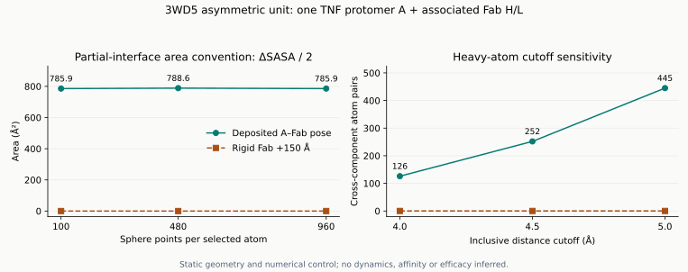

# گزارش محاسبهٔ ساختاری: سطح تماس TNF و Fab آدالیموماب

**وضعیت: پیوست اختیاریِ اجراشده.** هدف ارائهٔ این هفته، انتخاب پروتئین، فهم ساختار و خلاصهٔ مقالات است. این گزارش برای پرسش‌های تکمیلی دربارهٔ امکان محاسبه نگه داشته شده و پیش‌نیاز ارائه یا تعهد به اجرای MD نیست.

## این گزارش دقیقاً چه چیزی نشان می‌دهد؟

این یک **بازتحلیل اجراشده و قابل بازتولید از هندسهٔ ساختار تجربی** است. پرسش محدود آن این است: «در آرایش ثبت‌شدهٔ 3WD5، Fab چه مقدار از سطح قابل دسترس TNF را می‌پوشاند و آیا این نتیجه به دقت محاسبه حساس است؟» نتیجهٔ این پرسش می‌تواند بخش روش و یافته‌های یک گزارش درسی را پشتیبانی کند. این محاسبه، اثر دارو بر TOP2A یا درمان سرطان را آزمایش نمی‌کند.

ورودی، فایل اصلی [3WD5 در RCSB](https://www.rcsb.org/structure/3WD5) است: یک پروتومر TNF با شناسهٔ زنجیرهٔ نویسنده `A` و یک Fab شامل زنجیره‌های `H/L`. ساختار با پراش پرتو ایکس و تفکیک‌پذیری تقریباً 3.10 Å تعیین شده است. این واحد نامتقارن، تریمر فیزیولوژیک TNF همراه با تمام آنتی‌بادی‌ها نیست؛ همسایه‌های تقارن بلوری که به اپی‌توپ کامل کمک می‌کنند در محاسبه حاضر نیستند. مقدار تفکیک‌پذیری را نباید انحراف معیار نویز مختصات فرض کرد.

## فرضیه و کنترل پیش از تفسیر

**فرضیهٔ هندسی محدود:** در آرایش ثبت‌شده، نزدیکی TNF و Fab باید هم با تماس اتمی و هم با کاهش سطح در دسترس حلال دیده شود. این انتظار از یک کمپلکسِ از پیش شناخته‌شده می‌آید؛ آزمون حاضر کشف اتصال جدید نیست.

**کنترل محاسباتی:** کل Fab، یعنی `H` و `L` با هم، 150 Å در جهت مثبت محور x جابه‌جا می‌شود. TNF ثابت می‌ماند. هیچ اتمی به‌طور تصادفی تکان نمی‌خورد و تمام فاصله‌های داخلی هر جزء حفظ می‌شود. اگر الگوریتم درست باشد، تماس بین TNF و Fab و کاهش سطح ناشی از کنار هم بودن آنها باید تقریباً صفر شود. این یک کنترل هندسه و نرم‌افزار است؛ اختصاصیت زیستی آدالیموماب را با یک آنتی‌بادی نامرتبط مقایسه نمی‌کند.

پشتیبانی از این فرضیه یعنی سطح پوشیدهٔ مثبت در آرایش اصلی، تغییر اندک آن با افزایش دقت، و صفر شدن در کنترل. سطح صفر در آرایش اصلی، باقی ماندن پوشیدگی در کنترل دورشده، یا تغییر فاصله‌های داخلی، ابتدا نیازمند بررسی انتخاب زنجیره‌ها و صحت کد است و تفسیر زیستی را متوقف می‌کند.

## روش قابل بازتولید

مدل اول و شناسه‌های زنجیرهٔ نویسنده استفاده شد. فقط اتم‌های سنگین پروتئینی `ATOM` با اشغال مثبت و متناهی انتخاب شدند؛ آب، هتروژن، H/D و اتم بدون اشغال کنار گذاشته شدند. برای جایگاه‌های جایگزین، اشغال بیشتر و در تساوی، جایگاه خالی، سپس `A` و سپس ترتیب الفبایی ملاک بود. تعداد انتخاب‌شده: TNF برابر **1187**، H برابر **1593** و L برابر **1622** اتم؛ جمعاً **4402** اتم سنگین. بخش‌های حل‌نشده یا حذف‌شده بازسازی نشدند.

سطح قابل دسترس حلال یا **SASA** یعنی مساحتِ قابل دسترس برای مرکز یک کاوشگر کروی در اطراف اتم‌ها. از الگوریتم [Shrake–Rupley در Biopython](https://biopython.org/docs/latest/api/Bio.PDB.SASA.html)، کاوشگر با شعاع **1.4 Å** و شعاع‌های مشخص `C=1.70`، `N=1.55`، `O=1.52` و `S=1.80 Å` استفاده شد. برای هر اتم، 100، 480 و 960 نقطه با چیدمان قطعی مارپیچ طلایی ارزیابی شد؛ نمونه‌برداری تصادفی وجود ندارد. در محاسبهٔ Fab تنها، H/L همچنان با هم هستند؛ سطح دو زنجیرهٔ جدا از هم جمع نشده است. اجزای جداشده نیز همان شکلِ حالت متصل را دارند و بهینه‌سازی نشده‌اند.

\[
\Delta\mathrm{SASA}=\mathrm{SASA}(A)+\mathrm{SASA}(H/L)-\mathrm{SASA}(A+H+L)
\]

\[
I_{\mathrm{mean}}=\frac{\Delta\mathrm{SASA}}{2}
\]

عبارت اول، مجموع سطح از دست‌رفته در دو سمت است. عبارت دوم، **قرارداد میانگینِ سطح دو سمت رابط** در این گزارش است؛ واحد آن Ų است. این تقسیم بر دو، انرژی اتصال تولید نمی‌کند. سطح از دست‌رفتهٔ خود TNF و خود Fab لزوماً برابر نیست.

## یافته‌های اجراشده

| نقطه در هر اتم | SASA تنها TNF، Ų | SASA تنها Fab مرتبط، Ų | SASA کمپلکس، Ų | مجموع سطح از دست‌رفته، Ų | قرارداد ΔSASA/2، Ų |
| --- | ---: | ---: | ---: | ---: | ---: |
| 100 | 8637.16 | 19020.75 | 26086.19 | 1571.72 | 785.86 |
| 480 | 8634.86 | 18992.47 | 26050.03 | 1577.30 | 788.65 |
| 960 | 8631.67 | 19004.24 | 26064.13 | 1571.78 | 785.89 |

در 960 نقطه، TNF حدود **809.03 Ų** و Fab حدود **762.75 Ų** از سطح در دسترس خود را از دست می‌دهند. دامنهٔ سه مقدارِ قرارداد رابط **785.86 تا 788.65 Ų** است؛ دامنه نسبت به مقدار 960 نقطه حدود **0.355٪** و اختلاف 480 با 960 حدود **2.76 Ų** است. نزدیک بودن اتفاقی مقدار 100 به 960، برتری دقت پایین را ثابت نمی‌کند. این جدول حساسیت به گسسته‌سازی در یک آرایش ثابت است؛ سه تکرار زیستی، فاصلهٔ اطمینان یا سنجش عدم قطعیت تجربی نیست.

| آستانهٔ فاصله، Å | جفت اتم‌های سنگین TNF–Fab | جفت باقی‌مانده‌ها | باقی‌مانده‌های TNF در رابط |
| --- | ---: | ---: | ---: |
| 4.0 | 126 | 34 | 17 |
| 4.5 | 252 | 40 | 17 |
| 5.0 | 445 | 53 | 18 |

آستانهٔ 4.5 Å نتیجهٔ قبلی مخزن را بازتولید می‌کند: **252 جفت اتم، 40 جفت باقی‌مانده و 17 باقی‌ماندهٔ TNF**. 252 جفت اتم، 252 پیوند شیمیایی نیست؛ از این شمارش، پیوند هیدروژنی یا انرژی اتصال استخراج نشده است.

در کنترل دورشده، کمترین فاصلهٔ بین دو جزء **46.453 Å** بود؛ بسیار بیش از بیشینهٔ قطر اتمِ افزوده‌شده با کاوشگر، یعنی **6.4 Å**. تماس‌ها در هر سه آستانه صفر شدند و سطح از دست‌رفته در هر سه دقت، در حدود خطای جمع اعشاری صفر بود؛ بزرگ‌ترین باقیماندهٔ خام **3.64×10⁻¹² Ų** است و در JSON حفظ شده است. بیشینهٔ تغییر **تمام** فاصله‌های اتمی داخل TNF و داخل Fab مرتبط در این اجرا دقیقاً صفر بود؛ انتقال شکل اجزا را تغییر نداده است.



[باز کردن شکل در اندازهٔ اصلی](../assets/structural-feasibility.svg).

*این شکل مستقیماً از محاسبات این گزارش ساخته شده است. محور افقی سمت چپ دقت عددی و سمت راست آستانهٔ تماس است؛ هیچ‌کدام زمان شبیه‌سازی نیستند.*

## چه نتیجه‌ای مجاز است و چه چیزی هنوز آزمون نشده؟

می‌توان گفت «در نمای جزئی ثبت‌شده 3WD5، رابط TNF–Fab قابل اندازه‌گیری است، نتیجهٔ سطح به این سه دقت عددی حساسیت اندکی دارد و کنترل دورکردن، انتظار هندسی را برآورده می‌کند». این یک نتیجهٔ قابل گزارش با محدودیت مشخص است؛ ادعای نوآوری مستقل به حساب نمی‌آید.

نمی‌توان از این یافته نتیجه گرفت آدالیموماب TOP2A را مهار می‌کند، سرطان را درمان می‌کند، یا میزان CRP یک بیمار تغییر کرده است. برای پیوند **غیرمستقیم** با TOP2A، ابتدا دادهٔ مداخله‌ای آدالیموماب/شاهد در یک نوع سلول مشخص، زمان نمونه‌برداری، بیان TOP2A و سنجش مستقل تکثیر لازم است. مشاهده‌های جداگانهٔ «آدالیموماب→SIRPG» و «حذف SIRPG→TOP2A» در [مطالعهٔ Marguerie و همکاران](https://doi.org/10.3389/fimmu.2025.1668361)، زنجیرهٔ علّی کامل را اندازه‌گیری نکرده‌اند. جهت اثر آدالیموماب بر TOP2A در این پروژه باز است؛ نتیجهٔ بدون ارتباط نیز پذیرفتنی است.

برای دینامیک مولکولی واقعی، بازسازی و اعتبارسنجی سامانهٔ مناسب، رسیدگی به اتم‌های مفقود، پروتون‌گذاری، میدان نیرو، آب و یون، متعادل‌سازی، تکرارهای مستقل و ارزیابی همگرایی لازم است. این مراحل اینجا انجام نشده‌اند. حتی یک MD درست برای TNF–Fab، به‌تنهایی پاسخ سلولی TOP2A یا پیامد سرطان را مدل نمی‌کند. انتقال صلب حاضر نیز مسیر جداشدن واقعی یا برآورد ثابت اتصال نیست.

## فایل‌ها، فرمان اجرا و اعتبارسنجی

```bash
uv run --project structural-bioinformatics python structural-bioinformatics/scripts/analyze_structural_feasibility.py
uv run --project structural-bioinformatics pytest -q structural-bioinformatics/tests/test_feasibility.py
```

ورودیِ آفلاین `assets/3wd5.pdb` با SHA-256 زیر تثبیت شده است؛ اسکریپت فایل ویرایش‌شده را با همین هویت علمی نمی‌پذیرد:

```text
fae6eee1b06b8cba0a466280dbc32563efaa54ec639afd921cb610d17debd216
```

[خروجی کامل عددی و منشأ](../data/processed/structural-feasibility.json)، زمان UTC، نسخه‌ها، پارامترها، هش کد و شکل اصلی را ثبت می‌کند. اجرا روی macOS/ARM64 با Python 3.13.9، Biopython 1.88 و NumPy 2.5.4 انجام شد و محاسبه حدود 25 ثانیه طول کشید؛ این مدت، معیار سرعت عمومی برای همهٔ سیستم‌ها نیست.

**15 آزمون آفلاین جدید گذشت:** سطح تحلیلی یک کرهٔ منفرد، سطح کلاهک تحلیلی دو کرهٔ هم‌پوشان، حفظ همراهی H/L، صفر شدن پوشیدگی در کنترل، بازتولید شمارش ساختار اصلی، و رد پارامترهای نامعتبر. بررسی Ruff نیز موفق بود. گذشتن این آزمون‌ها صحت محاسبهٔ محدود را تقویت می‌کند و جای اعتبارسنجی زیستی را نمی‌گیرد.

منابع روش: [Shrake و Rupley، 1973](https://doi.org/10.1016/0022-2836(73)90011-9)، [پیاده‌سازی رسمی Biopython 1.88](https://github.com/biopython/biopython/blob/biopython-188/Bio/PDB/SASA.py) و [مقالهٔ ساختار TNF–آدالیموماب، Hu و همکاران، 2013](https://doi.org/10.1074/jbc.M113.491530). مقالهٔ قدیمی آخر، منبع بنیادی مختصات است و جای سه مقالهٔ جدید مرور انتخابی را نمی‌گیرد.
