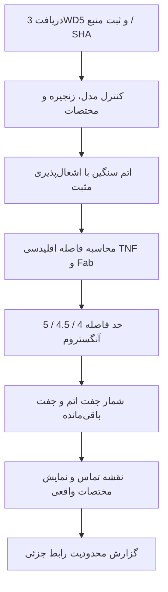

# روش تحلیل ساختاری: از مختصات تا تماس

> **جای این سند در مسیر:** [نقشهٔ واحد پروژه](course-guide.fa.md) · [جلسات درس](course-sessions.fa.md) · [پروتکل RNA-seq](rnaseq-research-plan.fa.md) · [اصلاح‌ها و موارد باز](comprehensive-review.fa.md).

این بخش روش **اجراشدهٔ پروژه** را توضیح می‌دهد. سؤال عملی ما این است: «در فایل آزمایشگاهی 3WD5، کدام اتم‌ها و آمینواسیدهای TNF و Fab به یکدیگر نزدیک‌اند و نتیجه به انتخاب حد فاصله چقدر حساس است؟» این محاسبه اثر دارو بر TOP2A یا درمان سرطان را اندازه نمی‌گیرد.

## داده و انتخاب اتم

ورودی، مختصات [3WD5 در RCSB PDB](https://www.rcsb.org/structure/3WD5) است. مدل اول، زنجیرهٔ نویسندهٔ A برای TNF و H/L برای Fab انتخاب می‌شوند. اتم‌های سنگین پروتئین با اشغال‌پذیری مثبت پذیرفته می‌شوند؛ آب، اتم‌های H/D و هتروژن‌ها کنار گذاشته می‌شوند. در جایگاه‌های جایگزین، بیشترین اشغال‌پذیری و سپس ترتیب مشخصِ blank/A/الفبایی ملاک است. مختصات و اشغال‌پذیری باید عدد متناهی باشند.

واحد فاصله آنگستروم است: $1\,\text{Å}=0.1\,\mathrm{nm}$. مقدار تفکیک‌پذیری بلوری، مثلاً 3.10 Å، کیفیت جزئیات ساختار را توصیف می‌کند؛ حد تماس یا اندازهٔ پروتئین نیست.

## فرمول فاصله و تماس

اگر $\mathbf{r}_i$ مختصات اتمی از TNF و $\mathbf{r}_j$ مختصات اتمی از Fab باشد، فاصلهٔ اقلیدسی چنین است:

$$
d_{ij}=\|\mathbf{r}_i-\mathbf{r}_j\|_2
=\sqrt{(x_i-x_j)^2+(y_i-y_j)^2+(z_i-z_j)^2}
$$

مجموعهٔ تماس‌های هندسی در حد فاصلهٔ $\tau$ تعریف می‌شود:

$$
C_{\tau}=\{(i,j)\mid d_{ij}\leq\tau\}
$$

علامت «کوچک‌تر یا مساوی» مهم است: جفتی با فاصلهٔ دقیقاً برابر حد نیز شمرده می‌شود. چند جفت اتم می‌توانند متعلق به یک جفت آمینواسید باشند؛ بنابراین شمار جفت اتم و جفت باقی‌مانده متفاوت است. شناسهٔ باقی‌مانده شامل زنجیره، شماره و کد درج است؛ شمارهٔ یکسان در H و L یک باقی‌ماندهٔ واحد نیست.

## حساسیت به حد فاصله؛ خروجی واقعی

| حد فاصلهٔ Å | جفت اتم سنگین | جفت باقی‌مانده |
| --- | ---: | ---: |
| 4.0 | 126 | 34 |
| 4.5 | 252 | 40 |
| 5.0 | 445 | 53 |

در حد 4.5 Å، تعداد باقی‌مانده‌های TNF حاضر در رابط جزئی 17 است. این اعداد مستقیماً از [خروجی محاسبه](../data/processed/interface-summary.json) آمده‌اند. زیادشدن تعداد تماس با افزایش حد، نتیجهٔ تعریف مجموعه است؛ به معنی قوی‌ترشدن دارو نیست.

$$
|C_{4.5}|=252,\qquad |R_{4.5}|=40
$$

در این‌جا $R_{\tau}$ مجموعهٔ جفت‌های یکتای باقی‌ماندهٔ متناظر با تماس‌های اتمی است. تغییر حد و سیاست انتخاب اتم باید همراه عدد نهایی گزارش شود.

## مسیر بازتولید



این نمودار، مراحل محاسباتی است؛ حرکت مولکولی یا مسیر زیستی دارو نیست. فرمان‌ها از ریشهٔ مخزن اجرا می‌شوند:

```sh
uv run --project structural-bioinformatics tnf-atlas fetch-structures
uv run --project structural-bioinformatics tnf-atlas analyze
uv run --project structural-bioinformatics pytest -q
```

فایل خام و SHA-256 نگهداری می‌شوند؛ مختصاتِ شکل، ویدئو و محاسبه با سیاست انتخاب اتم سازگارند. شکاف‌های مختصاتی به پیوند تازه تبدیل نمی‌شوند.

## کنترل کوچک RNA تا پروتئین

فایل mRNA مرجع ممکن است با حروف A/C/G/T ثبت شود؛ نمایش T→U یک تبدیل آموزشی است. **CDS** بخش کدکننده است؛ تمام mRNA، شامل بخش‌های ترجمه‌نشونده، یک‌جا ترجمه نمی‌شود. برای دو مرجع حاضر، CDS شامل یک کدون پایان است؛ در این شرایط:

$$
L_{\mathrm{protein}}=\frac{L_{\mathrm{CDS}}}{3}-1
$$

برای TNF، طول CDS برابر 702 نوکلئوتید و پروتئین 233 آمینواسید است. برای TOP2A، مقادیر 4596 و 1531 هستند. ترجمهٔ CDS با پروتئینِ جداگانهٔ دانلودشده مطابقت داده شده است. این رابطه برای هر توالی دلخواه یا هر قرارداد CDS بدون کنترل کدون آغاز/پایان معتبر فرض نمی‌شود. [شناسه‌ها، فایل‌ها و محدودیت‌ها](sequences-primer.fa.md)

## مرز تفسیر و ارتباط با سؤال اصلی

3WD5 در نمای حاضر یک زیرواحد TNF و یک Fab دارد؛ آنتی‌بادی کامل و تماس‌های همسایه‌های تقارن در این تحلیل نیستند. تماس هندسی، انرژی اتصال، پیوند هیدروژنی تأییدشده یا پاسخ بیمار نیست. ساختارهای 1TNF و 3WD5 نیز سازه‌های یکسانی ندارند؛ تفاوت شکل آن‌ها را صرفاً اثر آدالیموماب نمی‌نامیم.

ارتباط TOP2A بخش **نقد شواهد و فرضیه** است. در مقالهٔ SIRPG، تغییر SIRPG با آدالیموماب و تغییر TOP2A پس از حذف SIRPG در دو آزمایش جدا گزارش شده‌اند. محاسبهٔ فاصلهٔ بالا آن حلقهٔ علّی را تکمیل نمی‌کند. [پرسش و آزمون‌های لازم](research-questions.fa.md) و [جدول شواهد](connection-evidence.fa.md) مسیر بعدی را مشخص می‌کنند.
