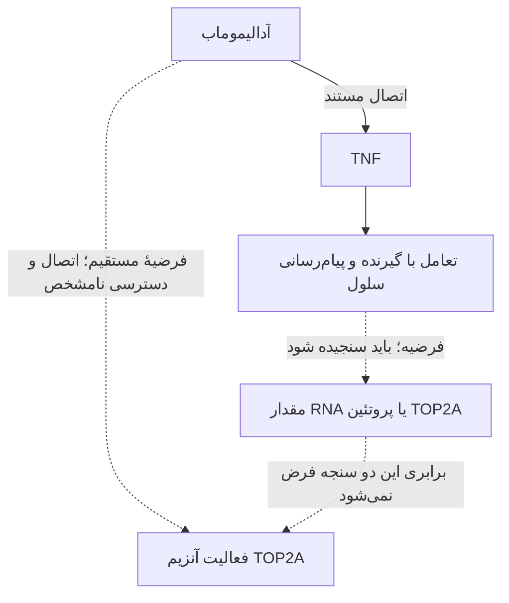

# آیا آدالیموماب می‌تواند TOP2A را مهار کند؟

> **جای این سند در مسیر:** [نقشهٔ واحد پروژه](course-guide.fa.md) · [جلسات درس](course-sessions.fa.md) · [پروتکل RNA-seq](rnaseq-research-plan.fa.md) · [اصلاح‌ها و موارد باز](comprehensive-review.fa.md).

**سؤال پژوهش پیشنهادی:** آیا آدالیموماب می‌تواند فعالیت توپوایزومراز IIα را مستقیماً، یا از راه تغییر پیام‌رسانی TNF، کاهش دهد؟ تحلیل ساختاری کدام بخش این فرضیه را می‌آزماید و برای نتیجهٔ زیستی چه شاهد دیگری لازم است؟

این سؤال یک توسعهٔ اختیاریِ خارج از موضوع اصلی ساختاری است؛ پاسخ آن تعیین نشده است. عنوان مناسب فقط برای ارائهٔ همین پیوست: **«امکان‌سنجی ساختاری اثر آدالیموماب بر TOP2A با تفکیک اتصال مستقیم و پیامد غیرمستقیم مهار TNF»**. «اثبات مهار TOP2A» عنوان نتیجه‌دار است و پیش از آزمون مناسب انتخاب نمی‌شود.

## ۱. چهار معنی که نباید یکی شوند

**اتصال** یعنی دو مولکول در شرایط معین یک کمپلکس تشکیل دهند. **مهار فعالیت** یعنی کار آنزیم، مثلاً انجام واکنش روی یک نمونهٔ DNA، در آزمون تعریف‌شده کمتر شود. **کاهش مقدار پروتئین** یعنی مولکول‌های آنزیم کمتری موجود باشند. **کاهش RNA** یعنی رونوشت کمتری از ژن اندازه‌گیری شود. RNA کمتر، به‌تنهایی سه ادعای دیگر را تعیین نمی‌کند.

TOP2A نام ژن است؛ محصول پروتئینی آن توپوایزومراز IIα نام دارد. این آنزیم با برش موقت، عبور و اتصال دوبارهٔ DNA، درهم‌پیچیدگی و اتصال حلقه‌های DNA را مدیریت می‌کند. جایگاه‌های هسته‌ای و حضور سیتوپلاسمی برای آن ثبت شده‌اند. [UniProt P11388](https://www.uniprot.org/uniprotkb/P11388)، [ساختار و کارکرد، Wendorff 2012](https://pmc.ncbi.nlm.nih.gov/articles/PMC3584591/).

| ادعای مورد آزمون | اندازه‌گیری لازم | نتیجهٔ قابل بیان |
| --- | --- | --- |
| اتصال مستقیم آدالیموماب–TOP2A | سنجش اتصال و مقایسه با یک آنتی‌بادی نامرتبط | اتصال در همان شرایط آزمون |
| مهار مستقیم فعالیت آنزیم | سرعت/مقدار محصول در آزمون عملکرد TOP2A با مقدار آنزیم ثابت | کاهش فعالیت در همان آزمون |
| تغییر مقدار پروتئین در سلول | سنجش پروتئین همراه زنده‌مانی و تعداد سلول | تغییر فراوانی پروتئین |
| تغییر بیان TOP2A | RNA-seq یا qPCR با طراحی دارو/کنترل معتبر | تغییر RNA؛ نیازمند بررسی پروتئین و عملکرد |

## ۲. مسیر مستقیم: فرضیهٔ تازه و پیش‌نیاز دسترسی

هدف اتصال شناخته‌شدهٔ آدالیموماب TNF است. دارو اتصال TNF به گیرنده‌های سطح سلول را محدود می‌کند؛ TOP2A در این توضیح، هدف اتصال گزارش‌شده نیست. [برچسب Humira، بخش ۱۲.۱](https://dailymed.nlm.nih.gov/dailymed/drugInfo.cfm?setid=608d4f0d-b19f-46d3-749a-7159aa5f933d).

**استنتاج امکان‌سنجی:** برای اثر مستقیم در سلول، دارو باید به TOP2A عملکردی دسترسی داشته باشد. در منابع بررسی‌شده، این دسترسی برای آدالیموماب معمول نشان داده نشده است. این یک حلقهٔ مفقود است؛ نتیجهٔ «هیچ نوع تعاملی تحت هیچ شرایطی ممکن نیست» از آن حاصل نمی‌شود. آزمون اتصال با پروتئین‌های خالص نیز به‌تنهایی ورود دارو به سلول یا هسته را نشان نمی‌دهد.

در این مسیر، تحلیل ساختاری می‌تواند **فرضیهٔ اتصال** بسازد. docking، پیشنهاد چیدمان دو مولکول است؛ نرم‌افزار می‌تواند برای دو سطح وضعیت تماس بسازد، حتی اگر آن دو در بدن به هم نرسند. امتیاز docking و پایدارماندن یک وضعیت در MD، بدون شاهد متناسب، سنجهٔ مهار آنزیم نیستند.

## ۳. مسیر غیرمستقیم: مهار TNF و تغییر وضعیت سلول

در این فرضیه، دارو به TNF متصل می‌شود؛ تغییر پیام‌رسانی و وضعیت سلول ممکن است مقدار یا فعالیت TOP2A را تغییر دهد. جهت تغییر باید اندازه‌گیری شود. کاهش تکثیر یا تغییر ترکیب سلولی نیز می‌تواند RNA کمتر ایجاد کند؛ این یافته با «آنتی‌بادی به جایگاه فعال TOP2A وصل شد» یکسان نیست.

در Marguerie 2025، افزایش SIRPG با آدالیموماب و کاهش RNA مربوط به TOP2A پس از حذف SIRPG، دو مداخلهٔ جدا هستند. از ترکیب آن‌ها، جهت اثر دارو بر TOP2A تعیین نمی‌شود. [مقالهٔ اصلی، شکل‌های ۲–۴](https://www.frontiersin.org/journals/immunology/articles/10.3389/fimmu.2025.1668361/full).

## ۴. تحلیل ساختاری قابل دفاع چگونه طراحی می‌شود؟

۱. **مرجع مثبت:** رابط شناخته‌شدهٔ TNF–Fab در 3WD5 برای یادگیری روش و کنترل بازسازی اتصال به‌کار می‌رود. مدل سپرده‌شده یک TNF و Fab دارد؛ همسایه‌ها در مدل مشتق‌شدهٔ مخزن بازسازی و منبع/عملگرهایشان ثبت شده‌اند. آنتی‌بادی کامل در این فایل نیست. [3WD5](https://www.rcsb.org/structure/3WD5).

۲. **انتخاب حالت TOP2A:** ساختار 4FM9 هستهٔ برش DNA و DNA مصنوعی دارد؛ آنزیم کامل و تمام چرخهٔ عملکرد در این فایل حضور ندارند. باید مشخص شود قرار است کدام سطح، حالت آنزیم و اجزای لازم بررسی شوند. [4FM9](https://www.rcsb.org/structure/4FM9)، [مطالعهٔ آلوستری و ساختارهای گسترده‌تر، Vanden Broeck 2021](https://pmc.ncbi.nlm.nih.gov/articles/PMC8137924/).

۳. **مقایسهٔ اتصال با نمونهٔ کنترل:** در طرح محاسباتی، نتیجه با آنتی‌بادی نامرتبطِ متناسب و چند وضعیت شروع مقایسه شود. روش باید دربارهٔ جایگاه اتصال معلوم هم ارزیابی شود. امتیاز دو سیستم با اندازه یا شرایط متفاوت، بدون اعتبارسنجی قابل رتبه‌بندی درمانی نیست.

۴. **گزارش واقعی:** برخورد اتمی، سطح مدفون، تماس و وابستگی نتیجه به آماده‌سازی ثبت شوند. MD تنها پس از آماده‌سازی معتبر و با کنترل/نمونه‌برداری کافی پیشنهاد می‌شود. در این پروژه، docking یا MD آدالیموماب–TOP2A اجرا نشده است.

۵. **آزمون عملکردی مرحلهٔ بعد:** برای ادعای مهار، بررسی فعالیت TOP2A با DNA که آنزیم روی آن کار می‌کند و مقدار آنزیم مشخص لازم است؛ فعالیت آنزیم، اتصال آنتی‌بادی و زنده‌مانی سلول خروجی‌های جدا هستند. یک کنترل مهارگر شناخته‌شده باید مطابق نوع آزمون انتخاب شود. اتوپوزاید نمونهٔ دارویی است که کمپلکس برش توپوایزومراز II–DNA را پایدار می‌کند؛ کاهش RNA، تعریف سازوکار آن نیست. [NCI، اتوپوزاید](https://www.cancer.gov/publications/dictionaries/cancer-drug/def/etoposide).

## ۵. یک دیتاست جدید برای شاخهٔ RNA

مقالهٔ **Veerasubramanian و همکاران، ۲۳ ژوئیهٔ ۲۰۲۶**، تک‌درمانی و ترکیب مهارگرهای TNF/TNFR را در کشت سلولی بررسی کرده است. TOP2A در متنِ مربوط به ژن‌های تکثیرِ تحت درمان‌های ترکیبی ذکر می‌شود. این عبارت، نتیجهٔ مربوط به آدالیموماب به‌تنهایی یا سنجش فعالیت آنزیم نیست. [مقالهٔ اولیه](https://pmc.ncbi.nlm.nih.gov/articles/PMC13442446/).

رکورد **GSE339038** دارای ۶۴ کتابخانه از **چهار اهداکننده، ۱۶ وضعیت و روز پنجم کشت MLR** است. MLR آزمایش پاسخ سلول‌ها به سلول‌های اهداکنندهٔ دیگر است؛ این نمونه‌ها بیماران RA نیستند. بازوهای `Ada + IgG1` و `IgG1+IgG1` هرکدام چهار نمونه دارند و برای بررسی آیندهٔ اثر تک‌دارویی نامزدند. اهداکننده‌ها در مقایسه باید جفت شوند؛ ۶۴ کتابخانه به معنی ۶۴ فرد مستقل نیست. [GEO و متادیتای نمونه‌ها](https://www.ncbi.nlm.nih.gov/geo/query/acc.cgi?acc=GSE339038)، [استخراج متادیتای ثبت‌شده](../data/metadata/top2a-followup-dataset.json).

در این نوبت، متادیتا و ماتریس شمارش بررسی شدند؛ [پایلوت توصیفی TOP2A](top2a-count-inspection.fa.md) چهار مقدار CPM کمتر را نشان داد. تحلیل اختلاف بیان یا آزمون فعالیت آنزیم اجرا نشده است. نوع مقادیر، کیفیت، نرمال‌سازی، کنترل منطبق و عدم قطعیت باید پیش از نتیجه‌گیری بررسی شوند. دیتاست GSE338910 همان مقاله، تحریک کوتاه‌مدت T-cell را دارد و جای مقایسهٔ دارویی GSE339038 نیست.

## ۶. خروجی قابل ارائهٔ این مرحله

می‌توان سؤال، ساختار مرجع، محدودیت دسترسی، کنترل‌ها و دیتاست نامزد را مستند و امکان اجرای آزمون را ارزیابی کرد. پاسخ فعلی: **مهار مستقیم TOP2A با آدالیموماب در منابع بررسی‌شده تأیید نشده؛ شاخهٔ تغییر RNA دادهٔ نامزد دارد؛ اثبات مهار آنزیم به سنجهٔ عملکردی نیاز دارد.** این نتیجه، یک گزارش امکان‌سنجی است و هنوز کشف سازوکار جدید یا اثر ضدسرطان محسوب نمی‌شود.

[ممیزی جمله‌های ارائه و متن دارو](scientific-claim-audit.fa.md)، [نقشهٔ شواهد](connection-evidence.fa.md).
