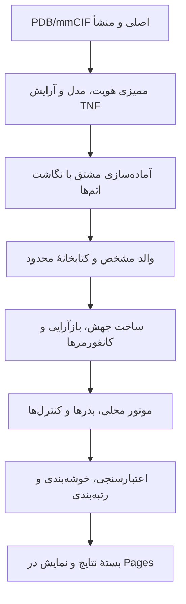

# طرح ساخت آزمایشگاه پپتیدی TNF

**این پروژه باید سامانه‌ای برای تولید و بررسی فرضیه‌های ساختاری بسازد.** هدف قابل‌دستیابی این پژوهش، مقایسهٔ مجموعه‌ای محدود از پپتیدهای الهام‌گرفته از سطح اتصال آدالیموماب به TNF-α است؛ جایگزینی بالینی آنتی‌بادی فرضیه‌ای دورتر می‌ماند. صفحهٔ موجود مشخصات آزمایش را می‌سازد، برنامه‌ای محلی ساخت مولکول و داکینگ را اجرا می‌کند و بستهٔ نتایج برای بازرسی به صفحه برمی‌گردد. زیرساخت هندسه و نمایش موجود قابل استفاده است؛ خط تولید پپتید هنوز ساخته یا اعتبارسنجی نشده است. این گزارش، بر پایهٔ سه یادداشت پژوهشی نهایی و شواهد مخزن، **طرح اجراست**؛ نصب موتور، اجرای پپتید، بنچمارک یا تأیید انتشار تازه‌ای گزارش نمی‌کند.

## پرسش پژوهش و معیار پاسخ

آنتی‌بادی پروتئینی با زنجیره‌های سنگین و سبک و سطح تشخیص سه‌بعدی است؛ پپتید زنجیره‌ای کوتاه‌تر از آمینواسیدهاست. جداکردن قطعه‌ای از آنتی‌بادی، شکل و عملکرد آن را تضمین نمی‌کند. داکینگ جست‌وجوی نحوهٔ قرارگیری دو مولکول کنار هم است. «کانفورمر» شکل فضایی یک پپتید، «پوز» شکل و جای‌گیری آن نسبت به هدف، و «اسکور» عدد رتبه‌بندی موتور است؛ اسکور اندازه‌گیری قدرت اتصال نیست. 3WD5 ساختار TNF همراه قطعهٔ اتصال‌دهندهٔ آنتی‌بادی، یعنی Fab، است. ([RCSB](https://www.rcsb.org/structure/3WD5))

**پرسش اصلی:** آیا یک روش ثابت و آزموده، برای پپتیدهای کوتاه با منشأ مشخص در سطح تماس آدالیموماب، پوزهای سازگار با ناحیهٔ هدف روی TNF انسانی سه‌تایی تولید می‌کند و آن‌ها را از کنترل‌های محاسباتی متمایز می‌سازد؟ خروجی درس، پاسخ مستند به همین پرسش است. کاهش اتصال TNF به گیرندهٔ سلولی TNFR1 و اثر درمانی به شواهد آزمایشگاهی بعدی نیاز دارند.

سابقهٔ دسترسی شش تب یکسان نیست: گوگل و LocalFold در مرورگر دیده شدند؛ خطاهای تمرکز Chrome ادامهٔ خواندن بومی تب‌ها را متوقف کرد. RCSB و DrugBank مستقیم بررسی شدند و هویت UniProt از API بررسی شد. بنابراین ادعای خواندن کامل هر شش تب نداریم؛ نشانی خصوصی جست‌وجو و اطلاعات نشست نیز اینجا ثبت نمی‌شود.

| تب | برداشت مجاز و وضعیت دسترسی |
|---|---|
| گوگل؛ ساخت پپتید علیه TNF | منشأ ایده است؛ پپتید پیشنهادیِ فاقد منبع اولیه، کنترل مثبت پذیرفته‌شده نیست. |
| [LocalFold](https://localfold.org) | رابط دیده شده؛ اجرای مدل و عملکرد محلی آزموده نشده است. |
| [P01375](https://rest.uniprot.org/uniprotkb/P01375.json) | TNF انسانی؛ پیش‌ساز ۲۳۳ باقی‌مانده‌ای، با بخش محلول ۷۷–۲۳۳. |
| [A0A7G8Z9Y8](https://rest.uniprot.org/uniprotkb/A0A7G8Z9Y8.json) | **TNF1 حلزون دریایی Littorina littorea است، نه آدالیموماب و نه TNF انسانی.** |
| [DB00051](https://go.drugbank.com/drugs/DB00051) | مدخل آدالیموماب؛ دسترسی مستقیم به بخش عمومی، بدون ادعای خواندن محتوای محدود. |
| [3WD5](https://www.rcsb.org/structure/3WD5) | ساختار تجربی TNF–Fab؛ زنجیره‌های مؤلف H و L مرجع منشأ پپتیدند. |

## اصلاحیهٔ Hu پیش‌شرط انتخاب پپتید است

مقالهٔ Hu در ۲۰۱۳ اتصال Fab به سطحی شامل دو زیرواحد TNF را بررسی کرد؛ آزمایش‌های جهش آن، تغییرات **TNF در برابر Fab** هستند، نه اثر جهش روی پپتید آزاد. اصلاحیهٔ ۲۰۱۴ جدول ۲ و شماره‌گذاری تماس‌ها، از جمله Pro20/Gln21، Thr72/His73 و Lys90–Asn92 را اصلاح می‌کند. تماس با Asp1 زنجیرهٔ سبک نیز هشدار می‌دهد که همهٔ شناسایی در یک حلقهٔ کوتاه خلاصه نمی‌شود. حلقه‌های CDR نواحی متغیرِ مشارکت‌کننده در شناسایی‌اند. اختلاف قدیمی برچسب‌های CDR نباید پیش از ممیزی جدول اصلاح‌شده، یافتهٔ تازه معرفی شود. ([Hu 2013](https://pmc.ncbi.nlm.nih.gov/articles/PMC3779706/)، [اصلاحیهٔ ۲۰۱۴](https://pmc.ncbi.nlm.nih.gov/articles/PMC4118091/))

[خروجی موجود بازسازی](../data/processed/full-epitope.json) در فاصلهٔ ۴٫۵ آنگستروم، ۲۵۲ تماس اتمی با زیرواحد A و ۱۱۳ تماس با همسایهٔ C ثبت می‌کند. این محاسبهٔ هندسی پیشین است؛ بازتولید تازه یا انرژی اتصال نیست. نمای سپرده‌شده یک TNF و Fab دارد؛ «assembly 1» با عملگر همانی، خودبه‌خود سه‌تایی کامل را نمی‌سازد. بازسازی اختصاصی پروژه باید همراه نگاشت عملگرها حفظ شود. **تا پذیرش نگاشت اصلاح‌شده، هیچ توالی جدیدی نامزد پذیرفته‌شده نیست؛ L2 نیز صرفاً به‌دلیل کوتاهی، بهترین گزینهٔ دارویی نمی‌شود.** ([روش موجود](../scripts/analyze_full_epitope.py)، [مقایسهٔ تاریخی](../data/processed/hu-mutation-comparison.json))

امکان مهار TNF با پپتید سابقه دارد: Döring پپتیدی از آنتی‌بادی Di62، نه آدالیموماب، گزارش کرد؛ Luzi پپتید دوحلقه‌ای M21 و Checco/Niu خانوادهٔ پپتیدهای α/β را مطالعه کردند. شواهد اتصال، رقابت با گیرنده و پاسخ سلولی باید جدا گزارش شوند. ساختارهای [4TWT](https://www.rcsb.org/structure/4TWT)، [7TA3](https://www.rcsb.org/structure/7TA3) و [7TA6](https://www.rcsb.org/structure/7TA6) گزینه‌های بررسی مرجع‌اند؛ شیمی حلقه‌ها، اتصال‌دهنده و باقی‌مانده‌های غیرمعمول باید پشتیبانی شوند. این خانواده‌ها با تغییر حالت تجمعی TNF مرتبط‌اند؛ موفقیت روی آن‌ها اثبات تقلید سطح آدالیموماب نیست. ([Döring](https://pubmed.ncbi.nlm.nih.gov/7935497/)، [Luzi](https://pmc.ncbi.nlm.nih.gov/articles/PMC4378371/)، [Checco](https://pmc.ncbi.nlm.nih.gov/articles/PMC7654703/)، [Niu](https://pmc.ncbi.nlm.nih.gov/articles/PMC9749406/))

## از فایل ورودی تا هر پوز، مسیر قابل بازرسی باشد

ورودی فایل محلی PDB/mmCIF یا دریافت صریح از آرشیو است. نسخهٔ اصلی دست‌نخورده، همراه URL، زمان UTC، نسخه و SHA-256 می‌ماند. mmCIF قالب کاری ترجیحی است؛ خروجی PDB فقط در صورت حفظ شناسه‌ها صادر می‌شود. قالب ناقص، مختصات نامتناهی و هویت تکراری خطای مشخص می‌گیرند. هر باقی‌مانده با مدل، زنجیرهٔ مؤلف و زنجیرهٔ label، شماره و کد درج شناخته می‌شود؛ شمارهٔ مؤلف، جایگاه پپتید و شمارهٔ UniProt یکی فرض نمی‌شوند. بارگذار فعلی نخستین مدل را می‌گیرد؛ سامانهٔ تازه باید انتخاب مدل را آشکار کند. ([بارگذار موجود](../src/tnf_atlas/structure.py))

پیش از آماده‌سازی، آب، یون، لیگاند، پیوند کووالانسی، دی‌سولفید، اتم مفقود و شکاف زنجیره فهرست می‌شوند. occupancy سهم اشغال ثبت‌شده است؛ مختصات با اشغال صفر وارد تحلیل نمی‌شوند. altloc جایگاه‌های جایگزین است و انتخابش باید در سطح باقی‌مانده سازگار باشد؛ مخلوط‌کردن اتم‌های چند حالت مولکول معتبری نمی‌سازد. مدل، واحد نامتقارن، assembly و همسایهٔ بلوری جدا نمایش داده می‌شوند. حذف Fab از سه‌تایی بازسازی‌شده تصمیم ثبت‌شدهٔ ساخت گیرنده است؛ حذف خودکار همهٔ اجزای غیرپروتئینی مجاز نیست.

آماده‌سازی فایل مشتق می‌سازد: pH و پروتون‌گذاری، هیدروژن‌ها، بار، شیمی دو انتها و کَپ‌ها، پیوندها، پارامترها و اتم‌های مجاز به حرکت روشن‌اند. اتم مدل‌شده از اتم تجربی متمایز است؛ ترمیم پشتیبانی‌نشده متوقف می‌شود. برای هر والد پپتیدی، فایل، زنجیره، بازهٔ دقیق و نگاشت جایگاه‌ها ذخیره می‌شود. بیرون‌آوردن CDR انتهاهای جدید و آزادی حرکتی تازه ایجاد می‌کند؛ شکل متصل در Fab شاهد اتصال پپتید آزاد نیست.

آزمایش ترکیبی به **توالی مرتب یا مجموعهٔ انتخاب‌های هر جایگاه** نیاز دارد. آغاز محدود به ۲۰ آمینواسید معمول با پیکربندی L و پپتید خطی است؛ D، حلقه و تغییر شیمیایی مسیر اعتبارسنجی جدا دارند. برای طول L، تعداد تک‌جهش‌ها L×19 است: پپتید ۱۲تایی **۲۲۸ جهش، یا ۲۲۹ توالی همراه والد** دارد؛ فضای کامل 20^L مسئله‌ای متفاوت است. تعداد یکتا، حذف‌شده، کانفورمر، بذر، جایگاه و کار پیش از اجرا محاسبه می‌شود؛ عبور از سقف، برنامه‌ریزی را متوقف می‌کند.

جهش واقعی اتم‌ها و پیوندهای زنجیرهٔ جانبی تازه می‌سازد، آرایش همسایه‌ها را بازچینی و ساختار را با روش مشخص آرام‌سازی می‌کند. حذف مجازی تماس‌های بعد از Cβ در [آزمایشگاه فعلی](../assets/epitope-lab.js) چنین کاری نمی‌کند. سازنده باید کامل‌بودن اتم‌ها، هندسه، دست‌سانی و برخوردها را بررسی کند. چند کانفورمر با بذرهای ثبت‌شده ساخته و رد یا قبول می‌شوند؛ این‌ها تکرار زیستی نیستند. اگر موتور از توالی شکل می‌سازد، قرارداد ورودی باید همین را نشان دهد.

هر کار محلی، توالی و شیمی، کانفورمر، گیرنده، جایگاه، موتور، پارامتر و بذر مشخص دارد. نسخهٔ واقعی ابزار، فرمان، محیط، زمان، لاگ و هش خروجی ثبت می‌شود. شکست، لغو، مهلت‌گذشتگی و حالت پشتیبانی‌نشده اسکور ناموجود دارند؛ صفر ساختگی ندارند. توقف فرایندهای فرزند و ادامهٔ کار پس از قطع باید آزموده شود؛ تغییر ورودی نتیجهٔ قبلی را نامعتبر می‌کند.

رابط از مسیر پژوهش موجود، اصل/آماده‌شده/جهش‌یافته/داک‌شده را جدا نشان می‌دهد. کلیک روی باقی‌مانده، منشأ، جهش، شریک تماس و فاصله را آشکار می‌کند؛ انتخاب ردیف نتیجه همان پوز قابل دریافت را نمایش می‌دهد. قراردادهای پیشنهادی experiment.json، residue-map.json، variants.jsonl، jobs.jsonl و results.jsonl، همراه manifest نسخه‌دار، داده، مختصات، لاگ، CSV و گزارش HTML را پیوند می‌دهند. واردکردن بسته، نسخه و هش و مسیرها را کنترل می‌کند؛ فایل واردشده داده است.

Pages میزبانی ایستا دارد؛ **CLI محلی نخستین مسیر اجراست** و worker پوشه‌ای بعداً اختیاری است. backend عمومی، آپلود خودکار فایل خصوصی یا سرویس دائمی لازم نیست. کد محلی در [src/tnf_atlas](../src/tnf_atlas/) توسعه می‌یابد؛ ویرایشگر مرورگری برای فهم شمارش، فیلتر و تحلیل نتایج مناسب است. تغییر کد علمی باید نسخهٔ آزمایش تازه بسازد. ویرایشگر آموزشی فعلی جای موتور بومی داکینگ را نمی‌گیرد. ([دامنهٔ فعلی ابزارها](../README.md)، [ماهیت Pages](https://docs.github.com/en/pages/getting-started-with-github-pages/what-is-github-pages))

## موتور و رتبه‌بندی باید پیش از نامزدسازی آزموده شوند

**HADDOCK3 پیشنهاد مشروط برای موتور نخست است**، چون مجموعهٔ کانفورمر و انعطاف پپتید را پشتیبانی می‌کند. ناحیهٔ تماس و محدودیت‌های فاصله باید منشأ روشن داشته باشند. نسخه، سازگاری پردازنده، CNS و مجوز وابستگی‌ها، زمان و حافظه در پایلوت واقعی بررسی می‌شوند؛ نصب Python اثبات آماده‌بودن موتور نیست. ADCP v1.1 بررسی مکمل اختیاری است؛ مسیر رسمی Linux/ماشین مجازی، اجرای بومی تأییدشده روی این Mac نیست. ([راهنمای پپتید](https://www.bonvinlab.org/software/bpg/peptides/)، [نصب HADDOCK3](https://www.bonvinlab.org/haddock3/pages/INSTALL.html)، [شرایط CNS](https://github.com/haddocking/haddock3/blob/d67d8a597568bb6ab498747c86416c7257ab9736/DISCLAIMER.md)، [ADCP](https://ccsb.scripps.edu/adcpv11/downloads/))

ابتدا یک کمپلکس واقعی پروتئین–پپتید با شیمی پشتیبانی‌شده انتخاب می‌شود. بازداکینگ با گیرندهٔ حالت متصل آسان‌تر از crossdocking با گیرندهٔ مستقلِ غیرمتصل است؛ این دو جدا گزارش می‌شوند. استخراج پوز بلوری آزمون مستقل نیست. پس از هم‌ترازی گیرنده، RMSD اسکلت پپتید با نگاشت اتمی و تقارن زیرواحدهای TNF محاسبه می‌شود؛ پپتید جداگانه هم‌تراز نمی‌شود. بازیابی تماس‌ها، برخوردها و بازیابی پوز مرجع در نمایندگان خوشه‌های top-1/5/10، برای چند بذر گزارش می‌شوند. بخشی از دادهٔ ارزیابی از تنظیم پارامتر کنار گذاشته می‌شود. آستانهٔ پذیرش باید پیش از اجرا تثبیت شود؛ اینجا هیچ نرخ موفقیتی نداریم. معیار پیشنهادیِ قابل تثبیت برای پنل مرجع، بازیابی در top-10 خوشه‌ها با RMSD حداکثر ۲٫۵ آنگستروم و دست‌کم نیمی از تماس‌های مرجع در دو بذر از سه بذر است؛ این آستانهٔ مهندسی، استاندارد عمومی یا نتیجهٔ اجراشده نیست. ([روش ارزیابی](https://github.com/wallnerlab/DockQ)، [مقایسهٔ حالت متصل و مستقل](https://journals.plos.org/ploscompbiol/article?id=10.1371/journal.pcbi.1005905))

کنترل‌ها شامل جایگاه جابه‌جا، توالی‌های درهم‌ریخته با طول/ترکیب/بار مشابه و، در صورت دسترسی، پپتید با شواهد اتصال و شیمی دقیق‌اند. توالی درهم‌ریخته منفیِ زیستی اثبات‌شده نیست. رتبه‌بندی ابتدا اعتبار شیمی و هندسه، سپس خانوادهٔ تماس و پایداری میان بذرها، و بعد اسکور همان پروتکل را بررسی می‌کند؛ انرژی موتورهای متفاوت میانگین نمی‌شود. [سابقهٔ 1B09](../data/processed/docking-redock-1b09.json) اهمیت این جداسازی را نشان می‌دهد: پوز مولکول کوچک بازیابی شد، اما اسکور، جایگاه درست را از کنترل تفکیک نکرد.

پایلوت مهندسی، مشروط به اندازه‌گیری زمان، حداکثر چهار توالی والد/کنترل، سه شروع، دو بذر و دو جایگاه دارد: **حداکثر ۴۸ تلاش و ۲۴۰ پوز ذخیره‌شده**؛ تلاش مجدد نیز بودجه مصرف می‌کند. نمونه‌های اختیاری AASTLQS، AGSTLQS، AASTLAS و AGSTLAS در یادداشت معماری فقط برای آزمون مسیر ساخت و ثبت‌اند؛ والد به L:50–56 در [3WD5 موجود](../assets/3wd5.pdb) نگاشت دارد. این چهارگانه پنل زیستی کافی یا نامزد دارویی نیست. اسکن ۲۲۹تایی آزمایش جداست؛ بودجهٔ کوچک، کفایت نمونه‌برداری علمی را تضمین نمی‌کند.

LocalFold بعداً می‌تواند فرضیهٔ ساختاری وارد کند. ادعای اجرای مرورگری متعلق به مستندات سازنده است؛ MSA اختیاری توالی را به سرویس بیرونی می‌فرستد. مدل، وزن، شبکه و خروجی آن اینجا آزموده نشده‌اند؛ pLDDT و ipTM اطمینان ساختاری‌اند، نه قدرت اتصال. ([مستندات LocalFold](https://github.com/sokrypton/localfold/blob/0724b7fcebd9a83d263d9d9c485f818dce0242a1/README.md)، [تعریف خروجی AlphaFold](https://github.com/google-deepmind/alphafold3/blob/main/docs/output.md))

## شش تحویل دروازه‌دار، مسیر اجرا و ارائه را مشخص می‌کنند

در اجرای آینده، هر مرحله پس از پذیرش، commit جدا دارد؛ **در این نوبت فقط گزارش نوشته می‌شود**. موعد اجرا وعده داده نمی‌شود.

| مرحله | ورودی ← خروجی | معیار پذیرش علمی و رابط |
|---|---|---|
| ۱. ممیزی | PDB/mmCIF و اصلاحیه ← فهرست هویت و نگاشت تماس | تطابق شناسه‌های مؤلف/label، مدل و کد درج؛ رد ورودی خراب؛ نمایش منشأ هر باقی‌مانده و ممیزی Hu. |
| ۲. آماده‌سازی | مدل پذیرفته‌شده ← گیرنده و نگاشت اتمی | حسابرسی اتم حذف/افزوده، altloc و پروتون‌گذاری؛ بازآزمایی بازسازی TNF؛ نمایش اصل و مشتق با هش متفاوت. |
| ۳. ساخت کتابخانه | والد و انتخاب جایگاه ← جهش‌ها و کانفورمرها | شمارش مستقل، سقف پیش از ساخت، پیوند و دست‌سانی درست؛ رابط، توالی ردشده و دلیلش را نشان دهد. |
| ۴. پذیرش موتور | کمپلکس مرجع و تنظیم ثابت ← لاگ و ارزیابی پوز | اجرای واقعی، چند بذر و کنترل، RMSD/تماس روی دادهٔ کنارگذاشته؛ رابط شکست علمی را از موفقیت فرایند جدا کند. |
| ۵. دستهٔ محدود | مشخصات تثبیت‌شده ← بستهٔ حداکثر ۴۸ کار | رعایت بودجه، لغو/قطع/ادامه و ابطال کش؛ هر ردیف به مختصات و لاگ همان کار برسد. |
| ۶. نمایش و دریافت | بستهٔ معتبر ← خوانشگر Pages و خروجی‌ها | خطای نسخه/هش، انتخاب پوز، یکسانی فایل نمایش/دریافت؛ RTL، موبایل، صفحه‌کلید و جایگزین بدون WebGL. |

آزمون‌های سریع باید ناوردایی تماس در چرخش/انتقال، مرز فاصله، شمارش ترکیبات و بقای نگاشت اتمی را بررسی کنند. آزمون فرایند شبیه‌سازی‌شده برای لغو، جای اجرای موتور واقعی را نمی‌گیرد. نه فصل و سی مبحث عمومی شریف، قلم Arad، نشانی‌ها و نتایج قدیمی TOP2A/RNA و نتیجهٔ منفی 1B09 حفظ می‌شوند؛ بازنویسی درس یا تبدیل نتایج تاریخی به شاهد پپتیدی جزو طرح نیست. ادغام، CI و پذیرش انتشار عمومی نیز در آینده شواهد جدا می‌خواهند.

برای ارائهٔ درسی، پرسش، هویت فایل، نقشهٔ اصلاح‌شده، یک مسیر آزمایش قابل ردگیری و شکست‌های روش قابل دفاع‌اند. خروجی نوشتاری نخست می‌تواند مرور روش‌های پپتیدی ضد TNF با تفکیک شیمی و سازوکار باشد؛ نتایج طراحی و بنچمارک فقط پس از اجرای واقعی، در پژوهشی محاسباتی جدا گزارش می‌شوند. دادهٔ تازه نباید به مرور منابع تحمیل شود. ادعای مهار به سنجش اتصال مستقیم، رقابت گیرنده و اثر عملکردی جدا نیاز دارد؛ جایگزینی دارو به شواهد پایداری، ایمنی و کارایی بیشتری وابسته است.

**گام بعدی مشخص:** ممیزی هویت PDB، سازه و حالت سه‌تایی، سپس نگاشت سطر‌به‌سطر جدول اصلاح‌شدهٔ Hu به زنجیره/شماره/اتم و مختصات موجود. خروجی پذیرش، جدول تماس قابل بازبینی با ابهام‌های آشکار و بازه‌های والدِ مجاز برای بررسی است؛ انتخاب نامزد پس از عبور از این دروازه انجام می‌شود.
